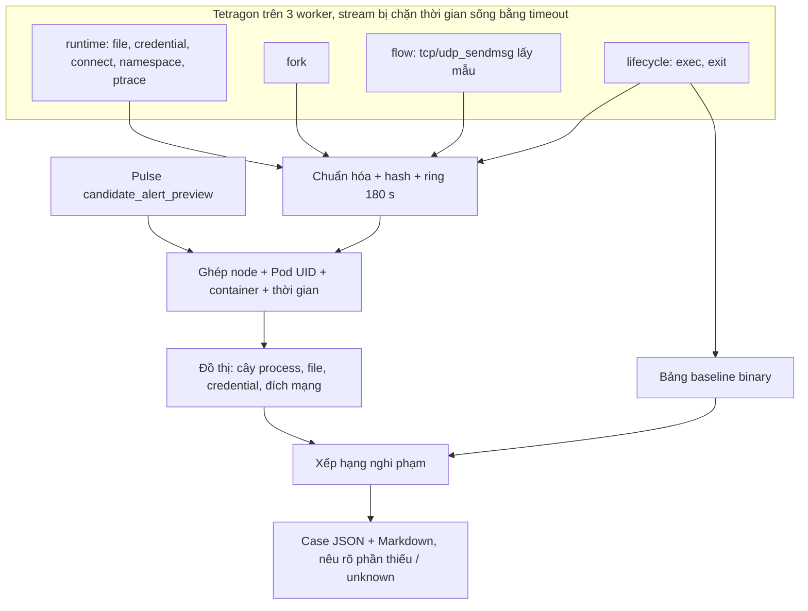

# RCA — đồ thị điều tra sau tín hiệu Pulse: trạng thái, kết quả và nhật ký

Cập nhật **25/10/2026 17:45 (UTC+7)**. RCA chạy độc lập với [Sentinel Pulse](SENTINEL_PULSE_STATUS.md) và [thí nghiệm chọn syscall](SYSCALL_FEATURE_EXPERIMENT_STATUS.md). Nó nhận cảnh báo thử của Pulse rồi ghép sự kiện Tetragon thành đồ thị bằng chứng.


## Tên gọi và đường dẫn thật trên cụm

Báo cáo dùng tên mô tả. Thư mục và unit có từ trước giữ tên cũ trên đĩa, vì config và hash bằng chứng tham chiếu tới chúng. Trên NFS có symlink tên mô tả trỏ tới từng thư mục, nên đường dẫn trong báo cáo dùng được trực tiếp.

| Tên trong báo cáo | Là gì | Thư mục / unit thật |
|---|---|---|
| `pulse-soak-baseline` | Soak 48 giờ của candidate gốc | `/mnt/sentinel-pulse-archive/matched-parallel-20261015` |
| `pulse-attack-dev` | Ma trận tấn công development 315 cặp | `matched-parallel-r3-20261015` |
| `pulse-attack-dev-rabbitmq` | 15 cặp RabbitMQ bổ sung | `matched-parallel-r5-rabbit-20261015` |
| `syscall-arms` | Thí nghiệm 11 cấu hình syscall (693 model) | `matched-parallel-r4-20261015` |
| `pulse-candidate-baseline` / `pulse-candidate-recalibrated` | Candidate gốc / candidate hiệu chỉnh lại | `runtime-f95867d-20261012` / `runtime-recal-c1-20261018` |
| `pulse-live-recalibrated` | Lượt live: candidate hiệu chỉnh lại + `policy-1win-a3` (xong 20/10 02:22) | `matched-r6-20261018`; unit `pulse-matched-worker-r6-20261018` |
| `…/campaign-main`, `…/campaign-rca` | Campaign 315 cặp / campaign 105 cặp đánh giá RCA | `coordinator-runtime-r6-d791d24-20261019` / `coordinator-rca-followup-20261019` |
| `policy-1win-a3` | Chính sách 1 cửa sổ, alpha×3 | `sentinel_pulse/protocol/policy-1win-a3.json` (SHA-256 `f6107351…`) |
| `pulse-stable-candidate` | Lượt live ứng viên bản stable (`policy-2of2-a10`, 20/10 10:14 → 21/10 10:25) | `/mnt/sentinel-pulse-archive/pulse-stable-candidate` |
| `pulse-stable-refreshed` | Lượt live kiểm cấu hình luật v2 (21/10 12:22 → 22/10 12:31, xong) | `/mnt/sentinel-pulse-archive/pulse-stable-refreshed` |
| `rca-pulse-stable-candidate` | RCA của lượt pulse-stable-candidate (20/10 10:16 → 21/10 12:22) | `/var/lib/sentinel-pulse-rca/rca-pulse-stable-candidate` |
| `rca-pulse-stable-refreshed` | RCA của lượt pulse-stable-refreshed, có luật hạ quyền lúc khởi chạy (21/10 12:22 → dừng sau lượt) | unit `rca-pulse-stable-refreshed`, `/var/lib/sentinel-pulse-rca/rca-pulse-stable-refreshed` |
| `rca-pulse-stable-confirm` | RCA của lượt xác nhận: seed 59 binary, nhãn triage, bộ đếm lý do từ chối (23/10 01:21 →) | unit `rca-pulse-stable-confirm`, `/var/lib/sentinel-pulse-rca/rca-pulse-stable-confirm` |
| `pulse-alert-bridge-pulse-stable-confirm` | Đường cảnh báo vận hành thử, chỉ đọc decision (RCA 5.14; 23/10 03:52 → 24/10 01:47) | unit cùng tên trên .234 (đã gỡ); trạng thái trên NFS `pulse-stable-confirm/alert-bridge/` và trong `validation-evidence/results-20261023/alert-bridge/` (bản local trùng NFS từng byte, xóa 25/10) |
| `rca-subscriber` | RCA đọc decision qua SSH trên pulse-live-recalibrated (19/10 19:24 → 20/10 10:16) | unit `rca-subscriber`, `/var/lib/sentinel-pulse-rca/rca-subscriber` |
| `rca-followup`, `rca-followup-v1`, `rca-flow`, `rca-runtime-v1` | Các bản RCA cũ (lịch sử) | `/var/lib/sentinel-pulse-rca/runtime-events-…` (có symlink cùng tên) |

## 1. Mục tiêu và trạng thái hiện hành

**Mục tiêu.** Pulse chỉ cho biết **container nào** bất thường, không cho biết process nào. Sau mỗi tín hiệu, RCA trả lời:
- process nào đang chạy, cha là ai, mới khởi chạy hay không;
- process đó đã làm gì: file, credential, namespace, ptrace, mạng;
- process nào đáng điều tra trước (xếp hạng nghi phạm).

Đồ thị là bằng chứng liên quan theo định danh và thời gian, **không chứng minh nhân quả**. RCA không tự xử lý pod.

| Thành phần (25/10 17:45) | Trạng thái |
|---|---|
| Subscriber | Không chạy. Lượt cuối `rca-pulse-peer-discount-confirm` (5.16) đã dừng sau lượt live 25/10; dữ liệu case trong `/var/lib/sentinel-pulse-rca/` trên `.234`, biên nhận trong repo |
| Cấu hình đã dùng ở 2 lượt cuối | Đọc decision trên worker qua SSH, nhịp dựng case 0,25 s; 3 policy (runtime, fork, flow); ring 180 s / 120.000 sự kiện; cooldown 300 s, có case tiếp nối khi có exec mới; giữ 20.000 case; seed binary đã biết (5.12); nhãn triage probe trên mỗi case |
| Policy Tetragon (`production`, chỉ quan sát) | `sentinel-rca-runtime-v1` (chỉ đường dẫn nhạy cảm, không `commit_creds`), `sentinel-rca-fork-v1`, `sentinel-rca-flow-v1`. Từ 25/10 DaemonSet Tetragon chạy với `shareProcessNamespace: true`: luồng `tetra getevents` xoay vòng không còn để lại zombie (đã có 3.931 zombie trên 3 worker) |
| Kết quả cuối (5.16, lượt `pulse-peer-discount-confirm`) | Attack có case riêng 459/524 (87,6%); top-1 99,8%, top-3 100%; preview → case p95 2,59 s (case attack); 575 case normal (lượt trước 3.666) |
| Các lượt trước | `pulse-stable-confirm` 86,9% / 99,8% / 2,50 s (5.15); `pulse-stable-refreshed` 86,7% / 100% / 2,59 s (5.11) |
| Lượt sau `pulse-final-system-confirm` (Pulse 5.28, chờ khởi chạy) | RCA dựng case từ cảnh báo Alertmanager đã giao (`alert_trigger_file`), cả cảnh báo ML lẫn tripwire; binary vô hại chạy từ đường dẫn riêng (kỳ vọng: gần như không còn attack bị gộp sau case binary vô hại); bridge thử lại push lỗi; ánh xạ IP node (5.13) |
| Phát hiện từ review nhãn (Pulse 5.20) | Tác vụ định kỳ hiếm (WAL archive của CloudNativePG) bị xếp đầu nghi phạm như binary mới: đã xử lý bằng seed (5.12) |
| Đường cảnh báo vận hành (5.14) | Bridge chỉ đọc, đưa preview vào Alertmanager/Prometheus/Grafana của cụm; mã đợt = mã case RCA. Đã chạy hết 2 lượt cuối; hiện dừng |
| Bản sao bằng chứng rca-flow | `/mnt/sentinel-pulse-archive/pulse-live-recalibrated/rca-flow-copy/`: 2.001 case + `context.sqlite3` |

## 2. Thuật ngữ

| Thuật ngữ | Nghĩa |
|---|---|
| RCA | Điều tra nguyên nhân gốc; ở đây mới là đồ thị bằng chứng và thứ tự ưu tiên điều tra |
| Trigger / preview | Cảnh báo thử của Pulse đã khớp hash model và chính sách; không phải cảnh báo vận hành |
| Case | Một đồ thị (JSON + Markdown) dựng cho một trigger |
| Node / edge | Thực thể (process, file, đích mạng…) / quan hệ (`parent_of`, `performed_exec`, `sent_on_socket`…) |
| Exec ID | Định danh một lần khởi chạy process; không dùng PID vì PID bị tái sử dụng |
| Ghép theo định danh + thời gian | Cùng node, Pod UID, container và khoảng thời gian; không ghép chỉ theo PID hay IP |
| Ring | Bộ đệm sự kiện gần nhất (180 s), lưu trong SQLite local |
| Cửa sổ trước (pre-window) | 30 s trước trigger; case đầu tiên không đợi sự kiện sau trigger (chỉ đợi 2 s để nhận nốt sự kiện đang truyền) |
| Cooldown | Các trigger cùng container trong 300 s được gộp vào một case |
| Case tiếp nối (follow-up) | Trong cooldown, nếu container exec một binary **mới** thì mở thêm case. Binary mới là binary không chạy trong 300 s trước cửa sổ của case trước, tra trong nhật ký exec 15 phút. Mỗi case cách nhau ≥ 10 s, tối đa 5 case mỗi cooldown; tắt trong 330 s đầu sau khi subscriber khởi động |
| Flow (`active_flow`) | Lần gửi trên socket đã mở (`tcp_sendmsg`/`udp_sendmsg`), lấy mẫu 1 lần / process / 10 s. Cho biết đích đang trao đổi kể cả khi dùng connection pool |
| Baseline binary | Bảng không hết hạn ghi lần đầu mỗi binary xuất hiện trong mỗi workload |
| Thời điểm đóng băng baseline | Binary thấy lần đầu sau mốc này được coi là "mới" |
| Nghi phạm (suspect) | Process trong case, được xếp hạng bằng heuristic có lý do rõ ràng (mục 4) |
| top-k | Tỉ lệ case mà process tấn công thật nằm trong k nghi phạm đầu |
| Unknown / coverage | Thiếu sự kiện không có nghĩa là không có hoạt động |

## 3. Luồng



## 4. Xếp hạng nghi phạm

Code: `sentinel_pulse/rca/ranking.py`. Điểm là heuristic để sắp thứ tự điều tra, không phải xác suất.

| Lý do | Điểm |
|---|---|
| Binary thấy lần đầu trong workload sau thời điểm đóng băng baseline (`novel_binary`) | 4 |
| Binary chưa từng ghi nhận (`unknown_binary`) | 2 |
| Exec trong cửa sổ (`started_in_window`) | 2 |
| Thao tác credential / namespace / mount / ptrace (`security_operation`) | 3 mỗi lần, tối đa 9 |
| Syscall thất bại (`failed_syscall`) | 1 mỗi lần, tối đa 3 |
| Là cha của một nghi phạm khác (`spawned_children`) | 1 |

- **Không xếp hạng tiến trình container runtime** (`containerd-shim*`, `runc`, `crun`, `conmon`). Đây là cha phía host của mọi `kubectl exec`, và từng đứng hạng 1 sai trong rca-flow (sửa ở `54f4635`).
- **Đánh giá:** `rca/evaluate_ranking.py`.
  - Nhãn thật là đường dẫn binary của fixture trong campaign.
  - `--rerank-db` xếp hạng lại offline từ bảng `binaries`, chỉ dùng binary đã thấy trước lúc tạo case.

## 5. Kết quả

### 5.1 Run rca-runtime-v1 (15–17/10): vì sao 99,9% case thiếu ngữ cảnh kết nối

- rca-runtime-v1 có 19.152 case; 99,9% không có sự kiện connect.
- Nguyên nhân **không phải lỗi ghép**: trong ring 180 s chỉ có 50 lần `connect()` trên toàn bộ production, so với 4.222 exec. Các service dùng connection pool nên gần như không gọi `connect()`.
- Cách sửa: policy flow `sentinel-rca-flow-v1` (`c71f604`), lấy mẫu lần gửi trên socket đã mở.

### 5.2 Sự cố client Tetragon mồ côi (phát hiện 19/10 02:05)

- **Nguyên nhân.** Subscriber RCA mở stream bằng `kubectl exec … tetra getevents`. Mỗi lần nối lại stream, `kubectl` phía `.234` bị giết nhưng tiến trình bên trong container Tetragon vẫn chạy. Campaign cũ và v8 cũng rò theo cùng cách.
- **Quy mô.** Có **301 / 18 / 59** client mồ côi trên worker1 / worker4 / worker3, chạy từ 10 giờ đến 25 ngày.
- **Tác động.** Tetragon tốn 5–7 core và 11,5 GB RAM, làm lượt live pulse-live-recalibrated của Pulse bị thiếu CPU lúc khởi động.
- **Sửa (`d791d24`).** Lệnh trong container được bọc `timeout`, và stream RCA xoay vòng mỗi 900 s (nối lại ngay khi hết hạn). Không client nào sống quá 15 phút.
- **Sau khi dọn.** CPU Tetragon giảm ~9 lần.

### 5.3 Run rca-flow trong campaign pulse-live-recalibrated (19/10 02:14 → 10:36)

Cấu hình: 3 policy, cooldown 300 s không có case tiếp nối, giữ 2.000 case. Bằng chứng: `rca-flow-copy/RANKING-{stored,reranked}.json`.

| 315 attack của campaign pulse-live-recalibrated | Số trial |
|---|---:|
| Có case của chính attack | **36** |
| Bị gộp cooldown vì case của binary vô hại 5 s trước đó | 88 |
| Bị gộp cooldown vì case khác trong 300 s | 130 |
| Case đã bị xóa do giới hạn 2.000 case (50 phút đầu campaign) | 48 |
| Không có case | 13 |

- **Xếp hạng:** trong **36/36 case**, binary tấn công đứng **hạng 1** (top-1 = top-3 = top-5 = 100%), với cả xếp hạng đã lưu lẫn xếp hạng lại offline. Mẫu 36 còn nhỏ, chưa có khoảng tin cậy.
- **Độ phủ** bị chi phối bởi cooldown theo container và giới hạn lưu, không phải bởi chất lượng xếp hạng. Đây là lý do có case tiếp nối và giới hạn 20.000 case trong rca-followup-v1 (sau đó là rca-followup, rca-subscriber).
- **Thông tin mạng:** mẫu 73 case đầu cho thấy chỉ 12% case có `active_flow`. Mẫu lấy trong lúc subscriber bị kẹt IO (5.4), nên cần đo lại (đã đo lại ở mục 5.8: 87% case có flow).

### 5.4 Tranh chấp IO trên .234 (19/10 02:30)

- **Triệu chứng.** Subscriber kẹt ở trạng thái chờ IO (D), không nạp sự kiện ~2,5 phút, stream bị nối lại.
- **Nguyên nhân.** Một job phân tích Pulse đọc ~200 GB từ NFS (rolling recalibration) cùng lúc với job arm-budget.
- **Xử lý.** Dừng job; RCA hồi phục ngay.
- **Quy tắc.** Không chạy phân tích đọc NFS nặng trên `.234` khi có lượt live hoặc campaign.

### 5.5 Tần suất exec bình thường (căn cứ thiết kế case tiếp nối)

Đo trên ring 180 s của rca-flow:

| Container | Exec/phút | Binary |
|---|---:|---|
| Kafka (`aims-kafka-dual-role-*`) | 72 | `grep`, `readlink`, `bash` (probe) |
| Redis / redis-sentinel | 36 | `sh`, `hostname`, `redis-cli` (probe) |
| Pod phát tải (không có model Pulse) | 270–510 | `wget`, `nc` |

Nếu điều kiện chỉ là "có exec bất kỳ" thì Kafka/Redis sẽ luôn mở case mới. Vì vậy case tiếp nối chỉ tính binary chưa có trong ring trước cửa sổ của case trước (`3e457fe`).

### 5.6 Lỗi điều kiện case tiếp nối ở rca-followup-v1 (19/10 10:36–10:48)

- **Triệu chứng.** Trong 10 phút đầu, trước khi có attack, rca-followup-v1 mở 117 case tiếp nối trên tổng 190 case.
- **Nguồn.** Chủ yếu từ probe sức khỏe định kỳ:
  - `python` của các app service (auth 24, search 23, notification 17…);
  - `sh`/`redis-cli` của Redis.
- **Nguyên nhân (lỗi thiết kế của mình).** Tập tham chiếu "binary đã chạy trước đó" lấy từ ring 180 s. Nếu case trước đã cách hơn 150 s thì phần tham chiếu nằm ngoài ring, tức là rỗng, nên mọi exec đều bị coi là mới.
- **Sửa (`ea5a3ee`).**
  - Thêm bảng `exec_log` giữ 15 phút.
  - Binary chỉ được coi là mới nếu không chạy trong 300 s trước cửa sổ của case trước.
  - Tắt case tiếp nối trong 330 s đầu sau khi subscriber khởi động.
  - Chuyển sang rca-followup lúc 10:48. Campaign tiếp nối đã chạy từ 10:46, nên khi đánh giá rca-followup chỉ tính các trial bắt đầu sau ~10:54.

### 5.7 Kết quả rca-followup trên campaign tiếp nối (xong 19/10 ~12:50)

- **Phạm vi đánh giá:** chỉ tính 99 trial bắt đầu sau khi rca-followup hết 330 s khởi động (10:54:15).
- **Bằng chứng:** `pulse-live-recalibrated/rca-followup-copy/`, gồm 2.140 case, `context.sqlite3` và `RANKING-{stored,reranked}.json`.

| Chỉ số | pulse-live-recalibrated (rca-flow, không có case tiếp nối) | Campaign tiếp nối (rca-followup) |
|---|---|---|
| Attack có case của chính nó | 36/315 (11%) | **71/99 (72%)**; 57 trong số đó là case tiếp nối |
| Gộp cooldown, không có case tiếp nối | 218 | 19 |
| Không có case | 13 | 9 |
| Bị xóa do giới hạn lưu | 48 | 0 |
| Top-1, xếp hạng lưu sẵn | 100% (36) | 56% (73 case) — lỗi baseline, xem dưới |
| **Top-1 / top-5, xếp hạng lại với baseline đúng** | 100% | **98,6% / 98,6%** (72/73; 1 case không có binary tấn công) |
| Case có `active_flow` | 12% (mẫu sớm) | **3%** (2/71) |
| Preview → case p50 / p95 | 8,4 / 16,6 s | 7,0 / 14,5 s |

- **Lỗi bước chép baseline (của mình).** Bước chép bảng `binaries` từ rca-flow sang rca-followup-v1/rca-followup không chạy, vì `printf password | sudo -S python3 -` khiến Python đọc stdin rỗng thay cho heredoc. Hậu quả:
  - Mọi binary đều có `first_seen` sau mốc đóng băng, nên probe định kỳ (`sh`, `hostname`, `bash`, `pg_isready`, script readiness/liveness của Kafka) được +4 điểm `novel_binary` và đứng trên binary tấn công.
- **Cách đánh giá đúng.** Gộp baseline của rca-flow vào bản sao rồi xếp hạng lại offline. `--rerank-db` chỉ dùng binary đã thấy trước lúc tạo case, nên đây đúng là kết quả live đáng lẽ đạt được.
- **Đã sửa:**
  - DB live của rca-followup đã được gộp baseline lúc 16:26, nên các case từ thời điểm đó xếp hạng đúng.
  - Script chạy bước chép qua file tạm, và báo lỗi nếu không chép được dòng nào.
- **Flow rất thấp (3%) — việc cần điều tra tiếp.** Có thể do giới hạn lấy mẫu 10 s/process, hoặc do service gửi qua sidecar mesh nên `tcp_sendmsg` thuộc container khác.
- **Một giới hạn còn lại:** attack `setns`/`mount` không để lại sự kiện bảo mật, vì seccomp chặn trước kprobe. Binary tấn công vẫn đứng đầu nhờ `novel_binary` + `started_in_window`.

### 5.8 Vì sao case thiếu flow: stream policy trễ ~80 s (sửa 19/10 16:35)

- **Triệu chứng.** Lúc dựng, case chỉ có ~16 sự kiện (lifecycle). Vài chục giây sau, cùng cửa sổ đó trong DB đã có 135–226 sự kiện, gồm cả flow.
- **Đo độ trễ.**
  - Sự kiện policy (runtime/flow) mới nhất trong DB cũ hơn hiện tại **~80 s** trên cả 3 worker; lifecycle chỉ < 5 s.
  - Tetragon tự giao sự kiện gần như tức thì (client thử có `timeout`: p50 0 s, max ~29 s do bộ đệm chờ thông tin process).
  - Subscriber gần như nhàn rỗi (`py-spy`: MainThread idle).
- **Nguyên nhân.** Lưu lượng policy runtime quá lớn: worker1 ~1.740 sự kiện/s, gồm `openat` ~976/s, `commit_creds` ~352/s, `vfs_write` ~160/s. `rateLimit: 1s` của Tetragon chỉ gộp các sự kiện *giống hệt nhau*, nên mỗi tên file vẫn sinh một sự kiện. `kubectl exec` không chuyển kịp lượng JSON này, backlog đẩy sự kiện đến sau lúc dựng case (case dựng sau trigger ~2 s + độ trễ subscriber).
- **Sửa (cập nhật tại chỗ policy `sentinel-rca-runtime-v1`, nhãn `revision: sensitive-paths-20261019`, `c233a42`):**
  - `openat`/`openat2` chỉ theo dõi đường dẫn nhạy cảm: `/etc/shadow`, `/etc/passwd`, `/etc/sudoers`, `/etc/ssh/`, `/root/`, secret của service account, `/proc/1/`…
  - `vfs_write` chỉ theo dõi `/etc`, `/root`, `/usr`, `/bin`, `/sbin`, `/lib`, cron, secret.
  - Bỏ hook `commit_creds`, vì mỗi exec đều gọi nó. `set*id`, `capset`, namespace/mount/ptrace, connect và flow giữ nguyên.
- **Kết quả:**
  - Lưu lượng worker1: 17.393 → **2.096** sự kiện / 10 s.
  - Sự kiện policy mới nhất chỉ còn trễ 0,2–1,5 s.
  - **Case có flow: 3% → 78%** (42/54 case trong 7 phút đầu sau khi sửa) **→ 87%** (392/449 case, 16:36–18:00; biên nhận `rca-flow-coverage-after-policy-change.json`).
- **Đánh đổi.** Không còn thấy mọi lần mở file, nhất là đường dẫn tương đối, và không còn snapshot credential mỗi lần exec. Ưu tiên của RCA là cây process, thao tác bảo mật, mạng và file nhạy cảm.
- **Thêm (`c233a42`).** `kubectl` không chuyển mã thoát 124 của `timeout`, nên mỗi lần xoay vòng stream bị coi là mất kết nối và chờ thêm 5 s. Giờ stream thoát ở tuổi xoay vòng được coi là xoay vòng và nối lại ngay; áp dụng từ lần đăng ký subscriber tiếp theo.

### 5.9 Độ trễ preview → case nằm ở đâu (19/10 18:00)

Biên nhận: `receipts/rca-latency-{rca-flow,rca-followup}.json` (`scripts/analysis/rca_latency.py`).

| Đoạn | rca-flow (1.998 case) p50 / p95 | rca-followup (2.140 case) p50 / p95 |
|---|---|---|
| Preview ghi trên worker → subscriber thấy decision | 5,0 / 11,5 s | 5,5 / 24,7 s |
| Thấy decision → ghi xong case | 2,1 / 2,7 s | 2,1 / 3,0 s |
| Tổng | 7,1 / 13,6 s | 7,7 / 26,9 s |

- **Phần dựng case** gần đúng bằng thời gian chờ 2 s để nhận nốt sự kiện.
- **Phần lớn nằm ở bước decision của worker hiện ra trên `.234` qua NFS.** Worker chỉ `flush` (không `fsync`) mỗi frame, nên NFS client ghi trễ; subscriber đọc lại mỗi 1 s.
- Đuôi p95 của rca-followup dài hơn. Nhiều khả năng do các job đọc NFS nặng trên `.234` lúc 12:50–13:40; chưa tách riêng.
- **Đã sửa (`08be414`), không đụng vòng lặp của worker Pulse.**
  - Subscriber đọc decision **ngay trên worker** qua SSH, bằng script nhỏ `DECISION_FOLLOWER` chạy với python3 hệ thống. Script bám file `decisions.jsonl` của segment mới nhất, không đọc lại dữ liệu cũ, và chuyển sang segment mới sau khi đọc hết segment cũ.
  - Nhịp kiểm tra để dựng case giảm từ 1 s xuống 0,25 s.
  - Bật bằng `decision_stream` trong config; `scripts/launch_run.sh` đã bật sẵn cho pulse-stable-candidate.
- **Đo thật trên pulse-live-recalibrated** (worker1, 20 s; biên nhận `receipts/rca-decision-visibility.json`, script `scripts/analysis/rca_decision_visibility.py`):

  | Cách đọc | p50 | p95 |
  |---|---|---|
  | Script bám file trên worker, qua SSH | **0,04 s** | **0,10 s** |
  | Mở lại file NFS (cách hiện tại) | 0,06 s | **7,2 s** |

  **Đo thật trên `rca-subscriber`** (45 case, chưa có attack; biên nhận `receipts/rca-latency-rca-subscriber.json`): preview → subscriber thấy decision p50 **0,06 s** / p95 0,14 s; preview → case p50 **2,21 s** / p95 **2,36 s** (trước: 7,0 / 14,5 s). Phần còn lại gần đúng bằng thời gian chờ 2 s để nhận nốt sự kiện Tetragon.

Bằng chứng cho mục 5: [`validation-evidence/results-20261019/`](validation-evidence/results-20261019/README.md) (`rca/`, `receipts/rca-*.json`).

### 5.10 Đánh giá trên campaign pulse-stable-candidate (21/10 02:17)

- **Subscriber:** `rca-pulse-stable-candidate`; 315 attack trial; baseline binary học trong pha chọn rồi đóng băng 11:47:29.
- **Biên nhận:** `validation-evidence/results-20261021/pulse-stable-candidate/rca-*.json`.

| Chỉ số | pulse-stable-candidate | Trước đó (rca-followup, 99 trial) |
|---|---|---|
| Attack có case riêng | **273/315 (86,7%)**, trong đó 255 là case tiếp nối | 71/99 (72%) |
| Không có case riêng | 31 gộp sau case binary vô hại, 9 gộp sau case khác, 2 không có case | |
| Top-1 lưu sẵn (lúc chạy) | 91,9% (251/273) | 56% lưu sẵn → 98,6% xếp hạng lại |
| **Top-1 với luật hạ quyền lúc khởi chạy** | **99,6% (272/273)**; 1 case không chứa fixture | 98,6% (không đổi) |
| Case có flow | 89,8% (3.598/4.006) | 87% |
| Preview → case | p50 2,23 s / p95 2,55 s (4.680 case) | p50 2,22 s / p95 2,47 s |

**Lỗi xếp hạng và cách sửa:**
- Ở 21 case, các exec của liveness probe redis (`/bin/sh`, `/bin/hostname`) xếp trên fixture (8–9 điểm so với 6).
- Lý do: lúc khởi chạy, runtime gọi `setuid`/`setgid` để chuyển sang user `redis` (uid/gid 1000, 1 ms sau khi bắt đầu). Luật cũ tính đó là "thao tác bảo mật", 3 điểm mỗi lần. Fixture chỉ có `exec`/`exit`, vì `setns`/`ptrace` bị seccomp chặn trước kprobe.
- Sửa (`d388b02`, có test): `setuid`/`setgid`/`setre*`/`setres*` về id khác 0 trong vòng 1 s sau khi chính tiến trình khởi động được ghi là `privilege_drop_at_start`, 0 điểm. Nâng lên root, hoặc đổi quyền muộn hơn, vẫn tính 3 điểm.
- Đây là sửa **sau khi xem kết quả**. Bằng chứng không làm hỏng chỗ khác: trên bộ case rca-followup cũ, top-1 vẫn 98,6%. Lượt live tiếp theo sẽ kiểm luật này trước, trên dữ liệu mới.

### 5.11 Đánh giá trên campaign pulse-stable-refreshed: kiểm luật hạ quyền trên dữ liệu mới (21/10 19:47)

- **Subscriber:** `rca-pulse-stable-refreshed`, chạy live với luật `privilege_drop_at_start` (`d388b02`). Luật đăng ký kiểm ở 5.10 trước khi lượt này có dữ liệu.
- **Biên nhận:** `validation-evidence/results-20261021/pulse-stable-refreshed/rca-*.json`.

| Chỉ số | pulse-stable-refreshed | pulse-stable-candidate (5.10) |
|---|---|---|
| Attack có case riêng | 273/315 (86,7%), trong đó 256 là case tiếp nối | 273/315 (86,7%) |
| Không có case riêng | 37 gộp sau case binary vô hại, 5 gộp sau case khác | 31 + 9 + 2 |
| **Top-1 lưu sẵn (luật mới, chạy live)** | **100% (273/273)** | 91,9% (luật cũ) |
| Top-1 xếp hạng lại không có luật (luật cũ) | 91,9% (251/273) | 91,9% |
| Case có flow | 85,6% (1.630/1.905) | 89,8% |
| Preview → case | p50 2,24 s / p95 2,59 s (2.552 case) | p50 2,23 s / p95 2,55 s |

**Kết luận:**
- Luật hạ quyền đạt trên dữ liệu mới. Top-1 tăng từ 91,9% lên 100%, và không case nào mất fixture khỏi danh sách.
- Phần còn hở là coverage: 42 attack (13%) không có case riêng, phần lớn vì bị gộp sau case của binary vô hại vừa chạy cùng container.
- Kiểm nhanh theo giờ của trial (không cần dữ liệu case):
  - attack bắt đầu khoảng 19,4–20,3 s sau binary vô hại (p5–p95), nên điều kiện "≥ 10 s sau case trước" ít khả năng là nguyên nhân;
  - 24/315 attack có một trial trước đó trong cùng container, chạy **cùng đường dẫn binary**, trong vòng 360 s. Với các trial này, binary không còn "mới" theo cửa sổ novelty 300 s, nên case tiếp nối không mở.
  - Phần lớn chỗ hở vì vậy là hệ quả của fixture (binary vô hại và attack dùng cùng một file) cộng với luật novelty. Kẻ tấn công thật dùng binary khác thì không bị gộp kiểu này.
- Kiểm bằng case DB (chỉ đọc):
  - với cả 42 attack, case trước đó tạo ít nhất 10 s trước attack và chưa chạm trần 5 case tiếp nối, nên loại được hai điều kiện này;
  - không kiểm lại được luật novelty, vì `exec_log` chỉ giữ 900 s và dữ liệu lúc đó đã bị xóa. Giả thuyết "cùng binary trong 300 s" khớp lý thuyết, nhưng chỉ giải thích tối đa 24/42.
- Từ lượt sau, subscriber đếm từng lý do từ chối case tiếp nối trong STATUS (`follow_up_refused_{too_soon,cap,warming_up,no_exec,binary_not_new}`), có test. Lượt đang chạy vẫn dùng code cũ. Chưa đổi luật.

### 5.12 Baseline binary mang qua các lượt (22/10 16:15–16:24; dùng từ lượt `pulse-stable-confirm`)

- **Vấn đề (Pulse 5.20):** pha học baseline 90 phút ngắn hơn chu kỳ của tác vụ định kỳ hiếm. Ví dụ, WAL archive của CloudNativePG (`/controller/manager`) chạy lần đầu sau khi baseline đóng băng, nên bị đánh `novel_binary` và xếp đầu nghi phạm.
- **Sửa:** `sentinel_pulse/rca/baseline_seed.py` lấy các binary mà mỗi workload đã chạy trong **khoảng bình thường** của các lượt trước, rồi nạp vào database của lượt mới **một lần lúc khởi động**, với `first_seen = 0` (biết từ trước lượt). Binary lần đầu xuất hiện trong lượt mới không bị ảnh hưởng.
- **Chống rò rỉ nhãn:**
  - binary có lần thấy đầu tiên nằm trong campaign của lượt trước (từ interval đầu − 60 s tới cuối campaign + 60 s) **bị loại**, nên fixture attack và binary vô hại của campaign cũ không thể thành "đã biết";
  - binary thấy lần đầu trong campaign, rồi mới thấy lại lúc bình thường, cũng bị loại (thận trọng).
- **Seed đã dựng:**
  - từ `rca-pulse-stable-candidate` và `rca-pulse-stable-refreshed`: giữ 93 dòng (59 binary khác nhau, 25 workload), loại 57 dòng có lần thấy đầu tiên trong campaign;
  - có `/controller/manager` của Postgres; không có binary nào dưới `/tmp` hay mang tên attack;
  - file `/mnt/sentinel-pulse-archive/pulse-next-run-model/rca-baseline-seed-20261022.json`, sha256 `a93861ad…`.
- **Nối vào lượt chạy:** `launch_run.sh` nhận `BASELINE_SEED`; service ghi đường dẫn, sha256 và số dòng nạp vào metadata của database.
- **Test:** binary trong campaign không vào seed; binary đã seed không còn `novel_binary`/`unknown_binary`; khởi động lại không seed hai lần; tổng test 384/384.
- **Kiểm ở lượt sau:** trên case normal, tỉ lệ nghi phạm hạng 1 là `novel_binary`/`unknown_binary` phải giảm; top-1 của attack phải giữ 100%.
- **Mốc trước khi có seed (`scripts/analysis/rca_suspect_reasons.py`, 22/10 23:10):**
  - nghi phạm hạng 1 của case normal mang `novel_binary`/`unknown_binary` ở **22,2%** (`pulse-stable-candidate`, 966/4.347) và **14,2%** (`pulse-stable-refreshed`, 612/4.325);
  - binary đứng sau: `java` (entity-operator khởi động lại trong lượt), `node`, `sh`, `envoy`, `/controller/manager`, `minio`, `dash`;
  - seed bao `java`, `envoy`, `/controller/manager`, `minio`, sidecar của minio và `sh` ở 7 workload, tức khoảng 400/612 case của `pulse-stable-refreshed`. Không bao `node` và `dash`;
  - biên nhận: `results-20261021/{pulse-stable-candidate,pulse-stable-refreshed}/rca-suspect-reasons.json`. Lượt xác nhận chạy cùng script trong giai đoạn final.
- **Số tạm trên lượt xác nhận (23/10 11:45; cùng khoảng: case normal trước campaign; mô tả):** nghi phạm hạng 1 là binary mới/chưa biết **11,3% (45/397) ở `pulse-stable-refreshed` → 5,1% (21/410) ở `pulse-stable-confirm`**.
  - `/controller/manager`, `java` và `envoy` biến mất khỏi danh sách.
  - Còn lại `sh` (10), `node` (4), `dash` (4): `node` và `dash` không có trong seed, đúng dự đoán; `sh` còn ở các workload seed không bao.
  - Top-1 của attack: chờ đánh giá sau lượt.
- **Bộ đếm lý do từ chối case tiếp nối (11:35, trên mọi decision dương trong cooldown):** `binary_not_new` 208.867, `no_exec` 42.004, `too_soon` 28.604, `warming_up` 888; đã mở 512 case tiếp nối. Gắn lý do cho từng attack chưa có case: sau lượt.

### 5.13 Ánh xạ IP qua NAT và mesh (23/10 03:55–04:10)

- **Đang có (từ 15/10):** RCA ánh xạ IP đích của `connect` và flow bằng **một ảnh chụp inventory** pod / Service / EndpointSlice, làm mới định kỳ (`inventory_age_seconds` khoảng 50 s trong case):
  - pod IP → Pod;
  - ClusterIP → Service;
  - địa chỉ endpoint → Service.
- **Lỗi tìm thấy khi lấy ví dụ cây (23/10):** địa chỉ IP node (`10.1.16.x`, cổng tạm) bị ghi là pod `monitoring-prometheus-node-exporter-*`.
  - Nguyên nhân: node-exporter chạy `hostNetwork`, nên pod IP của nó **chính là IP node**. Chỉ mục gán IP node cho pod hostNetwork nào đến sau cùng.
  - Thực tế đó là lưu lượng đã qua SNAT ở node (NodePort, masquerade) hoặc của tiến trình host. Peer thật không xác định được.
  - Đo trên toàn bộ case của `pulse-stable-refreshed`: **5.101/6.772 case (75%)** có ít nhất một đích là IP node, và **cả 32.932 đích IP node (28% số đích)** bị gán nhầm cho node-exporter.
  - Không ảnh hưởng số liệu đã báo cáo: xếp hạng nghi phạm, coverage, độ trễ và tỉ lệ case có flow đều không dùng tên đích. Chỉ phần đọc của người điều tra bị sai.
- **Sửa (`sentinel_pulse/rca/connect.py`, có test):** IP của pod `hostNetwork` (hoặc pod có `podIP = hostIP`) được ánh xạ thành `kind: Node`, `ambiguous: true`, kèm danh sách pod và Service hostNetwork dùng IP đó. Không còn gán cho một pod cụ thể. Áp dụng từ lượt RCA sau; lượt xác nhận đang chạy giữ code đã đóng băng.
- **Mesh:** cụm chạy Istio **ambient**, gồm ztunnel trên mỗi node và waypoint `aims-waypoint` cho namespace `production`. CNI là Cilium, kube-proxy làm DNAT.
  - Chiều đi: `connect()` của app thấy ClusterIP của Service, ánh xạ đúng thành Service. Pod backend nào nhận kết nối (sau DNAT của kube-proxy, rồi qua ztunnel và waypoint) thì **không thấy** từ container nguồn.
  - Chiều về: với kết nối đến server, peer nhìn thấy là pod waypoint (ví dụ `aims-waypoint-…`), **không phải client thật**.
  - Hai việc này cần nguồn ngoài kernel probe của container: Hubble của Cilium (đã bật trên cụm) hoặc access log của waypoint/ztunnel. Ghép với case theo 5-tuple và thời gian.
- **Đích "ngoài cụm" (23/10 12:10, mẫu 600 case):** thực ra là socket Unix (`AF_UNIX`, không có địa chỉ) và `169.254.7.127`.
  - `169.254.7.127` (và `fd16:9254:7127:1337:ffff:ffff:ffff:ffff`) là địa chỉ link-local cố định mà Istio ambient dùng để SNAT mọi health probe của kubelet ([tài liệu Istio](https://istio.io/latest/docs/ambient/usage/networkpolicy/)).
  - Từ lượt sau, hai địa chỉ này ánh xạ thành `KubeletProbe` (`connect.py`, có test). Hình vẽ case ghi rõ socket Unix.
- **Lịch sử inventory theo thời gian: không làm, có lý do.**
  - RCA ánh xạ IP ngay lúc nhận sự kiện, theo ảnh chụp inventory chụp không quá 60 s trước. Case được dựng 2 s sau trigger, nên lịch sử chỉ có ích khi phân tích lại offline.
  - Trên `pulse-stable-refreshed`, chỉ 389/43.455 đích trong dải IP của cụm (0,9%) không ánh xạ được. Ghi là giới hạn nhỏ.
- **Chưa làm (ghi là giới hạn):** backend sau DNAT; client thật sau waypoint của Istio ambient. Cả hai cần Hubble hoặc access log của waypoint.

### 5.14 Cảnh báo vận hành thật: Prometheus / Alertmanager / Grafana (23/10 03:52 →, đang chạy)

- **Mục tiêu:** thử đường cảnh báo vận hành bằng stack monitoring có sẵn của cụm (kube-prometheus-stack 87.16.1: Prometheus, Alertmanager, Grafana) và đo độ trễ tới người nhận. TODO "đo độ trễ kernel → cảnh báo đến người nhận thật" còn mở.
- **Ranh giới:** chỉ đọc decision của lượt `pulse-stable-confirm`. Pulse, RCA và chính sách đóng băng không đổi. Alertmanager chỉ gửi về webhook trên `.234`; route gốc của cụm vẫn là receiver `null`.
- **Cách làm (`sentinel_pulse/ops/alert_bridge.py`, `testbed/k8s/monitoring/`, `scripts/alert_bridge.sh`; có test):**
  - **Nguồn và gom đợt:** bridge trên `.234` theo dõi decision của 3 worker qua SSH, giống RCA. Chỉ dòng `"candidate_alert_preview":true` rời worker. Bridge gom thành **đợt** theo container: ngắt quá 3 s thì kết thúc đợt. Mã đợt là mã case RCA của trigger đầu, nên cảnh báo trỏ thẳng tới cây bằng chứng.
  - **Ba đường giao trên cùng một đợt:**
    - `push`: POST vào API `/api/v2/alerts` của Alertmanager ngay khi đợt bắt đầu, làm mới khi đợt còn kéo dài;
    - `pull-fast`: Prometheus scrape gauge mỗi 5 s, rule chạy mỗi 5 s, Alertmanager `group_wait` 0 s;
    - `pull-default`: đúng mặc định của stack (scrape 30 s, rule 30 s, `group_wait` 30 s).
  - **Đo:** webhook nhận ghi lần giao đầu của mỗi (đường, đợt). Độ trễ tính từ `preview_emitted_at` (Pulse ghi preview, đồng hồ worker) tới lúc webhook nhận (đồng hồ `.234`).
  - **Grafana:** dashboard `sentinel-pulse-alerts` có container đang cảnh báo, số đợt mỗi giờ, độ trễ p50/p95 theo đường, và bảng `ALERTS` của Prometheus.
- **Kết quả sơ bộ (04:07, 163 đợt đã đóng từ khi Prometheus nạp rule lúc 03:53:22; dữ liệu live, chưa phải kết luận):**

  | Đường | Đợt tới người nhận | p50 | p95 | Đợt bị bỏ sót |
  |---|---|---|---|---|
  | `push` | **163/163** | **0,04 s** | **0,06 s** | 0 |
  | `pull-fast` (5 s / 5 s / 0 s) | 154/163 (94,5%) | 4,5 s | 7,1 s | 9 đợt, đều ngắn hơn 4,6 s |
  | `pull-default` (30 s / 30 s / 30 s) | 11/163 (6,7%) | 54 s | 67 s | 152 đợt, dài tới 22,9 s |

  - Preview → bridge: p50 0,032 s / p95 0,057 s. 47/163 đợt ngắn hơn 5 s.
  - Bốn lần giao đầu (3,5–5,6 s) rơi vào lúc Alertmanager chưa nạp route mới (20:52:31 UTC, tức 03:52:31 giờ VN). Chúng nằm ngoài khoảng đo.
- **Đọc:**
  - Đường Prometheus chuẩn (pull) không hợp với tín hiệu của Pulse. Đợt cảnh báo thường ngắn hơn chu kỳ scrape và đánh giá rule, nên với mặc định của stack, 93% đợt **không bao giờ tới người nhận**. Đợt tới được thì trễ gần một phút.
  - Đẩy thẳng vào Alertmanager chỉ thêm khoảng 0,06 s.
  - Ước tính kernel → người nhận = kernel → preview (ML stable p95 2,05 s, replay) + 0,06 s. Số đo thật sẽ có khi ghép với thời điểm kernel của từng trial attack sau lượt (24/10).
- **Kernel → người nhận theo từng trial (sơ bộ, 04:36; `scripts/analysis/alert_delivery_latency.py`, có test):**
  - Cách tính: ghép mỗi trial attack của campaign (`kernel_event_at`) với đợt của cùng container bắt đầu trong 15 s của trial. Chỉ tính trial bắt đầu sau 03:53:22, khi cả 3 đường đã chạy.

  | Đường | Trial attack có cảnh báo tới người nhận | p50 | p95 | max |
  |---|---|---|---|---|
  | `push` | 36/39 (92,3%) | 0,61 s | **2,58 s** | 3,69 s |
  | `pull-fast` | 36/39 (92,3%) | 6,17 s | 8,42 s | 9,42 s |
  | `pull-default` | 6/39 (15,4%) | 54,3 s | 60,2 s | 60,2 s |

  - Ba trial không có cảnh báo mới: 2 FN của Pulse, và 1 trial mà container đã đang có đợt cảnh báo từ trước (`alert_already_active`).
  - Kernel → preview của cùng các trial: p50 0,75 s, p95 2,54 s. Đường push chỉ thêm khoảng 0,04 s.
  - Theo tốc độ attack (push): ở 1 lần/giây, 10/12 trial có cảnh báo, p95 3,69 s; ở 3–24 lần/giây, 26/27 trial có cảnh báo, p95 0,99–2,43 s.
  - Biên nhận tạm lúc đó: `/var/lib/sentinel-pulse-alert-bridge/pulse-stable-confirm/delivery-latency-prelim.json` (bản sơ bộ, đã thay bằng `results-20261023/delivery-latency-campaign.json`; thư mục local đã xóa 25/10).
- **Kernel → người nhận trên toàn campaign** (23/10 13:05, sau khi campaign xong; cùng script, cùng mốc 03:53:22; biên nhận `validation-evidence/results-20261023/pulse-stable-confirm/delivery-latency-campaign.json`):

  | Tập trial | Trial attack | Có cảnh báo mới qua `push` | p50 | p95 | max |
  |---|---|---|---|---|---|
  | Tập chính (6, 12, 24/s) | 282 | 268 (95,0%) | 0,61 s | **2,89 s** | 6,42 s |
  | Tập chính, chỉ đợt mở từ cửa sổ nằm trọn trong trial | 282 | 201 | 0,77 s | 3,04 s | 6,42 s |
  | Mọi tốc độ | 471 | 446 (94,7%) | 0,61 s | 3,56 s | 14,36 s |

  - Trial không có cảnh báo mới: 8 FN của Pulse; 17 trial mà container đã đang có đợt cảnh báo từ trước (`alert_already_active`; 14 trong tập chính, chủ yếu container báo liên tục ở worker1, Pulse 5.25).
  - Kernel → preview của tập chính: p95 2,61 s. Đường push thêm khoảng 0,3 s ở p95.
  - Phân vị theo hạng gần nhất, như trong script (`quantile`).
  - **Đợt mở từ cửa sổ vắt qua lúc tiêm:** 108/446 trial (67 trong tập chính) có đợt cảnh báo mở từ một cửa sổ 0,5 s bắt đầu trước lúc tiêm attack. Lệnh exec binary tấn công nằm trong cửa sổ đó, nên cảnh báo tới người nhận sớm hơn preview mà campaign công nhận (tới 0,55 s); campaign không bao giờ tính công cho cửa sổ như vậy. Script đánh dấu các trial này (`episode_window_starts_before_attack`); bỏ chúng ra thì push p95 tập chính là 3,04 s (dòng thứ hai của bảng). Số vận hành là dòng đầu; dòng thứ hai cùng quy tắc với campaign.
  - Push theo tốc độ: 24/s p95 1,77 s; 12/s 2,34 s; 6/s 3,84 s; 3/s 4,33 s; 1/s 4,09 s. Pull nhanh: p95 9,4 s (tập chính); pull mặc định: 23% trial, p50 63 s.
  - Bridge: 27 lần mất kết nối luồng decision (mỗi lần segment xoay vòng), nối lại ngay, khoảng hở tổng cộng ~0 s.
  - Phần sau campaign (đợt trên normal, `episodes.jsonl`, `deliveries.jsonl`) chép vào repo sau lượt.
- **RCA nhận trigger từ cảnh báo vận hành (code 23/10 04:40, có test; dùng từ lượt sau):**
  - Ở lần giao đầu tiên của mỗi đợt, bridge ghi dòng decision gốc vào `triggers.jsonl`.
  - RCA có cấu hình `alert_trigger_file` thì đọc file này thay cho luồng decision. Case ghi `trigger_source = alertmanager`, `alert_delivered_at`, `alert_path`; `START.json` ghi `trigger = alertmanager_delivered_alert`.
  - Không chạy RCA thứ hai trong lượt xác nhận, vì sẽ thêm stream Tetragon trên worker. Bridge đang chạy cũng giữ bản cũ để không đứt chuỗi số đo.
- **Việc tiếp:** chạy lại `alert_delivery_latency.py` trên toàn lượt; ở lượt sau, chạy RCA ở chế độ `alert_trigger_file`.
- **Biên nhận:** `validation-evidence/results-20261023/alert-bridge/` (`START.json` với config, commit `e2cbc01`; `episodes`, `deliveries`, `pushes`, `issues`, `STATUS`) và bản trên NFS `pulse-stable-confirm/alert-bridge/`. Thư mục gốc `/var/lib/sentinel-pulse-alert-bridge/pulse-stable-confirm/` trên `.234` trùng NFS từng byte nên đã xóa 25/10.

### 5.15 Lượt xác nhận `pulse-stable-confirm`: kết quả campaign (đọc 23/10 13:10)

- **Subscriber:** `rca-pulse-stable-confirm`, với seed 59 binary (5.12), nhãn triage probe, bộ đếm lý do từ chối case tiếp nối. Luật Pulse của lượt là CUSUM `cap` (Pulse 5.25).
- **Biên nhận:** `validation-evidence/results-20261023/pulse-stable-confirm/rca-*.json` (giai đoạn campaign của `after-stable-confirm`, 05:33 UTC; bản gốc `/mnt/sentinel-pulse-archive/pulse-stable-confirm/analysis/`).

| Chỉ số | pulse-stable-confirm (525 cặp, tốc độ 1–24/s) | pulse-stable-refreshed (5.11, 315 cặp) |
|---|---|---|
| Attack có case riêng | 456/525 (86,9%), trong đó 408 là case tiếp nối | 273/315 (86,7%) |
| Không có case riêng | 56 gộp sau case binary vô hại, 7 gộp sau case khác, 6 không có case | 37 + 5 |
| **Top-1 lưu sẵn (luật hạ quyền, chạy live)** | **99,8% (455/456)**; xếp hạng lại cho cùng kết quả | 100% (273/273) |
| Case có flow (case attack) | 80,9% (369/456) | 85,6% (mọi case) |
| Case có flow (mọi case sau mốc campaign) | 85,1% (2.569/3.020) | 85,6% |
| Preview → case | p50 2,23 s / p95 2,50 s | p50 2,24 s / p95 2,59 s |

- **Độ trễ tách theo chặng** (3.668 case): preview → subscriber thấy p95 0,36 s; thấy → ghi case p95 2,42 s; tổng p95 2,65 s. Gần như toàn bộ nằm ở bước chờ đủ ngữ cảnh để ghi case, như 5.9.
- **Bộ đếm của subscriber** (cả lượt tới 05:33 UTC, gồm normal):
  - 3.671 case, 1.187 (32%) chỉ có probe;
  - 558 case tiếp nối mở vì có exec mới;
  - lý do từ chối case tiếp nối: binary không mới 219.374, không có exec 42.387, quá sớm 30.952, đang khởi động 888. Bộ đếm "chạm trần 5 case" không xuất hiện, tức bằng 0 (bộ đếm chỉ được ghi khi tăng lần đầu, `service.py`).
- **Kết luận:**
  - Xếp hạng đứng vững trên lượt mới, với số trial lớn hơn: top-1 99,8%.
  - Coverage giữ nguyên ~87%. Phần hở vẫn chủ yếu là attack bị gộp sau case của binary vô hại chạy ngay trước trong cùng container (56/69). Bộ đếm cho thấy lý do từ chối nhiều nhất là "binary không mới". Bộ đếm là tổng toàn lượt, chưa tách theo từng trial.
  - **Giả thuyết của 5.11 đã kiểm trên dữ liệu (`campaign-RESULTS.json`, 13:50):** trong **mọi** cặp, binary vô hại và attack dùng cùng một đường dẫn: `/tmp/sentinel-runtime-attack-blind` 450 cặp; `/operator/…`, `/run/…`, `/etc/istio/proxy/…` mỗi đường 25 cặp. Binary vô hại chạy trước attack khoảng 20 s trong cùng container, nên khi attack chạy, đường dẫn đó không còn mới trong cửa sổ novelty 300 s và case tiếp nối không mở.
  - Đây là hệ quả của thiết kế fixture, không phải giới hạn của RCA với kẻ tấn công thật. **Đề xuất cho campaign sau** (chưa làm, phải đăng ký trước lượt): đặt tên file khác cho binary vô hại, cùng thư mục. Pulse chỉ thấy số đếm syscall, không thấy đường dẫn, nên đối chứng của Pulse không đổi; chỉ RCA và luật dựa trên đường dẫn (Falco drift) bị ảnh hưởng. Khi đó coverage của RCA đo đúng hơn.
  - **Tác dụng của seed (5.12), giai đoạn final:** trên 3.666 case normal (ngoài khoảng campaign), nghi phạm hạng 1 là binary mới hoặc chưa biết ở **6,8%** case có nghi phạm (220/3.230), so với 11,3% khi không có seed. Binary đứng sau phần còn lại chủ yếu là shell (`/bin/sh` 94, `dash` 34) và `node` 84. Biên nhận: `results-20261023/pulse-stable-confirm/rca-suspect-reasons.json`.
  - **Phân loại cảnh báo (lặp lại Pulse 5.18):** 50,7% case normal trùng exec trong cửa sổ, 27,4% chỉ có exec trong case, 21,9% không có exec. Luật triage probe giữ lại 45,4% case normal (1.663/3.666). Biên nhận: `alarm-taxonomy.json` cùng thư mục.
- **Subscriber và bridge bị khởi động lại một lần** lúc 23/10 06:19:47 UTC (13:19), sau campaign, do `unattended-upgrades` nâng cấp `zlib1g` rồi `needrestart` khởi động lại service (Pulse 5.25). Bộ đếm và case được giữ (6.677 case lúc 01:40 ngày 24/10); chỉ ring 180 s mất, nên vài case đầu sau mốc đó có thể thiếu ngữ cảnh trước. Bridge mất các đợt đang mở trong bộ nhớ (không có sự kiện `end` cho chúng). Từ 24/10, `.234` đã `mask` các unit tự nâng cấp như worker.

### 5.16 Lượt `pulse-peer-discount-confirm`: RCA dưới ML stable mới (đọc 25/10 12:00)

- Subscriber `rca-pulse-peer-discount-confirm`, cấu hình như 5.15 (seed, nhãn triage). Luật Pulse của lượt là k2of2 α×5 + chiết khấu theo replica (Pulse 5.26, 5.27). Biên nhận: `validation-evidence/results-20261025/pulse-peer-discount-confirm/rca-*.json`.

| Chỉ số | pulse-peer-discount-confirm (524 trial attack) | pulse-stable-confirm (5.15) |
|---|---|---|
| Attack có case riêng | 459/524 (87,6%) | 456/525 (86,9%) |
| Không có case riêng | 44 gộp sau case binary vô hại, 5 gộp sau case khác, 16 không có case | 56 + 7 + 6 |
| Top-1 / top-3 | **99,8% / 100%** (459 case) | 99,8% / 99,8% |
| Preview → case | p95 2,59 s | p95 2,50 s |
| Case normal (ngoài campaign) | **575** | 3.666 |

- **Gánh cho người trực giảm mạnh:** 575 case normal so với 3.666, vì chiết khấu bớt preview. Luật triage probe giữ lại 50,4% số đó; 51,7% trùng exec trong cửa sổ, 40,7% không có exec.
- **Seed:** nghi phạm hạng 1 là binary mới/chưa biết ở 12,1% case normal có nghi phạm (55/456). Gần như toàn bộ là `java-21-openjdk-21.0.11…` của `aims-kafka-entity-operator` (`topic-operator`, `user-operator`), workload **một replica** nên không bao giờ được chiết khấu, và binary Java của nó không có trong seed. Tỉ lệ cao hơn lượt trước (6,8%) vì mẫu số nhỏ đi nhiều, không phải vì seed kém đi.
- 16 trial không có case (lượt trước 6): một phần do Pulse bỏ sót nhiều hơn ở tốc độ thấp (20 FN ở 1/s, Pulse 5.27).

## 6. Coverage, hiệu năng, giới hạn

| Mục | Giá trị / giới hạn |
|---|---|
| Phạm vi policy | Namespace `production`, mọi pod. File: chỉ đường dẫn nhạy cảm (từ 19/10 16:35). Flow: lấy mẫu 10 s / process. Đã bỏ `commit_creds` |
| Ring | 180 s, tối đa 120.000 sự kiện |
| Grouping | Cooldown 300 s; rca-followup-v1 thêm tối đa 5 case tiếp nối mỗi cooldown |
| Lưu case | rca-runtime-v1: 500; rca-flow: 2.000 (đã xóa mất 48 trial campaign); rca-followup-v1/rca-followup: 20.000 |
| Tài nguyên | Subscriber `MemoryMax=2G`, `Nice=10`; 6 stream (policy + lifecycle × 3 worker) |
| Đã biết thiếu | Syscall namespace/mount bị seccomp `RuntimeDefault` chặn trước kprobe nên không có sự kiện. Chưa đo đầy đủ mất mát khi truyền sự kiện. Ánh xạ IP: IP node (hostNetwork/SNAT) đã sửa thành `Node`, không xác định (5.13); chưa có lịch sử inventory, backend sau DNAT, client thật sau waypoint của Istio ambient |
| Độ trễ preview → case | **`rca-subscriber`, cả đêm 19→20/10: p50 2,22 s / p95 2,47 s (2.364 case)**; decision hiện ra p50 0,07 s / p95 0,23 s; dựng case p50 2,14 s / p95 2,30 s (biên nhận `receipts/rca-latency-rca-subscriber-night.json`). Lần đo đầu (45 case): p50 2,21 s / p95 2,36 s. Trước đó: ít nhất ~2 s (thời gian chờ nhận nốt sự kiện) cộng độ trễ subscriber; rca-runtime-v1: p50 11 s / p95 17 s; rca-flow (campaign pulse-live-recalibrated): p50 8,4 s / p95 16,6 s; **rca-followup: p50 7,0 s / p95 14,5 s**. Từ pulse-stable-candidate dùng stream decision qua SSH, decision hiện ra p95 0,1 s |
| Tải case dưới policy-1win-a3 | `rca-subscriber` 19/10 19:24 → 20/10 02:22: 2.364 case, khoảng 330 case mỗi giờ từ 20:00, toàn bộ là case gốc (không có case tiếp nối vì đây là thời gian normal, không có exec mới). Mức này bị chặn trên bởi cooldown 300 s cho mỗi container; về bản chất đó là số preview dương ở normal của policy 1 cửa sổ alpha×3. Policy chặt hơn ở pulse-stable-candidate sẽ giảm con số này |
| Thử reboot / mất NFS / backlog | **Không làm** theo quyết định của bạn (không tác động infra) |

## 7. Tiến độ (cập nhật 23/10 04:12)

| Hạng mục | Trạng thái |
|---|---|
| Subscriber 3 worker × (policy + lifecycle), case JSON/Markdown | Có; chạy theo từng lượt live (`rca-<run>`) |
| Xếp hạng nghi phạm, luật hạ quyền lúc khởi chạy | **Có:** top-1 100% (273/273) trên `pulse-stable-refreshed`, luật cũ 91,9% (5.11); **99,8% (455/456)** trên lượt xác nhận (5.15) |
| Case tiếp nối cho exec mới trong cooldown | Có; 86,7–86,9% attack có case riêng (5.11, 5.15) |
| Ngữ cảnh mạng (flow) | Có; 85,6–89,8% case có flow |
| Độ trễ preview → case | p50 2,23 s / p95 2,50 s (lượt xác nhận, 5.15); 2,59 s ở `pulse-stable-refreshed` |
| Nhãn triage probe trên case | Có (chỉ là nhãn); dùng cho phần rule sau khi ML hoàn thiện |
| Baseline binary mang qua các lượt | **Có code + seed** (5.12); kiểm trên lượt `pulse-stable-confirm` |
| 13% attack không có case riêng | Lượt xác nhận: 69/525, 56 gộp sau case binary vô hại; lý do từ chối nhiều nhất là "binary không mới" (5.15). Hệ quả của fixture dùng chung file; chưa đổi luật |
| RCA dưới luật Pulse stable (CUSUM) | Campaign lượt xác nhận xong (5.15); capture chạy tới ~24/10 01:20 |
| Cảnh báo vận hành thật | **Đang thử (5.14):** preview → Alertmanager/Prometheus/Grafana của cụm. Push 163/163 đợt, p95 0,06 s sau preview; kernel → người nhận p95 2,89 s trên tập chính của toàn campaign (268/282 trial có cảnh báo mới; 3,04 s theo quy tắc cửa sổ của campaign), 3,56 s trên mọi tốc độ; pull mặc định bỏ sót 93% đợt. RCA nhận trigger từ webhook: có code và test, chạy ở lượt sau |
| Ánh xạ IP qua NAT/mesh | IP node đã sửa (5.13, lượt sau); lịch sử, backend sau DNAT, client sau waypoint: chưa |
| Chứng minh nhân quả | Ngoài phạm vi |

## 8. File, service, lệnh kiểm tra

- **Code (`sentinel_pulse/rca/`):**
  - `service.py` — subscriber, cooldown, case tiếp nối;
  - `runtime_events.py` — chuẩn hóa sự kiện;
  - `runtime_tree.py` — dựng đồ thị;
  - `ranking.py`, `evaluate_ranking.py` — xếp hạng và đánh giá.
- **Policy Tetragon:** `sentinel_pulse/k8s/tetragon-rca-*.yaml`.
- **Khởi chạy:** `scripts/launch_rca_subscriber.sh` (rca-followup-v1/rca-followup + campaign tiếp nối), `scripts/launch_run.sh` (lượt live kế tiếp: Pulse + RCA cấu hình đầy đủ), `scripts/launch_pulse_live_recalibrated.sh` (rca-flow).
- **Cấu hình:** `/etc/sentinel-pulse-rca/rca-followup.json`.
- **Đầu ra:** `/var/lib/sentinel-pulse-rca/rca-followup/`.

```bash
python3 scripts/ssh_lab.py systemctl show rca-followup (unit cũ) -p ActiveState -p NRestarts
python3 scripts/ssh_lab.py bash -c 'echo $PW | sudo -S python3 -m json.tool /var/lib/sentinel-pulse-rca/rca-followup/STATUS.json | head -40'
PYTHONPATH=<snapshot>/source python3 -m sentinel_pulse.rca.evaluate_ranking --cases <cases> --campaign <campaign> \
  --rerank-db <context.sqlite3> --frozen-at <binary_baseline_frozen_at> --output RANKING.json
```

## 9. Nhật ký

| Thời điểm | Việc đã làm | Kết quả / bằng chứng |
|---|---|---|
| 18/10 | Tìm nguyên nhân 99,9% case rca-runtime-v1 thiếu connect: connection pool | mục 5.1 |
| 18/10 ~15:22 | Viết policy flow `sentinel-rca-flow-v1` + node `active_flow`; server dry-run đạt | `c71f604` |
| 18/10 ~15:43 | Xếp hạng nghi phạm + `evaluate_ranking` | `52d1a08` |
| 19/10 02:05–02:13 | Phát hiện 378 client `tetra getevents` mồ côi; sửa bằng `timeout` + xoay vòng stream; dừng rca-runtime-v1; dọn client | `d791d24`; mục 5.2 |
| 19/10 02:14 | Apply `sentinel-rca-flow-v1`; chạy subscriber rca-flow (6 stream, case đầu tiên sau < 1 phút) | mục 5.3 |
| 19/10 02:16 | Sửa script khởi chạy (chép từ NFS lỗi ACL; unit file rỗng do stdin của sudo) | `a9cc061` |
| 19/10 02:26 | rca-flow: 73 case, 12% có flow; `containerd-shim` đứng hạng 1 sai → loại container runtime; thêm `--rerank-db` | `54f4635` |
| 19/10 02:30 | Subscriber kẹt IO do job NFS nặng; dừng job; RCA hồi phục | mục 5.4 |
| 19/10 10:06 | Chép 2.001 case + `context.sqlite3` của rca-flow sang NFS (giới hạn 2.000 đang xóa case campaign) | `rca-flow-copy/` |
| 19/10 10:08 | Đánh giá xếp hạng pulse-live-recalibrated: 36/315 attack có case, top-1 100%; phân rã nguyên nhân thiếu case | mục 5.3 |
| 19/10 10:23–10:24 | Case tiếp nối cho exec mới trong cooldown; siết điều kiện để bỏ qua probe định kỳ | `5436d11`, `3e457fe` |
| 19/10 10:33 | Dừng job rolling recalibration của Pulse để không tranh IO trong campaign tiếp nối | — |
| 19/10 10:36 | Chạy rca-followup-v1 (baseline binary lấy từ rca-flow, giữ 20.000 case, case tiếp nối); dừng rca-flow | `15dab8a`, `scripts/launch_rca_subscriber.sh` |
| 19/10 10:36 | Cài campaign tiếp nối 105 cặp trên capture pulse-live-recalibrated (attack từ 10:46) | `campaign-rca/` |
| 19/10 10:41 | Viết lại báo cáo này theo trạng thái hiện hành | file này |
| 19/10 10:46 | rca-followup-v1 mở 117 case tiếp nối trong 10 phút (probe `python`/`redis-cli`) → phát hiện lỗi tham chiếu dựa trên ring | mục 5.6 |
| 19/10 10:48 | Nhật ký exec 15 phút + bảo vệ giai đoạn khởi động (298 test pass); chuyển sang rca-followup | `ea5a3ee` |
| 19/10 10:52 | Campaign tiếp nối 5/105 cặp; rca-followup 30 case, chưa có case tiếp nối (đang trong 330 s khởi động) | — |
| 19/10 16:24 | Chép 2.140 case + DB của rca-followup; đánh giá 99 trial sau khởi động: 72% có case, top-1 lưu sẵn 56% | mục 5.7 |
| 19/10 16:25 | Phát hiện baseline chưa được chép (lỗi stdin sudo) → probe bị coi là `novel_binary` | mục 5.7 |
| 19/10 16:26 | Gộp baseline rca-flow vào bản sao + DB live rca-followup; xếp hạng lại: top-1 98,6%; sửa script chép baseline | `RANKING-reranked.json` |
| 19/10 16:30 | Đo độ trễ nạp: sự kiện policy trễ ~80 s, lifecycle < 5 s; Tetragon giao tức thì; subscriber nhàn rỗi | mục 5.8 |
| 19/10 16:35 | Thu hẹp hook file về đường dẫn nhạy cảm, bỏ `commit_creds`; dry-run rồi apply tại chỗ | `c233a42` |
| 19/10 16:40 | Sự kiện policy chỉ còn trễ 0,2–1,5 s; nhận diện xoay vòng stream theo tuổi | `c233a42` |
| 19/10 16:42 | Case có flow: 78% (42/54) | mục 5.8 |
| 19/10 17:57 | Biên nhận JSON cho độ phủ (rca-flow: 36/315; rca-followup: 71/99), xếp hạng, flow (87% trên 449 case) và độ trễ preview → case của rca-flow (p50 8,4 s) | `validation-evidence/results-20261019/` |
| 19/10 18:00 | Phân rã độ trễ preview → case: ~5 s là thời gian decision hiện ra qua NFS, ~2 s là dựng case | mục 5.9 |
| 19/10 18:45 | Subscriber đọc decision trên worker qua SSH (`DECISION_FOLLOWER`), nhịp dựng case 0,25 s; 307 test pass; đo trên pulse-live-recalibrated: p95 0,10 s so với 7,2 s qua NFS | `08be414`; mục 5.9 |
| 19/10 19:32 | `rca-subscriber` (đọc decision qua SSH) đo trên lượt live: preview → case p50 2,21 s / p95 2,36 s | `receipts/rca-latency-rca-subscriber.json` |
| 20/10 02:35 | Đo lại độ trễ trên toàn bộ 2.364 case của đêm (sau khi pulse-live-recalibrated kết thúc): preview → case p50 2,22 s / p95 2,47 s; tải khoảng 330 case mỗi giờ dưới policy-1win-a3 | `receipts/rca-latency-rca-subscriber-night.json`; mục 6 |
| 20/10 10:16 | Dừng `rca-subscriber`; chạy `rca-pulse-stable-candidate` cho lượt live mới (`scripts/launch_run.sh rca`). 10:17: 6 stream nhận sự kiện, đọc 3.601 dòng decision qua SSH, 12 case | mục 1 |
| 20/10 11:15 | Hẹn đánh giá RCA tự động khi campaign pulse-stable-candidate xong (`pulse-stable-candidate-analysis`, giai đoạn campaign): coverage theo trial, xếp hạng lưu sẵn và xếp hạng lại với baseline đóng băng, độ trễ preview → case, tỉ lệ case có flow | `scripts/pulse_stable_candidate_analysis.sh` |
| 20/10 15:28 | Phát hiện 9–10 tiến trình `tetra getevents` mồ côi trên mỗi worker (sống 5–29 giờ). Tuổi khớp với các lần dừng subscriber (19/10 ~10:30, 19:24; 20/10 10:16): khi phiên `kubectl exec` đóng, `timeout` trong container nhận SIGKILL, tiến trình con `tetra` bị gán cho init, bỏ qua SIGTERM và chạy mãi. Đã SIGKILL hết (còn đúng 2 stream mỗi worker) và cài timer `tetra-orphan-reaper` (5 phút; giết `tetra getevents` > 1.000 s không có `timeout` làm cha) | `scripts/tetra_orphan_reaper.sh` |
| 21/10 02:17 | Đánh giá campaign pulse-stable-candidate: 86,7% attack có case, top-1 lưu sẵn 91,9% | mục 5.10 |
| 21/10 02:23 | Tìm ra probe redis vượt fixture do `setuid`/`setgid` hạ quyền lúc khởi chạy bị tính là thao tác bảo mật; sửa luật (`d388b02`); xếp hạng lại: 99,6% (lượt mới), 98,6% (rca-followup, không đổi) | mục 5.10 |
| 21/10 11:28 | Lượt live kế tiếp `pulse-stable-refreshed` đã hẹn (tự khởi chạy). RCA mới `rca-pulse-stable-refreshed` dùng code có luật `privilege_drop_at_start`; đây là lần kiểm luật này trên dữ liệu mới (đăng ký ở 5.10) | Pulse 5.13 |
| 21/10 13:55 | Hẹn đánh giá RCA của `pulse-stable-refreshed`. Chạy tự động khi campaign xong (unit `after-stable-refreshed`, giai đoạn campaign): coverage theo trial; xếp hạng lưu sẵn (lượt này chạy live với luật hạ quyền); xếp hạng lại với luật mới; xếp hạng lại **không** có luật (`evaluate_ranking --without-privilege-drop-rule`, có test) để so luật cũ với luật mới trên dữ liệu chưa xem; độ trễ preview → case; tỉ lệ case có flow | `scripts/pulse_stable_refreshed_analysis.sh`, `bf35f5e` |
| 21/10 20:15 | Kiểm luật hạ quyền trên `pulse-stable-refreshed`: top-1 100% (luật cũ trên cùng case: 91,9%); coverage 86,7%; preview → case p95 2,59 s | mục 5.11 |
| 21/10 20:17 | 42 attack không có case riêng: loại được điều kiện 10 s và trần 5 case tiếp nối. Không kiểm lại được luật novelty vì `exec_log` chỉ giữ 900 s. Thêm bộ đếm lý do từ chối case tiếp nối cho lượt sau | mục 5.11 |
| 21/10 21:12 | Cập nhật đầu báo cáo (bảng tên gọi, trạng thái subscriber) theo lượt `pulse-stable-refreshed` | mục 1 |
| 21/10 22:12 | Dùng case RCA để phân loại cảnh báo trên normal của `pulse-stable-candidate`: 57,9% trùng exec trong cửa sổ, phần lớn là probe exec của Kubernetes. Triage nhận ra probe đã khai báo giữ lại 54% case, 0/273 attack. Đây là bước đầu cho triage hai tầng (C1); sẽ lặp lại trên `pulse-stable-refreshed` | Pulse 5.18 |
| 22/10 01:19 | Case RCA được gắn nhãn triage probe (`sentinel_pulse/rca/triage.py`, Pulse 5.18): exec trong cửa sổ, số exec, số exec của probe đã khai báo trong pod spec, `probe_only`. **Chỉ là nhãn**: preview và case giữ nguyên, lỗi khi gắn nhãn không chặn được case. Định nghĩa trùng với `alarm_taxonomy.py` (có test). Có hiệu lực từ subscriber của lượt sau; STATUS đếm `cases_probe_only` | Pulse 5.18 |
| 22/10 01:24 | Phân rã mức giảm tỉ lệ case có flow (89,8% → 85,6%, từ biên nhận `rca-flow-coverage.json` của hai lượt). Nếu lấy tỉ lệ từng workload của lượt mới, nhân theo cơ cấu case của lượt trước, thì ra 87,4%. Vậy khoảng 1,8 điểm là do cơ cấu thay đổi: `auth-service`, workload 100% có flow, giảm từ 501 xuống 55 case. 2,4 điểm còn lại do tỉ lệ từng workload, gần như toàn bộ ở `aims-waypoint:istio-proxy` (81% → 58%). Số lượt mới tính tới 19:47, chưa hết lượt | mục 5.11 |
| 22/10 02:00 | Review nhãn (Pulse 5.20) cho thấy binary định kỳ hiếm (`/controller/manager wal-archive` của CloudNativePG) bị đánh `novel_binary` và xếp đầu nghi phạm, vì pha học baseline (90 phút) ngắn hơn chu kỳ của nó. Hướng sửa: học baseline dài hơn hoặc mang baseline qua các lượt. Chưa đổi | Pulse 5.20 |
| 22/10 09:58 | Rà đồng bộ; cập nhật đầu báo cáo và bảng trạng thái (code chờ lượt sau, phát hiện từ review nhãn, case cũ đã xóa) | mục 1 |
| 22/10 16:15–16:24 | Baseline binary mang qua các lượt (`baseline_seed.py`, có test); seed từ hai lượt trước (59 binary, loại 57 dòng thấy lần đầu trong campaign); `launch_run.sh` nhận `BASELINE_SEED` cho lượt `pulse-stable-confirm` | mục 5.12 |
| 22/10 23:10 | Mốc trước khi có seed: nghi phạm hạng 1 của case normal là binary mới/chưa biết ở 22,2% / 14,2% (2 lượt trước); script đưa vào chuỗi phân tích của lượt xác nhận | mục 5.12 |
| 23/10 01:19–01:22 | `rca-pulse-stable-confirm` không khởi động: service chạy bằng Python hệ thống, `baseline_seed.py` kéo numpy qua import `campaign_span`. Sửa (định nghĩa tại chỗ, test chặn numpy), đưa bản RCA lên `a2e6748`, chạy từ 01:21 (trước pha chọn). Seed nạp 59 binary; bộ đếm `follow_up_refused_*` và `cases_probe_only` đã có số | mục 5.12 |
| 23/10 03:55–04:10 | Ví dụ cây RCA thật vào repo (`validation-evidence/rca/examples-20261023/`, hình vẽ bằng `scripts/analysis/rca_case_graph.py`). Lấy ví dụ thì thấy IP node bị gán cho pod `node-exporter` (hostNetwork): 75% case, 28% số đích. Sửa `connect.py` thành `Node` không xác định, có test; áp dụng từ lượt sau. Ghi rõ phần chưa làm của NAT/mesh (Istio ambient) | mục 5.13 |
| 23/10 03:52–04:12 | Thử cảnh báo vận hành thật: bridge chỉ đọc + Prometheus/Alertmanager/Grafana của cụm, 3 đường trên cùng đợt. Push 163/163, p95 0,06 s; pull-fast 94,5%, p95 7,1 s; pull mặc định 6,7%, p50 54 s | mục 5.14 |
| 23/10 04:30–04:45 | Kernel → người nhận theo từng trial (sơ bộ): push p95 2,58 s, 36/39 trial; pull mặc định 6/39. RCA chế độ `alert_trigger_file` (trigger = cảnh báo đã qua Alertmanager), có test; dùng từ lượt sau. Cập nhật bảng mục 1 và bảng tên gọi | mục 1, 5.14 |
| 23/10 11:45 | Số tạm của seed trên lượt xác nhận: nghi phạm hạng 1 là binary mới/chưa biết 11,3% → 5,1% (case normal trước campaign); bộ đếm lý do từ chối case tiếp nối | mục 5.12 |
| 23/10 12:10 | Đích "ngoài cụm" là socket Unix và địa chỉ probe kubelet của Istio ambient (`169.254.7.127`): ánh xạ thành `KubeletProbe` từ lượt sau, có test. Lịch sử inventory: không làm (chỉ 0,9% IP trong cụm không ánh xạ được; ánh xạ lúc nhận sự kiện dùng ảnh chụp ≤ 60 s) | mục 5.13 |
| 23/10 13:00–13:15 | Campaign lượt xác nhận xong: coverage 86,9%, top-1 99,8%, preview → case p95 2,50 s (5.15). Kernel → người nhận trên toàn campaign: push p95 2,89 s tập chính (3,04 s nếu chỉ tính đợt mở từ cửa sổ nằm trọn trong trial), 3,56 s mọi tốc độ (5.14) |
| 25/10 12:00 | Lượt `pulse-peer-discount-confirm`: coverage 87,6%, top-1 99,8%, top-3 100%; case normal 575 (lượt trước 3.666); seed 12,1% do workload một replica `kafka-entity-operator` (5.16) |
| 25/10 16:45–17:30 | 3.931 process `timeout` zombie dưới Tetragon trên 3 worker (khoảng 300/ngày trên worker1 từ 18/10): mỗi lần luồng `tetra getevents` của RCA xoay vòng để lại một zombie, vì Tetragon là PID 1 trong namespace PID riêng. Sửa: DaemonSet `tetragon` chạy với `shareProcessNamespace: true` (pause container làm PID 1); kiểm 3 lệnh `timeout … tetra getevents` qua `kubectl exec` không còn để lại zombie. DaemonSet do Helm quản lý: `helm upgrade` sau này sẽ ghi đè | 1 |
| 25/10 18:00–18:28 | Chuẩn bị lượt `pulse-final-system-confirm`: RCA nhận trigger từ Alertmanager (case cho cảnh báo ML và tripwire), `trigger_kind` nhận dòng tripwire, binary vô hại có đường dẫn riêng (đã thử stage/chạy/dọn trên container thật, Tetragon thấy đường dẫn mới) | 1 |

