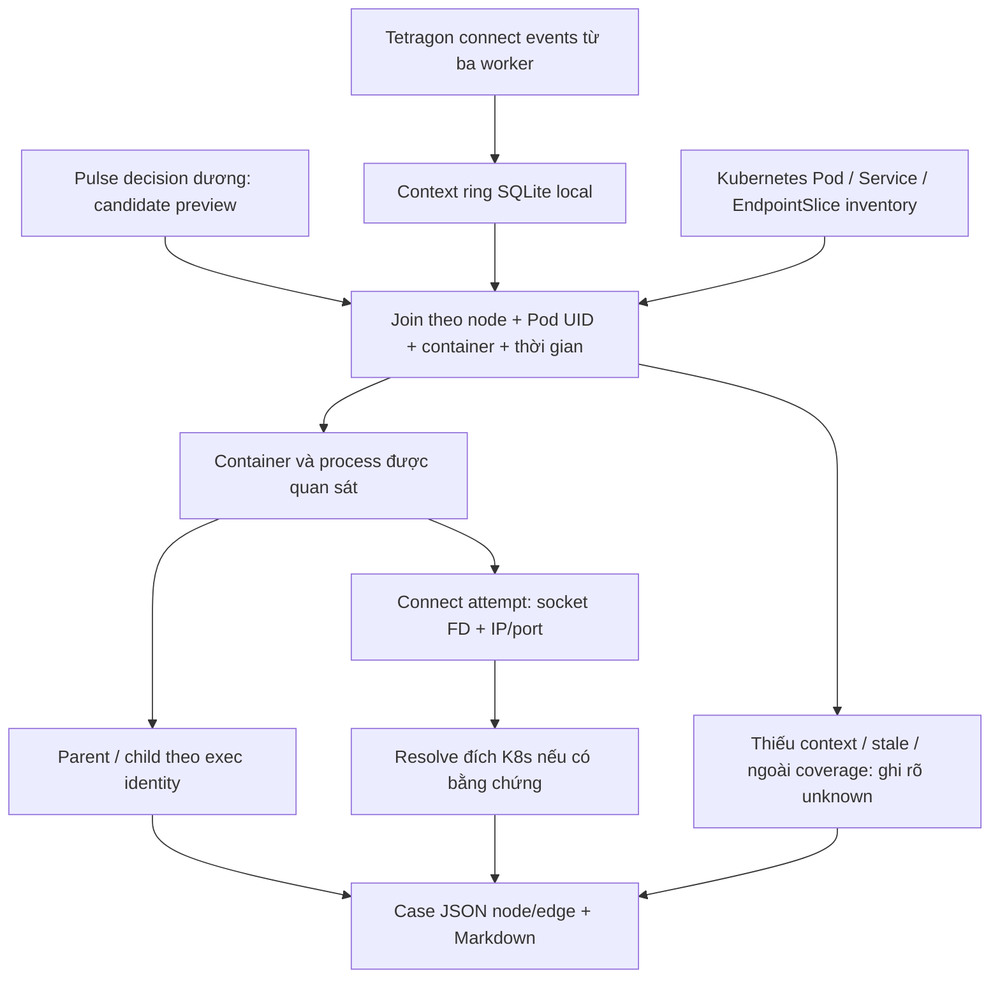

# Dựng cây RCA sau alert — thuật ngữ, triển khai và tiến độ

Cập nhật bằng SSH **14:05 ngày 15/10/2026, UTC+7**. Nhánh RCA chạy độc lập
với [Pulse ML](SENTINEL_PULSE_STATUS.md) và [thí nghiệm feature/syscall](SYSCALL_FEATURE_EXPERIMENT_STATUS.md).
Đây là một trong ba báo cáo tiến độ hiện hành, không thêm nhật ký checkpoint.

## 1. Mục tiêu và những gì thực sự đã triển khai

Sau tín hiệu Pulse, thu thập bằng chứng để trả lời: process nào đang hoạt động,
parent là ai, process nào gọi connect, thử kết nối tới đâu và đích K8s nào?

Hiện Pulse chưa phát operational alert. Subscriber nhận
**candidate_alert_preview** đã khớp model/policy hash; không đổi tên preview
thành alert production. Output hiện là **cây/graph bằng chứng điều tra**,
chưa phải thuật toán chứng minh root cause nhân quả, không tự xử lý pod.

| Mục | Trạng thái xác minh |
|---|---|
| VM chạy subscriber | 10.1.16.234 — k8s-master.local |
| Unit | pulse-rca-context.service |
| systemd | active/running, enabled; MainPID 231866 |
| Case trong lượt đăng ký hiện hành | **41** case đã xuất; audit kiểm tra 41 case |
| Context ring đang giữ | 2.805 normalized connect event tại snapshot |
| Stream được mở | Ba sensor trên worker1, worker4, worker3 |
| Stream có connect event đã nhận ở snapshot | worker1 và worker4; worker3 chưa có normalized event |
| Trigger | candidate_alert_preview, không phải alert production |
| Tự thay model/enforce/cách ly | Không |

Mở stream không chứng minh mọi workload đều có event. Pod ngoài selector,
khoảng thiếu telemetry hoặc không phát sinh connect đều có thể làm thiếu
context; không tự suy ra không có kết nối hay không có anomaly.

Worker3 hiện chỉ có frontend đang Running và thuộc selector của policy;
Kafka/PostgreSQL/RabbitMQ/Redis/waypoint trên node này nằm ngoài selector.
Các pod service tên cũ có `ready=false` trên worker3 là phase `Succeeded`,
không phải microservice đang Running nhưng mất readiness. Sensor và policy
connect trên node này đã được kiểm tra enabled; số normalized event vẫn bằng
0 nên coverage connect của worker3 chưa được xác nhận bằng event.

## 2. Thuật ngữ cần hiểu

| Thuật ngữ | Nghĩa trong nhánh này |
|---|---|
| RCA — Root Cause Analysis | Điều tra nguyên nhân gốc; khác với chỉ phát hiện điểm bất thường |
| Alert/preview | Alert đã publish phục vụ vận hành / tín hiệu ứng viên để đánh giá; hiện dùng preview |
| Evidence graph/tree | Các node và quan hệ có chứng cứ; có thể chia sẻ parent/đích nên không nhất thiết là cây thuần túy |
| Node/edge | Thực thể / quan hệ: process, container, destination; parent_of, called_connect... |
| Process lineage | Quan hệ cha–con giữa các process |
| Exec ID | Identity process gắn với lần khởi chạy; không dùng PID đơn lẻ vì PID có thể tái sử dụng |
| Pod UID/CRI ID | Identity lần tạo pod / container runtime, khác tên pod hoặc tên workload |
| Cgroup | Nhóm tài nguyên mà Pulse đếm; count anomaly là tổng container, chưa chỉ ra process gây ra |
| Socket FD | File descriptor socket trong process; không phải ID duy nhất toàn cụm |
| Connect attempt | Lần gọi connect ở entry hook; chưa có return receipt để biết thành công |
| Destination/inventory | IP/port đích / thông tin Pod, Service, EndpointSlice từ Kubernetes API |
| Identity/time join | Ghép cùng node, Pod UID, container và khoảng thời gian, không chỉ trùng PID/IP |
| Pre/post context | Dữ liệu trước/sau tín hiệu để điều tra; ở đây 30 giây trước và 5 giây sau |
| Subscriber | Consumer riêng nhận event/decision; không nằm trong bước tính score |
| JSONL | Mỗi dòng là một JSON; chỉ xử lý dòng hoàn chỉnh để tránh đọc partial write |
| Cursor/checkpoint | Vị trí đọc / trạng thái đã lưu để resume sau restart |
| NFS revalidation | Mở lại file trước khi kiểm tra độ dài để cập nhật trạng thái append từ writer; cached stat có thể chưa thấy dữ liệu mới |
| SQLite WAL | Journal local giúp commit context/case/cursor và phục hồi process |
| Ring buffer/retention | Context gần hiện tại có trần / quy tắc giữ và hết hạn output |
| Cooldown/grouping | Gom nhiều preview cùng identity thành một case, không xóa decision gốc |
| Coverage/unknown | Phạm vi đã quan sát / không đủ bằng chứng; thiếu event không được mặc định là normal |
| Correlation/causality | Xuất hiện liên quan theo identity/thời gian / quan hệ gây ra; nhánh hiện tại mới chứng minh liên quan |
| Payload/L7/TLS plaintext | Nội dung tầng ứng dụng/nội dung giải mã; connect không cung cấp các dữ liệu này |
| Hash/provenance | Checksum và nguồn bằng chứng; hash không thay cho event hoặc nhãn ground truth |

## 3. Luồng và output hiện hành

1. Subscribe Tetragon qua kubectl exec tới ba sensor, chỉ chuẩn hóa sys_connect
   của policy sentinel-aims-syscalls. Không thay tracing policy/collector.
2. Giữ context normalized trong SQLite local. Raw event chỉ được dùng lúc
   normalize và tính hash, không persist argv, token hoặc request payload.
3. Tail decisions của ba worker từ NFS, kiểm tra model/policy, status và identity.
   Lần đầu bắt đầu ở cuối log hiện tại, ghi byte đã bỏ qua; không giả vờ có
   lịch sử trước subscription. Sau restart dùng lại cursor, không tự seek-tail mới.
4. Gom preview theo identity với cooldown 300 giây. Chờ post-context rồi
   dựng graph bằng chứng trong khoảng window_end−30 s tới window_end+5 s.
5. Xuất một JSON đầy đủ node/edge và Markdown để đọc. Từng connect có raw
   event hash; destination có mapping K8s nếu inventory xác định được.

Không join chỉ theo PID, pod name hoặc địa chỉ IP. Nếu trigger có CRI ID thì
kiểm tra thêm CRI ID. Parent ngoài container có thể xuất hiện vì lineage
kernel; không vì thế kết luận parent là workload hoặc process tấn công.

## 4. Ví dụ thật và kiểm chứng đã làm

[Cây thật và normalized input](validation-evidence/pulse-rca-context-20261015/README.md)
của inventory-service-695bf6f445-ttlgj:

- Case ID: 87ab07911c7413268acae4f4.
- **99 connect attempt**, 10 process, 5 parent, 3 đích.
- Đích resolve được: kube-dns:53 và aims-postgres-cnpg-rw:5432;
  loopback 127.0.0.1:8000 chưa gán một Service K8s.
- Trigger có alert=false, candidate_alert_preview=true. Các kết nối này
  không được tự gắn nhãn attack hoặc nguyên nhân anomaly.
- Replay 99 normalized edge tạo lại cùng nodes/links. Raw Tetragon corpus
  không được lưu trong sample này; không khẳng định raw replay end-to-end.

Đã kiểm tra restart riêng subscriber: ledger case vẫn còn, cursor tăng,
chỉ có ba receipt initial-tail của lần start đầu. **Chưa thử reboot VM**.
Lượt sửa hiện hành đã qua 61 test liên quan trên host; 37 test RCA pass trên VM.
Snapshot triển khai trong receipt có MemoryCurrent 84,7 MiB; đó là cgroup gồm
subscriber và ba kubectl, không phải overhead A/B đã đo.

Audit phát hiện case cũ thiếu trường `policy_evaluated` trong signal được lưu,
mặc dù subscriber kiểm tra policy lúc nhận decision. Runtime hiện hành giữ
trường này cùng binding model/policy. Các case cũ giữ nguyên, không điền bù
receipt thiếu. Đã sửa reader để mở file trước khi so độ dài, tránh bỏ qua
append vì kích thước NFS còn cache. Lượt đăng ký mới dùng output riêng;
Pulse và evaluator syscall tiếp tục chạy trong thời gian cập nhật subscriber.

[Audit SSH hiện hành](validation-evidence/pulse-parallel-live-20261015/inspection.json)
kiểm tra **41/41 case không có lỗi cấu trúc/binding**; 8 có connect context,
33 chưa có, trong đó 8 nằm ngoài selector. Số này gồm giai đoạn đầu sau
subscription nên chưa đủ pre-context 30 giây cho mọi case. Audit kiểm tra
identity, model/policy, graph node/edge và evidence hash; không xác nhận nhãn
attack hay root cause. Một số case còn thiếu context dù thuộc selector.

Trong 41 case này, preview→case có p50 **16,36 giây**, p95 **22,88 giây**.
Đây là mẫu đầu lượt đăng ký, gồm post-context và backlog, chưa phải benchmark
ổn định hoặc bằng chứng cải thiện theo paired A/B. RCA chưa hoàn tất trong
1–2 giây. Phép đo này tách khỏi latency suy luận của Pulse.

[Sample mới và input normalized](validation-evidence/pulse-parallel-live-20261015/rca-case-replay.json)
giữ case `5b7c1b37393c64bdc4687c41`: **52 connect event, 74 node, 127 edge**.
Dựng lại từ 52 normalized event cho kết quả nodes/edges và số đếm khớp nguyên
case đã xuất; `policy_evaluated` được giữ. Đây là replay từ normalized events,
chưa phải tái dựng từ raw Tetragon corpus hoặc kiểm chứng nguyên nhân tấn công.

Startup từng gặp quyền đọc config do thư mục cha root-only. Đã chuyển config
sang thư mục RCA riêng root:dat 0750/file 0640, giữ journal lỗi; không nới quyền
cấu hình khác. Không dùng NRestarts hiện tại để phủ nhận startup failure cũ.

## 5. Coverage, hiệu năng và retention

| Cấu hình | Ý nghĩa/giới hạn |
|---|---|
| Selector policy | aims.hust.vn/runtime-hardened=true; không mặc nhiên có connect detail cho mọi broker/database |
| Context ring | 180 giây, tối đa 20.000 event; vượt trần ghi issue và bỏ context cũ nhất của riêng RCA |
| Case grouping | 300 giây/node/Pod UID/container; decision gốc Pulse vẫn nguyên |
| Cây mỗi case | Tối đa 200 connect event; truncation phải hiện rõ |
| Query guard | Tối đa 10.001 event, có cờ khi chạm cap |
| Case retention | Chỉ giữ 500 case JSON/Markdown gần nhất của subscriber; có counter hết hạn |
| CPU/RAM | Quota 1 core, MemoryMax 512 MiB; MemoryCurrent 85,9 MiB ở snapshot; chưa phải A/B overhead |
| Persistence | SQLite WAL local và case/cursor checkpoint; không gắn terminal SSH |
| Boot/retry | enabled + Restart=always; NFS mount không phải prerequisite của unit |

Case local hết retention sẽ bị xóa; sample đã giữ trong Git/evidence không bị
vòng retention này xóa. Counter STATUS có thể mất phần chưa checkpoint trong
khoảng 5 giây khi restart; ledger/cursor SQLite dùng để kiểm chứng resume.

IP mapping lấy từ inventory gần thời điểm nhận event, có tuổi inventory;
chưa có timeline đầy đủ để xử lý mọi lần IP reuse, NAT hay service-mesh mapping.
Stream reconnect được log, transport loss chưa được đo exact. Subscription
đã bắt đầu trước pre-window cũng không bảo đảm không mất event.

Reader NFS còn có thể bị hard-mount stall; đây là rủi ro của consumer RCA.
Bước đợi 5 giây post-context không cộng vào **mốc tính preview của ML**, nhưng
cây RCA hoàn tất muộn hơn; latency tới khi người dùng nhận alert/cây cần đo riêng.
Không có cơ sở claim RCA hoàn tất trong 1–2 giây.

## 6. Tiến độ hoàn thiện

| Hạng mục | Trạng thái |
|---|---|
| Normalize process/parent/socket/destination không lấy payload | Đã triển khai |
| Subscriber ba sensor, join preview có model/policy binding | Đang chạy |
| Local context, durable case/cursor, bounded output | Đã có; restart process đã thử |
| Cây và input evidence thật, replay normalized | Đã có |
| Pod ngoài selector hoặc context thiếu | Đã đánh dấu; coverage chưa toàn workload |
| Operational alert thật làm trigger | Chưa có vì Pulse chưa promote |
| Kết quả connect thành công/thất bại | Chưa có return/flow receipt |
| Chuỗi process đầy đủ qua mọi fork/exec/exit | Chưa triển khai đầy đủ |
| Đích qua NAT/mesh và lịch sử inventory | Còn thiếu |
| Causal root-cause ranking, nhãn và benchmark độ đúng | Chưa có |
| Reboot, NFS outage, backlog và transport-loss tests | Chưa hoàn tất |
| Audit cấu trúc/binding của case live | Đã có tool và 41/41 case mới qua kiểm tra; không đánh đồng với causal accuracy |
| Latency tới khi cây sẵn sàng | Có mẫu preview→case 41 case; còn cần đo dài và A/B overhead |

Hướng tiếp theo: đo coverage theo workload và lý do thiếu; kiểm thử recovery/
transport; bổ sung process lifecycle và return/flow evidence ở release riêng;
xây tập incident có root-cause labels rồi mới đánh giá causal ranking.
Không mở thêm kernel hooks giữa một lượt freeze chỉ để làm cây nhiều event hơn.

## 7. File, service và lệnh kiểm tra

- Source: [rca_service.py](sentinel_pulse/rca_service.py),
  [rca_tree.py](sentinel_pulse/rca_tree.py), [rca_connect.py](sentinel_pulse/rca_connect.py),
  [audit_rca_cases.py](sentinel_pulse/audit_rca_cases.py).
- Runtime source: /home/dat/eBPF-project-current, code commit 61a72e9 khi deploy;
  START/SQLite binding khóa hash source và config, sửa source phải đăng ký lại.
- Config: /etc/sentinel-pulse-rca/parallel-20261015-r3.json.
- Environment file systemd đọc: /etc/sentinel-pulse/rca-context.env.
- Output hiện hành: /var/lib/sentinel-pulse-rca/parallel-20261015-r3.
  Hai output trước vẫn được giữ để đối chiếu, không sửa case cũ.
- Unit: [pulse-rca-context.service](sentinel_pulse/systemd/pulse-rca-context.service).
- Model/policy hash phải trùng candidate trong [báo cáo Pulse](SENTINEL_PULSE_STATUS.md).

    sudo systemctl show pulse-rca-context.service -p ActiveState -p SubState -p NRestarts -p UnitFileState
    python3 -m json.tool /var/lib/sentinel-pulse-rca/parallel-20261015-r3/STATUS.json
    PYTHONPATH=/home/dat/eBPF-project-current python3 -m sentinel_pulse.audit_rca_cases --config /etc/sentinel-pulse-rca/parallel-20261015-r3.json

Không reset Pulse hoặc thí nghiệm syscall nếu subscriber lỗi. Cây điều tra
không tự xác nhận anomaly, false positive, attack hay root cause.
