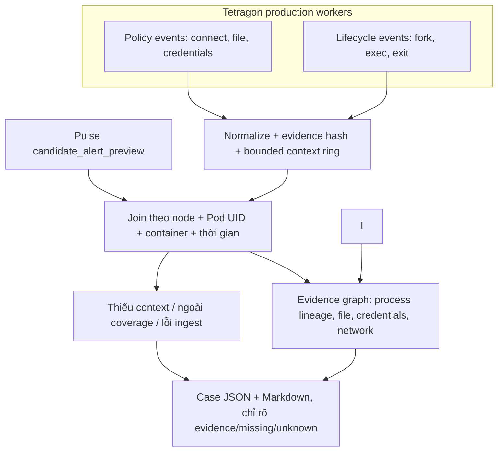

# Dựng cây RCA sau alert — thuật ngữ, triển khai và tiến độ

Cập nhật bằng SSH **15:42 ngày 15/10/2026, UTC+7**. Nhánh RCA chạy độc lập
với [Pulse ML](SENTINEL_PULSE_STATUS.md) và [thí nghiệm feature/syscall](SYSCALL_FEATURE_EXPERIMENT_STATUS.md).
Đây là một trong ba báo cáo tiến độ hiện hành, không thêm nhật ký checkpoint.

## 1. Mục tiêu và trạng thái hiện hành

Ba nhánh bổ trợ theo chuỗi nghiên cứu: thí nghiệm syscall/feature cung cấp
bằng chứng cho lần chọn feature của Pulse kế tiếp; Pulse hiện phát
`candidate_alert_preview`; RCA nhận preview đó và ghép context để điều tra.
Kết quả thí nghiệm syscall không tự đổi candidate đang freeze. Pulse hiện chưa
phát operational alert, nên các case live hiện được kích hoạt từ preview.

| Trạng thái live tại 15:41 UTC+7 | Giá trị |
|---|---:|
| Expanded RCA subscriber | `pulse-rca-runtime-events.service`, **active/enabled**, PID 284577, NRestarts=0 |
| Connect-only subscriber | `pulse-rca-context.service`, **inactive/disabled**; output cũ được giữ nguyên |
| Deployed source | `/home/dat/eBPF-project-current`, commit `15ef2dd`; deployed service source SHA khớp checkout |
| Active output/config | `/var/lib/sentinel-pulse-rca/runtime-events-20261015-r2`; `/etc/sentinel-pulse-rca/runtime-events-20261015-r2.json` |
| Runtime tracing policies | `sentinel-rca-runtime-v1`, `sentinel-rca-fork-v1`; namespace `production`, observation-only |
| Ring behavior after capacity fix | 115.694 cumulative runtime events; current 180s ring ~58.000 events; no ring-cap drops in this run at snapshot |
| Worker streams | 3 workers × policy+lifecycle; each stream had fresh events at audit |
| Cases retained / structural audit | 59 emitted and audited; 0 structural/binding errors |
| Full pre-window among cases | 16/59 had subscription before the complete 30s pre-window; 10/16 had runtime context |
| Retained case context | 15/59 runtime context; 3/59 connect context; early cases include initial-tail/warm-up gap |
| Retained preview→case latency | p50 9,91s; p95 13,61s; p99 13,61s (n=59; descriptive only) |
| Probe in restricted production pod | 35 events → 59 nodes/78 edges; 19/23 checks; 4 namespace/mount checks had no matching Tetragon event |

Fastcase connect-only đã được **dừng và disable**; dữ liệu/run cũ không bị xóa.
Subscriber mở rộng là service duy nhất đang chạy cho RCA. Nó đọc policy+lifecycle
streams của worker1, worker3, worker4, ghi event process/file/credential/network
và dựng case từ preview. Cumulative counters là bộ đếm service tại thời điểm
audit, không phải số event độc lập, attack, hay số case chính xác. Run đầu có
105 lần `event_ring_count_cap`, mỗi lần bỏ khoảng 2.300–2.700 event; output và
issues được giữ nguyên. Run r2 tăng ring từ 40.000 lên 120.000 event. Sau hơn
180 giây, ring đang chứa khoảng 58.000 event và chưa ghi cap drop; đây là kiểm
tra capacity ngắn, không bảo đảm trước mọi đợt burst.

Case audit **chỉ xác nhận cấu trúc, identity/model/policy binding và hash**;
không xác nhận event completeness, ground truth, causal root cause hoặc độ đúng
của nhãn. Các số đếm category trong case là số operation được giữ trong case,
không phải độc lập với nhau hay confusion matrix. Probe giới hạn chạy trong Pod
restricted ở `production`: process/file/credential và ptrace được ghi thành
event; `unshare`, `setns`, `mount` trả EPERM nhưng không có event Tetragon tương
ứng. Nguyên nhân phù hợp với syscall bị `RuntimeDefault` seccomp chặn trước
kprobe, nhưng receipt hiện chưa xác định chính xác tầng từ chối. Không suy ra
“không xảy ra” từ việc không quan sát thấy.

R4 normal holdout vẫn chạy đến **12:38 ngày 16/10/2026 UTC+7**. Thời điểm bật
production instrumentation đã được append vào
`INSTRUMENTATION_INTERVALS.jsonl`: run đầu đóng tại `08:37:30Z`, run r2 tiếp tục
từ `08:37:36Z` và còn mở. Probe riêng diễn ra `08:38:05Z`–`08:39:42Z` trên
worker1; khoảng test đã đóng, Pod đã xóa, evidence vẫn nằm trên NFS. Toàn bộ
instrumented exposure phải được phân tích riêng/sensitivity-check; không coi là
normal sạch và cũng không loại âm thầm.

Trong validation, hai `TracingPolicyNamespaced` và pod thử nghiệm đã ở
worker1 từ **07:36:34Z đến 08:09:19Z**. Hash evidence C3 đã đối chiếu với
bản lưu NFS; namespace thử nghiệm đã được gỡ. Khoảng can thiệp được ghi trong
`INSTRUMENTATION_INTERVALS.jsonl` và
[receipt holdout](validation-evidence/rca-runtime-validation-20261015-c3/HOLDOUT_INSTRUMENTATION_INTERVAL.json).
Holdout không bị dừng; phần exposure worker1 giao interval phải được báo riêng
và sensitivity-check, không coi là normal.

### Vì sao R3 đợi hậu ngữ cảnh, và RCA đầu tiên có cần đợi không?

R3 cấu hình `after_seconds=5`; `emit_cases()` còn đợi thêm 2 giây trước khi
đóng case. Khoảng này chỉ gom sự kiện xảy ra **sau** preview và cho stream thời
gian chuyển event tới subscriber. Nó không cần thiết để biết workload: preview
đã mang namespace/pod/container. Nhưng identity của pod chỉ trả lời “tín hiệu
đến từ đâu”, không chỉ ra process/syscall nào tạo tín hiệu hay process đó đã
làm gì. RCA cần ghép alert với event buffer theo pod/container và thời gian.
Mốc sớm nhất là 5+2=7 giây tính từ lúc
subscriber đọc preview, không phải từ lúc kernel phát hiện; backlog khiến mẫu
495 case có p50 15,00 giây và p95 22,63 giây.

Fastcase live đổi RCA đầu tiên thành snapshot không hậu ngữ cảnh: ghép ring
buffer trước alert với event đã nhận đến `window_end`. `after_seconds=0`; code
đợi grace 2 giây để drain event đang trên stream, không phải cửa sổ post-context.
Số đo cho thấy subscriber lag là nút thắt lớn hơn phần dựng case. Nếu cần sự kiện xảy ra sau alert, chúng
phải tạo một bản enrichment/update riêng, không trì hoãn RCA đầu tiên; cơ chế
enrichment đó chưa được triển khai. Pulse không cần đợi RCA mới phát hiện.

## 2. Mục tiêu và những gì thực sự đã triển khai

Sau tín hiệu Pulse, thu thập bằng chứng để trả lời: process nào đang hoạt động,
parent là ai, process nào gọi connect, thử kết nối tới đâu và đích K8s nào?

Hiện Pulse chưa phát operational alert. Subscriber nhận
**candidate_alert_preview** đã khớp model/policy hash; không đổi tên preview
thành alert production. Output hiện là **cây/graph bằng chứng điều tra**,
chưa phải thuật toán chứng minh root cause nhân quả, không tự xử lý pod.

| Mục | Trạng thái xác minh lúc 15:41 UTC+7 |
|---|---|
| VM chạy subscriber | 10.1.16.234 — k8s-master.local |
| Unit đang chạy | `pulse-rca-runtime-events.service`; active/running, enabled; PID 284577, NRestarts=0 |
| Unit connect-only cũ | `pulse-rca-context.service`; inactive/disabled, evidence cũ được giữ |
| Policy | Hai `TracingPolicyNamespaced` observation-only trong `production` |
| Tetragon stream | policy+lifecycle trên worker1, worker3, worker4; có event mới ở cả sáu stream tại snapshot |
| Run/output hiện hành | `runtime-events-20261015-r2`; ring cap 120.000; run trước không bị xóa |
| Case hiện tại | 59 retained; audit không tìm thấy lỗi cấu trúc/binding |
| Runtime detail | Process/file/credential/ptrace đã thấy ở restricted probe; namespace/mount chưa có Tetragon event tương ứng |
| Trigger | candidate_alert_preview, không phải alert production |
| Tự thay model/enforce/cách ly | Không |

Mở stream và có event ở node không chứng minh mọi workload hay mọi loại event
đều được bao phủ. Trong 59 case r2, 56 thiếu connect context và 44 thiếu runtime
context; chỉ 16 case có đủ 30 giây pre-window sau khi subscriber bắt đầu. Không
được diễn giải những ô thiếu thành “không có hoạt động”.

## 3. Thuật ngữ cần hiểu

| Thuật ngữ | Nghĩa trong nhánh này |
|---|---|
| RCA — Root Cause Analysis | Điều tra nguyên nhân gốc; khác với chỉ phát hiện điểm bất thường |
| Alert/preview | Alert đã publish phục vụ vận hành / tín hiệu ứng viên để đánh giá; hiện dùng preview |
| Evidence graph/tree | Các node và quan hệ có chứng cứ; có thể chia sẻ parent/đích nên không nhất thiết là cây thuần túy |
| Node/edge | Thực thể / quan hệ: process, container, destination; parent_of, called_connect... |
| Process lineage | Quan hệ cha–con giữa các process |
| Exec ID | Identity process gắn với lần khởi chạy; không dùng PID đơn lẻ vì PID có thể tái sử dụng |
| Pod UID/CRI ID | Identity lần tạo pod / container runtime, khác tên pod hoặc tên workload |
| Cgroup | Nhóm tài nguyên mà Pulse đếm; count anomaly là tổng container, chưa chỉ ra process gây ra |
| Socket FD | File descriptor socket trong process; không phải ID duy nhất toàn cụm |
| Connect attempt | Lần gọi connect ở entry hook; chưa có return receipt để biết thành công |
| Destination/inventory | IP/port đích / thông tin Pod, Service, EndpointSlice từ Kubernetes API |
| Identity/time join | Ghép cùng node, Pod UID, container và khoảng thời gian, không chỉ trùng PID/IP |
| Pre/post context | RCA đầu tiên dùng ring buffer trước preview và event đến `window_end`; post-context chỉ dành cho enrichment riêng, hiện chưa triển khai |
| Subscriber | Consumer riêng nhận event/decision; không nằm trong bước tính score |
| JSONL | Mỗi dòng là một JSON; chỉ xử lý dòng hoàn chỉnh để tránh đọc partial write |
| Cursor/checkpoint | Vị trí đọc / trạng thái đã lưu để resume sau restart |
| NFS revalidation | Mở lại file trước khi kiểm tra độ dài để cập nhật trạng thái append từ writer; cached stat có thể chưa thấy dữ liệu mới |
| SQLite WAL | Journal local giúp commit context/case/cursor và phục hồi process |
| Ring buffer/retention | Context gần hiện tại có trần / quy tắc giữ và hết hạn output |
| Cooldown/grouping | Gom nhiều preview cùng identity thành một case, không xóa decision gốc |
| Coverage/unknown | Phạm vi đã quan sát / không đủ bằng chứng; thiếu event không được mặc định là normal |
| Correlation/causality | Xuất hiện liên quan theo identity/thời gian / quan hệ gây ra; nhánh hiện tại mới chứng minh liên quan |
| Payload/L7/TLS plaintext | Nội dung tầng ứng dụng/nội dung giải mã; connect không cung cấp các dữ liệu này |
| Hash/provenance | Checksum và nguồn bằng chứng; hash không thay cho event hoặc nhãn ground truth |

## 4. Luồng và output hiện hành

1. Chỉ `pulse-rca-runtime-events.service` đang được enable để chạy lúc boot.
   Service mở policy+lifecycle event streams qua ba Tetragon sensor và theo dõi
   decision preview từ Pulse.
2. Chuẩn hóa event thành process (`fork/exec/exit`), file (`open/write` và các
   thao tác được policy bắt), credential, network/connect; ghi evidence hash,
   giữ context bounded và không lấy argv/token/request payload.
3. Kiểm tra model/policy binding của preview, join theo identity và thời gian,
   kết hợp Kubernetes inventory khi có dữ liệu phù hợp.
4. Xuất graph/case JSON và Markdown. Case nêu rõ phần evidence quan sát được,
   giới hạn coverage và unknown; đây không phải chứng minh nhân quả.
5. Service connect-only cũ đã bị dừng/disable. Không xóa thư mục output cũ,
   config, journal hay case lịch sử.

Không join chỉ theo PID, pod name hoặc địa chỉ IP. Nếu trigger có CRI ID thì
kiểm tra thêm CRI ID. Parent ngoài container có thể xuất hiện vì lineage
kernel; không vì thế kết luận parent là workload hoặc process tấn công.

## 5. Ví dụ thật và kiểm chứng đã làm

[Cây thật và normalized input](validation-evidence/pulse-rca-context-20261015/README.md)
của inventory-service-695bf6f445-ttlgj:

- Case ID: 87ab07911c7413268acae4f4.
- **99 connect attempt**, 10 process, 5 parent, 3 đích.
- Đích resolve được: kube-dns:53 và aims-postgres-cnpg-rw:5432;
  loopback 127.0.0.1:8000 chưa gán một Service K8s.
- Trigger có alert=false, candidate_alert_preview=true. Các kết nối này
  không được tự gắn nhãn attack hoặc nguyên nhân anomaly.
- Replay 99 normalized edge tạo lại cùng nodes/links. Raw Tetragon corpus
  không được lưu trong sample này; không khẳng định raw replay end-to-end.

Đã kiểm tra restart riêng subscriber: ledger case vẫn còn, cursor tăng,
chỉ có ba receipt initial-tail của lần start đầu. **Chưa thử reboot VM**.
Lượt sửa hiện hành đã qua 61 test liên quan trên host; 37 test RCA pass trên VM.
Snapshot triển khai trong receipt có MemoryCurrent 84,7 MiB; đó là cgroup gồm
subscriber và ba kubectl, không phải overhead A/B đã đo.

Audit phát hiện case cũ thiếu trường `policy_evaluated` trong signal được lưu,
mặc dù subscriber kiểm tra policy lúc nhận decision. Runtime hiện hành giữ
trường này cùng binding model/policy. Các case cũ giữ nguyên, không điền bù
receipt thiếu. Đã sửa reader để mở file trước khi so độ dài, tránh bỏ qua
append vì kích thước NFS còn cache. Lượt đăng ký mới dùng output riêng;
Pulse và evaluator syscall tiếp tục chạy trong thời gian cập nhật subscriber.

Audit SSH r2 hiện hành kiểm tra **59 case, không có lỗi cấu trúc/binding**;
15 có runtime context và 3 có connect context. **43 case chưa có đủ history
30 giây khi subscriber bắt đầu**; trong 16 case có đủ pre-window, 10 có runtime
evidence và 6 không có event phù hợp trong cửa sổ. Retained preview→case p50/p95/p99
lần lượt **9,91/13,61/13,61 giây**. Đây là mô tả các case được giữ, không phải
latency bảo đảm. Audit không kiểm chứng raw event completeness, ground truth,
confusion matrix hay causal root.

Run r2 có **115.694 cumulative normalized events**, ring hiện giữ khoảng **58.000**
event trong cửa sổ 180 giây. `issues.jsonl` có 10 mục khởi tạo/subscription, chưa
có `event_ring_count_cap`. Đây là counters, không phải số event độc lập/attack.
Run đầu đã lưu 105 ring-cap issues; giữ nguyên làm evidence. R3 cũ (495 case,
preview→case p50/p95 15,00/22,63 giây) không phải benchmark đối chứng trực tiếp.

[Sample mới và input normalized](validation-evidence/pulse-parallel-live-20261015/rca-case-replay.json)
giữ case `5b7c1b37393c64bdc4687c41`: **52 connect event, 74 node, 127 edge**.
Dựng lại từ 52 normalized event cho kết quả nodes/edges và số đếm khớp nguyên
case đã xuất; `policy_evaluated` được giữ. Đây là replay từ normalized events,
chưa phải tái dựng từ raw Tetragon corpus hoặc kiểm chứng nguyên nhân tấn công.

Startup từng gặp quyền đọc config do thư mục cha root-only. Đã chuyển config
sang thư mục RCA riêng root:dat 0750/file 0640, giữ journal lỗi; không nới quyền
cấu hình khác. Không dùng NRestarts hiện tại để phủ nhận startup failure cũ.

## 6. Coverage, hiệu năng và retention

| Cấu hình | Ý nghĩa/giới hạn |
|---|---|
| Policy hiện hành | Namespaced trong `production`; quan sát connect, file, credential, process lifecycle và các thao tác namespace/mount/ptrace khai báo trong policy; có sampling cho sự kiện file; không phải mọi event đều được giữ |
| Context ring hiện hành (r2) | 180 giây, tối đa 120.000 normalized events; không ghi cap drop trong lần quan sát hơn 180 giây |
| Case grouping | Cooldown 300 giây theo identity; không xóa Pulse decision gốc |
| Case retention | Tối đa 500 case gần nhất theo config; counter và file bị retention cần được tính đến |
| CPU/RAM subscriber | `CPUQuota=200%`, `MemoryMax=1G`; snapshot usage A/B chưa đo |
| Persistence | SQLite WAL local và case/cursor checkpoint; không gắn terminal SSH |
| Boot/retry | Expanded unit enabled + `Restart=always`; connect-only unit disabled; NFS mount không phải prerequisite của unit |

Case local hết retention sẽ bị xóa; sample đã giữ trong Git/evidence không bị
vòng retention này xóa. Counter STATUS có thể mất phần chưa checkpoint trong
khoảng 5 giây khi restart; ledger/cursor SQLite dùng để kiểm chứng resume.

IP mapping lấy từ inventory gần thời điểm nhận event, có tuổi inventory;
chưa có timeline đầy đủ để xử lý mọi lần IP reuse, NAT hay service-mesh mapping.
Stream reconnect được log, transport loss chưa được đo exact. Subscription
đã bắt đầu trước pre-window cũng không bảo đảm không mất event.

Reader NFS còn có thể bị hard-mount stall; đây là rủi ro của consumer RCA.
Thời gian dựng RCA không cộng vào **mốc tính preview của ML**, nhưng latency
tới khi người dùng nhận alert/cây cần đo riêng.
Không có cơ sở claim RCA hoàn tất trong 1–2 giây.

## 7. Tiến độ hoàn thiện

| Hạng mục | Trạng thái |
|---|---|
| Expanded Tetragon subscriber (policy+lifecycle) ba worker | Đang chạy; active/enabled, NRestarts=0 tại kiểm tra; run r2 đã qua quan sát cửa sổ 180s không cap drop |
| Connect-only subscriber | Đã stop/disable; output cũ giữ nguyên |
| Normalize process/file/credential/network, không lấy payload | Có evidence production; coverage chưa đầy đủ |
| Join preview có model/policy binding | Đang chạy; 59 case r2 audit không lỗi cấu trúc/binding |
| Local context, durable case/cursor, bounded output | Đã có; restart process đã thử |
| Cây và input evidence thật, replay normalized | Đã có |
| Pod ngoài selector hoặc context thiếu | Đã đánh dấu; coverage chưa toàn workload |
| Operational alert thật làm trigger | Chưa có vì Pulse chưa promote |
| Kết quả connect thành công/thất bại | Chưa có return/flow receipt |
| Production restricted fixture | 19/23 checks; process/file/credentials/ptrace thấy được, namespace/mount attempts EPERM nhưng không có Tetragon event tương ứng |
| Namespace/mount trong fixture cô lập | Đã có kiểm chứng trước đây; không thay thế kiểm chứng production |
| Đích qua NAT/mesh và lịch sử inventory | Còn thiếu |
| Causal root-cause ranking, nhãn và benchmark độ đúng | Chưa có |
| Reboot, NFS outage, backlog và transport-loss tests | Chưa hoàn tất |
| Audit cấu trúc/binding của expanded cases | 59 audited, 0 structural/binding errors; không chứng minh event completeness hoặc causal accuracy |
| Latency tới khi cây sẵn sàng | Expanded r2 retained cases n=59: preview→case p50 9,91s, p95 13,61s; descriptive only |

Fixture restricted production được lưu ở
`/mnt/sentinel-pulse-archive/rca-production-runtime-validation-20261015-r2`:
35 normalized events → 59 node/78 edge; 19/23 checks đạt. SHA-256 của
`TERMINAL.json`: `ee6a0052307000b14ad531f688f150bf7e68e2ef7018c1bb6857993c4c588856`;
`TREE.json`: `83687b9c5fb449cb486638e338a4425341f09aca860d1dae9821b247944c6110`.
Checks còn thiếu là `unshare_zero`, `unshare_denied`, `setns_invalid`,
`mount_denied`; app nhận EPERM, nhưng policy không thấy syscall event. Fixture
cô lập trước đây có 24/24, nhưng không thay thế kết quả restricted production.
Probe không sinh ML alert, không phải blind attack, không tác động workload khác;
Pod tạm đã xóa.

Run r2 hiện active với cap 120.000 event, 59 case retained được audit không lỗi
cấu trúc, nhưng chỉ 15 case có runtime context và 3 có connect context. Trong
59 case, 43 case không có đủ 30 giây history trước lúc subscriber bắt đầu (tail
NFS/warm-up); trong 16 case có đủ pre-window, 10 có runtime evidence và 6 không
có event phù hợp trong cửa sổ. Vì vậy RCA vẫn thiếu coverage thực tế, dù service
đã chạy và cấu trúc case qua audit.

## 8. File, service và lệnh kiểm tra

- Source: [rca_service.py](sentinel_pulse/rca_service.py),
  [rca_tree.py](sentinel_pulse/rca_tree.py), [rca_connect.py](sentinel_pulse/rca_connect.py),
  [audit_rca_cases.py](sentinel_pulse/audit_rca_cases.py).
- Runtime source: `/home/dat/eBPF-project-current`, commit `15ef2dd`; source
  snapshot của systemd có SHA-256 trùng checkout tại thời điểm kiểm tra.
- Config/env: `/etc/sentinel-pulse-rca/runtime-events-20261015-r2.json` và
  `/etc/sentinel-pulse-rca/rca-runtime-events.env`.
- Output hiện hành: `/var/lib/sentinel-pulse-rca/runtime-events-20261015-r2`.
  Run đầu `/var/lib/sentinel-pulse-rca/runtime-events-20261015` giữ nguyên.
  Output connect-only cũ `/var/lib/sentinel-pulse-rca/parallel-20261015-r3-fastcase`
  được giữ nguyên.
- Unit hiện hành: [pulse-rca-runtime-events.service](sentinel_pulse/systemd/pulse-rca-runtime-events.service).
- Model/policy hash phải trùng candidate trong [báo cáo Pulse](SENTINEL_PULSE_STATUS.md).

    sudo systemctl show pulse-rca-runtime-events.service -p ActiveState -p SubState -p NRestarts -p UnitFileState
    sudo systemctl is-active pulse-rca-context.service  # expected: inactive
    python3 -m json.tool /var/lib/sentinel-pulse-rca/runtime-events-20261015-r2/STATUS.json
    PYTHONPATH=/opt/sentinel-pulse-rca/runtime-events-20261015-r2/source python3 -m sentinel_pulse.audit_rca_cases --config /etc/sentinel-pulse-rca/runtime-events-20261015-r2.json

Không reset Pulse hoặc thí nghiệm syscall nếu subscriber lỗi. Cây điều tra
không tự xác nhận anomaly, false positive, attack hay root cause.
