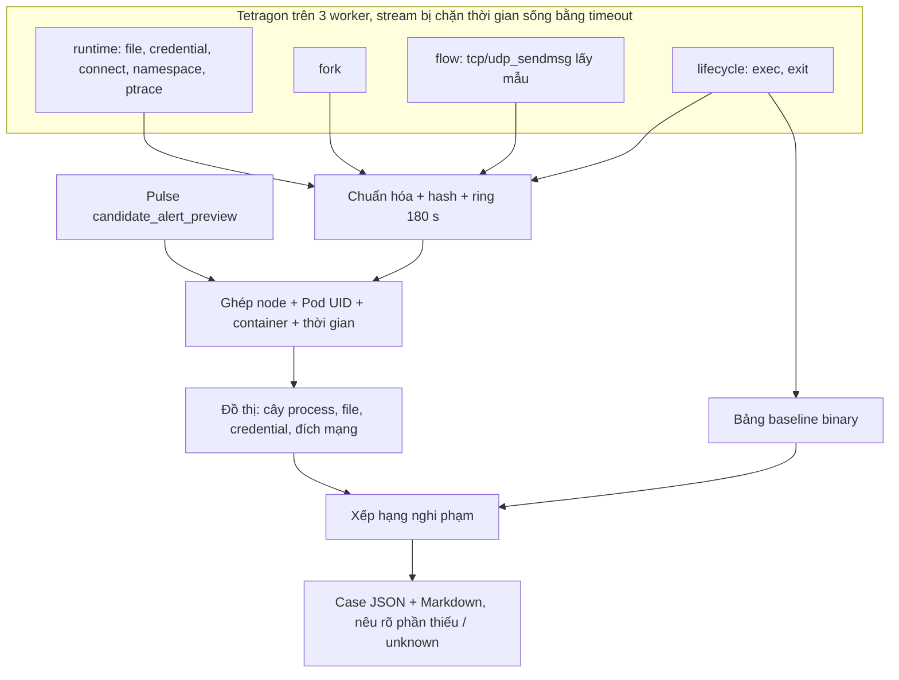

# RCA — đồ thị điều tra sau tín hiệu Pulse: trạng thái, kết quả và nhật ký

Cập nhật **19/10/2026 10:45 (UTC+7)**. RCA chạy độc lập với [Sentinel Pulse](SENTINEL_PULSE_STATUS.md) và [thí nghiệm chọn syscall](SYSCALL_FEATURE_EXPERIMENT_STATUS.md). Nó nhận cảnh báo thử của Pulse rồi ghép sự kiện Tetragon thành đồ thị bằng chứng.

## 1. Mục tiêu và trạng thái hiện hành

**Mục tiêu.** Pulse chỉ cho biết **container nào** bất thường, không cho biết process nào. Sau mỗi tín hiệu, RCA trả lời:
- process nào đang chạy, cha là ai, mới khởi chạy hay không;
- process đó đã làm gì: file, credential, namespace, ptrace, mạng;
- process nào đáng điều tra trước (xếp hạng nghi phạm).

Đồ thị là bằng chứng liên quan theo định danh và thời gian, **không chứng minh nhân quả**. RCA không tự xử lý pod.

| Thành phần (10:45 ngày 19/10) | Trạng thái |
|---|---|
| Subscriber | **r6b** `pulse-rca-runtime-events-r6b` (.234), chạy từ 10:36 trên source `15dab8a` |
| Cấu hình r6b | Gồm:<br>• 3 policy (runtime, fork, flow);<br>• ring 180 s / 120.000 sự kiện;<br>• cooldown 300 s có **case tiếp nối**;<br>• giữ 20.000 case;<br>• stream xoay vòng 900 s;<br>• baseline binary lấy từ r6, đóng băng 19/10 03:45:45 |
| Policy Tetragon (`production`, chỉ quan sát) | `sentinel-rca-runtime-v1`, `sentinel-rca-fork-v1`, **`sentinel-rca-flow-v1`** (apply 19/10 02:14) |
| Campaign kiểm chứng | `pulse-matched-campaign-r6-rca-followup-20261019`: 7 workload × 15 = 105 cặp, attack từ 10:46, dự kiến xong ~12:50 |
| Subscriber trước | r2 dừng 19/10 02:13; r6 dừng 10:36. Output được giữ nguyên |
| Bản sao bằng chứng r6 | `/mnt/sentinel-pulse-archive/matched-r6-20261018/rca-r6-copy-20261019/`: 2.001 case + `context.sqlite3` |

## 2. Thuật ngữ

| Thuật ngữ | Nghĩa |
|---|---|
| RCA | Điều tra nguyên nhân gốc; ở đây mới là đồ thị bằng chứng và thứ tự ưu tiên điều tra |
| Trigger / preview | Cảnh báo thử của Pulse đã khớp hash model và chính sách; không phải cảnh báo vận hành |
| Case | Một đồ thị (JSON + Markdown) dựng cho một trigger |
| Node / edge | Thực thể (process, file, đích mạng…) / quan hệ (`parent_of`, `performed_exec`, `sent_on_socket`…) |
| Exec ID | Định danh một lần khởi chạy process; không dùng PID vì PID bị tái sử dụng |
| Ghép theo định danh + thời gian | Cùng node, Pod UID, container và khoảng thời gian; không ghép chỉ theo PID hay IP |
| Ring | Bộ đệm sự kiện gần nhất (180 s), lưu trong SQLite local |
| Cửa sổ trước (pre-window) | 30 s trước trigger; case đầu tiên không đợi sự kiện sau trigger (chỉ đợi 2 s để nhận nốt sự kiện đang truyền) |
| Cooldown | Các trigger cùng container trong 300 s được gộp vào một case |
| Case tiếp nối (follow-up) | Trong cooldown, nếu container exec một binary **mới** (không có trong ring trước case trước) thì mở thêm case. Mỗi case cách nhau ≥ 10 s, tối đa 5 case mỗi cooldown |
| Flow (`active_flow`) | Lần gửi trên socket đã mở (`tcp_sendmsg`/`udp_sendmsg`), lấy mẫu 1 lần / process / 10 s. Cho biết đích đang trao đổi kể cả khi dùng connection pool |
| Baseline binary | Bảng không hết hạn ghi lần đầu mỗi binary xuất hiện trong mỗi workload |
| Thời điểm đóng băng baseline | Binary thấy lần đầu sau mốc này được coi là "mới" |
| Nghi phạm (suspect) | Process trong case, được xếp hạng bằng heuristic có lý do rõ ràng (mục 4) |
| top-k | Tỉ lệ case mà process tấn công thật nằm trong k nghi phạm đầu |
| Unknown / coverage | Thiếu sự kiện không có nghĩa là không có hoạt động |

## 3. Luồng



## 4. Xếp hạng nghi phạm

Code: `sentinel_pulse/rca/ranking.py`. Điểm là heuristic để sắp thứ tự điều tra, không phải xác suất.

| Lý do | Điểm |
|---|---|
| Binary thấy lần đầu trong workload sau thời điểm đóng băng baseline (`novel_binary`) | 4 |
| Binary chưa từng ghi nhận (`unknown_binary`) | 2 |
| Exec trong cửa sổ (`started_in_window`) | 2 |
| Thao tác credential / namespace / mount / ptrace (`security_operation`) | 3 mỗi lần, tối đa 9 |
| Syscall thất bại (`failed_syscall`) | 1 mỗi lần, tối đa 3 |
| Là cha của một nghi phạm khác (`spawned_children`) | 1 |

- **Không xếp hạng tiến trình container runtime** (`containerd-shim*`, `runc`, `crun`, `conmon`). Đây là cha phía host của mọi `kubectl exec`, và từng đứng hạng 1 sai trong r6 (sửa ở `54f4635`).
- **Đánh giá:** `rca/evaluate_ranking.py`.
  - Nhãn thật là đường dẫn binary của fixture trong campaign.
  - `--rerank-db` xếp hạng lại offline từ bảng `binaries`, chỉ dùng binary đã thấy trước lúc tạo case.

## 5. Kết quả

### 5.1 Run r2 (15–17/10): vì sao 99,9% case thiếu ngữ cảnh kết nối

- r2 có 19.152 case; 99,9% không có sự kiện connect.
- Nguyên nhân **không phải lỗi ghép**: trong ring 180 s chỉ có 50 lần `connect()` trên toàn bộ production, so với 4.222 exec. Các service dùng connection pool nên gần như không gọi `connect()`.
- Cách sửa: policy flow `sentinel-rca-flow-v1` (`c71f604`), lấy mẫu lần gửi trên socket đã mở.

### 5.2 Sự cố client Tetragon mồ côi (phát hiện 19/10 02:05)

- **Nguyên nhân.** Subscriber RCA mở stream bằng `kubectl exec … tetra getevents`. Mỗi lần nối lại stream, `kubectl` phía `.234` bị giết nhưng tiến trình bên trong container Tetragon vẫn chạy. Campaign cũ và v8 cũng rò theo cùng cách.
- **Quy mô.** Có **301 / 18 / 59** client mồ côi trên worker1 / worker4 / worker3, chạy từ 10 giờ đến 25 ngày.
- **Tác động.** Tetragon tốn 5–7 core và 11,5 GB RAM, làm lượt live R6 của Pulse bị thiếu CPU lúc khởi động.
- **Sửa (`d791d24`).** Lệnh trong container được bọc `timeout`, và stream RCA xoay vòng mỗi 900 s (nối lại ngay khi hết hạn). Không client nào sống quá 15 phút.
- **Sau khi dọn.** CPU Tetragon giảm ~9 lần.

### 5.3 Run r6 trong campaign R6 (19/10 02:14 → 10:36)

Cấu hình: 3 policy, cooldown 300 s không có case tiếp nối, giữ 2.000 case. Bằng chứng: `rca-r6-copy-20261019/RANKING-{stored,reranked}.json`.

| 315 attack của campaign R6 | Số trial |
|---|---:|
| Có case của chính attack | **36** |
| Bị gộp cooldown vì case của binary vô hại 5 s trước đó | 88 |
| Bị gộp cooldown vì case khác trong 300 s | 130 |
| Case đã bị xóa do giới hạn 2.000 case (50 phút đầu campaign) | 48 |
| Không có case | 13 |

- **Xếp hạng:** trong **36/36 case**, binary tấn công đứng **hạng 1** (top-1 = top-3 = top-5 = 100%), với cả xếp hạng đã lưu lẫn xếp hạng lại offline. Mẫu 36 còn nhỏ, chưa có khoảng tin cậy.
- **Độ phủ** bị chi phối bởi cooldown theo container và giới hạn lưu, không phải bởi chất lượng xếp hạng. Đây là lý do có case tiếp nối và giới hạn 20.000 case trong r6b.
- **Thông tin mạng:** mẫu 73 case đầu cho thấy chỉ 12% case có `active_flow`. Mẫu lấy trong lúc subscriber bị kẹt IO (5.4), nên cần đo lại trên r6b.

### 5.4 Tranh chấp IO trên .234 (19/10 02:30)

- **Triệu chứng.** Subscriber kẹt ở trạng thái chờ IO (D), không nạp sự kiện ~2,5 phút, stream bị nối lại.
- **Nguyên nhân.** Một job phân tích Pulse đọc ~200 GB từ NFS (rolling recalibration) cùng lúc với job arm-budget.
- **Xử lý.** Dừng job; RCA hồi phục ngay.
- **Quy tắc.** Không chạy phân tích đọc NFS nặng trên `.234` khi có lượt live hoặc campaign.

### 5.5 Tần suất exec bình thường (căn cứ thiết kế case tiếp nối)

Đo trên ring 180 s của r6:

| Container | Exec/phút | Binary |
|---|---:|---|
| Kafka (`aims-kafka-dual-role-*`) | 72 | `grep`, `readlink`, `bash` (probe) |
| Redis / redis-sentinel | 36 | `sh`, `hostname`, `redis-cli` (probe) |
| Pod phát tải (không có model Pulse) | 270–510 | `wget`, `nc` |

Nếu điều kiện chỉ là "có exec bất kỳ" thì Kafka/Redis sẽ luôn mở case mới. Vì vậy case tiếp nối chỉ tính binary chưa có trong ring trước cửa sổ của case trước (`3e457fe`).

## 6. Coverage, hiệu năng, giới hạn

| Mục | Giá trị / giới hạn |
|---|---|
| Phạm vi policy | Namespace `production`, mọi pod; file lấy mẫu 1 s / process / hook; flow lấy mẫu 10 s / process |
| Ring | 180 s, tối đa 120.000 sự kiện |
| Grouping | Cooldown 300 s; r6b thêm tối đa 5 case tiếp nối mỗi cooldown |
| Lưu case | r2: 500; r6: 2.000 (đã xóa mất 48 trial campaign); r6b: 20.000 |
| Tài nguyên | Subscriber `MemoryMax=2G`, `Nice=10`; 6 stream (policy + lifecycle × 3 worker) |
| Đã biết thiếu | Syscall namespace/mount bị seccomp `RuntimeDefault` chặn trước kprobe nên không có sự kiện. Chưa đo đầy đủ mất mát khi truyền sự kiện. Ánh xạ IP qua NAT/mesh chưa có lịch sử |
| Độ trễ preview → case | Ít nhất ~2 s (thời gian chờ nhận nốt sự kiện) cộng độ trễ subscriber; r2 đo p50 11 s / p95 17 s. **Chưa đo lại trên r6/r6b** |
| Thử reboot / mất NFS / backlog | **Không làm** theo quyết định của bạn (không tác động infra) |

## 7. Tiến độ

| Hạng mục | Trạng thái |
|---|---|
| Subscriber 3 worker × (policy + lifecycle), case JSON/Markdown | Chạy (r6b) |
| Ngữ cảnh mạng cho service dùng connection pool | Policy flow đã apply; độ phủ cần đo lại |
| Stream không rò tiến trình trong container | Có (`d791d24`) |
| Xếp hạng nghi phạm + đánh giá top-k theo nhãn campaign | Có; R6: top-1 100% trên 36 case |
| Loại cha container runtime khỏi xếp hạng | Có (`54f4635`) |
| Case tiếp nối cho exec mới trong cooldown; lưu 20.000 case | Đang chạy thử (r6b + campaign 105 cặp) |
| Đo lại: tỉ lệ attack có case, top-k, flow coverage, độ trễ preview → case | Sau khi campaign tiếp nối xong (~12:50) |
| Cảnh báo vận hành thật làm trigger | Chưa có (Pulse vẫn chạy shadow) |
| Chứng minh nhân quả | Ngoài phạm vi hiện tại |

## 8. File, service, lệnh kiểm tra

- **Code (`sentinel_pulse/rca/`):**
  - `service.py` — subscriber, cooldown, case tiếp nối;
  - `runtime_events.py` — chuẩn hóa sự kiện;
  - `runtime_tree.py` — dựng đồ thị;
  - `ranking.py`, `evaluate_ranking.py` — xếp hạng và đánh giá.
- **Policy Tetragon:** `sentinel_pulse/k8s/tetragon-rca-*.yaml`.
- **Khởi chạy:** `scripts/launch_rca_followup.sh` (r6b + campaign tiếp nối), `scripts/launch_r6.sh` (r6).
- **Cấu hình:** `/etc/sentinel-pulse-rca/runtime-events-20261019-r6b.json`.
- **Đầu ra:** `/var/lib/sentinel-pulse-rca/runtime-events-20261019-r6b/`.

```bash
python3 scripts/ssh_lab.py systemctl show pulse-rca-runtime-events-r6b -p ActiveState -p NRestarts
python3 scripts/ssh_lab.py bash -c 'echo $PW | sudo -S python3 -m json.tool /var/lib/sentinel-pulse-rca/runtime-events-20261019-r6b/STATUS.json | head -40'
PYTHONPATH=<snapshot>/source python3 -m sentinel_pulse.rca.evaluate_ranking --cases <cases> --campaign <campaign> \
  --rerank-db <context.sqlite3> --frozen-at <binary_baseline_frozen_at> --output RANKING.json
```

## 9. Nhật ký

| Thời điểm | Việc đã làm | Kết quả / bằng chứng |
|---|---|---|
| 18/10 | Tìm nguyên nhân 99,9% case r2 thiếu connect: connection pool | mục 5.1 |
| 18/10 ~15:22 | Viết policy flow `sentinel-rca-flow-v1` + node `active_flow`; server dry-run đạt | `c71f604` |
| 18/10 ~15:43 | Xếp hạng nghi phạm + `evaluate_ranking` | `52d1a08` |
| 19/10 02:05–02:13 | Phát hiện 378 client `tetra getevents` mồ côi; sửa bằng `timeout` + xoay vòng stream; dừng r2; dọn client | `d791d24`; mục 5.2 |
| 19/10 02:14 | Apply `sentinel-rca-flow-v1`; chạy subscriber r6 (6 stream, case đầu tiên sau < 1 phút) | mục 5.3 |
| 19/10 02:16 | Sửa script khởi chạy (chép từ NFS lỗi ACL; unit file rỗng do stdin của sudo) | `a9cc061` |
| 19/10 02:26 | r6: 73 case, 12% có flow; `containerd-shim` đứng hạng 1 sai → loại container runtime; thêm `--rerank-db` | `54f4635` |
| 19/10 02:30 | Subscriber kẹt IO do job NFS nặng; dừng job; RCA hồi phục | mục 5.4 |
| 19/10 10:06 | Chép 2.001 case + `context.sqlite3` của r6 sang NFS (giới hạn 2.000 đang xóa case campaign) | `rca-r6-copy-20261019/` |
| 19/10 10:08 | Đánh giá xếp hạng R6: 36/315 attack có case, top-1 100%; phân rã nguyên nhân thiếu case | mục 5.3 |
| 19/10 10:23–10:24 | Case tiếp nối cho exec mới trong cooldown; siết điều kiện để bỏ qua probe định kỳ | `5436d11`, `3e457fe` |
| 19/10 10:33 | Dừng job rolling recalibration của Pulse để không tranh IO trong campaign tiếp nối | — |
| 19/10 10:36 | Chạy r6b (baseline binary lấy từ r6, giữ 20.000 case, case tiếp nối); dừng r6 | `15dab8a`, `scripts/launch_rca_followup.sh` |
| 19/10 10:36 | Cài campaign tiếp nối 105 cặp trên capture R6 (attack từ 10:46) | `coordinator-rca-followup-20261019/` |
| 19/10 10:45 | Viết lại báo cáo này theo trạng thái hiện hành | file này |
