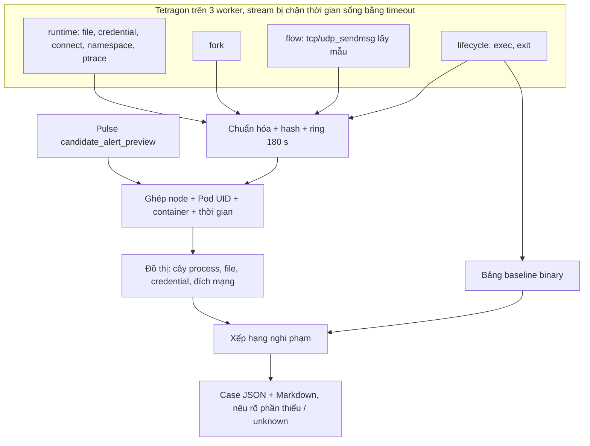

# RCA — đồ thị điều tra sau tín hiệu Pulse: trạng thái, kết quả và nhật ký

Cập nhật **19/10/2026 10:41 (UTC+7)**. RCA chạy độc lập với [Sentinel Pulse](SENTINEL_PULSE_STATUS.md) và [thí nghiệm chọn syscall](SYSCALL_FEATURE_EXPERIMENT_STATUS.md). Nó nhận cảnh báo thử của Pulse rồi ghép sự kiện Tetragon thành đồ thị bằng chứng.


## Tên gọi và đường dẫn thật trên cụm

Báo cáo dùng tên mô tả. Thư mục và unit có từ trước giữ tên cũ trên đĩa, vì config và hash bằng chứng tham chiếu tới chúng. Trên NFS có symlink tên mô tả trỏ tới từng thư mục, nên đường dẫn trong báo cáo dùng được trực tiếp.

| Tên trong báo cáo | Là gì | Thư mục / unit thật |
|---|---|---|
| `pulse-soak-baseline` | Soak 48 giờ của candidate gốc | `/mnt/sentinel-pulse-archive/matched-parallel-20261015` |
| `pulse-attack-dev` | Ma trận tấn công development 315 cặp | `matched-parallel-r3-20261015` |
| `pulse-attack-dev-rabbitmq` | 15 cặp RabbitMQ bổ sung | `matched-parallel-r5-rabbit-20261015` |
| `syscall-arms` | Thí nghiệm 11 cấu hình syscall (693 model) | `matched-parallel-r4-20261015` |
| `pulse-candidate-baseline` / `pulse-candidate-recalibrated` | Candidate gốc / candidate hiệu chỉnh lại | `runtime-f95867d-20261012` / `runtime-recal-c1-20261018` |
| `pulse-live-recalibrated` | Lượt live: candidate hiệu chỉnh lại + `policy-1win-a3` (xong 20/10 02:22) | `matched-r6-20261018`; unit `pulse-matched-worker-r6-20261018` |
| `…/campaign-main`, `…/campaign-rca` | Campaign 315 cặp / campaign 105 cặp đánh giá RCA | `coordinator-runtime-r6-d791d24-20261019` / `coordinator-rca-followup-20261019` |
| `policy-1win-a3` | Chính sách 1 cửa sổ, alpha×3 | `sentinel_pulse/protocol/policy-1win-a3.json` (SHA-256 `f6107351…`) |
| `pulse-stable-candidate` | Lượt live ứng viên bản stable (`policy-2of2-a10`, đang chạy từ 20/10 10:14) | `/mnt/sentinel-pulse-archive/pulse-stable-candidate` |
| `rca-pulse-stable-candidate` | RCA của lượt pulse-stable-candidate (đang chạy) | unit `rca-pulse-stable-candidate`, `/var/lib/sentinel-pulse-rca/rca-pulse-stable-candidate` |
| `rca-subscriber` | RCA đọc decision qua SSH trên pulse-live-recalibrated (19/10 19:24 → 20/10 10:16) | unit `rca-subscriber`, `/var/lib/sentinel-pulse-rca/rca-subscriber` |
| `rca-followup`, `rca-followup-v1`, `rca-flow`, `rca-runtime-v1` | Các bản RCA cũ (lịch sử) | `/var/lib/sentinel-pulse-rca/runtime-events-…` (có symlink cùng tên) |

## 1. Mục tiêu và trạng thái hiện hành

**Mục tiêu.** Pulse chỉ cho biết **container nào** bất thường, không cho biết process nào. Sau mỗi tín hiệu, RCA trả lời:
- process nào đang chạy, cha là ai, mới khởi chạy hay không;
- process đó đã làm gì: file, credential, namespace, ptrace, mạng;
- process nào đáng điều tra trước (xếp hạng nghi phạm).

Đồ thị là bằng chứng liên quan theo định danh và thời gian, **không chứng minh nhân quả**. RCA không tự xử lý pod.

| Thành phần (10:18 ngày 20/10) | Trạng thái |
|---|---|
| Subscriber | **`rca-pulse-stable-candidate`** (.234), chạy từ 20/10 10:16 trên snapshot `6a3a0b5`, cho lượt live pulse-stable-candidate (`policy-2of2-a10`) |
| Cấu hình | Giống `rca-subscriber`:<br>• đọc decision trên worker qua SSH, nhịp dựng case 0,25 s;<br>• 3 policy (runtime, fork, flow);<br>• ring 180 s / 120.000 sự kiện;<br>• cooldown 300 s, có case tiếp nối khi có exec mới (nhật ký exec 15 phút);<br>• giữ 20.000 case; stream xoay vòng 900 s.<br>Baseline binary **học từ đầu** trong pha chọn (10:16–11:47) rồi đóng băng lúc 11:47:29, trước attack đầu tiên; không chép từ DB cũ |
| Policy Tetragon (`production`, chỉ quan sát) | `sentinel-rca-runtime-v1` (chỉ đường dẫn nhạy cảm, không `commit_creds`), `sentinel-rca-fork-v1`, `sentinel-rca-flow-v1` |
| Campaign kiểm chứng | Campaign 315 cặp của pulse-stable-candidate, attack từ 11:49. Sẽ đo coverage, xếp hạng và độ trễ như với rca-followup |
| Subscriber trước | `rca-subscriber` 19/10 19:24 → 20/10 10:16 (2.364 case qua đêm, mục 6); rca-followup, rca-followup-v1, rca-flow, rca-runtime-v1 đã dừng. Output được giữ nguyên |
| Bản sao bằng chứng rca-flow | `/mnt/sentinel-pulse-archive/pulse-live-recalibrated/rca-flow-copy/`: 2.001 case + `context.sqlite3` |

## 2. Thuật ngữ

| Thuật ngữ | Nghĩa |
|---|---|
| RCA | Điều tra nguyên nhân gốc; ở đây mới là đồ thị bằng chứng và thứ tự ưu tiên điều tra |
| Trigger / preview | Cảnh báo thử của Pulse đã khớp hash model và chính sách; không phải cảnh báo vận hành |
| Case | Một đồ thị (JSON + Markdown) dựng cho một trigger |
| Node / edge | Thực thể (process, file, đích mạng…) / quan hệ (`parent_of`, `performed_exec`, `sent_on_socket`…) |
| Exec ID | Định danh một lần khởi chạy process; không dùng PID vì PID bị tái sử dụng |
| Ghép theo định danh + thời gian | Cùng node, Pod UID, container và khoảng thời gian; không ghép chỉ theo PID hay IP |
| Ring | Bộ đệm sự kiện gần nhất (180 s), lưu trong SQLite local |
| Cửa sổ trước (pre-window) | 30 s trước trigger; case đầu tiên không đợi sự kiện sau trigger (chỉ đợi 2 s để nhận nốt sự kiện đang truyền) |
| Cooldown | Các trigger cùng container trong 300 s được gộp vào một case |
| Case tiếp nối (follow-up) | Trong cooldown, nếu container exec một binary **mới** thì mở thêm case. Binary mới là binary không chạy trong 300 s trước cửa sổ của case trước, tra trong nhật ký exec 15 phút. Mỗi case cách nhau ≥ 10 s, tối đa 5 case mỗi cooldown; tắt trong 330 s đầu sau khi subscriber khởi động |
| Flow (`active_flow`) | Lần gửi trên socket đã mở (`tcp_sendmsg`/`udp_sendmsg`), lấy mẫu 1 lần / process / 10 s. Cho biết đích đang trao đổi kể cả khi dùng connection pool |
| Baseline binary | Bảng không hết hạn ghi lần đầu mỗi binary xuất hiện trong mỗi workload |
| Thời điểm đóng băng baseline | Binary thấy lần đầu sau mốc này được coi là "mới" |
| Nghi phạm (suspect) | Process trong case, được xếp hạng bằng heuristic có lý do rõ ràng (mục 4) |
| top-k | Tỉ lệ case mà process tấn công thật nằm trong k nghi phạm đầu |
| Unknown / coverage | Thiếu sự kiện không có nghĩa là không có hoạt động |

## 3. Luồng



## 4. Xếp hạng nghi phạm

Code: `sentinel_pulse/rca/ranking.py`. Điểm là heuristic để sắp thứ tự điều tra, không phải xác suất.

| Lý do | Điểm |
|---|---|
| Binary thấy lần đầu trong workload sau thời điểm đóng băng baseline (`novel_binary`) | 4 |
| Binary chưa từng ghi nhận (`unknown_binary`) | 2 |
| Exec trong cửa sổ (`started_in_window`) | 2 |
| Thao tác credential / namespace / mount / ptrace (`security_operation`) | 3 mỗi lần, tối đa 9 |
| Syscall thất bại (`failed_syscall`) | 1 mỗi lần, tối đa 3 |
| Là cha của một nghi phạm khác (`spawned_children`) | 1 |

- **Không xếp hạng tiến trình container runtime** (`containerd-shim*`, `runc`, `crun`, `conmon`). Đây là cha phía host của mọi `kubectl exec`, và từng đứng hạng 1 sai trong rca-flow (sửa ở `54f4635`).
- **Đánh giá:** `rca/evaluate_ranking.py`.
  - Nhãn thật là đường dẫn binary của fixture trong campaign.
  - `--rerank-db` xếp hạng lại offline từ bảng `binaries`, chỉ dùng binary đã thấy trước lúc tạo case.

## 5. Kết quả

### 5.1 Run rca-runtime-v1 (15–17/10): vì sao 99,9% case thiếu ngữ cảnh kết nối

- rca-runtime-v1 có 19.152 case; 99,9% không có sự kiện connect.
- Nguyên nhân **không phải lỗi ghép**: trong ring 180 s chỉ có 50 lần `connect()` trên toàn bộ production, so với 4.222 exec. Các service dùng connection pool nên gần như không gọi `connect()`.
- Cách sửa: policy flow `sentinel-rca-flow-v1` (`c71f604`), lấy mẫu lần gửi trên socket đã mở.

### 5.2 Sự cố client Tetragon mồ côi (phát hiện 19/10 02:05)

- **Nguyên nhân.** Subscriber RCA mở stream bằng `kubectl exec … tetra getevents`. Mỗi lần nối lại stream, `kubectl` phía `.234` bị giết nhưng tiến trình bên trong container Tetragon vẫn chạy. Campaign cũ và v8 cũng rò theo cùng cách.
- **Quy mô.** Có **301 / 18 / 59** client mồ côi trên worker1 / worker4 / worker3, chạy từ 10 giờ đến 25 ngày.
- **Tác động.** Tetragon tốn 5–7 core và 11,5 GB RAM, làm lượt live pulse-live-recalibrated của Pulse bị thiếu CPU lúc khởi động.
- **Sửa (`d791d24`).** Lệnh trong container được bọc `timeout`, và stream RCA xoay vòng mỗi 900 s (nối lại ngay khi hết hạn). Không client nào sống quá 15 phút.
- **Sau khi dọn.** CPU Tetragon giảm ~9 lần.

### 5.3 Run rca-flow trong campaign pulse-live-recalibrated (19/10 02:14 → 10:36)

Cấu hình: 3 policy, cooldown 300 s không có case tiếp nối, giữ 2.000 case. Bằng chứng: `rca-flow-copy/RANKING-{stored,reranked}.json`.

| 315 attack của campaign pulse-live-recalibrated | Số trial |
|---|---:|
| Có case của chính attack | **36** |
| Bị gộp cooldown vì case của binary vô hại 5 s trước đó | 88 |
| Bị gộp cooldown vì case khác trong 300 s | 130 |
| Case đã bị xóa do giới hạn 2.000 case (50 phút đầu campaign) | 48 |
| Không có case | 13 |

- **Xếp hạng:** trong **36/36 case**, binary tấn công đứng **hạng 1** (top-1 = top-3 = top-5 = 100%), với cả xếp hạng đã lưu lẫn xếp hạng lại offline. Mẫu 36 còn nhỏ, chưa có khoảng tin cậy.
- **Độ phủ** bị chi phối bởi cooldown theo container và giới hạn lưu, không phải bởi chất lượng xếp hạng. Đây là lý do có case tiếp nối và giới hạn 20.000 case trong rca-followup-v1 (sau đó là rca-followup, rca-subscriber).
- **Thông tin mạng:** mẫu 73 case đầu cho thấy chỉ 12% case có `active_flow`. Mẫu lấy trong lúc subscriber bị kẹt IO (5.4), nên cần đo lại (đã đo lại ở mục 5.8: 87% case có flow).

### 5.4 Tranh chấp IO trên .234 (19/10 02:30)

- **Triệu chứng.** Subscriber kẹt ở trạng thái chờ IO (D), không nạp sự kiện ~2,5 phút, stream bị nối lại.
- **Nguyên nhân.** Một job phân tích Pulse đọc ~200 GB từ NFS (rolling recalibration) cùng lúc với job arm-budget.
- **Xử lý.** Dừng job; RCA hồi phục ngay.
- **Quy tắc.** Không chạy phân tích đọc NFS nặng trên `.234` khi có lượt live hoặc campaign.

### 5.5 Tần suất exec bình thường (căn cứ thiết kế case tiếp nối)

Đo trên ring 180 s của rca-flow:

| Container | Exec/phút | Binary |
|---|---:|---|
| Kafka (`aims-kafka-dual-role-*`) | 72 | `grep`, `readlink`, `bash` (probe) |
| Redis / redis-sentinel | 36 | `sh`, `hostname`, `redis-cli` (probe) |
| Pod phát tải (không có model Pulse) | 270–510 | `wget`, `nc` |

Nếu điều kiện chỉ là "có exec bất kỳ" thì Kafka/Redis sẽ luôn mở case mới. Vì vậy case tiếp nối chỉ tính binary chưa có trong ring trước cửa sổ của case trước (`3e457fe`).

### 5.6 Lỗi điều kiện case tiếp nối ở rca-followup-v1 (19/10 10:36–10:48)

- **Triệu chứng.** Trong 10 phút đầu, trước khi có attack, rca-followup-v1 mở 117 case tiếp nối trên tổng 190 case.
- **Nguồn.** Chủ yếu từ probe sức khỏe định kỳ:
  - `python` của các app service (auth 24, search 23, notification 17…);
  - `sh`/`redis-cli` của Redis.
- **Nguyên nhân (lỗi thiết kế của mình).** Tập tham chiếu "binary đã chạy trước đó" lấy từ ring 180 s. Nếu case trước đã cách hơn 150 s thì phần tham chiếu nằm ngoài ring, tức là rỗng, nên mọi exec đều bị coi là mới.
- **Sửa (`ea5a3ee`).**
  - Thêm bảng `exec_log` giữ 15 phút.
  - Binary chỉ được coi là mới nếu không chạy trong 300 s trước cửa sổ của case trước.
  - Tắt case tiếp nối trong 330 s đầu sau khi subscriber khởi động.
  - Chuyển sang rca-followup lúc 10:48. Campaign tiếp nối đã chạy từ 10:46, nên khi đánh giá rca-followup chỉ tính các trial bắt đầu sau ~10:54.

### 5.7 Kết quả rca-followup trên campaign tiếp nối (xong 19/10 ~12:50)

- **Phạm vi đánh giá:** chỉ tính 99 trial bắt đầu sau khi rca-followup hết 330 s khởi động (10:54:15).
- **Bằng chứng:** `pulse-live-recalibrated/rca-followup-copy/`, gồm 2.140 case, `context.sqlite3` và `RANKING-{stored,reranked}.json`.

| Chỉ số | pulse-live-recalibrated (rca-flow, không có case tiếp nối) | Campaign tiếp nối (rca-followup) |
|---|---|---|
| Attack có case của chính nó | 36/315 (11%) | **71/99 (72%)**; 57 trong số đó là case tiếp nối |
| Gộp cooldown, không có case tiếp nối | 218 | 19 |
| Không có case | 13 | 9 |
| Bị xóa do giới hạn lưu | 48 | 0 |
| Top-1, xếp hạng lưu sẵn | 100% (36) | 56% (73 case) — lỗi baseline, xem dưới |
| **Top-1 / top-5, xếp hạng lại với baseline đúng** | 100% | **98,6% / 98,6%** (72/73; 1 case không có binary tấn công) |
| Case có `active_flow` | 12% (mẫu sớm) | **3%** (2/71) |
| Preview → case p50 / p95 | 8,4 / 16,6 s | 7,0 / 14,5 s |

- **Lỗi bước chép baseline (của mình).** Bước chép bảng `binaries` từ rca-flow sang rca-followup-v1/rca-followup không chạy, vì `printf password | sudo -S python3 -` khiến Python đọc stdin rỗng thay cho heredoc. Hậu quả:
  - Mọi binary đều có `first_seen` sau mốc đóng băng, nên probe định kỳ (`sh`, `hostname`, `bash`, `pg_isready`, script readiness/liveness của Kafka) được +4 điểm `novel_binary` và đứng trên binary tấn công.
- **Cách đánh giá đúng.** Gộp baseline của rca-flow vào bản sao rồi xếp hạng lại offline. `--rerank-db` chỉ dùng binary đã thấy trước lúc tạo case, nên đây đúng là kết quả live đáng lẽ đạt được.
- **Đã sửa:**
  - DB live của rca-followup đã được gộp baseline lúc 16:26, nên các case từ thời điểm đó xếp hạng đúng.
  - Script chạy bước chép qua file tạm, và báo lỗi nếu không chép được dòng nào.
- **Flow rất thấp (3%) — việc cần điều tra tiếp.** Có thể do giới hạn lấy mẫu 10 s/process, hoặc do service gửi qua sidecar mesh nên `tcp_sendmsg` thuộc container khác.
- **Một giới hạn còn lại:** attack `setns`/`mount` không để lại sự kiện bảo mật, vì seccomp chặn trước kprobe. Binary tấn công vẫn đứng đầu nhờ `novel_binary` + `started_in_window`.

### 5.8 Vì sao case thiếu flow: stream policy trễ ~80 s (sửa 19/10 16:35)

- **Triệu chứng.** Lúc dựng, case chỉ có ~16 sự kiện (lifecycle). Vài chục giây sau, cùng cửa sổ đó trong DB đã có 135–226 sự kiện, gồm cả flow.
- **Đo độ trễ.**
  - Sự kiện policy (runtime/flow) mới nhất trong DB cũ hơn hiện tại **~80 s** trên cả 3 worker; lifecycle chỉ < 5 s.
  - Tetragon tự giao sự kiện gần như tức thì (client thử có `timeout`: p50 0 s, max ~29 s do bộ đệm chờ thông tin process).
  - Subscriber gần như nhàn rỗi (`py-spy`: MainThread idle).
- **Nguyên nhân.** Lưu lượng policy runtime quá lớn: worker1 ~1.740 sự kiện/s, gồm `openat` ~976/s, `commit_creds` ~352/s, `vfs_write` ~160/s. `rateLimit: 1s` của Tetragon chỉ gộp các sự kiện *giống hệt nhau*, nên mỗi tên file vẫn sinh một sự kiện. `kubectl exec` không chuyển kịp lượng JSON này, backlog đẩy sự kiện đến sau lúc dựng case (case dựng sau trigger ~2 s + độ trễ subscriber).
- **Sửa (cập nhật tại chỗ policy `sentinel-rca-runtime-v1`, nhãn `revision: sensitive-paths-20261019`, `c233a42`):**
  - `openat`/`openat2` chỉ theo dõi đường dẫn nhạy cảm: `/etc/shadow`, `/etc/passwd`, `/etc/sudoers`, `/etc/ssh/`, `/root/`, secret của service account, `/proc/1/`…
  - `vfs_write` chỉ theo dõi `/etc`, `/root`, `/usr`, `/bin`, `/sbin`, `/lib`, cron, secret.
  - Bỏ hook `commit_creds`, vì mỗi exec đều gọi nó. `set*id`, `capset`, namespace/mount/ptrace, connect và flow giữ nguyên.
- **Kết quả:**
  - Lưu lượng worker1: 17.393 → **2.096** sự kiện / 10 s.
  - Sự kiện policy mới nhất chỉ còn trễ 0,2–1,5 s.
  - **Case có flow: 3% → 78%** (42/54 case trong 7 phút đầu sau khi sửa) **→ 87%** (392/449 case, 16:36–18:00; biên nhận `rca-flow-coverage-after-policy-change.json`).
- **Đánh đổi.** Không còn thấy mọi lần mở file, nhất là đường dẫn tương đối, và không còn snapshot credential mỗi lần exec. Ưu tiên của RCA là cây process, thao tác bảo mật, mạng và file nhạy cảm.
- **Thêm (`c233a42`).** `kubectl` không chuyển mã thoát 124 của `timeout`, nên mỗi lần xoay vòng stream bị coi là mất kết nối và chờ thêm 5 s. Giờ stream thoát ở tuổi xoay vòng được coi là xoay vòng và nối lại ngay; áp dụng từ lần đăng ký subscriber tiếp theo.

### 5.9 Độ trễ preview → case nằm ở đâu (19/10 18:00)

Biên nhận: `receipts/rca-latency-{rca-flow,rca-followup}.json` (`scripts/analysis/rca_latency.py`).

| Đoạn | rca-flow (1.998 case) p50 / p95 | rca-followup (2.140 case) p50 / p95 |
|---|---|---|
| Preview ghi trên worker → subscriber thấy decision | 5,0 / 11,5 s | 5,5 / 24,7 s |
| Thấy decision → ghi xong case | 2,1 / 2,7 s | 2,1 / 3,0 s |
| Tổng | 7,1 / 13,6 s | 7,7 / 26,9 s |

- **Phần dựng case** gần đúng bằng thời gian chờ 2 s để nhận nốt sự kiện.
- **Phần lớn nằm ở bước decision của worker hiện ra trên `.234` qua NFS.** Worker chỉ `flush` (không `fsync`) mỗi frame, nên NFS client ghi trễ; subscriber đọc lại mỗi 1 s.
- Đuôi p95 của rca-followup dài hơn. Nhiều khả năng do các job đọc NFS nặng trên `.234` lúc 12:50–13:40; chưa tách riêng.
- **Đã sửa (`08be414`), không đụng vòng lặp của worker Pulse.**
  - Subscriber đọc decision **ngay trên worker** qua SSH, bằng script nhỏ `DECISION_FOLLOWER` chạy với python3 hệ thống. Script bám file `decisions.jsonl` của segment mới nhất, không đọc lại dữ liệu cũ, và chuyển sang segment mới sau khi đọc hết segment cũ.
  - Nhịp kiểm tra để dựng case giảm từ 1 s xuống 0,25 s.
  - Bật bằng `decision_stream` trong config; `scripts/launch_run.sh` đã bật sẵn cho pulse-stable-candidate.
- **Đo thật trên pulse-live-recalibrated** (worker1, 20 s; biên nhận `receipts/rca-decision-visibility.json`, script `scripts/analysis/rca_decision_visibility.py`):

  | Cách đọc | p50 | p95 |
  |---|---|---|
  | Script bám file trên worker, qua SSH | **0,04 s** | **0,10 s** |
  | Mở lại file NFS (cách hiện tại) | 0,06 s | **7,2 s** |

  **Đo thật trên `rca-subscriber`** (45 case, chưa có attack; biên nhận `receipts/rca-latency-rca-subscriber.json`): preview → subscriber thấy decision p50 **0,06 s** / p95 0,14 s; preview → case p50 **2,21 s** / p95 **2,36 s** (trước: 7,0 / 14,5 s). Phần còn lại gần đúng bằng thời gian chờ 2 s để nhận nốt sự kiện Tetragon.

Bằng chứng cho mục 5: [`validation-evidence/results-20261019/`](validation-evidence/results-20261019/README.md) (`rca/`, `receipts/rca-*.json`).

## 6. Coverage, hiệu năng, giới hạn

| Mục | Giá trị / giới hạn |
|---|---|
| Phạm vi policy | Namespace `production`, mọi pod. File: chỉ đường dẫn nhạy cảm (từ 19/10 16:35). Flow: lấy mẫu 10 s / process. Đã bỏ `commit_creds` |
| Ring | 180 s, tối đa 120.000 sự kiện |
| Grouping | Cooldown 300 s; rca-followup-v1 thêm tối đa 5 case tiếp nối mỗi cooldown |
| Lưu case | rca-runtime-v1: 500; rca-flow: 2.000 (đã xóa mất 48 trial campaign); rca-followup-v1/rca-followup: 20.000 |
| Tài nguyên | Subscriber `MemoryMax=2G`, `Nice=10`; 6 stream (policy + lifecycle × 3 worker) |
| Đã biết thiếu | Syscall namespace/mount bị seccomp `RuntimeDefault` chặn trước kprobe nên không có sự kiện. Chưa đo đầy đủ mất mát khi truyền sự kiện. Ánh xạ IP qua NAT/mesh chưa có lịch sử |
| Độ trễ preview → case | **`rca-subscriber`, cả đêm 19→20/10: p50 2,22 s / p95 2,47 s (2.364 case)**; decision hiện ra p50 0,07 s / p95 0,23 s; dựng case p50 2,14 s / p95 2,30 s (biên nhận `receipts/rca-latency-rca-subscriber-night.json`). Lần đo đầu (45 case): p50 2,21 s / p95 2,36 s. Trước đó: ít nhất ~2 s (thời gian chờ nhận nốt sự kiện) cộng độ trễ subscriber; rca-runtime-v1: p50 11 s / p95 17 s; rca-flow (campaign pulse-live-recalibrated): p50 8,4 s / p95 16,6 s; **rca-followup: p50 7,0 s / p95 14,5 s**. Từ pulse-stable-candidate dùng stream decision qua SSH, decision hiện ra p95 0,1 s |
| Tải case dưới policy-1win-a3 | `rca-subscriber` 19/10 19:24 → 20/10 02:22: 2.364 case, khoảng 330 case mỗi giờ từ 20:00, toàn bộ là case gốc (không có case tiếp nối vì đây là thời gian normal, không có exec mới). Mức này bị chặn trên bởi cooldown 300 s cho mỗi container; về bản chất đó là số preview dương ở normal của policy 1 cửa sổ alpha×3. Policy chặt hơn ở pulse-stable-candidate sẽ giảm con số này |
| Thử reboot / mất NFS / backlog | **Không làm** theo quyết định của bạn (không tác động infra) |

## 7. Tiến độ (cập nhật 20/10 11:25)

| Hạng mục | Trạng thái |
|---|---|
| Subscriber 3 worker × (policy + lifecycle), case JSON/Markdown | Chạy (`rca-pulse-stable-candidate`) |
| Stream không rò tiến trình; xoay vòng stream | Có |
| Xếp hạng nghi phạm, loại cha container runtime | Có; top-1 100% (rca-flow, 36 case), 98,6% (rca-followup, xếp hạng lại) |
| Case tiếp nối cho exec mới trong cooldown | Có; tỉ lệ attack có case từ 11% lên 72% (71/99) |
| Ngữ cảnh mạng (flow) | Có; 87% case có flow sau khi thu hẹp hook file |
| Độ trễ preview → case | **p50 2,22 s / p95 2,47 s** trên 2.364 case (đọc decision qua SSH) |
| Đánh giá trên campaign pulse-stable-candidate | Đã hẹn, tự chạy khi campaign xong (coverage, top-k, độ trễ, flow) |
| Coverage còn thiếu (~28% attack không có case riêng) | Do cooldown/gộp case; chưa giải quyết |
| Cảnh báo vận hành thật làm trigger | Chưa có (Pulse vẫn chạy shadow) |
| Chứng minh nhân quả | Ngoài phạm vi |

## 8. File, service, lệnh kiểm tra

- **Code (`sentinel_pulse/rca/`):**
  - `service.py` — subscriber, cooldown, case tiếp nối;
  - `runtime_events.py` — chuẩn hóa sự kiện;
  - `runtime_tree.py` — dựng đồ thị;
  - `ranking.py`, `evaluate_ranking.py` — xếp hạng và đánh giá.
- **Policy Tetragon:** `sentinel_pulse/k8s/tetragon-rca-*.yaml`.
- **Khởi chạy:** `scripts/launch_rca_subscriber.sh` (rca-followup-v1/rca-followup + campaign tiếp nối), `scripts/launch_run.sh` (lượt live kế tiếp: Pulse + RCA cấu hình đầy đủ), `scripts/launch_pulse_live_recalibrated.sh` (rca-flow).
- **Cấu hình:** `/etc/sentinel-pulse-rca/rca-followup.json`.
- **Đầu ra:** `/var/lib/sentinel-pulse-rca/rca-followup/`.

```bash
python3 scripts/ssh_lab.py systemctl show rca-followup (unit cũ) -p ActiveState -p NRestarts
python3 scripts/ssh_lab.py bash -c 'echo $PW | sudo -S python3 -m json.tool /var/lib/sentinel-pulse-rca/rca-followup/STATUS.json | head -40'
PYTHONPATH=<snapshot>/source python3 -m sentinel_pulse.rca.evaluate_ranking --cases <cases> --campaign <campaign> \
  --rerank-db <context.sqlite3> --frozen-at <binary_baseline_frozen_at> --output RANKING.json
```

## 9. Nhật ký

| Thời điểm | Việc đã làm | Kết quả / bằng chứng |
|---|---|---|
| 18/10 | Tìm nguyên nhân 99,9% case rca-runtime-v1 thiếu connect: connection pool | mục 5.1 |
| 18/10 ~15:22 | Viết policy flow `sentinel-rca-flow-v1` + node `active_flow`; server dry-run đạt | `c71f604` |
| 18/10 ~15:43 | Xếp hạng nghi phạm + `evaluate_ranking` | `52d1a08` |
| 19/10 02:05–02:13 | Phát hiện 378 client `tetra getevents` mồ côi; sửa bằng `timeout` + xoay vòng stream; dừng rca-runtime-v1; dọn client | `d791d24`; mục 5.2 |
| 19/10 02:14 | Apply `sentinel-rca-flow-v1`; chạy subscriber rca-flow (6 stream, case đầu tiên sau < 1 phút) | mục 5.3 |
| 19/10 02:16 | Sửa script khởi chạy (chép từ NFS lỗi ACL; unit file rỗng do stdin của sudo) | `a9cc061` |
| 19/10 02:26 | rca-flow: 73 case, 12% có flow; `containerd-shim` đứng hạng 1 sai → loại container runtime; thêm `--rerank-db` | `54f4635` |
| 19/10 02:30 | Subscriber kẹt IO do job NFS nặng; dừng job; RCA hồi phục | mục 5.4 |
| 19/10 10:06 | Chép 2.001 case + `context.sqlite3` của rca-flow sang NFS (giới hạn 2.000 đang xóa case campaign) | `rca-flow-copy/` |
| 19/10 10:08 | Đánh giá xếp hạng pulse-live-recalibrated: 36/315 attack có case, top-1 100%; phân rã nguyên nhân thiếu case | mục 5.3 |
| 19/10 10:23–10:24 | Case tiếp nối cho exec mới trong cooldown; siết điều kiện để bỏ qua probe định kỳ | `5436d11`, `3e457fe` |
| 19/10 10:33 | Dừng job rolling recalibration của Pulse để không tranh IO trong campaign tiếp nối | — |
| 19/10 10:36 | Chạy rca-followup-v1 (baseline binary lấy từ rca-flow, giữ 20.000 case, case tiếp nối); dừng rca-flow | `15dab8a`, `scripts/launch_rca_subscriber.sh` |
| 19/10 10:36 | Cài campaign tiếp nối 105 cặp trên capture pulse-live-recalibrated (attack từ 10:46) | `campaign-rca/` |
| 19/10 10:41 | Viết lại báo cáo này theo trạng thái hiện hành | file này |
| 19/10 10:46 | rca-followup-v1 mở 117 case tiếp nối trong 10 phút (probe `python`/`redis-cli`) → phát hiện lỗi tham chiếu dựa trên ring | mục 5.6 |
| 19/10 10:48 | Nhật ký exec 15 phút + bảo vệ giai đoạn khởi động (298 test pass); chuyển sang rca-followup | `ea5a3ee` |
| 19/10 10:52 | Campaign tiếp nối 5/105 cặp; rca-followup 30 case, chưa có case tiếp nối (đang trong 330 s khởi động) | — |
| 19/10 16:24 | Chép 2.140 case + DB của rca-followup; đánh giá 99 trial sau khởi động: 72% có case, top-1 lưu sẵn 56% | mục 5.7 |
| 19/10 16:25 | Phát hiện baseline chưa được chép (lỗi stdin sudo) → probe bị coi là `novel_binary` | mục 5.7 |
| 19/10 16:26 | Gộp baseline rca-flow vào bản sao + DB live rca-followup; xếp hạng lại: top-1 98,6%; sửa script chép baseline | `RANKING-reranked.json` |
| 19/10 16:30 | Đo độ trễ nạp: sự kiện policy trễ ~80 s, lifecycle < 5 s; Tetragon giao tức thì; subscriber nhàn rỗi | mục 5.8 |
| 19/10 16:35 | Thu hẹp hook file về đường dẫn nhạy cảm, bỏ `commit_creds`; dry-run rồi apply tại chỗ | `c233a42` |
| 19/10 16:40 | Sự kiện policy chỉ còn trễ 0,2–1,5 s; nhận diện xoay vòng stream theo tuổi | `c233a42` |
| 19/10 16:42 | Case có flow: 78% (42/54) | mục 5.8 |
| 19/10 17:57 | Biên nhận JSON cho độ phủ (rca-flow: 36/315; rca-followup: 71/99), xếp hạng, flow (87% trên 449 case) và độ trễ preview → case của rca-flow (p50 8,4 s) | `validation-evidence/results-20261019/` |
| 19/10 18:00 | Phân rã độ trễ preview → case: ~5 s là thời gian decision hiện ra qua NFS, ~2 s là dựng case | mục 5.9 |
| 19/10 18:45 | Subscriber đọc decision trên worker qua SSH (`DECISION_FOLLOWER`), nhịp dựng case 0,25 s; 307 test pass; đo trên pulse-live-recalibrated: p95 0,10 s so với 7,2 s qua NFS | `08be414`; mục 5.9 |
| 19/10 19:32 | `rca-subscriber` (đọc decision qua SSH) đo trên lượt live: preview → case p50 2,21 s / p95 2,36 s | `receipts/rca-latency-rca-subscriber.json` |
| 20/10 02:35 | Đo lại độ trễ trên toàn bộ 2.364 case của đêm (sau khi pulse-live-recalibrated kết thúc): preview → case p50 2,22 s / p95 2,47 s; tải khoảng 330 case mỗi giờ dưới policy-1win-a3 | `receipts/rca-latency-rca-subscriber-night.json`; mục 6 |
| 20/10 10:16 | Dừng `rca-subscriber`; chạy `rca-pulse-stable-candidate` cho lượt live mới (`scripts/launch_run.sh rca`). 10:17: 6 stream nhận sự kiện, đọc 3.601 dòng decision qua SSH, 12 case | mục 1 |
| 20/10 11:15 | Hẹn đánh giá RCA tự động khi campaign pulse-stable-candidate xong (`pulse-stable-candidate-analysis`, giai đoạn campaign): coverage theo trial, xếp hạng lưu sẵn và xếp hạng lại với baseline đóng băng, độ trễ preview → case, tỉ lệ case có flow | `scripts/pulse_stable_candidate_analysis.sh` |
