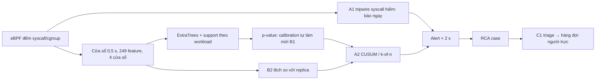

# Ý tưởng từ tài liệu cho Sentinel Pulse

Tổng hợp research sâu ngày 21/10/2026. File này để dùng **sau khi** hoàn tất hướng hiện tại:
- lượt live `pulse-stable-refreshed`, kiểm cấu hình luật v2;
- kiểm blind CUSUM/Cauchy;
- thí nghiệm nhóm feature;
- phép thử 5.7d.

Kết quả thí nghiệm nằm trong [SENTINEL_PULSE_STATUS.md](SENTINEL_PULSE_STATUS.md). File này chỉ chứa **ý tưởng, tài liệu và kế hoạch kiểm**. Các số mục như 5.6b, 5.7b, 5.8c… là mục trong báo cáo Pulse; "syscall 5.9", "syscall 5B" là mục trong [SYSCALL_FEATURE_EXPERIMENT_STATUS.md](SYSCALL_FEATURE_EXPERIMENT_STATUS.md).

**Độ tin cậy của nguồn:** phần lớn số liệu dưới đây do chính tác giả các paper báo cáo; một số là preprint chưa qua phản biện. Đây là nguồn ý tưởng, chưa phải bằng chứng cho Pulse. Mỗi ý tưởng phải được đăng ký tiêu chí trước, rồi đo trên dữ liệu của Pulse, ở cùng ngân sách cảnh báo, với p95 kernel → alert < 2 s ưu tiên và ≤ 3 s chấp nhận.

## Đánh giá tổng thể đồ án và định hướng paper (21/10 11:46)

**Mục tiêu:** đồ án phục vụ luận văn tốt nghiệp **và** một paper đủ mạnh để xin học bổng thạc sĩ. Hội nghị bảo mật hàng đầu chấm theo bốn tiêu chí: đóng góp mới, độ chặt của đánh giá, baseline và khả năng tái lập. Cụ thể là:
- top-4: USENIX Security, ACM CCS, NDSS, IEEE S&P;
- vừa sức hơn: RAID, ACSAC, EuroS&P, DIMVA.

### Đang mạnh ở đâu

1. **Đánh giá live trên ứng dụng thật:** lượt 24 giờ trên ứng dụng AIMS (21 workload, ~80 pod, 3 worker), 315 cặp control → binary vô hại → attack mỗi lượt. Các công trình gần nhất chủ yếu đánh giá offline trên trace 10–30 s (mục 3).
2. **Đo đúng ràng buộc vận hành:**
   - độ trễ kernel → alert, p95 1,85–1,96 s;
   - gánh cảnh báo theo replica-giờ trên toàn bộ normal;
   - CPU worker 13–31% một core.
   
   Hầu như không công trình nào cùng nhóm báo đủ ba thứ này.
3. **Đối chứng binary vô hại chạy cùng đường exec với attack.** Đối chứng này lộ ra phát hiện quan trọng: detector bắt "hoạt động mới" chứ không bắt "ác ý" (80–94% binary vô hại bị gắn cờ). Các paper khác không đo.
4. **Phương pháp chặt:**
   - đăng ký tiêu chí trước mọi lựa chọn (luật v1, v2, 5.7b, 5.7c, 5B);
   - bootstrap theo workload;
   - replay khớp đúng số live;
   - kiểm tái lập từng bit (chấm nhanh, nhóm feature);
   - ghi lại cả lỗi của mình (đếm đôi α×1, luật hạ quyền).
5. **Ablation có bằng chứng cho bộ feature:**
   - 29 syscall: không cấu hình nào thắng; bỏ cặp exec thì kém có ý nghĩa; thêm syscall làm chậm p95 tới 5 s;
   - hai nhánh p-value đều cần;
   - nhóm feature: đang chấm.
6. **Kết quả âm có giá trị đo đạc:**
   - calibration cũ đi theo ngày; làm mới thì −22,8% cảnh báo và precision từ 92 lên 96%;
   - chỉ đếm tần suất thì yếu với attack tần suất thấp;
   - độ bền tín hiệu tách được attack khỏi process vô hại nhưng tốn thời gian.
7. **Hệ thống trọn vẹn:** eBPF → model theo workload → p-value conformal → alert < 2 s → RCA. RCA có coverage 86,7% và xếp hạng nghi phạm top-1 99,6% (sau khi sửa luật hạ quyền).
8. **Lần đầu đạt cả 4 kỳ vọng (trên replay):** k2of2_a10 + calibration làm mới cho precision 96,3%, recall 99,4%, control 3,9%, p95 1,96 s. Lượt live `pulse-stable-refreshed` đang chờ xác nhận.

### Khoảng cách còn lại

Xếp theo mức reviewer sẽ phạt nặng:

| # | Khoảng cách | Vì sao quan trọng | Hướng xử lý |
|---|---|---|---|
| G1 | **Baseline trên cùng dữ liệu: đã có kết quả development (21/10), chờ lặp lại trên dữ liệu mới** | Câu hỏi đầu tiên của reviewer: hơn STIDE/BoSC, autoencoder tần suất (CDL), Isolation Forest, luật Falco bao nhiêu? | Pulse 5.15a (cùng feature, conformal, k2of2, ngân sách khớp): Isolation Forest kém hẳn; freq_profile kiểu BoSC tách binary vô hại tốt nhất (16%) nhưng bỏ sót 37% attack; **autoencoder bắt attack ngang hoặc hơn Pulse, gánh cảnh báo thấp hơn khoảng 9 lần ở cùng recall, nhanh hơn (p95 1,1 s so với 2,8 s), nhưng gắn cờ binary vô hại khoảng 100%**; base29 chỉ hơn AE ở khả năng tách binary vô hại. Đã đăng ký lặp lại trên `pulse-stable-refreshed`, kèm ứng viên `tree_ae` (tree của Pulse + AE) và luật chọn bộ chấm (5.15b). STIDE không tái lập được vì Pulse chỉ ghi số đếm; nó thuộc phần LID-DS (G3). Luật Falco: chưa làm |
| G2 | **Tấn công là fixture tự viết** (`ptrace`/`setns`/`execveat`/`mprotect`/`seccomp` theo nhịp) | Dễ bị chê là "tấn công nhân tạo, có lợi cho detector" | Thêm exploit thật (vài CVE container) trong namespace thử nghiệm riêng |
| G3 | **Chưa có dataset công khai** | Không có điểm so sánh công bằng với tài liệu; chưa chứng minh tổng quát hóa | LID-DS 2021 (R8): bộ chuyển đổi sang khung 500 ms |
| G4 | **Chưa có kẻ tấn công thích nghi** | Hội nghị top luôn hỏi về né tránh: tấn công chậm, trải dài, bắt chước normal | 21/10 (Pulse 5.15c): trên dữ liệu có sẵn, attack 6/s làm Pulse giảm còn 95,6% và p95 3,75 s ở ngân sách 1, trong khi AE không đổi. Còn thiếu: mức 1–3/s và attack trải dài ở campaign sau; lập luận mimicry |
| G5 | **Vấn đề process mới vô hại chưa giải** (giải được một phần: novelty bỏ tập exec tách 100%/0% cho lớp syscall hiếm, 5.7c) | Đây là điểm yếu cốt lõi; muốn lên top-4 cần một cải tiến giải được nó | Đặc trưng theo tham số syscall (R7a), tripwire trừ tập exec (A1), triage bằng cây process (C1) |
| G6 | **Gánh cảnh báo vẫn ~65 lần ngân sách 0,1/giờ** | Ảnh hưởng tính khả thi khi vận hành | Calibration tự làm mới (B1), CUSUM (A2), so sánh replica (B2), FDR (R6) |
| G7 | **Overhead mới đo sơ bộ** | Cần cho phần hệ thống | A/B CPU và độ trễ ứng dụng có/không Pulse |
| G8 | **Chưa có review nhãn và blind test độc lập đầy đủ** | Nhãn hiện là nhãn kỳ vọng; kịch bản attack đã dùng khi phát triển | Review một mẫu cảnh báo normal; campaign mới với exploit thật |
| G9 | **Chưa có artifact mở và bản thảo** | Cần cho huy hiệu artifact evaluation và cho luận văn | Gói script tái lập + dữ liệu ẩn danh; viết luận văn và paper tiếng Anh |

### Đề xuất

**Câu chuyện paper:** *Phát hiện bất thường bằng tần suất syscall cho Kubernetes dưới ràng buộc vận hành thật: độ trễ, gánh cảnh báo và process mới vô hại.*

Ba đóng góp:
1. **Hệ thống Pulse:**
   - eBPF đếm syscall theo cgroup, model thời gian theo workload;
   - p-value conformal kiểm soát báo nhầm, chấm điểm nhanh khớp từng bit;
   - alert < 2 s, RCA từ Tetragon xếp hạng nghi phạm.
2. **Đánh giá live chặt chẽ nhất trong nhóm này,** với 3 phát hiện có số liệu và CI:
   - detector tần suất bắt "mới" chứ không bắt "ác ý";
   - calibration là đòn bẩy lớn nhất, chọn bộ syscall thì không;
   - thêm feature làm chậm phát hiện.
3. **Cải tiến có bằng chứng** cho gánh cảnh báo và process vô hại: calibration tự làm mới, CUSUM, đặc trưng theo tham số hoặc tripwire, triage. Mỗi cải tiến kiểm blind.

**Điều chỉnh sau G1 (21/10):** trên cùng dữ liệu, bộ chấm ExtraTrees của Pulse không hơn autoencoder về recall và gánh cảnh báo; nó chỉ hơn ở khả năng tách binary vô hại. Vì vậy đóng góp 1 không nên nhấn vào bản thân bộ chấm. Nên nhấn vào: khung đánh giá vận hành, so sánh công bằng nhiều bộ chấm trong cùng khung, và tín hiệu bổ sung (tripwire A1). Bộ chấm sẽ đổi sang AE hoặc `tree_ae` nếu lần lặp lại trên dữ liệu mới (5.15b) đạt luật chọn đã đăng ký.

**Đích nhắm thực tế:**
- RAID/ACSAC: khả thi nếu xong G1–G4 và G7–G9;
- top-4: cần thêm G5 (giải được process vô hại), có bằng chứng trên cả LID-DS lẫn live.

**Thứ tự đề xuất** (sau khi xong hướng hiện tại):
1. Xác nhận cấu hình v2 trên `pulse-stable-refreshed`; kiểm blind CUSUM/Cauchy; xong nhóm feature và 5.7d.
2. **G1 baseline:** đã có kết quả development (21/10); lặp lại trên dữ liệu mới chạy tự động sau lượt live; còn luật Falco.
3. **G3 LID-DS** và **G2 exploit thật** + **G4 tốc độ thấp:** đưa vào campaign của lượt live sau.
4. **G5:** tripwire trừ tập exec (sau 5.7c), rồi đặc trưng theo tham số nếu cần.
5. **G6:** calibration tự làm mới trong live; so sánh replica.
6. **G7, G8, G9:** overhead, review nhãn, artifact, viết.

### Đánh giá tiến độ (% hoàn thiện, 21/10)

Đây là ước lượng chủ quan, dựa trên khối việc còn lại; không phải đo chính xác.

| Hạng mục | % | Đã có | Còn thiếu |
|---|---:|---|---|
| Hệ thống Pulse (thu thập, model, chấm nhanh, alert) | ~90% | Chạy ổn định 24 giờ, 7 issue, CPU 13–31% | Calibration tự làm mới trong live; tripwire |
| Đánh giá Pulse cho luận văn | ~75% | 3 lượt live, campaign có đối chứng, luật chọn đăng ký trước, đạt 4 kỳ vọng trên replay | Xác nhận live của cấu hình v2; review nhãn |
| Thí nghiệm syscall + nhóm feature | ~90% | Kết luận syscall có CI; nhánh p-value; fit 693 model nhóm feature | Giai đoạn B nhóm feature (chấm holdout, so ngân sách) |
| RCA | ~85% | Coverage 86,7%, top-1 99,6%, preview → case p50 2,2 s | Kiểm luật hạ quyền trên dữ liệu mới; giảm case gộp |
| **Luận văn (tổng thể, gồm viết)** | **~65–70%** | Số liệu và bằng chứng đầy đủ trong 3 báo cáo | Viết chương; hình; xác nhận live cuối |
| Baseline (G1) | ~65% | 3 baseline có kết quả development kèm CI; đăng ký lặp lại trên dữ liệu mới với `tree_ae` | Lặp lại trên dữ liệu mới (22/10); luật Falco; STIDE trên LID-DS |
| Dataset công khai (G3) | 0% | | Toàn bộ |
| Exploit thật, kẻ tấn công thích nghi (G2, G4) | ~5% | Fixture có tham số tốc độ | Campaign mới |
| Ablation | ~70% | Syscall, nhánh p-value | Nhóm feature giai đoạn B; họ model |
| Overhead (G7) | ~30% | CPU worker trong vận hành | A/B có kiểm soát |
| Blind test, review nhãn (G8) | ~20% | `pulse-stable-refreshed` sắp chạy | Review nhãn; campaign exploit thật |
| Artifact mở (G9) | ~40% | Repo, script, biên nhận bằng chứng, CI | Gói tái lập, dữ liệu ẩn danh, hướng dẫn |
| Bản thảo paper | 0% | Tài liệu tham khảo (mục 3) | Toàn bộ |
| **Mức sẵn sàng cho paper hàng đầu** | **~30%** | Hệ thống + đánh giá live mạnh | G1–G5, G7–G9 |

## Trạng thái các ý tưởng (21/10)

| Ý tưởng | Trạng thái |
|---|---|
| R4 gộp p-value Cauchy, R5/A2 CUSUM thay k-of-n | Đã sàng lọc offline trên khoảng campaign (Pulse 5.11a); tham số đóng băng (`cauchy_a10`, `cusum_b3_h6`); chờ kiểm blind trên `pulse-stable-refreshed`. Script: `scripts/analysis/ideas_screen.py`, `scripts/analysis/ideas_burden.py` |
| A1 tripwire syscall hiếm | **5.7c xong (21/10, dữ liệu mới, đăng ký trước):** novelty bỏ tập exec E cho attack `ptrace`/`execveat`/`setns` 100% so với binary vô hại 0% (tổng binary vô hại 0,3%, 1/315; control 0%). `mprotect`/`seccomp` không bắt được (0%), nên tiêu chí tổng 90% không đạt (60%). Đây là bằng chứng mạnh nhất cho G5 với lớp attack dùng syscall hiếm: ghép với Pulse ML (bắt `mprotect`/`seccomp`) thành tripwire + ML. **Kiểm blind đã đăng ký 21/10 14:56** (`sentinel_pulse/protocol/tripwire-a1-blind-v1.json`): lặp lại trên pulse-stable-refreshed với cùng E; có thêm độ trễ (p95 ≤ 2 s) và tham chiếu chỉ 90 phút trước attack, tức tham chiếu mà tripwire live có được |
| B1 calibration tự làm mới | Phần gần nhất là 5.7d (làm mới định kỳ + k2of2), chạy sau lượt live; ACI/PID và Mondrian chưa làm |
| Các ý tưởng còn lại | Chưa làm |

## 1. Ý tưởng theo từng vấn đề tồn đọng

**Cách làm:** tìm paper cho 5 vấn đề:
1. calibration trôi theo thời gian và theo node;
2. không tách được process mới vô hại;
3. gánh cảnh báo normal cao;
4. đuôi độ trễ do k-of-n liên tiếp;
5. kiểm định đồng thời trên ~80 container.

Phần lớn bằng chứng là kết quả do chính tác giả báo cáo; một số là preprint chưa qua phản biện. Đây là **nguồn ý tưởng, không phải bằng chứng cho Pulse**. Mỗi ý tưởng cần đăng ký trước và kiểm trên dữ liệu của mình.

| # | Vấn đề | Ý tưởng / tài liệu | Áp vào Pulse | Kiểm thế nào, chi phí |
|---|---|---|---|---|
| R1 | Calibration trôi (control live 8,4% so với 4,8% dev) | **Adaptive Conformal Inference** (Gibbs & Candès 2021); **Conformal PID control** (Angelopoulos, Candès, Tibshirani, NeurIPS 2023): chỉnh mức α online để giữ tỉ lệ lỗi dài hạn dưới dịch chuyển | Mỗi workload giữ một α_t: tăng hoặc giảm theo tỉ lệ dương thực tế trên normal so với mục tiêu (ví dụ control 5%) | Replay offline trên `tree_score`/`support_score` đã lưu (soak 48 giờ + pulse-stable-candidate); so với `static`, `rolling` (5.6, 5.7d). **Rẻ, không fit lại** |
| R2 | Calibration không khớp từng node (worker3 gấp 2,7–4,7 lần, 5.6b) | **Mondrian / group-conditional conformal**: hiệu chỉnh riêng từng nhóm thì bảo đảm theo từng nhóm. Nhóm phải cố định trước, không chọn sau khi xem điểm | Calibration theo cặp (workload, node); mỗi ô cần ≥ 1.200 điểm (~10 phút normal mỗi replica) | Replay offline. Nhóm = node, cố định từ trước (đúng giả thuyết 5.6b). **Rẻ** |
| R3 | Trôi do tải, cập nhật, chế độ traffic | **REPLICAWATCHER** (NDSS 2024): so sánh các **replica** cùng image, không cần huấn luyện. Thay đổi chung cho mọi replica bị triệt tiêu; replica lệch khỏi các replica còn lại mới là bất thường. Precision 91%, recall 98% | Chuẩn hóa điểm của một container theo các replica cùng workload ở cùng cửa sổ, ví dụ điểm trừ trung vị replica | Offline trên decisions đã lưu, với workload có ≥ 3 replica. **Giới hạn:** paper dùng khoảng 30 s (Pulse cần ≤ 3 s); StatefulSet có vai trò khác nhau (redis master/replica, kafka); hiệu ứng node (worker3) làm replica khác node lệch nhau; binary vô hại chạy trên một replica vẫn nổi bật. **Trung bình** |
| R4 | Gộp p-value 2 nhánh (đang 2·min, Bonferroni) | **Cauchy combination test** (Liu & Xie, JASA 2020) và harmonic mean (Wilson 2019): gộp p-value phụ thuộc, có p-value giải tích. Chen (2022): minP có thể mạnh hơn trong một số điều kiện, nên phải kiểm thực nghiệm | joint_p = gộp Cauchy của tree_p, support_p | Offline từ `tree_p`/`support_p` đã lưu; so ở cùng ngân sách như syscall 5B.1. **Rất rẻ** |
| R5 | Đuôi độ trễ do k2of2 đòi 2 cửa sổ liên tiếp (5.8c) | **Conformal test martingale / conformal CUSUM, Shiryaev–Roberts** (Vovk et al. 2021; "Retrain or not retrain"); e-detector: dồn bằng chứng tuần tự, có giới hạn tần suất báo nhầm, không đòi liên tiếp | Thay k-of-n bằng CUSUM trên −log p của từng container | Replay offline chuỗi `joint_p` của campaign và normal; so độ trễ ở cùng control/ngân sách. **Rẻ** |
| R6 | Precision trên cả cụm, báo nhầm trên nhiều container cùng lúc | **Testing for outliers with conformal p-values** (Bates, Candès, Lei, Romano, Sesia, Ann. Stat. 2023): conformal p-value phụ thuộc dương nên BH kiểm soát FDR. **Online FDR bằng e-value**: e-LOND, e-GAI (ICML 2025) | Mỗi nhịp 0,5 s áp BH trên p-value của mọi container, hoặc online FDR theo thời gian, để kiểm soát *tỉ lệ cảnh báo sai trong số cảnh báo* (đúng nghĩa precision) | Offline; cần bảo đảm độ trễ không tăng. **Rẻ–trung bình** |
| R7 | Binary vô hại mới bị gắn cờ 80–92% | **METANOIA** (2025) xác nhận "khởi tạo process mới" là nguồn báo nhầm điển hình; họ lọc bằng điểm đường đi trong đồ thị provenance và tương quan theo cửa sổ. **NODLINK** (NDSS 2024), **ORTHRUS** (USENIX Sec 2025) dùng đồ thị provenance để giảm báo nhầm. **Contextualizing system calls in containers** (2022): thêm ngữ cảnh thread/process giảm FAR. **eBPF-PATROL** (2025): seccomp chỉ lọc theo số syscall, cần kiểm cả tham số | (a) Đặc trưng **có điều kiện theo tham số** đếm ở syscall entry: `mprotect` với PROT_EXEC trên vùng nhớ ẩn danh, `ptrace` ATTACH/SEIZE, cờ `clone`/`unshare`/`setns`. Chúng tách hành vi của attack khỏi việc "chỉ là process mới". (b) Ghép ngữ cảnh RCA (cây process từ Tetragon) vào bậc triage sau alert | (a) cần sửa eBPF + capture mới + đánh giá như thí nghiệm nhóm feature: **đắt**. (b) dùng dữ liệu RCA sẵn có: **trung bình** |
| R8 | Chưa có blind test độc lập | **LID-DS 2021** (Leipzig): dataset syscall trong container Docker, kèm tham số, giá trị trả về, thread; attack chèn ở thời điểm ngẫu nhiên; có bộ đánh giá chung | Huấn luyện và đánh giá pipeline Pulse trên normal và attack của LID-DS như một kiểm chứng bên ngoài | Cần bộ chuyển đổi từ LID-DS sang khung 500 ms của Pulse. **Đắt** nhưng có giá trị cho luận văn |

**Thứ tự đề xuất:**
- **R4, R5, R1, R2** trước, vì kiểm được offline trên điểm đã lưu, không fit lại và không cần capture mới.
- Tiếp theo **R6, R3**.
- **R7a** và **R8** để sau, vì cần sửa eBPF hoặc thêm dataset ngoài.

Mỗi phép kiểm sẽ được đăng ký tiêu chí trước, rồi so ở cùng ngân sách cảnh báo, với p95 < 2 s ưu tiên và ≤ 3 s chấp nhận.

## 2. Ý tưởng tối ưu mô hình và kiến trúc

**Kiến trúc hiện tại:**
1. eBPF đếm syscall theo cgroup;
2. snapshot 0,5 s → vector 249 chiều → context 4 cửa sổ;
3. mỗi workload có model riêng: ExtraTrees phân biệt (lịch sử → hiện tại) + nhánh support;
4. p-value conformal → k-of-n;
5. preview;
6. RCA (Tetragon) dựng case.

**Các điểm đo được làm cơ sở:**
- p95 alert 1,85 s, phần lớn là chờ cửa sổ cộng xác nhận (5.8c); chấm điểm không còn là nút thắt (CPU worker 13–31%);
- gánh cảnh báo do calibration cũ (5.7b, 5.6b, syscall 5.9);
- binary vô hại bị gắn cờ 92%;
- 7 syscall bảo mật bằng 0 trên 185 triệu lượt gọi normal (syscall C3); `ptrace`/`setns`/`execveat` bắt được 100% (syscall 5.8, 5.9).

**Nguồn tài liệu:** phần lớn là kết quả do chính tác giả báo cáo; một số là preprint. Đây là nguồn ý tưởng; mỗi ý cần đăng ký trước và đo trên Pulse.

| Tầng | Ý tưởng | Tài liệu | Lợi ích dự kiến cho Pulse | Chi phí / rủi ro |
|---|---|---|---|---|
| Độ trễ | **A1. Đường nhanh "tripwire" cho syscall bảo mật hiếm.** Khi container gọi syscall thuộc tập hiếm của chính workload đó, báo ngay qua ring buffer, không chờ cửa sổ 0,5 s và k-of-n | IDS lai signature + anomaly: signature ít báo nhầm, anomaly bắt cái mới (CONDOR; khảo sát hybrid IDS) | Với lớp attack `ptrace`/`setns`/`execveat`: độ trễ từ ~1 s xuống ~ms. Phải loại các syscall do cơ chế exec sinh ra (`seccomp`, `capget`…, 5.5b), vì chúng xuất hiện ở binary vô hại. Kết quả 5.7c (novelty có xét exec) quyết định tập này | Sửa loader eBPF + collector; kiểm trên campaign mới. **Trung bình** |
| Độ trễ | **A2. CUSUM / martingale conformal thay k-of-n** (= R5) | Vovk et al. 2021; change detection với martingale conformal (2026) | Bỏ được kiểu "qua ngưỡng so le bị lỡ" của k2of2 (5.8c), có giới hạn tần suất báo nhầm | Offline trên `joint_p` đã lưu. **Rẻ** |
| Độ trễ | **A3. Cửa sổ ngắn hơn hoặc thích nghi** (250 ms, hay cửa sổ theo workload) | Khảo sát cửa sổ trên syscall trong Docker (SBC); cửa sổ động theo process | Cửa sổ ngắn báo nhanh hơn nhưng dễ cắt đôi hành vi, báo nhầm tăng; mỗi process có cửa sổ tối ưu riêng | Cần capture mới ở 250 ms. **Đắt**; chỉ làm nếu A1/A2 chưa đủ |
| Độ trễ | A4. Biên dịch rừng cây (Treelite, QuickScorer, Hummingbird) | So sánh nền tảng suy luận forest 2023; QuickScorer nhanh ~9 lần | Chấm điểm hiện không phải nút thắt | **Ưu tiên thấp** |
| Mô hình | **B1. Dịch vụ calibration tự làm mới**, có chống đầu độc: ACI/PID chỉnh α online (R1), calibration theo (workload, node) (R2); chỉ dùng cửa sổ đủ cũ, không bị gắn cờ, có độ trễ an toàn | ACI (Gibbs & Candès 2021); Conformal PID (NeurIPS 2023); Mondrian conformal; nghiên cứu khi nào nên retrain dưới drift (2026: ADWIN quá bảo thủ với drift chậm) | Đòn bẩy lớn nhất đã đo: calibration làm mới −22,8% cảnh báo, precision 92 → 96% (5.8g). Bản `guarded` của 5.6 hỏng, nên phải thiết kế chống đầu độc khác: dùng độ trễ thay cho lọc cửa sổ dương | Offline trên soak và lượt stable trước, rồi bật trong live. **Rẻ → trung bình** |
| Mô hình | **B2. Bộ dò so sánh replica** chạy song song với model theo workload | REPLICAWATCHER (NDSS 2024): precision 91%, recall 98%, không cần huấn luyện; luận án Twente 2025 về phát hiện không cần huấn luyện cho microservice | Thay đổi chung cho mọi replica (tải, cập nhật, chế độ traffic) tự triệt tiêu, nên bổ sung tốt cho B1 | Paper dùng khoảng 30 s; StatefulSet có vai trò khác nhau; hiệu ứng node; chỉ áp cho workload ≥ 3 replica. **Trung bình** |
| Mô hình | **B3. So họ model trong khung matched** (Isolation Forest, kNN/LOF, autoencoder, Deep SVDD so với ExtraTrees + support) | Chưa có benchmark nào trên vector đếm syscall container; benchmark chung 2024: Isolation Forest mạnh trên nhiều tập; DeepOD có sẵn cài đặt | Bằng chứng "vì sao chọn ExtraTrees + support" cho luận văn, đúng phần "họ model" đang ghi là giới hạn ở syscall 5B | Fit thêm 21 × K × 3 model trên cùng dữ liệu, cùng calibration, cùng ngân sách. **Trung bình** |
| Mô hình | **B4. Model dùng chung + calibration riêng** cho workload hoặc revision mới (cold start) | Transfer theo cụm: độ chính xác ngang model riêng, 40% thời gian huấn luyện (ACM TAAS 2025); ShareAD (pre-train dùng chung) | Hiện workload chưa có model thì không được chấm. Model dùng chung giúp có điểm ngay khi deploy | Kiểm leave-one-workload-out. **Trung bình–đắt** |
| Mô hình | B5. Model ngôn ngữ / Transformer trên chuỗi syscall | LSTM syscall LM; Transformer trên ma trận bigram (SBSeg 2024: F1 0,90 so với 0,92, nhanh hơn nhiều) | Pulse đếm chứ không lưu chuỗi; bin cặp syscall đã là bigram băm. Khó giữ p95 < 2 s | **Ưu tiên thấp** |
| Quyết định | **C1. Triage hai tầng:** preview < 2 s giữ nguyên; tầng sau (luật xác định hoặc LLM) chấm điểm case RCA để quyết định cái nào lên hàng đợi người trực | LLM triage: SIABench (mẫu nhỏ, 35 alert), CORTEX (NeurIPS 2025, đa agent); chuẩn người: tier-2 loại 70–80% báo nhầm | Giảm gánh cảnh báo *mà người trực thấy*, không làm chậm alert. Tín hiệu đã có: binary mới, thao tác bảo mật (sau khi bỏ hạ quyền lúc khởi chạy), độ bền tín hiệu (5.8b), độ lệch so với replica (B2) | Bắt đầu bằng luật xác định đo được trên 4.006 case. **Trung bình** |
| Quyết định | C2. Kiểm soát FDR toàn cụm (= R6) | Bates et al. 2023; e-GAI (ICML 2025) | Kiểm soát *tỉ lệ cảnh báo sai trong số cảnh báo* trên ~80 container | **Rẻ–trung bình** |
| Đánh giá | D1. Blind test bên ngoài trên LID-DS (= R8) | LID-DS 2021 | Kiểm chứng độc lập cho luận văn | **Đắt** |

**Kiến trúc đề xuất** (giữ nguyên lõi đã có bằng chứng: 249 feature, base29, ExtraTrees + support, chấm nhanh):

**Thứ tự đề xuất:**
1. Offline, rẻ: B1 (ACI/Mondrian/rolling), A2, R4. Chạy trên điểm đã lưu sau khi chuỗi phân tích nặng xong.
2. A1 tripwire: 5.7c đã cho tập exec E. Không cần sửa eBPF, vì worker đã ghi full-ID delta mỗi cửa sổ 500 ms. Kiểm blind (kèm độ trễ) đã đăng ký 21/10 14:56 trên pulse-stable-refreshed; nếu đạt thì mới nối vào luồng live.
3. B2, C1, B3.
4. B4, D1.

Mỗi bước giữ cách làm cũ: đăng ký tiêu chí trước, so ở cùng ngân sách, p95 < 2 s ưu tiên và ≤ 3 s chấp nhận.

## 3. Công trình liên quan và so sánh

**Kết luận ngắn:** chưa tìm thấy công trình nào trùng toàn bộ hướng của Pulse:
- eBPF đếm syscall theo cgroup;
- model thời gian riêng cho từng workload, p-value conformal, xác nhận k-of-n;
- chạy live trên ứng dụng Kubernetes thật;
- đo độ trễ kernel → alert và gánh cảnh báo theo giờ;
- có đối chứng binary vô hại.

Có nhiều công trình trùng **từng phần**. Một số báo cáo kết quả cao hơn, nhưng **đo theo cách khác**, nên không so trực tiếp được.

| Công trình | Dữ liệu / đặc trưng | Mô hình | Cách đánh giá | Kết quả báo cáo | Khác Pulse |
|---|---|---|---|---|---|
| **BoSC trong container** (Abed, Clancy, Levy, STM 2015) | Túi tần suất syscall theo cửa sổ trượt, thu từ kernel host | So khớp túi tần suất với normal | Một ứng dụng cơ sở dữ liệu | (đánh giá nhỏ) | Gần nhất về ý tưởng "tần suất syscall theo container"; không có độ trễ, gánh cảnh báo hay live K8s |
| **CDL** (dùng làm baseline trong REPLICAWATCHER) | Tần suất syscall | Autoencoder, ngưỡng trên lỗi tái tạo | 1.000 trace normal + 100 attack mỗi kịch bản, mỗi trace 30 s | **Recall < 50%** ở nhiều kịch bản | Cảnh báo về giới hạn của "chỉ tần suất": bỏ lỡ attack tần suất thấp. Ở Pulse, điểm yếu tương tự là `mprotect`/`seccomp` |
| **CHIDS** (El Khairi et al., ACM CCSW 2022) | Syscall chưa từng thấy, **tham số** chưa từng thấy, tần suất; đồ thị ngữ cảnh | Autoencoder trên đồ thị | 11.700 trace normal + 1.980 attack, 20 kịch bản; trace 30 s | Precision 97–100%, recall 96–100% (theo bảng của REPLICAWATCHER) | Dùng tham số syscall (Pulse chưa có). Đánh giá offline, cân bằng, theo trace 30 s; không có độ trễ < 3 s, gánh cảnh báo hay đối chứng process vô hại |
| **REPLICAWATCHER** (El Khairi et al., NDSS 2024) | Syscall, file, mạng, process theo replica | So sánh các replica, không huấn luyện | 13 kịch bản CVE/CWE, khoảng 30 s | Precision 91,1%, recall 98,4% | Chống trôi bằng replica; độ trễ ≥ 30 s; giả định attack không chạm mọi replica cùng lúc |
| **FedMon** (arXiv 2025) | eBPF syscall + mạng trên K8s (DaemonSet) | VAE federated + Isolation Forest | 3 cluster `kind` trên một máy; nginx/redis; 3 kiểu attack | Precision 94%, recall 91%, F1 0,92 | Không báo FPR hay độ trễ; quy mô nhỏ; theo node, không theo pod |
| **KubAnomaly** (Tien et al., Engineering Reports 2019) | Giám sát container trên K8s | Mạng nơ-ron 4 lớp (có giám sát) | Dữ liệu riêng, công khai, thực tế; nhãn mỗi 10 s | Accuracy 96% | Học có giám sát, cần nhãn attack; khoảng 10 s |
| **sentinel-ebpf** (đồ án danh dự, Pretoria 2026) | 6 tracepoint eBPF (execve, openat, connect, setuid, clone, ptrace), cửa sổ 20 sự kiện | Isolation Forest, autoencoder, LSTM | Dữ liệu tự sinh, một node | AUC 0,73–0,78; FPR 2,5–9,4% | Phát hiện phụ thuộc chủ yếu vào đặc trưng **cây process** (bỏ đi thì AUC dưới ngẫu nhiên) |
| **Conformal false-alarm control cho IDS** (O-RAN, ICML 2026) | Lưu lượng 5G | Autoencoder + khoảng cách Mahalanobis + split conformal | So ở cùng mức báo nhầm mục tiêu | Tỉ lệ phát hiện cao hơn baseline conformal; độ trễ cỡ µs | Cùng ý tưởng ngưỡng conformal như Pulse, nhưng cho mạng |

**Nhận xét cho luận văn:**
1. **Pulse đánh giá chặt hơn các công trình trên** ở bốn điểm: dữ liệu live 24 giờ trên ứng dụng thật (21 workload, ~80 pod); đo **độ trễ kernel → alert** (p95 ~1,9 s); đo **gánh cảnh báo theo replica-giờ** trên toàn bộ normal; có **đối chứng binary vô hại** chạy cùng đường exec với attack. Các công trình khác chủ yếu báo precision/recall trên tập trace cân bằng, cửa sổ 10–30 s, không có đối chứng process vô hại.
2. Precision 97–100% của CHIDS hay 91% của REPLICAWATCHER **không so trực tiếp** với 92–96% của Pulse được, vì đơn vị (trace 30 s so với khoảng 15 s), tỉ lệ normal/attack và định nghĩa báo nhầm đều khác.
3. **Bài học từ tài liệu khớp với kết quả của Pulse:**
   - chỉ tần suất thì yếu với attack tần suất thấp (CDL; `mprotect`/`seccomp` của Pulse);
   - tham số syscall và ngữ cảnh process là thứ giúp tách hành vi (CHIDS, sentinel-ebpf). Điều này ủng hộ hướng R7a (đặc trưng theo tham số) và C1 (triage dùng cây process từ RCA);
   - baseline cũ đi nhanh trong microservice (REPLICAWATCHER), khớp với 5.6b và 5.7b.
4. **Khả năng tái lập:** chưa có dataset chung giữa các công trình. Chạy Pulse trên LID-DS (R8), dataset mà CHIDS/REPLICAWATCHER-style work cũng dùng làm chuẩn, sẽ cho một điểm so sánh công bằng.

## Nguồn

- [ACI cho chuỗi thời gian (Zaffran et al., ICML 2022)](https://proceedings.mlr.press/v162/zaffran22a.html)
- [Conformal PID control](https://ar5iv.labs.arxiv.org/html/2307.16895)
- [Mondrian conformal (MAPIE)](https://mapie.readthedocs.io/en/stable/theoretical_description_mondrian.html)
- [Conformal calibration / look-elsewhere](https://arxiv.org/pdf/2606.13780)
- [REPLICAWATCHER, NDSS 2024](https://www.ndss-symposium.org/wp-content/uploads/2024-286-paper.pdf)
- [Cauchy combination test](https://arxiv.org/pdf/1808.09011)
- [Change detection with conformal martingales](https://arxiv.org/pdf/2609.27179)
- [Testing randomness online (Vovk 2021)](https://projecteuclid.org/journals/statistical-science/volume-36/issue-4/Testing-Randomness-Online/10.1214/20-STS817.full)
- [Testing for outliers with conformal p-values](https://arxiv.org/pdf/2104.08279)
- [e-GAI online FDR](https://proceedings.mlr.press/v267/zhang25cd.html)
- [METANOIA](https://arxiv.org/html/2501.00438)
- [NODLINK](https://www.ndss-symposium.org/wp-content/uploads/2024-204-paper.pdf)
- [ORTHRUS](https://tfjmp.org/publications/2025-usenixsec.pdf)
- [Contextualizing system calls in containers](https://www.researchgate.net/publication/365185410_Contextualizing_System_Calls_in_Containers_for_Anomaly-Based_Intrusion_Detection)
- [eBPF-PATROL](https://arxiv.org/pdf/2511.18155v1)
- [LID-DS 2021](https://dbs.uni-leipzig.de/file/CRITIS_2022_Extended_Abstract_LID-DS-2021.pdf)
- [Weighted conformal under covariate shift](https://arxiv.org/abs/1904.06019)
- [Training-less IDS in containerized microservices (Twente)](https://www.utwente.nl/en/eemcs/events/2025/11/654945/phd-defence-asbat-el-khairi-training-less-anomaly-based-intrusion-detection-in-containerized-microservices)
- [CONDOR hybrid IDS](https://shura.shu.ac.uk/5246/)
- [Cửa sổ syscall trong Docker (SBC)](https://sol.sbc.org.br/index.php/errc/article/download/15203/15047)
- [So sánh nền tảng suy luận forest](https://ar5iv.labs.arxiv.org/html/2302.04430)
- [Hummingbird](https://www.microsoft.com/en-us/research/publication/a-tensor-compiler-for-unified-machine-learning-prediction-serving/)
- [Benchmark anomaly detection 2024](https://arxiv.org/html/2402.07281v3)
- [DeepOD](https://github.com/xuhongzuo/DeepOD)
- [Transfer learning cho anomaly detection ở edge](https://arxiv.org/pdf/2408.12855)
- [ShareAD](https://api.crossref.org/works/10.1145%2F3712195)
- [Transformer + phân loại syscall (SBSeg)](https://sol.sbc.org.br/index.php/sbseg/article/view/36676)
- [LSTM system-call LM](https://ar5iv.labs.arxiv.org/html/1611.01726)
- [Khi nào nên retrain dưới drift](https://arxiv.org/pdf/2608.19488)
- [SIABench](https://arxiv.org/pdf/2603.06422)
- [CORTEX](https://neurips.cc/virtual/2025/137134)
- [SIR-Bench](https://arxiv.org/pdf/2604.12040)
- [CNN trong kernel bằng eBPF](https://link.springer.com/chapter/10.1007/978-981-95-8417-8_34)
- [Dynamic fixed-point trong eBPF](https://dl.acm.org/doi/fullHtml/10.1145/3674213.3674219)
- [BoSC trong container](https://arxiv.org/pdf/1611.03056)
- [CHIDS, CCSW 2022](https://research.utwente.nl/en/publications/contextualizing-system-calls-in-containers-for-anomaly-based-intr/)
- [FedMon](https://arxiv.org/html/2510.10126)
- [KubAnomaly](https://pure.lib.cgu.edu.tw/en/publications/kubanomaly-anomaly-detection-for-the-docker-orchestration-platfor/)
- [sentinel-ebpf](https://github.com/Murashidzi/sentinel-ebpf)
- [Conformal false-alarm control cho O-RAN](https://icml.cc/virtual/2026/78428)
