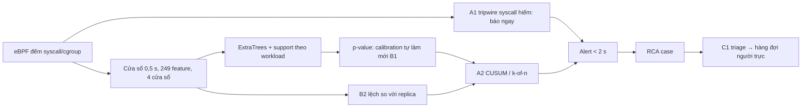

# Ý tưởng từ tài liệu cho Sentinel Pulse

Tổng hợp research sâu ngày 21/10/2026 (đợt 1 buổi sáng; đợt 2 buổi tối, mục 4). File này để dùng **sau khi** hoàn tất hướng hiện tại:
- lượt live `pulse-stable-refreshed`, kiểm cấu hình luật v2;
- kiểm blind CUSUM/Cauchy;
- thí nghiệm nhóm feature;
- phép thử 5.7d.

Kết quả thí nghiệm nằm trong [SENTINEL_PULSE_STATUS.md](SENTINEL_PULSE_STATUS.md). File này chỉ chứa **ý tưởng, tài liệu và kế hoạch kiểm**. Các số mục như 5.6b, 5.7b, 5.8c… là mục trong báo cáo Pulse; "syscall 5.9", "syscall 5B" là mục trong [SYSCALL_FEATURE_EXPERIMENT_STATUS.md](SYSCALL_FEATURE_EXPERIMENT_STATUS.md).

**Độ tin cậy của nguồn:** phần lớn số liệu dưới đây do chính tác giả các paper báo cáo; một số là preprint chưa qua phản biện. Đây là nguồn ý tưởng, chưa phải bằng chứng cho Pulse. Mỗi ý tưởng phải được đăng ký tiêu chí trước, rồi đo trên dữ liệu của Pulse, ở cùng ngân sách cảnh báo, với p95 kernel → alert < 2 s ưu tiên và ≤ 3 s chấp nhận.

## Đánh giá tổng thể đồ án(21/10 11:46)

Hội nghị bảo mật hàng đầu chấm theo bốn tiêu chí: đóng góp mới, độ chặt của đánh giá, baseline và khả năng tái lập. Cụ thể là:
- top-4: USENIX Security, ACM CCS, NDSS, IEEE S&P;
- vừa sức hơn: RAID, ACSAC, EuroS&P, DIMVA.

### Đang mạnh ở đâu

1. **Đánh giá live trên ứng dụng thật:** lượt 24 giờ trên ứng dụng AIMS (21 workload, ~80 pod, 3 worker), 315 cặp control → binary vô hại → attack mỗi lượt. Các công trình gần nhất chủ yếu đánh giá offline trên trace 10–30 s (mục 3).
2. **Đo đúng ràng buộc vận hành:**
   - độ trễ kernel → alert, p95 1,85–1,96 s;
   - gánh cảnh báo theo replica-giờ trên toàn bộ normal;
   - CPU worker 13–31% một core.
   
   Hầu như không công trình nào cùng nhóm báo đủ ba thứ này.
3. **Đối chứng binary vô hại chạy cùng đường exec với attack.** Đối chứng này lộ ra phát hiện quan trọng: detector bắt "hoạt động mới" chứ không bắt "ác ý" (80–94% binary vô hại bị gắn cờ). Các paper khác không đo.
4. **Phương pháp chặt:**
   - đăng ký tiêu chí trước mọi lựa chọn (luật v1, v2, 5.7b, 5.7c, 5B);
   - bootstrap theo workload;
   - replay khớp đúng số live;
   - kiểm tái lập từng bit (chấm nhanh, nhóm feature);
   - ghi lại cả lỗi của mình (đếm đôi α×1, luật hạ quyền).
5. **Ablation có bằng chứng cho bộ feature:**
   - 29 syscall: không cấu hình nào thắng; bỏ cặp exec thì kém có ý nghĩa; thêm syscall làm chậm p95 tới 5 s;
   - hai nhánh p-value đều cần;
   - nhóm feature: đang chấm.
6. **Kết quả âm có giá trị đo đạc:**
   - calibration cũ đi theo ngày; làm mới thì −22,8% cảnh báo và precision từ 92 lên 96%;
   - chỉ đếm tần suất thì yếu với attack tần suất thấp;
   - độ bền tín hiệu tách được attack khỏi process vô hại nhưng tốn thời gian.
7. **Hệ thống trọn vẹn:** eBPF → model theo workload → p-value conformal → alert < 2 s → RCA. RCA có coverage 86,7% và xếp hạng nghi phạm top-1 99,6% (sau khi sửa luật hạ quyền).
8. **Lần đầu đạt cả 4 kỳ vọng (trên replay):** k2of2_a10 + calibration làm mới cho precision 96,3%, recall 99,4%, control 3,9%, p95 1,96 s. **Xác nhận live 21/10 (`pulse-stable-refreshed`):** precision 96,0%, recall 100%, control 4,2%, p95 2,26 s. Đạt cả 4 kỳ vọng ở mức ≤ 3 s; mức < 2 s chưa đạt. CUSUM/Cauchy blind đưa p95 về 1,70 / 1,46 s; chờ gánh cảnh báo để kết luận.

### Khoảng cách còn lại

Xếp theo mức reviewer sẽ phạt nặng:

| # | Khoảng cách | Vì sao quan trọng | Hướng xử lý |
|---|---|---|---|
| G1 | **Baseline trên cùng dữ liệu: đã có kết quả development (21/10), chờ lặp lại trên dữ liệu mới** | Câu hỏi đầu tiên của reviewer: hơn STIDE/BoSC, autoencoder tần suất (CDL), Isolation Forest, luật Falco bao nhiêu? | Pulse 5.15a (cùng feature, conformal, k2of2, ngân sách khớp): Isolation Forest kém hẳn; freq_profile kiểu BoSC tách binary vô hại tốt nhất (16%) nhưng bỏ sót 37% attack; **autoencoder bắt attack ngang hoặc hơn Pulse, gánh cảnh báo thấp hơn khoảng 9 lần ở cùng recall, nhanh hơn (p95 1,1 s so với 2,8 s), nhưng gắn cờ binary vô hại khoảng 100%**; base29 chỉ hơn AE ở khả năng tách binary vô hại. Đã đăng ký lặp lại trên `pulse-stable-refreshed`, kèm ứng viên `tree_ae` (tree của Pulse + AE) và luật chọn bộ chấm (5.15b). STIDE không tái lập được vì Pulse chỉ ghi số đếm; nó thuộc phần LID-DS (G3). Luật Falco: chưa làm |
| G2 | **Tấn công là fixture tự viết** (`ptrace`/`setns`/`execveat`/`mprotect`/`seccomp` theo nhịp) | Dễ bị chê là "tấn công nhân tạo, có lợi cho detector" | Thêm exploit thật (vài CVE container) trong namespace thử nghiệm riêng; độ phủ theo ATT&CK và đường vào phân tích ở mục 5 (22/10): thiếu nhất là tấn công đi qua chính ứng dụng |
| G3 | **Chưa có dataset công khai** | Không có điểm so sánh công bằng với tài liệu; chưa chứng minh tổng quát hóa | LID-DS 2021 (R8): bộ chuyển đổi sang khung 500 ms. **Tạm hoãn (21/10):** máy chủ tải chính thức từ chối kết nối, host còn ~41 GB trống. Không cần cho luận văn; xem lại khi viết paper, vì reviewer thường đòi một dataset công khai để so với tài liệu và chạy STIDE |
| G4 | **Chưa có kẻ tấn công thích nghi** | Hội nghị top luôn hỏi về né tránh: tấn công chậm, trải dài, bắt chước normal | 21/10 (Pulse 5.15c): trên dữ liệu có sẵn, attack 6/s làm Pulse giảm còn 95,6% và p95 3,75 s ở ngân sách 1, trong khi AE không đổi. Còn thiếu: mức 1–3/s và attack trải dài ở campaign sau; lập luận mimicry |
| G5 | **Vấn đề process mới vô hại chưa giải** (giải được một phần: novelty bỏ tập exec tách 100%/0% cho lớp syscall hiếm, 5.7c) | Đây là điểm yếu cốt lõi; muốn lên top-4 cần một cải tiến giải được nó | Đặc trưng theo tham số syscall (R7a), tripwire trừ tập exec (A1), triage bằng cây process (C1) |
| G6 | **Gánh cảnh báo vẫn ~65 lần ngân sách 0,1/giờ** | Ảnh hưởng tính khả thi khi vận hành | Calibration tự làm mới (B1), CUSUM (A2), so sánh replica (B2), FDR (R6) |
| G7 | **Overhead mới đo sơ bộ** | Cần cho phần hệ thống | A/B CPU và độ trễ ứng dụng có/không Pulse |
| G8 | **Chưa có review nhãn và blind test độc lập đầy đủ** | Nhãn hiện là nhãn kỳ vọng; kịch bản attack đã dùng khi phát triển | Review một mẫu cảnh báo normal; campaign mới với exploit thật |
| G9 | **Chưa có artifact mở và bản thảo** | Cần cho huy hiệu artifact evaluation và cho luận văn | Gói script tái lập + dữ liệu ẩn danh; viết luận văn và paper tiếng Anh |

### Đề xuất

**Câu chuyện paper:** *Phát hiện bất thường bằng tần suất syscall cho Kubernetes dưới ràng buộc vận hành thật: độ trễ, gánh cảnh báo và process mới vô hại.*

Ba đóng góp:
1. **Hệ thống Pulse:**
   - eBPF đếm syscall theo cgroup, model thời gian theo workload;
   - p-value conformal kiểm soát báo nhầm, chấm điểm nhanh khớp từng bit;
   - alert < 2 s, RCA từ Tetragon xếp hạng nghi phạm.
2. **Đánh giá live chặt chẽ nhất trong nhóm này,** với 3 phát hiện có số liệu và CI:
   - detector tần suất bắt "mới" chứ không bắt "ác ý";
   - calibration là đòn bẩy lớn nhất, chọn bộ syscall thì không;
   - thêm feature làm chậm phát hiện.
3. **Cải tiến có bằng chứng** cho gánh cảnh báo và process vô hại: calibration tự làm mới, CUSUM, đặc trưng theo tham số hoặc tripwire, triage. Mỗi cải tiến kiểm blind.

**Điều chỉnh sau G1 (21/10):** trên cùng dữ liệu, bộ chấm ExtraTrees của Pulse không hơn autoencoder về recall và gánh cảnh báo; nó chỉ hơn ở khả năng tách binary vô hại. Vì vậy đóng góp 1 không nên nhấn vào bản thân bộ chấm. Nên nhấn vào: khung đánh giá vận hành, so sánh công bằng nhiều bộ chấm trong cùng khung, và tín hiệu bổ sung (tripwire A1). Bộ chấm sẽ đổi sang AE hoặc `tree_ae` nếu lần lặp lại trên dữ liệu mới (5.15b) đạt luật chọn đã đăng ký.

**Đích nhắm thực tế:**
- RAID/ACSAC: khả thi nếu xong G1–G4 và G7–G9;
- top-4: cần thêm G5 (giải được process vô hại), có bằng chứng trên cả LID-DS lẫn live.

**Thứ tự đề xuất** (sau khi xong hướng hiện tại):
1. Xác nhận cấu hình v2 trên `pulse-stable-refreshed`; kiểm blind CUSUM/Cauchy; xong nhóm feature và 5.7d.
2. **G1 baseline:** đã có kết quả development (21/10); lặp lại trên dữ liệu mới chạy tự động sau lượt live; còn luật Falco.
3. **G3 LID-DS** và **G2 exploit thật** + **G4 tốc độ thấp:** đưa vào campaign của lượt live sau.
4. **G5:** tripwire trừ tập exec (sau 5.7c), rồi đặc trưng theo tham số nếu cần.
5. **G6:** calibration tự làm mới trong live; so sánh replica.
6. **G7, G8, G9:** overhead, review nhãn, artifact, viết.

### Đánh giá tiến độ (% hoàn thiện, cập nhật 24/10 11:25)

Đây là ước lượng chủ quan, dựa trên khối việc còn lại; không phải đo chính xác.

**Ưu tiên hiện tại (22/10, vẫn giữ 24/10):**
1. Hoàn thiện bằng chứng của cả Pulse ML, syscall và RCA, đưa ML ra stable rồi mới viết luận văn.
2. Rule chỉ tích hợp **sau khi ML hoàn thiện**, rồi so sánh có/không rule ([RULE_INTEGRATION_STATUS](RULE_INTEGRATION_STATUS.md) R6).
3. Cải tiến cho paper làm sau.

| Hạng mục | % | Đã có | Còn thiếu |
|---|---:|---|---|
| Hệ thống Pulse (thu thập, model, chấm nhanh, alert) | ~95% | Chạy ổn định 24 giờ nhiều lượt (lượt xác nhận: 3 worker, capture liên tục); chấm nhanh khớp từng bit; CPU worker 13–31%; overhead probe (5.21); CUSUM `cap` chạy live; đường cảnh báo thật qua Alertmanager: kernel → người nhận p95 2,89 s trên tập chính (RCA 5.14); `.234` đã tắt tự nâng cấp gói; chiết khấu theo replica chạy live, các worker trao đổi mặt nạ syscall (5.26) | Calibration tự làm mới trong live; bỏ ghi NFS khỏi đường chấm điểm (rủi ro độ trễ, 5.26) |
| Đánh giá Pulse ML cho luận văn | ~88% | 4 lượt live; final `pulse-stable-refreshed` (5.13b); ML stable chốt lại sau khi phát hiện CUSUM nhớ alarm (5.19 bổ sung 1): CUSUM `cap`, 4/4 kỳ vọng ở mức ≤ 3 s trên luồng liên tục; baseline lặp lại (5.15b); chiến lược calibration (5.17); Pareto 2 lượt; review nhãn | Lượt xác nhận `pulse-stable-confirm`: campaign **không đạt** (precision 94,6%, control 5,8%, recall 100%, p95 2,53 s; 14/18 control dương ở worker1, Pulse 5.25); chờ final (gánh, test blind 5.22, ~03:00 24/10). Nếu 5.22 đạt blind: thêm một lượt live 24 giờ; nếu không: báo "đạt trên development, không đạt trên lượt xác nhận" |
| Giảm gánh cảnh báo (Pulse 5.22) | ~85% | Kết quả development: chiết khấu theo replica cho 1,5–2,4 đợt/replica-giờ (−65–75%), control ~1%, đạt 4 kỳ vọng ở cả 2 mức độ trễ | Test blind đạt ở mức ≤ 3 s (5.25); bản live đã cài (5.26); lượt live xác nhận `pulse-peer-discount-confirm` đang chạy (24/10 10:55 → 25/10 ~11:00) |
| Thí nghiệm syscall + nhóm feature | ~98% | Kết luận syscall có CI dưới k2of2 và dưới CUSUM (5C); nhóm feature trên hai holdout, gộp theo luật bổ sung (5B.3), cả hai nhánh p-value cần; dưới CUSUM `cap` không đổi kết luận nào (5C) | Chỉ còn viết vào luận văn; đổi feature (bỏ 64 bin syscall) cần lượt live riêng, không làm |
| RCA | ~95% | Lượt xác nhận (525 cặp): coverage 86,9%, top-1 99,8%, preview → case p95 2,50 s (RCA 5.15); 13% không có case riêng đã rõ nguyên nhân (fixture dùng chung đường dẫn binary); nhãn triage; seed binary (5.12); ánh xạ IP node và probe Istio (5.13); ví dụ cây thật trong repo | RCA nhận trigger từ Alertmanager chạy live; đổi tên binary vô hại cho campaign; backend sau DNAT, client sau waypoint (ghi là giới hạn). Seed đã đo: 11,3% → 6,8% (RCA 5.15) |
| Baseline ML (G1) | ~97% | 3 baseline + `tree_ae` có CI, lặp lại trên dữ liệu mới: không thay base29; Holm trên 24 so sánh (24/10): mọi kết luận ở ngân sách 1 đứng vững, chỉ lật 2 hiệu tách ở ngân sách 18 (Pulse 5.15b) | Luật Falco đặt cạnh ML (phần rule, R2 đã có số; so sánh R6 sau) |
| Phần rule, tách khỏi ML | ~45% | Falco riêng (R2); tripwire riêng đạt blind (R3); tầng triage có protocol và code (R4); thiết kế so sánh có/không rule (R6) | Chạy so sánh sau khi ML hoàn thiện; gánh tripwire trên normal dài; đường triage nhanh |
| Overhead (G7) | ~80% | A/B 3 điều kiện trên worker4 (5.21): ~250–450 ns mỗi syscall khi theo dõi | Kernel/distro khác; độ trễ request ứng dụng thật |
| Kẻ tấn công chậm (G4) | ~55% | Recall theo tốc độ 1–24/s: 93,1% ở 1/s, 99,0% ở 3/s, 100% ở 6–24/s; p95 3,4–4,3 s ở 1–6/s (Pulse 5.25); lập luận mimicry 4 cách né, có bằng chứng Wagner (mục 4.4) | Thí nghiệm kẻ tấn công thích nghi (payload chỉ dùng syscall có sẵn, tốc độ < 1/s) |
| Hình và bảng cho luận văn | ~75% | 7 hình vi/en từ biên nhận: 4 lượt live, độ trễ, Pareto, baseline, nhóm feature, đường cảnh báo, gánh cảnh báo các cấu hình (24/10); bảng tổng hợp lượt live; hình cây RCA | Cập nhật khi lượt `pulse-peer-discount-confirm` xong; bảng tổng hợp RCA và syscall |
| **Viết luận văn** | **~10%** | 4 báo cáo chi tiết, mục lục tài liệu | Toàn bộ các chương (chỉ viết sau khi đủ bằng chứng) |
| **Luận văn (tổng thể, gồm viết)** | **~83%** | Thí nghiệm ~95%; lượt xác nhận và test blind 5.22 đã đọc; lượt live cuối của ML (`pulse-peer-discount-confirm`) đang chạy; biên nhận 22–24/10 trong repo; 7 hình + bảng | Kết quả lượt live cuối (25/10 ~11:00); so sánh có/không rule; viết chương |
| Exploit thật (G2) | ~10% | Đánh giá độ phủ so với ATT&CK, REPLICAWATCHER, LID-DS | Để mở: Claude không tự dựng phần này |
| Dataset công khai (G3) | 0% (tạm hoãn) | | Xem lại khi viết paper |
| Review nhãn (G8) | ~75% | 4.766 cảnh báo normal: không case nào có dấu hiệu độc hại (5.20) | Người review độc lập cho một mẫu |
| Artifact mở (G9) | ~58% | Repo, script, biên nhận có ghi nguồn từng file, test, script vẽ hình; README hướng dẫn đọc từ con số tới bằng chứng; danh mục 87 nguồn, 70 bài có PDF và SHA-256, bản tổng hợp tri thức (`references/KNOWLEDGE_SYNTHESIS.md`) | Gói tái lập, dữ liệu ẩn danh |
| Bản thảo paper | 0% | Tài liệu tham khảo | Toàn bộ |
| **Mức sẵn sàng** | **~42%** | Hệ thống + đánh giá live mạnh + baseline + phát hiện về probe + CUSUM blind | G2, G5 (lời giải), G8 độc lập, G9 |

**Đường ngắn nhất để xong luận văn (24/10):**
1. Đọc final của lượt xác nhận (gánh cảnh báo, test blind 5.22, seed RCA, phân loại cảnh báo, so sánh 3 broker kafka).
2. Áp luật đã đăng ký: nếu đề xuất 5.22 đạt rule 5 trên lượt này, đóng băng cấu hình đó và chạy một lượt live 24 giờ để xác nhận; nếu không, ghi ML stable là "đạt trên development, không đạt trên lượt xác nhận", kèm phân tích độ nhạy (`cnpg-2`).
3. So sánh có/không rule (R6) trên dữ liệu lượt xác nhận.
4. Viết chương: mở đầu, nền tảng, công trình liên quan, thiết kế, cài đặt, đánh giá, thảo luận và giới hạn, kết luận. Dùng hình trong `docs/figures/` và `references/KNOWLEDGE_SYNTHESIS.md`.

Lượt live thêm, exploit thật và LID-DS là phần cho paper, làm sau.

## Trạng thái các ý tưởng (21/10)

| Ý tưởng | Trạng thái |
|---|---|
| R4 gộp p-value Cauchy, R5/A2 CUSUM thay k-of-n | Đã sàng lọc offline trên khoảng campaign (Pulse 5.11a); tham số đóng băng (`cauchy_a10`, `cusum_b3_h6`); chờ kiểm blind trên `pulse-stable-refreshed`. Script: `scripts/analysis/ideas_screen.py`, `scripts/analysis/ideas_burden.py` |
| A1 tripwire syscall hiếm | **5.7c xong (21/10, dữ liệu mới, đăng ký trước):** novelty bỏ tập exec E cho attack `ptrace`/`execveat`/`setns` 100% so với binary vô hại 0% (tổng binary vô hại 0,3%, 1/315; control 0%). `mprotect`/`seccomp` không bắt được (0%), nên tiêu chí tổng 90% không đạt (60%). Đây là bằng chứng mạnh nhất cho G5 với lớp attack dùng syscall hiếm: ghép với Pulse ML (bắt `mprotect`/`seccomp`) thành tripwire + ML. **Kiểm blind đã đăng ký 21/10 14:56** (`sentinel_pulse/protocol/tripwire-a1-blind-v1.json`): lặp lại trên pulse-stable-refreshed với cùng E; có thêm độ trễ (p95 ≤ 2 s) và tham chiếu chỉ 90 phút trước attack, tức tham chiếu mà tripwire live có được |
| B1 calibration tự làm mới | **Đã cài đặt và đăng ký (21/10 22:04, Pulse 5.17):** NexCP có trọng số theo thời gian, Mondrian theo (workload, node), ACI, `asrun`. Chạy tự động sau lượt live: bản chính trên `pulse-stable-refreshed` (dữ liệu mới) và bản development trên soak 48 giờ (5.7d) |
| C1 triage hai tầng | **Một phần (21/10, Pulse 5.18):** 57,9% case trên normal trùng lúc có exec, phần lớn là probe exec của Kubernetes. Luật triage nhận ra probe đã khai báo giữ lại 54% case trên normal, không giữ attack nào (0/273). Đang lặp lại trên dữ liệu mới |
| Các ý tưởng còn lại | Chưa làm |

## 1. Ý tưởng theo từng vấn đề tồn đọng

**Cách làm:** tìm paper cho 5 vấn đề:
1. calibration trôi theo thời gian và theo node;
2. không tách được process mới vô hại;
3. gánh cảnh báo normal cao;
4. đuôi độ trễ do k-of-n liên tiếp;
5. kiểm định đồng thời trên ~80 container.

Phần lớn bằng chứng là kết quả do chính tác giả báo cáo; một số là preprint chưa qua phản biện. Đây là **nguồn ý tưởng, không phải bằng chứng cho Pulse**. Mỗi ý tưởng cần đăng ký trước và kiểm trên dữ liệu của mình.

| # | Vấn đề | Ý tưởng / tài liệu | Áp vào Pulse | Kiểm thế nào, chi phí |
|---|---|---|---|---|
| R1 | Calibration trôi (control live 8,4% so với 4,8% dev) | **Adaptive Conformal Inference** (Gibbs & Candès 2021); **Conformal PID control** (Angelopoulos, Candès, Tibshirani, NeurIPS 2023): chỉnh mức α online để giữ tỉ lệ lỗi dài hạn dưới dịch chuyển | Mỗi workload giữ một α_t: tăng hoặc giảm theo tỉ lệ dương thực tế trên normal so với mục tiêu (ví dụ control 5%) | Replay offline trên `tree_score`/`support_score` đã lưu (soak 48 giờ + pulse-stable-candidate); so với `static`, `rolling` (5.6, 5.7d). **Rẻ, không fit lại** |
| R2 | Calibration không khớp từng node (worker3 gấp 2,7–4,7 lần, 5.6b) | **Mondrian / group-conditional conformal**: hiệu chỉnh riêng từng nhóm thì bảo đảm theo từng nhóm. Nhóm phải cố định trước, không chọn sau khi xem điểm | Calibration theo cặp (workload, node); mỗi ô cần ≥ 1.200 điểm (~10 phút normal mỗi replica) | Replay offline. Nhóm = node, cố định từ trước (đúng giả thuyết 5.6b). **Rẻ** |
| R3 | Trôi do tải, cập nhật, chế độ traffic | **REPLICAWATCHER** (NDSS 2024): so sánh các **replica** cùng image, không cần huấn luyện. Thay đổi chung cho mọi replica bị triệt tiêu; replica lệch khỏi các replica còn lại mới là bất thường. Precision 91%, recall 98% | Chuẩn hóa điểm của một container theo các replica cùng workload ở cùng cửa sổ, ví dụ điểm trừ trung vị replica | Offline trên decisions đã lưu, với workload có ≥ 3 replica. **Giới hạn:** paper dùng khoảng 30 s (Pulse cần ≤ 3 s); StatefulSet có vai trò khác nhau (redis master/replica, kafka); hiệu ứng node (worker3) làm replica khác node lệch nhau; binary vô hại chạy trên một replica vẫn nổi bật. **Trung bình** |
| R4 | Gộp p-value 2 nhánh (đang 2·min, Bonferroni) | **Cauchy combination test** (Liu & Xie, JASA 2020) và harmonic mean (Wilson 2019): gộp p-value phụ thuộc, có p-value giải tích. Chen (2022): minP có thể mạnh hơn trong một số điều kiện, nên phải kiểm thực nghiệm | joint_p = gộp Cauchy của tree_p, support_p | Offline từ `tree_p`/`support_p` đã lưu; so ở cùng ngân sách như syscall 5B.1. **Rất rẻ** |
| R5 | Đuôi độ trễ do k2of2 đòi 2 cửa sổ liên tiếp (5.8c) | **Conformal test martingale / conformal CUSUM, Shiryaev–Roberts** (Vovk et al. 2021; "Retrain or not retrain"); e-detector: dồn bằng chứng tuần tự, có giới hạn tần suất báo nhầm, không đòi liên tiếp | Thay k-of-n bằng CUSUM trên −log p của từng container | Replay offline chuỗi `joint_p` của campaign và normal; so độ trễ ở cùng control/ngân sách. **Rẻ** |
| R6 | Precision trên cả cụm, báo nhầm trên nhiều container cùng lúc | **Testing for outliers with conformal p-values** (Bates, Candès, Lei, Romano, Sesia, Ann. Stat. 2023): conformal p-value phụ thuộc dương nên BH kiểm soát FDR. **Online FDR bằng e-value**: e-LOND, e-GAI (ICML 2025) | Mỗi nhịp 0,5 s áp BH trên p-value của mọi container, hoặc online FDR theo thời gian, để kiểm soát *tỉ lệ cảnh báo sai trong số cảnh báo* (đúng nghĩa precision) | Offline; cần bảo đảm độ trễ không tăng. **Rẻ–trung bình** |
| R7 | Binary vô hại mới bị gắn cờ 80–92% | **METANOIA** (2025) xác nhận "khởi tạo process mới" là nguồn báo nhầm điển hình; họ lọc bằng điểm đường đi trong đồ thị provenance và tương quan theo cửa sổ. **NODLINK** (NDSS 2024), **ORTHRUS** (USENIX Sec 2025) dùng đồ thị provenance để giảm báo nhầm. **Contextualizing system calls in containers** (2022): thêm ngữ cảnh thread/process giảm FAR. **eBPF-PATROL** (2025): seccomp chỉ lọc theo số syscall, cần kiểm cả tham số | (a) Đặc trưng **có điều kiện theo tham số** đếm ở syscall entry: `mprotect` với PROT_EXEC trên vùng nhớ ẩn danh, `ptrace` ATTACH/SEIZE, cờ `clone`/`unshare`/`setns`. Chúng tách hành vi của attack khỏi việc "chỉ là process mới". (b) Ghép ngữ cảnh RCA (cây process từ Tetragon) vào bậc triage sau alert | (a) cần sửa eBPF + capture mới + đánh giá như thí nghiệm nhóm feature: **đắt**. (b) dùng dữ liệu RCA sẵn có: **trung bình** |
| R8 | Chưa có blind test độc lập | **LID-DS 2021** (Leipzig): dataset syscall trong container Docker, kèm tham số, giá trị trả về, thread; attack chèn ở thời điểm ngẫu nhiên; có bộ đánh giá chung | Huấn luyện và đánh giá pipeline Pulse trên normal và attack của LID-DS như một kiểm chứng bên ngoài | Cần bộ chuyển đổi từ LID-DS sang khung 500 ms của Pulse. **Đắt** nhưng có giá trị cho luận văn |

**Thứ tự đề xuất:**
- **R4, R5, R1, R2** trước, vì kiểm được offline trên điểm đã lưu, không fit lại và không cần capture mới.
- Tiếp theo **R6, R3**.
- **R7a** và **R8** để sau, vì cần sửa eBPF hoặc thêm dataset ngoài.

Mỗi phép kiểm sẽ được đăng ký tiêu chí trước, rồi so ở cùng ngân sách cảnh báo, với p95 < 2 s ưu tiên và ≤ 3 s chấp nhận.

## 2. Ý tưởng tối ưu mô hình và kiến trúc

**Kiến trúc hiện tại:**
1. eBPF đếm syscall theo cgroup;
2. snapshot 0,5 s → vector 249 chiều → context 4 cửa sổ;
3. mỗi workload có model riêng: ExtraTrees phân biệt (lịch sử → hiện tại) + nhánh support;
4. p-value conformal → k-of-n;
5. preview;
6. RCA (Tetragon) dựng case.

**Các điểm đo được làm cơ sở:**
- p95 alert 1,85 s, phần lớn là chờ cửa sổ cộng xác nhận (5.8c); chấm điểm không còn là nút thắt (CPU worker 13–31%);
- gánh cảnh báo do calibration cũ (5.7b, 5.6b, syscall 5.9);
- binary vô hại bị gắn cờ 92%;
- 7 syscall bảo mật bằng 0 trên 185 triệu lượt gọi normal (syscall C3); `ptrace`/`setns`/`execveat` bắt được 100% (syscall 5.8, 5.9).

**Nguồn tài liệu:** phần lớn là kết quả do chính tác giả báo cáo; một số là preprint. Đây là nguồn ý tưởng; mỗi ý cần đăng ký trước và đo trên Pulse.

| Tầng | Ý tưởng | Tài liệu | Lợi ích dự kiến cho Pulse | Chi phí / rủi ro |
|---|---|---|---|---|
| Độ trễ | **A1. Đường nhanh "tripwire" cho syscall bảo mật hiếm.** Khi container gọi syscall thuộc tập hiếm của chính workload đó, báo ngay qua ring buffer, không chờ cửa sổ 0,5 s và k-of-n | IDS lai signature + anomaly: signature ít báo nhầm, anomaly bắt cái mới (CONDOR; khảo sát hybrid IDS) | Với lớp attack `ptrace`/`setns`/`execveat`: độ trễ từ ~1 s xuống ~ms. Phải loại các syscall do cơ chế exec sinh ra (`seccomp`, `capget`…, 5.5b), vì chúng xuất hiện ở binary vô hại. Kết quả 5.7c (novelty có xét exec) quyết định tập này | Sửa loader eBPF + collector; kiểm trên campaign mới. **Trung bình** |
| Độ trễ | **A2. CUSUM / martingale conformal thay k-of-n** (= R5) | Vovk et al. 2021; change detection với martingale conformal (2026) | Bỏ được kiểu "qua ngưỡng so le bị lỡ" của k2of2 (5.8c), có giới hạn tần suất báo nhầm | Offline trên `joint_p` đã lưu. **Rẻ** |
| Độ trễ | **A3. Cửa sổ ngắn hơn hoặc thích nghi** (250 ms, hay cửa sổ theo workload) | Khảo sát cửa sổ trên syscall trong Docker (SBC); cửa sổ động theo process | Cửa sổ ngắn báo nhanh hơn nhưng dễ cắt đôi hành vi, báo nhầm tăng; mỗi process có cửa sổ tối ưu riêng | Cần capture mới ở 250 ms. **Đắt**; chỉ làm nếu A1/A2 chưa đủ |
| Độ trễ | A4. Biên dịch rừng cây (Treelite, QuickScorer, Hummingbird) | So sánh nền tảng suy luận forest 2023; QuickScorer nhanh ~9 lần | Chấm điểm hiện không phải nút thắt | **Ưu tiên thấp** |
| Mô hình | **B1. Dịch vụ calibration tự làm mới**, có chống đầu độc: ACI/PID chỉnh α online (R1), calibration theo (workload, node) (R2); chỉ dùng cửa sổ đủ cũ, không bị gắn cờ, có độ trễ an toàn | ACI (Gibbs & Candès 2021); Conformal PID (NeurIPS 2023); Mondrian conformal; nghiên cứu khi nào nên retrain dưới drift (2026: ADWIN quá bảo thủ với drift chậm) | Đòn bẩy lớn nhất đã đo: calibration làm mới −22,8% cảnh báo, precision 92 → 96% (5.8g). Bản `guarded` của 5.6 hỏng, nên phải thiết kế chống đầu độc khác: dùng độ trễ thay cho lọc cửa sổ dương | Offline trên soak và lượt stable trước, rồi bật trong live. **Rẻ → trung bình** |
| Mô hình | **B2. Bộ dò so sánh replica** chạy song song với model theo workload | REPLICAWATCHER (NDSS 2024): precision 91%, recall 98%, không cần huấn luyện; luận án Twente 2025 về phát hiện không cần huấn luyện cho microservice | Thay đổi chung cho mọi replica (tải, cập nhật, chế độ traffic) tự triệt tiêu, nên bổ sung tốt cho B1 | Paper dùng khoảng 30 s; StatefulSet có vai trò khác nhau; hiệu ứng node; chỉ áp cho workload ≥ 3 replica. **Trung bình** |
| Mô hình | **B3. So họ model trong khung matched** (Isolation Forest, kNN/LOF, autoencoder, Deep SVDD so với ExtraTrees + support) | Chưa có benchmark nào trên vector đếm syscall container; benchmark chung 2024: Isolation Forest mạnh trên nhiều tập; DeepOD có sẵn cài đặt | Bằng chứng "vì sao chọn ExtraTrees + support" cho luận văn, đúng phần "họ model" đang ghi là giới hạn ở syscall 5B | Fit thêm 21 × K × 3 model trên cùng dữ liệu, cùng calibration, cùng ngân sách. **Trung bình** |
| Mô hình | **B4. Model dùng chung + calibration riêng** cho workload hoặc revision mới (cold start) | Transfer theo cụm: độ chính xác ngang model riêng, 40% thời gian huấn luyện (ACM TAAS 2025); ShareAD (pre-train dùng chung) | Hiện workload chưa có model thì không được chấm. Model dùng chung giúp có điểm ngay khi deploy | Kiểm leave-one-workload-out. **Trung bình–đắt** |
| Mô hình | B5. Model ngôn ngữ / Transformer trên chuỗi syscall | LSTM syscall LM; Transformer trên ma trận bigram (SBSeg 2024: F1 0,90 so với 0,92, nhanh hơn nhiều) | Pulse đếm chứ không lưu chuỗi; bin cặp syscall đã là bigram băm. Khó giữ p95 < 2 s | **Ưu tiên thấp** |
| Quyết định | **C1. Triage hai tầng:** preview < 2 s giữ nguyên; tầng sau (luật xác định hoặc LLM) chấm điểm case RCA để quyết định cái nào lên hàng đợi người trực | LLM triage: SIABench (mẫu nhỏ, 35 alert), CORTEX (NeurIPS 2025, đa agent); chuẩn người: tier-2 loại 70–80% báo nhầm | Giảm gánh cảnh báo *mà người trực thấy*, không làm chậm alert. Tín hiệu đã có: binary mới, thao tác bảo mật (sau khi bỏ hạ quyền lúc khởi chạy), độ bền tín hiệu (5.8b), độ lệch so với replica (B2) | Bắt đầu bằng luật xác định đo được trên 4.006 case. **Trung bình** |
| Quyết định | C2. Kiểm soát FDR toàn cụm (= R6) | Bates et al. 2023; e-GAI (ICML 2025) | Kiểm soát *tỉ lệ cảnh báo sai trong số cảnh báo* trên ~80 container | **Rẻ–trung bình** |
| Đánh giá | D1. Blind test bên ngoài trên LID-DS (= R8) | LID-DS 2021 | Kiểm chứng độc lập cho luận văn | **Đắt** |

**Kiến trúc đề xuất** (giữ nguyên lõi đã có bằng chứng: 249 feature, base29, ExtraTrees + support, chấm nhanh):

**Quyết định(22/10):** tầng theo rule (A1 tripwire, Falco) là phần tích hợp **sau cùng**. Nó chỉ quyết định **song song** với ML (mỗi bên báo riêng); không được chặn trước hay lọc trước quyết định của ML. Trước hết hoàn thiện ML ra stable (Pulse 5.19). Có cho rule quyết định trước hay không, chủ đồ án sẽ định sau.

**Thứ tự đề xuất:**
1. Offline, rẻ: B1 (ACI/Mondrian/rolling), A2, R4. Chạy trên điểm đã lưu sau khi chuỗi phân tích nặng xong.
2. A1 tripwire: 5.7c đã cho tập exec E. Không cần sửa eBPF, vì worker đã ghi full-ID delta mỗi cửa sổ 500 ms. Kiểm blind (kèm độ trễ) đã đăng ký 21/10 14:56 trên pulse-stable-refreshed; nếu đạt thì mới nối vào luồng live.
3. B2, C1, B3.
4. B4, D1.

Mỗi bước giữ cách làm cũ: đăng ký tiêu chí trước, so ở cùng ngân sách, p95 < 2 s ưu tiên và ≤ 3 s chấp nhận.

## 3. Công trình liên quan và so sánh

**Kết luận ngắn:** chưa tìm thấy công trình nào trùng toàn bộ hướng của Pulse:
- eBPF đếm syscall theo cgroup;
- model thời gian riêng cho từng workload, p-value conformal, xác nhận k-of-n;
- chạy live trên ứng dụng Kubernetes thật;
- đo độ trễ kernel → alert và gánh cảnh báo theo giờ;
- có đối chứng binary vô hại.

Có nhiều công trình trùng **từng phần**. Một số báo cáo kết quả cao hơn, nhưng **đo theo cách khác**, nên không so trực tiếp được.

| Công trình | Dữ liệu / đặc trưng | Mô hình | Cách đánh giá | Kết quả báo cáo | Khác Pulse |
|---|---|---|---|---|---|
| **BoSC trong container** (Abed, Clancy, Levy, STM 2015) | Túi tần suất syscall theo cửa sổ trượt, thu từ kernel host | So khớp túi tần suất với normal | Một ứng dụng cơ sở dữ liệu | (đánh giá nhỏ) | Gần nhất về ý tưởng "tần suất syscall theo container"; không có độ trễ, gánh cảnh báo hay live K8s |
| **CDL** (dùng làm baseline trong REPLICAWATCHER) | Tần suất syscall | Autoencoder, ngưỡng trên lỗi tái tạo | 1.000 trace normal + 100 attack mỗi kịch bản, mỗi trace 30 s | **Recall < 50%** ở nhiều kịch bản | Cảnh báo về giới hạn của "chỉ tần suất": bỏ lỡ attack tần suất thấp. Ở Pulse, điểm yếu tương tự là `mprotect`/`seccomp` |
| **CHIDS** (El Khairi et al., ACM CCSW 2022) | Syscall chưa từng thấy, **tham số** chưa từng thấy, tần suất; đồ thị ngữ cảnh | Autoencoder trên đồ thị | 11.700 trace normal + 1.980 attack, 20 kịch bản; trace 30 s | Precision 97–100%, recall 96–100% (theo bảng của REPLICAWATCHER) | Dùng tham số syscall (Pulse chưa có). Đánh giá offline, cân bằng, theo trace 30 s; không có độ trễ < 3 s, gánh cảnh báo hay đối chứng process vô hại |
| **REPLICAWATCHER** (El Khairi et al., NDSS 2024) | Syscall, file, mạng, process theo replica | So sánh các replica, không huấn luyện | 13 kịch bản CVE/CWE, khoảng 30 s | Precision 91,1%, recall 98,4% | Chống trôi bằng replica; độ trễ ≥ 30 s; giả định attack không chạm mọi replica cùng lúc |
| **FedMon** (arXiv 2025) | eBPF syscall + mạng trên K8s (DaemonSet) | VAE federated + Isolation Forest | 3 cluster `kind` trên một máy; nginx/redis; 3 kiểu attack | Precision 94%, recall 91%, F1 0,92 | Không báo FPR hay độ trễ; quy mô nhỏ; theo node, không theo pod |
| **KubAnomaly** (Tien et al., Engineering Reports 2019) | Giám sát container trên K8s | Mạng nơ-ron 4 lớp (có giám sát) | Dữ liệu riêng, công khai, thực tế; nhãn mỗi 10 s | Accuracy 96% | Học có giám sát, cần nhãn attack; khoảng 10 s |
| **sentinel-ebpf** (đồ án danh dự, Pretoria 2026) | 6 tracepoint eBPF (execve, openat, connect, setuid, clone, ptrace), cửa sổ 20 sự kiện | Isolation Forest, autoencoder, LSTM | Dữ liệu tự sinh, một node | AUC 0,73–0,78; FPR 2,5–9,4% | Phát hiện phụ thuộc chủ yếu vào đặc trưng **cây process** (bỏ đi thì AUC dưới ngẫu nhiên) |
| **Conformal false-alarm control cho IDS** (O-RAN, ICML 2026) | Lưu lượng 5G | Autoencoder + khoảng cách Mahalanobis + split conformal | So ở cùng mức báo nhầm mục tiêu | Tỉ lệ phát hiện cao hơn baseline conformal; độ trễ cỡ µs | Cùng ý tưởng ngưỡng conformal như Pulse, nhưng cho mạng |

**Nhận xét cho luận văn:**
1. **Pulse đánh giá chặt hơn các công trình trên** ở bốn điểm: dữ liệu live 24 giờ trên ứng dụng thật (21 workload, ~80 pod); đo **độ trễ kernel → alert** (p95 ~1,9 s); đo **gánh cảnh báo theo replica-giờ** trên toàn bộ normal; có **đối chứng binary vô hại** chạy cùng đường exec với attack. Các công trình khác chủ yếu báo precision/recall trên tập trace cân bằng, cửa sổ 10–30 s, không có đối chứng process vô hại.
2. Precision 97–100% của CHIDS hay 91% của REPLICAWATCHER **không so trực tiếp** với 92–96% của Pulse được, vì đơn vị (trace 30 s so với khoảng 15 s), tỉ lệ normal/attack và định nghĩa báo nhầm đều khác.
3. **Bài học từ tài liệu khớp với kết quả của Pulse:**
   - chỉ tần suất thì yếu với attack tần suất thấp (CDL; `mprotect`/`seccomp` của Pulse);
   - tham số syscall và ngữ cảnh process là thứ giúp tách hành vi (CHIDS, sentinel-ebpf). Điều này ủng hộ hướng R7a (đặc trưng theo tham số) và C1 (triage dùng cây process từ RCA);
   - baseline cũ đi nhanh trong microservice (REPLICAWATCHER), khớp với 5.6b và 5.7b.
4. **Khả năng tái lập:** chưa có dataset chung giữa các công trình. Chạy Pulse trên LID-DS (R8), dataset mà CHIDS/REPLICAWATCHER-style work cũng dùng làm chuẩn, sẽ cho một điểm so sánh công bằng.

## 4. Research đợt 2 (21/10 21:20–22:15): áp dụng được gì cho đồ án

**Câu hỏi:** sau kết quả trong ngày (baseline AE ngang Pulse, binary vô hại 94%, gánh cảnh báo 4–7 đợt/replica-giờ, attack chậm, chưa có exploit thật), tài liệu có gì áp dụng được ngay?

**Cách đánh giá nguồn:**
- paper bình duyệt được ghi venue;
- blog hay tài liệu của hãng ghi rõ là nguồn công nghiệp;
- số liệu là kết quả tác giả báo cáo, chưa phải bằng chứng cho Pulse.

### 4.1 Đã áp dụng ngay

| Nguồn | Điều nguồn cho thấy | Áp vào Pulse | Kết quả / trạng thái |
|---|---|---|---|
| Alahmadi, Axon, Martinovic, **USENIX Security 2022**, "99% False Positives" | Phần lớn alarm mà SOC gọi là báo nhầm thực ra là **benign trigger**: detector thấy đúng một sự kiện, chỉ là sự kiện vô hại. Đề xuất alarm cần có ngữ cảnh và giải thích được | Chia case RCA trên normal theo có hay không có `exec` trong cửa sổ gây cảnh báo (`scripts/analysis/alarm_taxonomy.py`) | **Pulse 5.18:** 57,9% case trên normal (2.758/4.765) trùng lúc có exec; 23,5% không có exec nào. Binary hay gặp là lệnh của **probe exec của Kubernetes** (`python -c urllib…` mỗi 5 s và 15 s ở 10 service, `redis-cli` qua `sh`, `kafka_*.sh`) |
| Hassan et al., **NDSS 2019**, NoDoze | Xếp hạng alert theo độ hiếm của đường provenance trong lịch sử; báo cáo giảm 84% báo nhầm trên 364 alert | Luật triage nhận ra probe: case chỉ có exec thuộc cây process của probe exec đã khai báo trong pod spec (cha là container runtime) thì giữ lại, không đưa lên người trực | **Pulse 5.18 (development):** giữ lại 54,0% case trên normal; 0/273 attack và 0/263 binary vô hại có case bị giữ lại. Đã gắn vào giai đoạn final để lặp lại trên dữ liệu mới |
| Gibbs & Candès, **NeurIPS 2021**, ACI | α_{t+1} = α_t + γ(α − err_t); \|tần suất lỗi trung bình − α\| ≤ (max{α₁, 1−α₁} + γ)/(Tγ), không cần giả định về dữ liệu | Chiến lược `aci-*` trong `rolling_recalibration.py`, γ = 0,01 × α mục tiêu | **Pulse 5.17:** đăng ký 22:04, chạy sau lượt live |
| Barber, Candès, Ramdas, Tibshirani, **Ann. Stat. 2023**, NexCP | Trọng số cố định w_i ∈ [0, 1] (theo thời gian, không theo điểm); khoảng chênh coverage ≤ Σ w̃_i·d_TV | `weighted-24-6-1`: cửa sổ 24 giờ, nửa đời 6 giờ, làm mới mỗi giờ | Như trên |
| Mondrian conformal | Hợp lệ riêng trong từng nhóm cố định từ trước | `mondrian-6-1`: calibration theo (workload, node), kiểm giả thuyết 5.6b | Như trên |
| Arp et al., **USENIX Security 2022**, "Dos and Don'ts of ML in Security" | 10 sai lầm phổ biến trong đánh giá ML cho bảo mật (P1–P10), có ở hầu hết 30 paper được khảo sát | Bảng tự kiểm cho luận văn và paper (mục 4.3) | Xong |

### 4.2 Để sau (ghi nguồn, chưa làm)

| Nguồn | Gợi ý | Vì sao chưa làm |
|---|---|---|
| Falco, rule "Drop and execute new binary in container" (blog Sysdig; nguồn công nghiệp) | **Drift:** binary không có trong image, nhận ra qua lớp upper của overlayfs. Fixture của mình chính là binary thả vào `/tmp`, nên trong container bất biến, chính drift đã đáng cảnh báo. Nguồn ghi các nguồn báo nhầm là debug tay của admin và image chạy binary ngoài image | Hữu ích cho triage (C1) và làm baseline luật Falco ở lượt live sau. Không tách được fixture vô hại khỏi attack, vì cả hai cùng là binary thả vào |
| Podkopaev & Ramdas, **ICLR 2022** | Kiểm tuần tự chỉ báo động khi dịch chuyển làm hỏng chỉ số (confidence sequence), cho phép theo dõi liên tục | Biến thể "làm mới khi cần" của B1; chờ kết quả 5.17 |
| Barbero et al., **IEEE S&P 2022** (Transcendent); Yang et al., **USENIX Security 2021** (CADE) | Đánh giá conformal và phát hiện drift cho bộ phân loại malware; từ chối mẫu kém tin cậy | Trích ở phần công trình liên quan (conformal + drift trong bảo mật); không đổi thiết kế |
| Goyal et al., **NDSS 2023**; Wagner & Soto, **CCS 2002** | Tấn công mimicry: chèn syscall vô hại, bắt chước hành vi normal, né được IDS dựa trên provenance và syscall | Mô hình đe dọa cho G4. Lập luận: syscall **vắng mặt** trong hồ sơ workload (`ptrace`, `setns`…) không thể "pha loãng" để giống normal, nên tripwire A1 bền với mimicry; điểm tần suất thì không. Luật triage probe hiện khớp theo binary, nên kẻ tấn công chạy cùng interpreter qua `kubectl exec` sẽ lọt. Bản triển khai thật phải khớp cả argv |
| Ghavamnia et al., **USENIX Security 2020** (temporal specialization); **RAID 2020** (Confine) | Sau pha khởi tạo, server cần ít syscall hơn nhiều (`execve` là ví dụ chặn được); Confine sinh seccomp cho container, chặn ≥ 145/326 syscall ở hơn nửa trong 150 image | Tripwire A1 là phiên bản "phát hiện" của allowlist syscall. `novel_syscalls.py` nay lưu tập syscall theo workload để sau này đo: một allowlist kiểu seccomp chặn được attack nào, làm hỏng launch vô hại nào |
| **LID-DS** (code kịch bản, GPL-3.0) | 15 kịch bản mã nguồn mở, mỗi cái có container victim, normal và exploit (ví dụ CVE-2017-7529 nginx, CVE-2020-9484 Tomcat, SQLi, ZipSlip, Heartbleed) | Đường khả thi nhất cho G2: port 3–5 kịch bản vào namespace thử nghiệm, không cần tải dữ liệu ghi sẵn. Cần duyệt, cụm rảnh, và fit model cho workload victim mới |
| DongTing (Zenodo 2022, 18.966 chuỗi, chương trình kích lỗi kernel); bộ container escape của PES University (IEEE DataPort) | Dataset syscall khác | Ưu tiên thấp; ngoài mô hình đe dọa container ứng dụng |
| So sánh Falco/Tetragon/Tracee trên K8s (SciTePress 2025) | MTTD 1,12–1,18 s (thoát container, DoS); riêng đào coin, Tetragon 0,42 s. CPU (millicore) Falco ~431, Tetragon ~6,5, Tracee ~92. FPR 0% nhưng không có tải vô hại để đo | Tham khảo cách đo overhead (G7); một ví dụ đánh giá thiếu đối chứng vô hại, đối lập với campaign của Pulse |
| Bài 2025 về eBPF + container: autoencoder có attention trên truy cập file (MDPI Mathematics, recall 82%, FPR 0,79%); cryptojacking với Tetragon (Electronics, có giám sát) | Công trình liên quan mới | Bổ sung vào bảng mục 3 khi viết |

### 4.3 Bảng tự kiểm theo Arp et al. (P1–P10)

| Sai lầm | Pulse hiện tại | Còn phải làm |
|---|---|---|
| P1 Lệch mẫu | Normal là ứng dụng AIMS thật 24 giờ/lượt; attack là fixture tự viết | Exploit thật (G2); nêu rõ giới hạn |
| P2 Nhãn sai | Review theo luật đăng ký trước cho 4.766 cảnh báo normal + đọc tay 33 case (5.20): không case nào có dấu hiệu độc hại; người gán là Claude, không độc lập | Một người khác review lại một mẫu |
| P3 Rò dữ liệu kiểm tra | Đăng ký trước; lượt live mới là dữ liệu chưa xem; tách calibration và đánh giá theo thời gian | Giữ kỷ luật này |
| P4 Tương quan giả | Phát hiện "bắt exec chứ không bắt ác ý" (binary vô hại 94%; 5.18) chính là dạng này, và đã được đo, không bị che | Tín hiệu theo tham số hoặc ngữ cảnh (R7) |
| P5 Chọn tham số trên dữ liệu kiểm tra | Luật v2, tham số CUSUM/Cauchy, tripwire, calibration đều đóng băng trước khi có dữ liệu kiểm | — |
| P6 Baseline không phù hợp | Có 3 baseline đơn giản trên cùng khung (5.15a), kể cả autoencoder, cái ngang Pulse | Luật Falco |
| P7 Chỉ số không phù hợp | Báo gánh cảnh báo theo replica-giờ, độ trễ, đối chứng vô hại, không chỉ precision/recall | — |
| P8 Bỏ qua tỉ lệ nền | Precision 96% là trên campaign cân bằng 1:1. Với 6,5 đợt/replica-giờ và ~80 container, cụm có khoảng 12.500 đợt/ngày; nếu có 1 attack/ngày thì precision thực tế cỡ 0,01% | Báo rõ con số này; mục tiêu ngân sách 0,1 |
| P9 Chỉ đánh giá trong lab | Live trên cụm thật, nhiều lượt; nhưng chỉ một ứng dụng và một cụm | Nêu giới hạn; dataset ngoài (G3) cho paper |
| P10 Mô hình đe dọa không phù hợp | Chưa có kẻ tấn công thích nghi | G4: tốc độ thấp, mimicry (mục 4.2) |

### 4.4 Lập luận mimicry cho G4 (24/10; lập luận, chưa phải thí nghiệm)

**Mô hình đe dọa:** kẻ tấn công biết Pulse đang chạy, biết nó đếm syscall theo cửa sổ 0,5 s cho từng container, và có thể chỉnh nhịp cũng như payload. Có bốn cách né, xếp từ dễ tới khó đối với kẻ tấn công.

1. **Chạy chậm (pha loãng theo thời gian).**
   - Đã có số (Pulse 5.25, lượt xác nhận): recall 93,1% ở 1/s và 99,0% ở 3/s, so với 100% ở 6–24/s. p95 tới cảnh báo 3,4–4,3 s ở 1–6/s, so với 1,6 s ở 24/s.
   - Nghĩa là chạy chậm làm Pulse vừa trễ hơn vừa bỏ sót nhiều hơn, nhưng ở 1/s vẫn bắt được 9/10. Chưa đo dưới 1/s; tấn công rải trong nhiều phút là việc của campaign sau.
2. **Độn syscall bình thường vào (pha loãng theo nội dung).**
   - Wagner 2002 chèn syscall "không làm gì" để chuỗi độc hại khớp mô hình normal. Với detector đếm tần suất, cách tương ứng là độn thêm syscall bình thường cho tỉ lệ trông như thường.
   - Cách này **không xóa được** một syscall vốn vắng mặt trong hồ sơ workload: `ptrace`, `setns`, `execveat` vẫn có số đếm ≥ 1. Base29 có kênh riêng cho từng syscall (bỏ kênh này thì mất 13 điểm recall, syscall 5B.3). Tripwire A1 báo theo đúng sự vắng mặt đó, nên không bị pha loãng (rule R3).
   - Thực nghiệm của Wagner xác nhận điểm này cho pH: syscall không có trong cơ sở dữ liệu normal (`dup2`, `mkdir`, `execve`) thì **không giấu được**.
3. **Đổi payload để chỉ dùng syscall có sẵn trong hồ sơ.**
   - Đây là cách Wagner thực sự dùng để né pH: không mở shell, mà gắn hành động vào shellcode, ví dụ thêm tài khoản root vào file mật khẩu.
   - Với cách này, cả Pulse lẫn tripwire đều có thể không thấy gì, nếu tần suất nằm trong vùng normal. Phải có tín hiệu theo **tham số** (đường dẫn file, đích kết nối; CHIDS, Zhou 2026) hoặc **ngữ cảnh process** (cây process từ Tetragon). Đây chính là các hướng R7a và C1, chưa làm.
4. **Không exec gì cả** (khai thác ngay trong process đang chạy).
   - Mọi fixture của đồ án đi vào bằng exec. Recall đo được vì vậy là **cận trên** cho tấn công vào qua exec (mục 5.4). Tấn công qua chính ứng dụng (G2) chưa được đo.

**Né RCA và tầng triage:** luật triage probe khớp theo binary, nên kẻ tấn công chạy cùng interpreter qua `kubectl exec` sẽ được dán nhãn "probe". Bản triển khai thật phải khớp cả argv và cây process cha (là container runtime). Goyal 2023 né được 100% năm IDS dựa trên đồ thị provenance bằng cách hòa hành vi vào process bình thường; RCA của Pulse xếp hạng nghi phạm theo độ mới của binary, nên cũng chịu cùng loại rủi ro nếu kẻ tấn công dùng binary đã có trong image.

**Luận văn được nói:** Pulse bắt được attack chậm tới 1/s với recall 93%; syscall vắng mặt trong hồ sơ không thể pha loãng (Wagner 2002 và tripwire A1); kẻ tấn công thích nghi vẫn né được bằng payload chỉ dùng syscall có sẵn hoặc không exec. **Không được nói:** Pulse bền với kẻ tấn công thích nghi.

## 5. Mô phỏng tấn công của đồ án đã đủ toàn diện chưa? (research 22/10 00:45–00:56)

**Kết luận ngắn:**
- **Cho luận văn: đủ**, với điều kiện trình bày rõ đây là nghiên cứu có kiểm soát ở mức syscall, nêu mô hình đe dọa và giới hạn.
- **Cho paper hội nghị hàng đầu: chưa đủ.** Thiếu nhất là đường vào qua chính ứng dụng, kèm theo vài nhóm chiến thuật phổ biến ngoài thực tế.

### 5.1 Mô phỏng hiện tại

| Khía cạnh | Pulse (fixture `runtime_attack_with_benign_control`) |
|---|---|
| Hành vi | 5 kịch bản ở mức syscall: thử thao tác namespace, ptrace, gọi exec bất thường, đổi quyền vùng nhớ, gọi API seccomp |
| Tính an toàn | Mọi thao tác chỉ ảnh hưởng chính process hoặc chắc chắn thất bại trước khi đổi trạng thái host, namespace, quyền, file hay mạng |
| Đường vào | Một process mới chạy trong container qua exec từ bên ngoài, tức mô phỏng giai đoạn **sau khi đã xâm nhập** |
| Thời lượng, tốc độ | 15 s mỗi lượt; 6, 12, 24 lần/s |
| Quy mô | 315 lượt/campaign trên 21 workload; mỗi lượt có control idle và binary vô hại cùng đường exec |

### 5.2 So với các nguồn

| Nguồn | Kịch bản | Đường vào | Ghi chú |
|---|---|---|---|
| **REPLICAWATCHER** (NDSS 2024, Bảng II) | 13 kịch bản CVE/CWE trên 2 nền tảng microservice: vượt xác thực (SQLi, brute force), lộ thông tin, RCE, file inclusion, command injection, leo thang đặc quyền | **Qua mạng, khai thác dịch vụ public**; tấn công đi vào chính process của dịch vụ | Mô hình đe dọa loại trừ cạn kiệt tài nguyên, flooding, side channel |
| **LID-DS 2021** (Grimmer et al.) | 15 kịch bản có mã nguồn (GPL-3.0): CVE web, cơ sở dữ liệu, Heartbleed, SQLi, upload file, ZipSlip, brute force, Juice Shop | Container attacker khai thác container victim qua mạng; có container người dùng bình thường | Đã ghi ở mục 4.2: đường khả thi nhất cho G2 |
| **MITRE ATT&CK for Containers** | 10 chiến thuật, 38 kỹ thuật: initial access, execution, persistence, privilege escalation, stealth, defense impairment, credential access, discovery, lateral movement, impact | — | Khung chuẩn để báo độ phủ |
| **Threat Matrix for Kubernetes** (Microsoft) | 10 chiến thuật, có thêm collection | — | Có kỹ thuật riêng của K8s |
| Báo cáo ngành (Aqua 2022, Sysdig 2022; nguồn công nghiệp) | Cryptominer là payload phổ biến nhất (Sysdig: 36% image độc hại); backdoor, rootkit, đánh cắp credential tăng | — | Số liệu cũ (2022); báo cáo 2025 cần tải bản đầy đủ |
| So sánh Falco/Tetragon/Tracee (SciTePress 2025) | Thoát container, DoS, cryptomining | Thao tác trong pod | Không có tải vô hại để đo báo nhầm |

### 5.3 Độ phủ theo chiến thuật ATT&CK for Containers

| Chiến thuật | Pulse hiện tại |
|---|---|
| Initial access (khai thác ứng dụng public) | **Không có** |
| Execution | Có một phần: process mới qua exec |
| Persistence | Không có |
| Privilege escalation / thoát container | Có một phần: chỉ là *thử* gọi syscall liên quan namespace và ptrace, luôn thất bại |
| Stealth / defense impairment | Có một phần: gọi seccomp, đổi quyền vùng nhớ |
| Credential access | Không có |
| Discovery | Không có |
| Lateral movement | Không có |
| Impact (gồm chiếm tài nguyên kiểu cryptomining) | Không có |

### 5.4 Vì sao thiếu đường vào qua ứng dụng là quan trọng nhất

- Mọi attack của Pulse đều là một process mới chạy qua exec. Pulse lại bắt được rất mạnh "có process mới": binary vô hại bị gắn cờ 94% (5.13a), và 57,9% cảnh báo trên normal trùng exec, phần lớn là probe (5.18).
- Vì vậy **recall 100% có thể bị thổi phồng một phần** bởi chính dấu hiệu exec. Đây đúng là dạng tương quan giả (P4) trong Arp et al. Đối chứng binary vô hại đo được mức thổi phồng này, nhưng không cho biết recall khi không có exec.
- Tấn công đi qua process của dịch vụ có hai dạng, cả hai Pulse chưa từng được đo:
  - không sinh process mới (lộ thông tin, SQLi): chỉ còn tín hiệu lệch tần suất syscall;
  - sinh process con từ dịch vụ (command injection, RCE): khác hẳn đường exec từ bên ngoài.
- Tài liệu cho thấy bộ dò chỉ dựa trên tần suất thường yếu ở loại này (CDL recall < 50% ở nhiều kịch bản theo REPLICAWATCHER, mục 3).

### 5.5 Đề xuất, theo ưu tiên hoàn thiện luận văn

1. **Luận văn (không cần thí nghiệm mới):**
   - viết mục mô hình đe dọa;
   - đưa bảng độ phủ 5.3;
   - nêu giới hạn: chỉ giai đoạn sau xâm nhập, thao tác thất bại có chủ đích, 15 s, tốc độ 6–24/s;
   - nêu rằng recall là cận trên với đường vào qua exec.
2. **Mở rộng tối thiểu nếu còn thời gian** (một campaign, cần bạn duyệt và cụm rảnh):
   - 2–3 kịch bản mã nguồn mở của LID-DS chạy trong namespace thử nghiệm riêng, mỗi loại một kịch bản: không sinh process; sinh process con từ dịch vụ; chiếm tài nguyên kéo dài;
   - thêm tốc độ thấp 1–3/s (`ATTACK_RATES`).

   Cần thu normal và fit model cho workload victim mới trước.
3. **Paper:** 10–15 kịch bản phủ các chiến thuật ATT&CK chính, kẻ tấn công thích nghi (mimicry, chậm), so với baseline luật Falco.

**Nguồn:**
- [REPLICAWATCHER (NDSS 2024)](https://www.ndss-symposium.org/wp-content/uploads/2024-286-paper.pdf)
- [LID-DS (kịch bản)](https://github.com/LID-DS/LID-DS)
- [MITRE ATT&CK for Containers](https://attack.mitre.org/matrices/enterprise/containers/)
- [Threat Matrix for Kubernetes](https://github.com/microsoft/Threat-Matrix-for-Kubernetes)
- [Báo cáo Aqua/Sysdig 2022 (tóm tắt)](https://www.scmagazine.com/news/cryptominers-still-preferred-in-cloud-attacks-but-the-use-of-other-malware-has-increased)
- [Sysdig 2025 report](https://www.sysdig.com/2025-cloud-native-security-and-usage-report)
- [So sánh Falco/Tetragon/Tracee (SciTePress 2025)](https://www.scitepress.org/PublishedPapers/2025/142727)

## 6. Research đợt 3 (22/10 15:20–15:40): giảm control, gánh cảnh báo và false positive

**Câu hỏi:** có cách nào giảm control, gánh cảnh báo và false positive mà vẫn đạt kỳ vọng confusion matrix không?

**Kết luận quan trọng nhất:** CUSUM đã là luật dừng tối ưu minimax giữa độ trễ và tần suất báo nhầm, **khi đã cho trước bằng chứng từng cửa sổ** (Lorden 1971, Moustakides 1986). Lưới CUSUM trên campaign (5.13b) cũng cho thấy điều này: siết tham số giảm control xuống 0,6–2% nhưng đẩy p95 lên 3–5 s. Muốn giảm báo nhầm ở cùng độ trễ phải **làm bằng chứng tốt hơn**, không phải đổi ngưỡng.

**Ba nguồn bằng chứng mới, nhắm đúng lớp "benign trigger" (khoảng 50% case là probe, 5.18):**
1. **Calibration Mondrian theo lớp launch** (Vovk et al.; class-conditional conformal): cửa sổ có exec chỉ so với các cửa sổ có exec lúc bình thường.
2. **So với replica khác** (ReplicaWatcher, NDSS 2024): hành vi mà replica khác cũng có thì không tính là bằng chứng.
3. **So với lịch sử của chính container** (NoDoze, NDSS 2019): hành vi lặp lại trong 1–5 phút thì không tính là bằng chứng.

**Không đăng ký, kèm lý do:**
- **BH trên conformal p-value** (Bates et al., Ann. Stat. 2023): khi không có attack, nó chỉ tương đương một ngưỡng chặt hơn.
- **Online FDR** (LORD, SAFFRON, ADDIS, e-GAI): ngưỡng co dần khi lâu không có phát hiện, không hợp với giám sát 24/7.
- **Phân loại cảnh báo theo command line / đồ thị nguồn gốc** (Carbon Filter, NoDoze): hoạt động sau ML, nên do chủ đồ án quyết định.

Thiết kế, luật chọn và kết quả nằm ở [Pulse 5.22](SENTINEL_PULSE_STATUS.md); protocol `burden-reduction-v1` và bản bổ sung 1.

## Nguồn

- [ACI cho chuỗi thời gian (Zaffran et al., ICML 2022)](https://proceedings.mlr.press/v162/zaffran22a.html)
- [Conformal PID control](https://ar5iv.labs.arxiv.org/html/2307.16895)
- [Mondrian conformal (MAPIE)](https://mapie.readthedocs.io/en/stable/theoretical_description_mondrian.html)
- [Conformal calibration / look-elsewhere](https://arxiv.org/pdf/2606.13780)
- [REPLICAWATCHER, NDSS 2024](https://www.ndss-symposium.org/wp-content/uploads/2024-286-paper.pdf)
- [Cauchy combination test](https://arxiv.org/pdf/1808.09011)
- [Change detection with conformal martingales](https://arxiv.org/pdf/2609.27179)
- [Testing randomness online (Vovk 2021)](https://projecteuclid.org/journals/statistical-science/volume-36/issue-4/Testing-Randomness-Online/10.1214/20-STS817.full)
- [Testing for outliers with conformal p-values](https://arxiv.org/pdf/2104.08279)
- [e-GAI online FDR](https://proceedings.mlr.press/v267/zhang25cd.html)
- [METANOIA](https://arxiv.org/html/2501.00438)
- [NODLINK](https://www.ndss-symposium.org/wp-content/uploads/2024-204-paper.pdf)
- [ORTHRUS](https://tfjmp.org/publications/2025-usenixsec.pdf)
- [Contextualizing system calls in containers](https://www.researchgate.net/publication/365185410_Contextualizing_System_Calls_in_Containers_for_Anomaly-Based_Intrusion_Detection)
- [eBPF-PATROL](https://arxiv.org/pdf/2511.18155v1)
- [LID-DS 2021](https://dbs.uni-leipzig.de/file/CRITIS_2022_Extended_Abstract_LID-DS-2021.pdf)
- [Weighted conformal under covariate shift](https://arxiv.org/abs/1904.06019)
- [Training-less IDS in containerized microservices (Twente)](https://www.utwente.nl/en/eemcs/events/2025/11/654945/phd-defence-asbat-el-khairi-training-less-anomaly-based-intrusion-detection-in-containerized-microservices)
- [CONDOR hybrid IDS](https://shura.shu.ac.uk/5246/)
- [Cửa sổ syscall trong Docker (SBC)](https://sol.sbc.org.br/index.php/errc/article/download/15203/15047)
- [So sánh nền tảng suy luận forest](https://ar5iv.labs.arxiv.org/html/2302.04430)
- [Hummingbird](https://www.microsoft.com/en-us/research/publication/a-tensor-compiler-for-unified-machine-learning-prediction-serving/)
- [Benchmark anomaly detection 2024](https://arxiv.org/html/2402.07281v3)
- [DeepOD](https://github.com/xuhongzuo/DeepOD)
- [Transfer learning cho anomaly detection ở edge](https://arxiv.org/pdf/2408.12855)
- [ShareAD](https://api.crossref.org/works/10.1145%2F3712195)
- [Transformer + phân loại syscall (SBSeg)](https://sol.sbc.org.br/index.php/sbseg/article/view/36676)
- [LSTM system-call LM](https://ar5iv.labs.arxiv.org/html/1611.01726)
- [Khi nào nên retrain dưới drift](https://arxiv.org/pdf/2608.19488)
- [SIABench](https://arxiv.org/pdf/2603.06422)
- [CORTEX](https://neurips.cc/virtual/2025/137134)
- [SIR-Bench](https://arxiv.org/pdf/2604.12040)
- [CNN trong kernel bằng eBPF](https://link.springer.com/chapter/10.1007/978-981-95-8417-8_34)
- [Dynamic fixed-point trong eBPF](https://dl.acm.org/doi/fullHtml/10.1145/3674213.3674219)
- [BoSC trong container](https://arxiv.org/pdf/1611.03056)
- [CHIDS, CCSW 2022](https://research.utwente.nl/en/publications/contextualizing-system-calls-in-containers-for-anomaly-based-intr/)
- [FedMon](https://arxiv.org/html/2510.10126)
- [KubAnomaly](https://pure.lib.cgu.edu.tw/en/publications/kubanomaly-anomaly-detection-for-the-docker-orchestration-platfor/)
- [sentinel-ebpf](https://github.com/Murashidzi/sentinel-ebpf)
- [Conformal false-alarm control cho O-RAN](https://icml.cc/virtual/2026/78428)
- [99% False Positives (USENIX Sec 2022)](https://www.usenix.org/conference/usenixsecurity22/presentation/alahmadi)
- [NoDoze (NDSS 2019)](https://www.ndss-symposium.org/ndss-paper/nodoze-combatting-threat-alert-fatigue-with-automated-provenance-triage)
- [Adaptive Conformal Inference (Gibbs & Candès)](https://arxiv.org/abs/2106.00170)
- [Conformal prediction beyond exchangeability (Ann. Stat. 2023)](https://doi.org/10.1214/23-AOS2276)
- [Dos and Don'ts of ML in Computer Security (USENIX Sec 2022)](https://arxiv.org/abs/2010.09470)
- [Falco drift detection (Sysdig blog)](https://www.sysdig.com/blog/container-drift-detection-with-falco)
- [Tracking the risk of a deployed model (ICLR 2022)](https://arxiv.org/abs/2110.06177)
- [Transcending Transcend (IEEE S&P 2022)](https://arxiv.org/abs/2010.03856)
- [CADE (USENIX Sec 2021)](https://www.usenix.org/conference/usenixsecurity21/presentation/yang)
- [Mimicry attacks against provenance-graph HIDS (NDSS 2023)](https://www.ndss-symposium.org/ndss-paper/sometimes-you-arent-what-you-do-mimicry-attacks-against-provenance-graph-host-intrusion-detection-systems)
- [Mimicry attacks on host-based IDS (CCS 2002)](https://www.cs.purdue.edu/homes/ninghui/readings/AccessControl/wagner_soto_ccs02.pdf)
- [Temporal System Call Specialization (USENIX Sec 2020)](https://www.usenix.org/conference/usenixsecurity20/presentation/ghavamnia)
- [Confine (RAID 2020)](https://usenix.org/conference/raid2020/presentation/ghavanmnia)
- [LID-DS (code và kịch bản)](https://github.com/LID-DS/LID-DS)
- [DongTing dataset](https://zenodo.org/records/6627050)
- [Docker container escape dataset (IEEE DataPort)](https://ieee-dataport.org/documents/docker-container-escape-attack-dataset-capabilities-and-system-call-traces)
- [So sánh Falco/Tetragon/Tracee trên K8s (SciTePress 2025)](https://www.scitepress.org/PublishedPapers/2025/142727)
- [Autoencoder có attention cho truy cập file trong container (MDPI 2025)](https://www.mdpi.com/2227-7390/14/6/991)
- [Phát hiện cryptojacking bằng Tetragon + ML (Electronics 2025)](https://doi.org/10.3390/electronics14061208)
- [KAIROS (IEEE S&P 2024)](https://arxiv.org/abs/2308.05034)
- [CUSUM và Shiryaev-Roberts, tối ưu theo Lorden/Moustakides (so sánh số)](https://arxiv.org/pdf/0908.4119)
- [Class-conditional conformal cho anomaly detection mất cân bằng (MDPI Make)](https://www.citedrive.com/en/discovery/class-conditional-conformal-prediction-for-reliable-anomaly-detection-under-extreme-class-imbalance/)
- [Online FDR cho anomaly detection chuỗi thời gian](https://arxiv.org/pdf/2112.03196)
- [FDR control for online anomaly detection (Krönert et al.)](https://ar5iv.labs.arxiv.org/html/2312.01969)
- [LORD và SAFFRON dưới phụ thuộc dương](https://arxiv.org/pdf/2110.08161)
- [Carbon Filter: phân loại cảnh báo EDR](https://arxiv.org/html/2405.04691v1)
