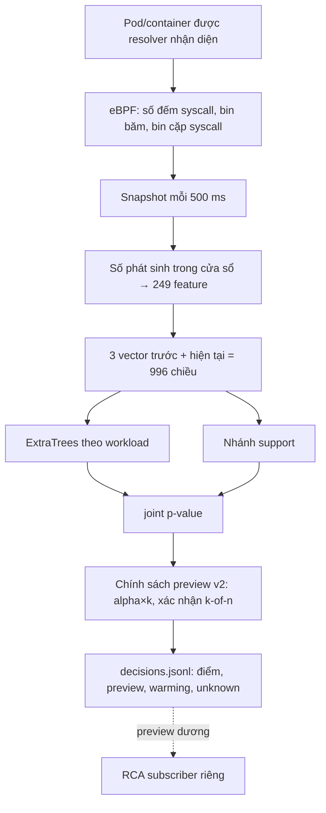

# Sentinel Pulse — trạng thái, kết quả và nhật ký

Cập nhật **19/10/2026 10:41 (UTC+7)** từ SSH vào cụm. Giờ trong file là UTC+7, trừ khi ghi UTC.

Đây là một trong ba báo cáo hiện hành:
- Sentinel Pulse — phát hiện bằng ML (file này; gồm cả hạ tầng chung và nhật ký);
- [thí nghiệm chọn syscall](SYSCALL_FEATURE_EXPERIMENT_STATUS.md);
- [RCA — dựng đồ thị điều tra](RCA_RUNTIME_STATUS.md).

Danh sách việc cần làm nằm ở [TODO.md](TODO.md).

## 1. Tóm tắt

- **Pulse làm gì.** Pulse đếm syscall của từng container Kubernetes bằng eBPF. Cứ 0,5 giây, nó tạo một vector 249 số cho mỗi container. Một model riêng cho từng workload chấm điểm xem cửa sổ đó "lạ hay không" so với lúc bình thường. Toàn bộ chạy ở chế độ **shadow**: chỉ ghi `candidate_alert_preview` (cảnh báo thử), không phát cảnh báo vận hành, không cách ly pod.
- **Kết quả mới nhất — lượt live R6 (19/10), dữ liệu mới, nhãn kỳ vọng:**

  | Chỉ số | Kết quả |
  |---|---|
  | Precision | 89,1% |
  | Recall | 92,8% |
  | Control idle dương | 11,2% |
  | p95 kernel → preview | 1,90 s (campaign tiếp nối 105 cặp: 2,17 s) |
  | Đợt cảnh báo trên normal | ~17 mỗi replica-giờ (**sơ bộ**, mẫu 7,3 replica-giờ; số chính thức từ job 20/10 02:10) |

- **Phát hiện quan trọng nhất.** Một binary vô hại chạy cùng đường khởi chạy với attack bị gắn cờ **80,7%**. Nghĩa là Pulse phát hiện "process bất thường", chưa phân biệt được ác ý. Nó chỉ tách rõ các attack dùng syscall hiếm: ptrace, setns, execveat.
- **Hướng gần nhất.** Replay trên R6 cho thấy chính sách xác nhận 2 cửa sổ (k2of2) đạt precision và recall ≥ 95%, control ≤ 5%, nhưng p95 là 2,3–2,9 s. Chấm điểm đã được tăng tốc ~4,9× và cho kết quả khớp từng bit, để lượt R7 thử đưa k2of2 xuống dưới 2 s.
- **Nút thắt kéo dài: gánh cảnh báo trên dữ liệu bình thường.**
  - Calibration lệch dần theo thời gian.
  - Hiệu chỉnh lại p-value giảm tỉ lệ cửa sổ bị gắn cờ từ 8,1% xuống 0,35%.
  - Dù vậy vẫn còn 6–17 đợt mỗi replica-giờ, xa ngân sách 0,1.
  - Thí nghiệm syscall cho thấy thay bộ syscall không giải quyết được vấn đề này.

## 2. Trạng thái cụm và job (10:41 ngày 19/10)

| Thành phần | Trạng thái |
|---|---|
| Lượt live R6: `pulse-matched-worker-r6-20261018` (3 worker) | Đang chạy từ 02:04, **chạy hết chu kỳ** đến 20/10 02:04 (không dừng giữa chừng); chấm điểm bằng đường sklearn cũ |
| Campaign R6 (315 cặp) | **Xong** 09:52 (mục 5.5) |
| Traffic R6 | Đã xong lịch các chế độ tải; hiện ở steady |
| Campaign tiếp nối cho RCA `pulse-matched-campaign-r6-rca-followup-20261019` | **Xong** ~12:50 (105/105 cặp), mục 5.5 |
| RCA | r6c đang chạy từ 10:48 (xem [RCA](RCA_RUNTIME_STATUS.md)) |
| `pulse-r6-syscall-arms-20261019` | **Xong** ~13:40 (xem [syscall](SYSCALL_FEATURE_EXPERIMENT_STATUS.md) mục 5.5) |
| `pulse-compress-raw-48h-20261020` | Timer 20/10 02:05: nén gzip 292 file `raw.jsonl` của soak 48 giờ (68,7 GB), kiểm tra SHA-256 khớp seal trước khi xóa bản gốc (`scripts/compress_raw_frames.py`) |
| `pulse-rolling-recalibration-20261020b` | Timer 20/10 02:15, trong khoảng không có lượt live; R7 chỉ khởi chạy sau khi job này xong |
| `pulse-r7-selection-20261020b` | Timer 20/10 02:10 (`scripts/r6_normal_burden.sh`), mục 5.7; bước cuối áp luật chọn bằng code → `SELECTION.json` |
| `pulse-syscall-bootstrap-20261020` | Timer 20/10 02:15: chạy lại replay syscall với khóa trial đã sửa, rồi bootstrap (xem [syscall](SYSCALL_FEATURE_EXPERIMENT_STATUS.md)) |
| Collector 1 s + resolver trên worker | Chạy; resolver bắt buộc phải có cho matched worker |
| Detector v8 cũ | Đã gỡ; phần còn sót chờ chạy tay (mục 8) |
| NFS `/mnt/sentinel-pulse-archive` | Còn 52 GB lúc 17:16. R6 cần thêm ~32 GB nên sẽ còn ~20 GB lúc kết thúc, trong khi R7 24 giờ cần ~82 GB → nén `raw.jsonl` của soak 48 giờ trả lại ~60 GB |
| Ổ đĩa worker | worker1 80%, worker4 84%, worker3 55%; dữ liệu thô cũ chờ xóa tay (mục 8) |

## 3. Thuật ngữ

| Thuật ngữ | Nghĩa trong triển khai này |
|---|---|
| syscall | Lời gọi hệ thống (read, connect, execve…); đếm ở entry nên chưa chứng minh thành công |
| eBPF | Chương trình chạy trong kernel, ở đây dùng để đếm syscall theo cgroup |
| cgroup / resolver | Nhóm tài nguyên của container / tiến trình ánh xạ Pod UID → container → cgroup → revision |
| cửa sổ (window) | 0,5 giây; mỗi container có một vector cho mỗi cửa sổ |
| vector 249 số | Gồm:<br>• log-count và tỷ lệ của 29 syscall;<br>• 5 tổng hợp;<br>• 64 bin băm syscall;<br>• 64 bin băm cặp syscall liền nhau;<br>• trung bình và độ lệch trượt (rolling-10) |
| ngữ cảnh (context) | 3 cửa sổ trước + cửa sổ hiện tại = 996 số đưa vào model |
| ExtraTrees | Họ cây quyết định ngẫu nhiên (không phải deep learning), học phân biệt normal với normal bị làm hỏng |
| nhánh support | Phát hiện tọa độ nằm ngoài vùng từng thấy khi bình thường |
| p-value (conformal) | Vị trí điểm của cửa sổ so với điểm normal dùng để hiệu chỉnh; p nhỏ là hiếm gặp. Chỉ đúng nghĩa khi normal lúc chạy giống normal lúc hiệu chỉnh |
| joint_p, alpha | joint_p = min(1, 2·min(tree_p, support_p)); alpha = 0,05/30 ≈ 0,00167 mỗi cửa sổ |
| hệ số alpha (alpha×k) | Nới ngưỡng thành k·alpha |
| xác nhận k-of-n | Chỉ báo khi ít nhất k trong n cửa sổ liên tiếp vượt ngưỡng; ví dụ k2of2_a10 là 2/2 cửa sổ với alpha×10 |
| hiệu chỉnh lại (recalibration) | Thay tập điểm normal dùng để tính p-value bằng normal gần hơn; giữ nguyên model |
| cảnh báo thử (preview) | `candidate_alert_preview=true`; tín hiệu để đánh giá, **không phải** cảnh báo vận hành |
| đóng băng (freeze) / frozen_source | Khóa source, model, chính sách bằng SHA-256. Worker từ chối chạy nếu các file chấm điểm khác bản đóng băng |
| kiểm tra tương đương | Replay segment đã niêm phong qua code mới, yêu cầu điểm giống **từng bit** với điểm đã ghi |
| soak | Chạy liên tục nhiều giờ trên tải bình thường |
| cặp attack/control | Control 15 s (không làm gì) → binary vô hại 15 s → attack 15 s, trên cùng container |
| binary vô hại (benign-exec control) | Cùng file, cùng đường `kubectl exec` như attack, chỉ gọi `getpid` lặp lại. Dùng để tách "có process mới" khỏi hành vi tấn công |
| TP / FN / FP / TN | Bắt đúng / bỏ sót / báo nhầm / im lặng đúng. "FP kỳ vọng" vì nhãn control chưa được review |
| unknown | Thiếu dữ liệu hoặc bằng chứng; không bao giờ tự đổi thành TN/FN |
| đợt cảnh báo (episode) | Các cửa sổ dương của một container cách nhau < 15 s gộp thành một đợt |
| replica-giờ | Một giờ dữ liệu đã chấm của một container (replica) |
| development / blind | Dữ liệu đã nhìn khi phát triển / dữ liệu mới chưa dùng để chỉnh. Chỉ blind mới dùng để kết luận cuối |
| cadence gap | Hai snapshot cách nhau ngoài 0,35–0,8 s; history bị reset, cửa sổ sau đó không tính là normal |

## 4. Luồng ML đang chạy



- **Model.** Mỗi workload/container có model riêng; bundle hiện hành có 21 key trong namespace `production` của ứng dụng AIMS. Cửa sổ của container chưa có model không được tính là TN.
- **Chính sách v2** (`detector/candidate_policy.py`, schema `sentinel-pulse-candidate-preview-policy-v2`) có hai tham số đăng ký trong file JSON có SHA-256:
  - hệ số alpha;
  - số cửa sổ xác nhận k-of-n.
- **Chấm điểm batch** (`detector/idle_batch.py`): gom các context cùng workload trong một frame rồi chấm một lần.
- **Đường chấm điểm nhanh** (`detector/fast_forest.py`, bật bằng `fast_scoring: true`) cho kết quả giống hệt từng bit. Batch đầu tiên của mỗi model được so với sklearn; nếu lệch thì tự quay về đường cũ.

## 5. Kết quả

### 5.1 Soak 48 giờ của candidate đóng băng (15–17/10, normal chưa review nhãn)

| Worker | Cửa sổ đã chấm | Cảnh báo thử | Tỷ lệ | Issue |
|---|---:|---:|---:|---:|
| worker1 (.237) | 9.011.856 | 673.825 | 7,5% | 146 |
| worker4 (.238) | 8.051.218 | 950.765 | 11,8% | 381 |
| worker3 (.239) | 4.408.203 | 90.161 | 2,0% | 65 |
| **Tổng** | **21.471.277** | **1.714.751** | **8,0%** | 592 |

- Model `747c4eed…`, chính sách `fd0be94a…`.
- Nếu p-value đúng nghĩa, tỷ lệ cửa sổ dương phải quanh 0,17%; thực tế cao gấp ~47 lần, tương ứng 37,1 đợt mỗi replica-giờ.
- Bằng chứng: `validation-evidence/results-20261018/pulse-soak-48h-*-TERMINAL.json`.

**Lưu ý (phát hiện ngày 19/10, mục 5.5).** Trong thời gian soak, Tetragon trên worker1/worker3 đang gánh hàng trăm client mồ côi. Điều này có thể đã gây cadence gap và làm lệch một phần số đo; worker4 có 7–9 gap mỗi segment trong 6 giờ đầu.

### 5.2 Ma trận attack/control phát triển R3 + R5 (14–15/10)

R3 gồm 315 cặp (21 key × 5 kịch bản × 3 tốc độ):

| | Bắt được | Không bắt | Unknown |
|---|---:|---:|---:|
| Attack | TP 284 | FN 2 | 29 |
| Control | FP kỳ vọng 72 | TN kỳ vọng 237 | 6 |

- Precision 79,8%, recall 99,3% (cận dưới khi tính cả unknown: 90,2%), control dương 23,3%.
- Kernel → preview p50 / p95 / p99 = 1,07 / 1,61 / 4,75 s.
- R5 (RabbitMQ, 15 cặp): TP 13, FN 0, FP 1, TN 14, unknown 2.
- Đây là dữ liệu development, thiết kế 1:1. R3/R5 **chưa có** đối chứng binary vô hại.

### 5.3 Xác nhận k-of-n trên p-value gốc (18/10, development)

Số đợt mỗi giờ tính trên toàn bộ soak 48 giờ (3.199,7 replica-giờ):

| Chính sách | Đợt/giờ normal | Precision R3 | Recall R3 | Control dương | p95 |
|---|---:|---:|---:|---:|---:|
| 1 cửa sổ | 37,1 | 79,8% | 99,3% | 23,3% | 1,61 s |
| 2 of 2 | 22,3 | 87,3% | 98,3% | 13,3% | 2,25 s |
| 4 of 6 | 19,5 | 90,6% | 98,3% | 9,4% | 3,42 s |
| 4 of 6, alpha/4 | 12,0 | 94,7% | 69,2% | 3,6% | 5,94 s |

Chỉ dùng k-of-n thì không đưa gánh cảnh báo về gần ngân sách, và làm p95 vượt 2 s.

### 5.4 Hiệu chỉnh lại p-value (18/10, development)

- **Tập hiệu chỉnh:** điểm của chính model đóng băng trên normal 15/10 00:30–07:30 UTC (bỏ khoảng R5); model giữ nguyên.
- **Tập kiểm tra:** soak từ 15/10 08:40 UTC (2.206,6 replica-giờ) và R3/R5.
- Bằng chứng: `validation-evidence/results-20261018/confirmation-study/recalibrated-c1/`.

| | P-value gốc | Hiệu chỉnh lại |
|---|---:|---:|
| Cửa sổ normal bị gắn cờ | 8,11% | **0,35%** |
| Đợt cảnh báo / replica-giờ | 36,3 | **9,1** |
| Precision R3 | 79,8% | **97,8%** |
| Recall R3 | 99,3% | 91,3% (mất `seccomp_api_probe` 14, `anonymous_mprotect_churn` 11) |
| Control dương R3 | 23,3% | **1,9%** |
| p95 / p99 | 1,61 / 4,75 s | 2,91 / 5,87 s |

Lưới alpha nới rộng (R3):

| Chính sách | Precision | Recall | Control | p95 | Đợt/giờ |
|---|---:|---:|---:|---:|---:|
| 1 cửa sổ, alpha×3 | 94,3% | 93,4% | 5,2% | 1,97 s | 18,0 |
| 2 of 3, alpha×5 | 98,9% | 97,9% | 1,0% | 3,39 s | 9,9 |
| 2 of 3, alpha×10 | 96,9% | 99,0% | 2,9% | 2,32 s | 17,1 |

- Kết quả này tạo ra candidate `ec72d9ea…` (`runtime-recal-c1-20261018/model-bundle`).
- Chính sách R6 (`recalibrated-preview-policy-r6.json`, SHA-256 `f6107351…`) là 1 cửa sổ, alpha×3: chính sách duy nhất có p95 < 2 s.
- Kiểm tra tương đương sau refactor: 214.449 cửa sổ, 0 sai khác (`scorer-equivalence-0117901.json`).

### 5.5 Lượt live R6 (19/10)

| Thành phần | Giá trị |
|---|---|
| Candidate / chính sách | `ec72d9ea…` / R6 (`f6107351…`) |
| Capture | 3 worker, 24 giờ, không ghi `raw.jsonl` (NFS không đủ chỗ cho kiểu 48 giờ ~4,9 GB/giờ) |
| Source worker | snapshot `4ba303a`; kiểm tra tương đương trên snapshot này: 27.840 dòng, 0 sai khác |
| Campaign | 315 cặp control → binary vô hại → attack; fixture `testbed/attack/runtime_attack_r6.c`; coordinator `d791d24` |
| Thư mục | `/mnt/sentinel-pulse-archive/matched-r6-20261018/` |

**Sự cố khi khởi động (02:04–02:20).**
- **Triệu chứng.** Worker1/worker3 báo `cadence_gap` khoảng mỗi 5 s.
- **Nguyên nhân.** Bên trong container Tetragon có **301 / 18 / 59 tiến trình `tetra getevents` mồ côi** (worker1 / worker4 / worker3), đã chạy từ 10 giờ đến 25 ngày. Chúng được sinh ra mỗi khi `kubectl exec` phía `.234` bị giết mà tiến trình trong container vẫn sống. Nguồn rò gồm:
  - campaign cũ;
  - subscriber RCA;
  - v8.
- **Tác động.** Tetragon tốn 5,3 core và 11,5 GB RAM ở worker1, 7,0 core ở worker3, làm matched worker thiếu CPU.
- **Xử lý.**
  - Sửa code (`d791d24`): bọc lệnh trong container bằng `timeout`.
  - Dọn toàn bộ client mồ côi.
- **Sau khi xử lý.** Tetragon worker1 còn 0,6 core / 2,8 GB; CPU node từ 62% xuống 35%; không còn cadence gap. Khoảng 02:04–02:13 không được tính là normal.

**Kết quả campaign (xong 09:52, 315/315 cặp).** Chính sách đúng như đăng ký, không chỉnh sau khi xem kết quả.

| Chỉ số | R6 live | Dự đoán development |
|---|---|---|
| Precision (attack : control idle = 1:1) | **89,1%** | 94,3% |
| Recall | **92,8%** (TP 285, FN 22, unknown 11) | 93,4% |
| Control idle dương | 11,2% (35/312) | 5,2% |
| **Binary vô hại dương** | **80,7%** (251/311) | — |
| Kernel → preview p50 / p95 / p99 | 1,03 / **1,90** / 5,39 s | p95 1,97 s |
| Đợt cảnh báo normal (02:07–02:20) | 17,2 / replica-giờ | 18 |

Tỉ lệ dương theo kịch bản:

| Kịch bản | Attack | Binary vô hại | Control idle |
|---|---|---|---|
| `child_ptrace_handshake` | 1,00 | 0,81 | 0,10 |
| `execveat_resolution_probe` | 1,00 | 0,79 | 0,11 |
| `invalid_setns_burst` | 1,00 | 0,81 | 0,11 |
| `anonymous_mprotect_churn` | 0,84 | 0,83 | 0,11 |
| `seccomp_api_probe` | 0,80 | 0,81 | 0,15 |

- Với attack, trung vị **100%** cửa sổ trong 15 s là dương. Với binary vô hại là 33%, với control là ~0%. Tín hiệu bền là dấu hiệu tách mạnh, nhưng đợi tín hiệu bền thì chậm.
- Precision 1:1 ở trên chỉ tính control idle. Nếu coi binary vô hại là âm tính thì precision thấp hơn nhiều. Báo cáo đồ án phải trình bày cả hai cách tính.

**Campaign tiếp nối (105 cặp, 7 workload, xong ~12:50):**
- TP 93, FN 11, FP 7, TN 98, unknown 1.
- Precision 93,0%, recall 89,4%, control idle 6,7%, **binary vô hại 70,6%** (72/102).
- **p95 kernel → preview 2,17 s, vượt ngưỡng 2 s** (p50 1,02 s, p99 5,19 s; 93 mẫu).
- Cùng xu hướng với campaign chính. Mẫu nhỏ hơn và chỉ có 7 workload, nên p95 không so trực tiếp được với 1,90 s của campaign chính.

**Cadence gap trong thời gian chạy:**

| Khoảng | worker1 | worker4 | worker3 | Nguyên nhân |
|---|---:|---:|---:|---|
| 02:00–03:00 | 230 | 0 | 296 | Tranh chấp CPU do client Tetragon mồ côi |
| 03:00–04:00 | 36 | 0 | 25 | Phần còn lại của sự cố trên |
| 13:00–14:00 | 17 | 5 | 18 | Job syscall đọc NFS |
| Các giờ khác | 0–5 | 0–5 | 0–5 | — |

Các cửa sổ sau gap tự động không tính là normal.

**Replay chính sách trên R6** (`analysis-20261019/attack-r6-{default,looser}.json`).
- Replay k1of1_a3 tái lập đúng kết quả live.
- Các chính sách khác được chọn sau khi đã xem R6, nên chỉ là development.

| Chính sách | Precision | Recall | Control | Binary vô hại | p95 |
|---|---|---|---|---|---|
| k1of1_a1 | 94,9% | 91,2% | 4,8% | 72% | 2,54 s |
| k1of1_a3 (R6) | 89,1% | 92,8% | 11,2% | 81% | 1,90 s |
| k1of1_a5 | 85,7% | 97,7% | 16,0% | 93% | 1,67 s |
| **k2of2_a5** | **97,4%** | **95,8%** | **2,6%** | 82% | 2,88 s |
| k2of2_a10 | 95,0% | 98,0% | 5,1% | 89% | 2,30 s |
| k2of3_a10 | 94,4% | 98,7% | 5,8% | 94% | 2,27 s |

**Độ trễ xử lý: từ cuối cửa sổ đến preview.**

| Node | Container/frame | p50 | p95 |
|---|---:|---:|---:|
| worker1 | 82 | 0,46 s | 0,54 s |
| worker3 | 85 | 0,50 s | 0,58 s |
| worker4 | 28 | 0,25 s | 0,30 s |

Profile trên frame thật cho thấy ~85% thời gian nằm ở `predict_proba` của sklearn, chủ yếu là overhead Python theo từng cây.

**Tăng tốc chấm điểm (`0913446`).**
- **Cách làm.** `fast_forest.py` cộng `tree_.predict` của từng cây theo đúng thứ tự trong float64 như sklearn, nhưng bỏ phần overhead.
- **Kiểm chứng.** Replay 2 segment R6 (40.000 dòng):
  - 13.505 dòng có điểm, **0 sai khác**;
  - CPU **42,4 s so với 208,9 s** (nhanh ~4,9×).
- **Ước tính.** Thời gian từ cuối cửa sổ đến preview giảm xuống ~0,1 s, nên p95 của k2of2_a10 có thể còn ~1,95 s. Con số thật phải đo live ở R7.

### 5.6 Hiệu chỉnh lại định kỳ (đang chờ chạy)

- **Module:** `attack/rolling_recalibration.py`.
- **Cách làm:** replay soak 48 giờ, so calibration tĩnh (c1) với làm mới mỗi giờ bằng 3 / 6 / 12 giờ trước đó. Biến thể "guarded" bỏ các cửa sổ đã dương khỏi những lần calibration sau.
- **Đầu ra:** gánh cảnh báo theo từng giờ, cùng recall và độ trễ trên R3/R5.
- **Trạng thái:** job đọc ~200 GB từ NFS, nên phải chạy khi không có lượt live cần RCA.

### 5.7 Kế hoạch chọn candidate và chính sách R7 (đăng ký trước, 19/10 10:52)

Job `pulse-r7-selection-20261020` chạy sau khi R6 kết thúc. Mỗi khoảng thời gian đều loại trừ hai campaign (±60 s) và đoạn tranh chấp lúc khởi động.

1. **Gánh cảnh báo như R6 đã chạy:** normal 19:00–02:04, mọi chính sách trong 2 lưới.
2. **Làm mới calibration:** hiệu chỉnh lại candidate `ec72d9ea…` bằng normal R6 13:00–19:00 (19/10). Đây chính là bước "làm mới định kỳ" trong vận hành thật.
3. **Đo với calibration mới:** gánh cảnh báo trên 19:00–02:04, và replay cả hai campaign R6.

**Luật chọn, đăng ký trước khi có số:**
- Ưu tiên calibration làm mới nếu nó giảm số đợt cảnh báo mà không làm giảm recall quá 2 điểm phần trăm.
- Trong các chính sách có p95 replay ≤ 2,3 s (đường nhanh dự kiến bớt ~0,35 s), precision và recall ≥ 95%, control ≤ 5%, chọn chính sách có **ít đợt cảnh báo/giờ nhất**.
- Nếu không chính sách nào đạt các điều kiện trên, chọn chính sách đạt p95 thấp nhất trong số có precision ≥ 95%, và ghi rõ là không đạt kỳ vọng.

- **Luật chọn đã viết thành code** (`attack/select_policy.py`, `3e2d2e4`, có test). Code đọc output của job, ghi `SELECTION.json` gồm calibration, chính sách, số liệu, cờ đạt kỳ vọng và hash đầu vào, rồi sinh file chính sách v2 gắn với hash candidate R7. Nhờ vậy việc chọn tái lập được, không có phán đoán thủ công sau khi đã xem số.

Sau đó chạy `scripts/prepare_r7.sh`. Script tạo bundle bằng `detector/recalibrate_bundle.py` (nếu chọn calibration làm mới), sinh file chính sách, và kiểm tra file đó nạp được với candidate qua loader thật. Đã thử với một lựa chọn giả lập trên candidate `ec72d9ea…`: nạp đúng `ConfirmedPreviewPolicy(k=2, n=2, alpha_scale=5.0)`. Cuối cùng commit file chính sách vào `sentinel_pulse/protocol/`, tạo snapshot, rồi chạy `scripts/launch_run.sh` với `FAST=1` (chấm điểm nhanh) và RCA cấu hình đầy đủ.

## 6. Tiến độ và việc còn lại

| Việc | Trạng thái |
|---|---|
| Capture chính xác, 249 feature, chấm điểm batch, preview | Chạy trên 3 worker |
| Soak 48 giờ, development attack R3/R5 | Có kết quả |
| Hiệu chỉnh lại p-value, chính sách v2 (alpha×k, k-of-n) | Có; dùng trong R6 |
| Đối chứng binary vô hại | **Có (R6)**: 80,7% bị gắn cờ |
| Lượt live R6 | Campaign xong; capture chạy đến 20/10 02:04 |
| Chấm điểm nhanh, khớp từng bit | Có; chưa chạy live |
| Chọn và đăng ký chính sách R7 trên normal R6 | Chờ job 20/10 02:10 |
| Lượt R7: chấm điểm nhanh + 2 cửa sổ + RCA case tiếp nối | Chưa chạy |
| Đặc trưng/luật tách attack khỏi process vô hại mới | Chưa có |
| Giảm gánh cảnh báo về gần 0,1 đợt/giờ | Chưa đạt (tốt nhất ~6–9 đợt/giờ khi hiệu chỉnh lại) |
| Review nhãn, ma trận đã xác nhận, blind attack mới | Chưa |
| Độ trễ tới người nhận cảnh báo (không chỉ preview) | Chưa đo |
| Thử reboot, mất NFS, backlog | **Không làm** theo quyết định của bạn (không tác động infra) |

Kỳ vọng development đã đăng ký: precision và recall ≥ 95%, control dương ≤ 5%, p95 kernel → alert < 2 s. Chưa có chính sách nào đạt cả bốn điều kiện trên dữ liệu live.

## 7. Đánh giá thẳng và chiến lược

**Hướng đi đúng:**
- eBPF đếm syscall rẻ và khó né.
- Model riêng cho từng workload, chỉ học normal.
- Ngưỡng dựa trên p-value.
- RCA tách khỏi đường phát hiện.
- Kỷ luật thí nghiệm: đóng băng, đăng ký trước, giữ unknown.

**Điểm yếu đã được xác nhận bằng số liệu:**
1. **Calibration lệch theo thời gian.** Đây là nguyên nhân chính của cảnh báo nhầm; hiệu chỉnh lại giảm mạnh nhưng chưa đủ.
2. **Pulse phát hiện tính bất thường, không phát hiện ác ý.** Process vô hại mới bị gắn cờ 81%. Đặc trưng chỉ là tần suất syscall, không có tham số.
3. **Ràng buộc 2 s xung đột với xác nhận nhiều cửa sổ.** Mỗi cửa sổ xác nhận thêm ~0,5 s, và độ trễ xử lý 0,25–0,5 s/frame làm việc đó khó hơn.
4. **Đánh giá 1:1 không phản ánh precision vận hành.** Chỉ số vận hành chính phải là số đợt cảnh báo mỗi giờ trên normal độc lập.

| Điểm yếu cũ | Điều chỉnh đã làm |
|---|---|
| Calibration tĩnh | Hiệu chỉnh lại (đã chứng minh hiệu quả); đang thử làm mới định kỳ |
| Recall có thể bị thổi phồng do "có process mới" | Fixture R6 + binary vô hại (R6 xác nhận đúng là bị thổi phồng) |
| Độ trễ xử lý | Chấm điểm nhanh, khớp từng bit |
| Chỉ báo precision 1:1 | Báo song song số đợt/giờ và tỉ lệ dương của binary vô hại |

## 8. Hạ tầng chung

**Đã gỡ khỏi cụm:**
- `sentinel-detector` (.234, worker1);
- unit/timer v8 (`agent-runtime-gat-trainer`, `aims-*`);
- TracingPolicy `aims-sensitive-exec`, `sentinel-aims-syscalls`;
- namespace `sentinel-system`;
- thư mục `ml-service*`, `v8-*-staging`, `aims-training-fit-*` (~6,3 GB);
- 378 client `tetra getevents` mồ côi (19/10).

**Chờ chạy tay** vì bộ kiểm duyệt quyền của Claude Code chặn lệnh: `bash /home/dat/cleanup-manual-20261018.sh` trên `.234`. Script xóa:
- **Tài nguyên v8 trên k8s:**
  - ValidatingAdmissionPolicy `sentinel-experiment-resource-lock`;
  - 2 TracingPolicy `sentinel-syscalls`;
  - workload baseline v8: `nginx`, `redis`, `loadgen`, `redis-loadgen` (production) và `postgres`, `postgres-loadgen` (default). Không workload nào trong số này thuộc 21 workload Pulse.
- **Dữ liệu thô cũ trên worker** (`/var/lib/sentinel-pulse-*`):
  - worker1 ~171 GB, worker4 ~194 GB, worker3 ~117 GB;
  - nội dung cũ trong `/var/lib/sentinel-pulse/`;
  - ~100 checkout/bundle cũ trong `/home/dat`.
- **Unit thế hệ cũ:** 5 oneshot vẫn `enabled` (sẽ tự chạy lại khi khởi động máy) và ~90 unit lỗi mỗi worker.

Script giữ lại collector, resolver, control-rotate, `/home/dat/pulse-matched-20261015` (loader/proof) và `/opt/sentinel-pulse`.

**Đồng bộ code:**
- GitHub `main` là nguồn chính; push thẳng, commit chỉ mang danh tính tndat-dev.
- Tag `archive/pre-refactor-20261018` giữ cây code trước đợt dọn ngày 18/10.
- Mỗi job trên cụm chạy từ một snapshot git trên NFS (`/mnt/sentinel-pulse-archive/runtime-<commit>-<ngày>/source`), không chạy từ checkout đang sửa.

## 9. Bằng chứng trong repo

[`validation-evidence/results-20261019/`](validation-evidence/results-20261019/README.md) chứa các file kết quả nhỏ và biên nhận JSON cho mọi con số ngày 19/10. README của thư mục nối từng con số trong 3 báo cáo với file tương ứng. Dữ liệu lớn vẫn nằm trên NFS.

## 10. Source, artifact và lệnh kiểm tra

- **Code:**
  - `sentinel_pulse/collector/` — capture, feature;
  - `sentinel_pulse/detector/` — model, chính sách, hiệu chỉnh lại, chấm điểm nhanh;
  - `sentinel_pulse/pipeline/` — matched worker, plan/derive run, kiểm tra tương đương;
  - `sentinel_pulse/attack/` — campaign, đánh giá, nghiên cứu xác nhận và hiệu chỉnh.
- **Khởi chạy:** `scripts/launch_r6.sh`, `scripts/launch_rca_followup.sh`, `scripts/r6_normal_burden.sh`.

```bash
export LAB_SSH_PASSWORD=...      # mật khẩu lab
python3 scripts/ssh_lab.py --list
python3 scripts/ssh_lab.py --host 10.1.16.237 systemctl show pulse-matched-worker-r6-20261018 -p ActiveState -p NRestarts
python3 scripts/ssh_lab.py python3 -m json.tool /mnt/sentinel-pulse-archive/matched-r6-20261018/workers/k8s-worker1.local/STATUS.json
python3 scripts/ssh_lab.py --put LOCAL REMOTE   # upload qua SFTP
```

## 11. Nhật ký làm việc

Ghi theo thứ tự thời gian. Nhật ký riêng của thí nghiệm syscall và RCA nằm trong file tương ứng.

### 18/10/2026

| Giờ | Việc đã làm | Kết quả / bằng chứng |
|---|---|---|
| sáng | Đọc toàn bộ repo, SSH đối chiếu cụm, kiểm tra đồng bộ GitHub ↔ local ↔ cụm | mục 8 |
| ~11:45 | Tái cấu trúc: gỡ các thế hệ code đã kết thúc, chia `sentinel_pulse/` thành 6 package | `bbce323`, `3a38319` |
| ~11:50 | Nghiên cứu xác nhận k-of-n và hiệu chỉnh lại p-value (offline) | `a8b25b7`, `9c56fc8`; mục 5.3–5.4 |
| ~12:10 | Sửa lỗi nạp pickle model cũ; kiểm tra tương đương: 214.449 cửa sổ, 0 sai khác | `1853a69` |
| ~12:10 | Gọn `validation-evidence/` từ 59 xuống 11 thư mục | `a6612a3` |
| 12:13–12:18 | Hợp nhất vào `main`, push thẳng; viết lại 10 commit để bỏ dòng Co-Authored-By | `22f365a`, `4d6dfbf` |
| ~15:07 | Lưới alpha nới rộng sau hiệu chỉnh (c2) | `e2807ec` |
| ~15:26 | Bundle candidate hiệu chỉnh lại `ec72d9ea…` và chính sách preview v2 | `ae25e6c` |
| ~15:41 | Đối chứng binary vô hại (fixture R6 + campaign) | `3a1c04f` |
| ~15:46 | Đăng ký chính sách R6 (1 cửa sổ, alpha×3), SHA-256 `f6107351…` | `51f019b` |
| chiều | Gỡ tài nguyên v8 | mục 8 |
| 15:56 | `kubectl delete` phần v8 còn sót | Bị bộ kiểm duyệt quyền chặn (lần 2) → chạy tay |
| 16:00 | Xóa dữ liệu thô cũ và unit cũ trên worker | Bị chặn 2 lần → soạn script chạy tay |
| 16:00 | Đo dung lượng: 48 giờ tốn 219 GB, NFS còn 102 GB | R6 chạy 24 giờ, không ghi `raw.jsonl` |
| 16:01 | Profile `r6` trong `plan_matched_run` + cờ `write_raw_frames` | `4ba303a` |
| 16:05 | Snapshot `4ba303a` lên NFS; nạp thử candidate R6 bằng runtime-venv của worker | 21 model, hash khớp |
| 16:10 | Thêm `--put` cho `ssh_lab.py`; viết `scripts/launch_r6.sh` | `ee69863` |

### 19/10/2026

| Giờ | Việc đã làm | Kết quả / bằng chứng |
|---|---|---|
| 02:03 | Kiểm tra tương đương trên snapshot R6: 27.840 dòng, 0 sai khác; `launch_r6.sh plan` | `matched-r6-20261018/CONFIG.json` |
| 02:04 | Cài matched worker R6 trên 3 worker | chạy |
| 02:05–02:10 | Phát hiện cadence gap; truy ra 301/18/59 client `tetra getevents` mồ côi | mục 5.5 |
| 02:10 | Bọc lệnh trong container bằng `timeout` (campaign + RCA); snapshot `d791d24` | `d791d24` |
| 02:13 | `pkill -KILL` mọi `tetra getevents` trên worker | CPU Tetragon giảm ~9 lần |
| 02:15 | Derive coordinator trên `d791d24`; cài traffic + campaign | attack từ 03:47 |
| 02:16 | Sửa `launch_r6.sh` (`cp -a` lỗi ACL trên NFS; unit file rỗng do stdin của sudo) | `a9cc061` |
| 02:20 | Đo R6 sau khi dọn: 17,2 đợt/replica-giờ, p99 cuối cửa sổ → preview 0,64 s | mục 5.5 |
| 02:22 | Viết `rolling_recalibration.py` (289 test pass), chạy job | `5f9a705` |
| 02:30 | Job rolling làm RCA kẹt IO → dừng, hẹn 10:30 | — |
| 10:04 | Campaign R6 xong: precision 89,1%, recall 92,8%, binary vô hại 80,7%, p95 1,90 s | mục 5.5 |
| 10:10 | Phân tích attack vs binary vô hại theo kịch bản và theo độ bền tín hiệu | mục 5.5 |
| 10:12 | `confirmation_study --model-hash/--policy-hash`; replay lưới k-of-n trên R6 (khớp live) | `f0b18af` |
| 10:16 | Phân rã độ trễ xử lý theo node | mục 5.5 |
| 10:17 | Profile frame thật: 85% thời gian ở overhead sklearn | mục 5.5 |
| 10:19 | `fast_forest.py` (khớp từng bit, tự kiểm tra từng model); 293 test pass | `0913446` |
| 10:22 | Kiểm tra tương đương đường nhanh trên R6: 0 sai khác, CPU 42,4 s so với 208,9 s | `runtime-0913446-20261019/EQUIVALENCE-*.json` |
| 10:27 | Hẹn job `pulse-r6-normal-burden-20261020` (02:10 ngày 20/10) | `scripts/r6_normal_burden.sh` |
| 10:33 | Dừng job rolling (lần chạy theo timer) để ưu tiên RCA live | sẽ chạy lại sau campaign tiếp nối |
| 10:41 | Chuyển báo cáo về 3 file theo thí nghiệm; xóa `docs/STATUS.md` | file này |
| 10:52 | `calibrate --model-hash`; job chọn R7 (calibration như đã chạy so với làm mới trên normal R6) thay cho job đo gánh cảnh báo; profile `custom` cho `plan_matched_run`; `scripts/launch_run.sh`; dời job rolling sang 20/10 03:30 | `6f0e6be`, `a4a8529`; mục 5.7 |
| 16:23 | Kiểm tra sau khi phiên khởi động lại: campaign tiếp nối và job syscall đã xong; R6 vẫn chạy | mục 2, 5.5 |
| 16:27 | Ghi quy tắc: soak/lượt live phải chạy hết chu kỳ, không dừng hay đánh fail giữa chừng | mục 2 |
| 16:35 | Policy RCA thu hẹp: lưu lượng Tetragon worker1 giảm ~8× (17.393 → 2.096 sự kiện / 10 s), giảm cả overhead trên node đang chạy R6 | [RCA](RCA_RUNTIME_STATUS.md) mục 5.8 |
| 17:16 | Kiểm tra sức khỏe: 3 worker R6 cập nhật đều; RCA r6c 2.453 case; NFS còn 52 GB → không đủ cho R7 | mục 2 |
| 17:18 | Hẹn nén `raw.jsonl` soak 48 giờ lúc 02:05 (kiểm tra seal, không mất dữ liệu); dời rolling sang 02:15 để không chạy cùng R7; bật watcher kiểm tra 5 phút/lần (heartbeat, cadence gap, RCA, NFS) | `scripts/compress_raw_frames.py` |
| 17:52 | Luật chọn R7 thành code + test; job chọn gọi nó ở bước cuối; sửa watcher (dấu hiệu xong = `SELECTION.json`) | `3e2d2e4` |
| 17:57 | Gom bằng chứng: 21 file kết quả + 8 biên nhận JSON (`scripts/analysis/*.py`) vào `validation-evidence/results-20261019/`; đối chiếu lại số liệu: bổ sung p95 2,17 s của campaign tiếp nối | mục 9 |
| 17:59 | `prepare_r7.sh` + chế độ `--from-selection`; thử sinh chính sách và nạp với loader thật trên `ec72d9ea…` | `89f606e` |
