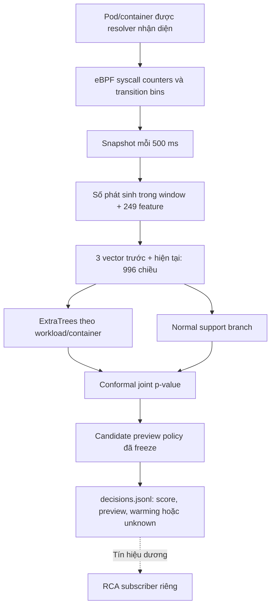

# Sentinel Pulse — thuật ngữ, triển khai và tiến độ

Cập nhật bằng SSH lúc **14:51 ngày 15/10/2026, UTC+7**. Đây là báo cáo
hiện hành của nhánh phát hiện ML, không phải nhật ký checkpoint.
Hai nhánh còn lại: [chọn feature/syscall](SYSCALL_FEATURE_EXPERIMENT_STATUS.md)
và [RCA sau tín hiệu](RCA_RUNTIME_STATUS.md). Báo cáo tổng hợp cũ
[SENTINEL_PULSE_VA_THI_NGHIEM_SYSCALL.md](SENTINEL_PULSE_VA_THI_NGHIEM_SYSCALL.md)
được giữ nguyên theo yêu cầu; số live trong file này có timestamp riêng.

## 1. Mục tiêu và trạng thái thực tế

Pulse tìm hành vi runtime khác normal baseline của từng workload/container.
Mục tiêu phát triển là latency kernel→alert khoảng 1–2 giây với precision và
recall tốt, **không yêu cầu false positive bằng 0**.

Hiện pipeline chạy **shadow/preview**, chưa phát alert production hoặc tự
cách ly pod. `candidate_alert_preview=true` là tín hiệu để đánh giá và điều
tra; runtime vẫn ghi `alert=false`, `policy_applied=false`.

| Node | IP | Trạng thái | Cadence tích lũy | Scored rows | Preview dương | Issue đã giữ |
|---|---|---|---:|---:|---:|---:|
| k8s-worker1.local | 10.1.16.237 | running | 14,12 giờ | 2.693.376 | 143.155 | 22 |
| k8s-worker4.local | 10.1.16.238 | running | 14,04 giờ | 2.850.198 | 326.807 | 196 |
| k8s-worker3.local | 10.1.16.239 | running | 14,10 giờ | 797.215 | 16.460 | 28 |

Đăng ký capture 48 giờ/node: cadence hiện khoảng **29,4% thời lượng đăng ký**,
không phải phần trăm hoàn thành toàn dự án. `completed_seconds` đếm cadence,
không thay cho valid normal/scored exposure. Preview dương và issue không tự
động là false positive, attack hoặc số lần service restart.

Unit trên cả ba worker: `pulse-matched-worker-parallel-20261015.service`.
Collector xuất full-ID delta và 249 feature từ cùng snapshot 500 ms, đồng
thời chấm candidate đã freeze. Thay tài liệu không restart các service này.

**Soak Pulse hiện có recovery.** Cả ba unit được xác minh `enabled`,
`Restart=on-failure`, `RestartSec=30`; process lỗi sẽ được systemd chạy lại.
Worker đọc `STATUS.json` để tiếp tục `completed_seconds`, tạo segment mới và
reset history. Khi loader thoát/mất dữ liệu, worker ghi issue rồi mở segment
mới. Khi storage thiếu chỗ, worker giữ tiến độ và chờ. NFS mount là prerequisite
của unit; boot được cấu hình khởi động service sau mount. Đây là cấu hình đã
xác minh, chưa phải bằng chứng đã thử reboot thực tế.

Khoảng gap/ineligible không tự trở thành normal/TN. Cadence tích lũy cũng không
thay cho exposure hợp lệ. Checkpoint có chu kỳ khoảng 5 giây; segment bị ngắt
trước seal cần giữ làm evidence thiếu coverage. Lượt này `NRestarts=0` trên cả
ba worker; issue count không phải số process restart. Yêu cầu bỏ bổ sung
recovery cho fit syscall R4 không tắt recovery của soak Pulse. Các unit đã được
xác nhận active/enabled lúc **14:51 UTC+7**. RCA runtime hooks mới chưa được
bật trên production trong normal holdout, vì vậy môi trường capture hiện tại
chưa bị thay đổi bởi RCA mở rộng.

Một mẫu tail ngắn tại snapshot có p99 **cuối-window→preview** lần lượt
0,522 / 0,603 / 0,224 giây (worker1/worker4/worker3), với 356 / 363 / 348
scored rows. Mẫu chỉ phủ khoảng 6–22 giây, chưa đại diện toàn soak và chưa
đo kernel→alert. [Dữ liệu kiểm tra SSH](validation-evidence/pulse-parallel-live-20261015/inspection.json)
giữ giới hạn mẫu và các timestamp.

## 2. Thuật ngữ cần hiểu

| Thuật ngữ | Nghĩa trong triển khai này |
|---|---|
| Syscall | Lần process yêu cầu dịch vụ kernel, ví dụ read, connect, execve; entry chưa chứng minh thành công |
| eBPF | Chương trình chạy trong kernel để quan sát và cập nhật counter |
| Telemetry | Dữ liệu quan sát runtime: số gọi, transition, identity và timestamp |
| Cgroup/resolver | Nhóm tài nguyên Linux; resolver ánh xạ Pod UID → container → cgroup → revision |
| Snapshot/counter tích lũy | Ảnh chụp số đếm tăng dần; lấy số mới trừ số cũ để biết lượng phát sinh trong window |
| Window/cadence | Khoảng gom dữ liệu, ở đây danh nghĩa 500 ms; dùng timestamp thực để tính rate |
| Exact count | Số lần hook đã quan sát trong phạm vi cgroup/ABI; không phải sampled log và không bảo đảm thấy mọi đường kernel |
| Feature/vector | Dãy số dùng cho ML; một window có 249 số float32 |
| Hash bin | Gom nhiều syscall ID hoặc cặp transition vào bucket; collision làm mất khả năng phân biệt từng ID |
| Adjacent transition | Cặp syscall kề nhau theo task, không phải toàn bộ chuỗi thứ tự toàn container |
| Rolling mean/std | Trung bình/độ lệch chuẩn rate của các window trước; runtime dùng rolling-10 |
| Temporal context | Ghép 3 vector trước và vector hiện tại: 4 × 249 = 996 chiều |
| Idle-aware | Giữ/xử lý window không có syscall thay vì mặc định bỏ hoặc coi là dữ liệu lỗi |
| ExtraTrees | Ensemble cây quyết định ngẫu nhiên; không phải LSTM hoặc deep learning |
| Self-supervised | Học normal so với negative được corrupt từ normal, không dùng attack evaluation để fit |
| Calibration/conformal p-value | Dùng normal calibration scores làm phân phối tham chiếu; p nhỏ là khác tham chiếu, không phải xác suất bị attack |
| Support branch | Nhánh học vùng hỗ trợ của normal để nhận ra tọa độ ngoài tham chiếu, kể cả tọa độ gần hằng số |
| Freeze/binding | Khóa source, model, policy, schema và checksum để tránh trộn các phiên bản |
| Batch/scalar | Chấm nhiều context cùng model trong một lần / chấm từng context riêng |
| Warming/reset | Chưa đủ history / xóa history khi identity hoặc continuity không còn hợp lệ |
| Soak/canary | Quan sát kéo dài để đo tính ổn định / thử live hữu hạn trước khi mở rộng |
| Ground truth/adjudication | Nhãn độc lập để chấm / review bằng chứng để xác nhận nhãn |
| Unknown | Thiếu nhãn, coverage hoặc provenance; không tự đổi thành normal/TN |
| Backlog/ingest lag | Dữ liệu tồn đọng / tuổi dữ liệu khi consumer xử lý |
| Artifact/receipt | Sản phẩm như model/prediction / biên nhận START, STATUS, TERMINAL và hash |

## 3. Luồng ML đang chạy



249 chiều gồm: 29 log-count + 29 ratio + 5 aggregate (`other`, total,
sensitive ratio, seccomp denied) + 64 syscall bins + 64 transition bins +
29 rolling mean + 29 rolling std. `log_count=ln(1+count)` nên không phải số
nguyên. Rolling dùng rate=count/thời lượng thực, sau đó log1p thống kê.

Model học phân biệt normal và corrupted context; history thật được giữ,
current row bị corrupt khi tạo negative. Mỗi workload/container có model
riêng, bundle hiện hành có 21 key. Window chưa có model không được coi là TN.

Hai nhánh trả `tree_p`, `support_p`; code kết hợp
`joint_p=min(1, 2*min(tree_p, support_p))`. Policy preview so joint_p với alpha
đã calibrate, **không có semantic gate hoặc two-window confirmation** trong
candidate này. Không lấy policy cũ trong repo làm mô tả runtime hiện hành.
History không đồng nghĩa mỗi quyết định phải chờ thu lại bốn window: sau
warm-up, pipeline cập nhật liên tục theo từng window.

## 4. Kết quả đã hoàn tất

### Normal soak và tối ưu inference

- Normal A1 đã thu đủ biên 24 giờ trên ba worker: 33.149.479 feature records;
  review 33.148.914 decisions, 11.388.831 scored, 30.412 preview dương.
- Soak scalar có backlog nên **không đạt realtime**, dù capture hoàn thành.
- Batch đã kiểm tra tương đương 21/21 model. Canary B2 khoảng 30 phút/node
  có p99 cuối-window→score khoảng 0,213–0,556 giây; đây không phải kernel→alert.
- Chênh 565 feature/decision và adjudication normal vẫn cần giải thích đầy đủ.

Nguồn: [tổng hợp và review](validation-evidence/pulse-parallel-completion-20261014/SUMMARY.json),
[B2 receipts](validation-evidence/pulse-batch-canary-b2-evidence-final-20261014/238-TERMINAL.json).

### Development attack/control R3

315 cặp = 630 interval, 21 key × 5 scenario đã lộ × 3 rate × 1 seed.
Không gọi đây là fresh blind set. Sau replay evaluator có binding:

| Nhãn interval | Preview dương | Preview âm | Unknown |
|---|---:|---:|---:|
| Attack theo lịch | TP 284 | FN 2 | 29 |
| Control expected-normal | FP kỳ vọng 72 | TN kỳ vọng 237 | 6 |

- Precision theo nhãn control kỳ vọng: **79,78%** = 284/(284+72).
- Recall observable: **99,30%** = 284/286; lower bound theo toàn bộ attack:
  **90,16%** = 284/315, không loại unknown khỏi đánh giá end-to-end.
- Control-positive rate: **23,30%** = 72/309. Chưa adjudicate nên chưa phải
  confirmed FPR; confirmed precision/FPR còn null.
- Kernel→preview trên 284 trial phát hiện: p50 **1,067 s**, p95 **1,609 s**,
  p99 **4,751 s**. Kernel receipt là execve của fixture, chưa phải syscall
  bảo mật đầu tiên. Timestamp preview chưa chứng minh alert đã được consumer nhận.

Nguồn: [terminal replay](validation-evidence/pulse-matched-r3-r4-20261015/r3-replay-TERMINAL.json).
Replay chỉ đổi một control unknown thành TN so với terminal gốc, không xóa
FN/control dương. Precision trong thiết kế gần 1:1 không suy ra production
precision khi attack hiếm.

### RabbitMQ follow-up R5

Đã chạy hết 15 cặp sau sửa nơi stage fixture cho root filesystem chỉ đọc:
TP=13, FN=0, FP kỳ vọng=1, TN kỳ vọng=14, unknown=2. Kernel→preview p95
**1,288 s** trên 13 trial phát hiện. Hai unknown là thiếu scored coverage
và thiếu kernel receipt. R5 nằm ở output riêng, không thay 15 unknown Rabbit
của R3. [Terminal R5](validation-evidence/pulse-matched-r3-r4-20261015/r5-TERMINAL.json).

## 5. Tiến độ hoàn thiện và việc còn lại

| Việc | Trạng thái |
|---|---|
| Exact capture, identity, 249 feature, idle handling | Đã triển khai |
| Frozen 21-key candidate, batch inference, preview | Đang chạy realtime trên ba worker |
| Một lượt normal soak và development attack/control | Đã có kết quả, giữ mọi miss/issue/unknown |
| Matched benign-exec control để tách launch artifact | Chưa có bằng chứng hoàn tất |
| Review nhãn và confirmed confusion matrix | Chưa hoàn tất |
| Fresh blind attack + independent normal đánh giá candidate freeze | Chưa hoàn tất |
| Kernel→published alert/consumer latency đúng endpoint | Chưa có; hiện là preview |
| Khắc phục control positives và tail latency p99 | Cần phát triển trên tập development rồi freeze, test mới |
| Overhead A/B lặp, CI và generalization | Còn thiếu |
| Operational alert/enforcement/promotion | Chưa bật |

Kỳ vọng development đăng ký: precision/recall ≥95%, interval false-positive
rate ≤5%, p95 kernel→alert ≤2 giây. Đây là **mục tiêu**, không phải kết quả
hay bảo đảm toán học. Xem [protocol](sentinel_pulse/protocol/pulse-improvement-expectations-c1.json).
Không tune theo blind set rồi chấm lại như độc lập; không bắt buộc FP=0.

Hạ tầng gap, rollout hoặc DiskPressure phải có log/coverage; thu tiếp sau
recovery nhưng không tự gán các khoảng lỗi thành normal. Không đổi model
đang freeze giữa một lượt đánh giá để làm đẹp kết quả.

## 6. Source, artifact và lệnh kiểm tra

- Runtime: [matched_worker.py](sentinel_pulse/matched_worker.py),
  [features.py](sentinel_pulse/features.py), [idle_batch.py](sentinel_pulse/idle_batch.py),
  [support_model.py](sentinel_pulse/support_model.py), [policy](sentinel_pulse/candidate_policy.py).
- Capture/scorer source: `/mnt/sentinel-pulse-archive/runtime-matched-7533e66/source`;
  frozen math: `runtime-2c1a72d-20261013/source`; bundle: `runtime-f95867d-20261012/model-bundle`.
- Model manifest SHA-256: `747c4eed2a9a74321d0ac3b716c201c449f946665252baa1ca314b1f18278a08`.
- Policy SHA-256: `fd0be94a4ca7f2cd64b97bf5c7dc074763405f821ab346e8e19bb5975d10f401`.
- Output NFS: `/mnt/sentinel-pulse-archive/matched-parallel-20261015/workers/<node>`;
  segment có raw/features/decisions/issues JSONL và TERMINAL seals.

```bash
# Trên từng worker; chỉ đọc, không restart.
systemctl show pulse-matched-worker-parallel-20261015.service -p ActiveState -p SubState -p NRestarts
# Trên control plane, thay node bằng hostname worker cần xem.
sudo python3 -m json.tool /mnt/sentinel-pulse-archive/matched-parallel-20261015/workers/k8s-worker1.local/STATUS.json
```

Job chạy bằng systemd, không gắn SSH/laptop. Có checkpoint/recovery nhưng
không cam kết không có outage; trạng thái phải kiểm tra bằng heartbeat và
artifact, không chỉ tên unit. Code legacy còn trong repo không có nghĩa nó
thuộc nhánh Pulse này. Không có tỷ lệ % toàn dự án có cơ sở để công bố.
