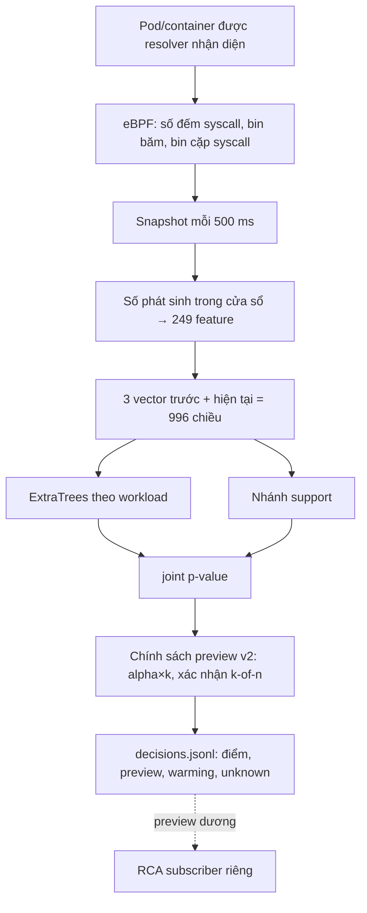

# Sentinel Pulse — trạng thái, kết quả và nhật ký

Cập nhật **19/10/2026 10:41 (UTC+7)** từ SSH vào cụm. Giờ trong file là UTC+7, trừ khi ghi UTC.

Đây là một trong ba báo cáo hiện hành:
- Sentinel Pulse — phát hiện bằng ML (file này; gồm cả hạ tầng chung và nhật ký);
- [thí nghiệm chọn syscall](SYSCALL_FEATURE_EXPERIMENT_STATUS.md);
- [RCA — dựng đồ thị điều tra](RCA_RUNTIME_STATUS.md).

Danh sách việc cần làm nằm ở [TODO.md](TODO.md).


## Tên gọi và đường dẫn thật trên cụm

Báo cáo dùng tên mô tả. Thư mục và unit có từ trước giữ tên cũ trên đĩa, vì config và hash bằng chứng tham chiếu tới chúng. Trên NFS có symlink tên mô tả trỏ tới từng thư mục, nên đường dẫn trong báo cáo dùng được trực tiếp.

| Tên trong báo cáo | Là gì | Thư mục / unit thật |
|---|---|---|
| `pulse-soak-baseline` | Soak 48 giờ của candidate gốc | `/mnt/sentinel-pulse-archive/matched-parallel-20261015` |
| `pulse-attack-dev` | Ma trận tấn công development 315 cặp | `matched-parallel-r3-20261015` |
| `pulse-attack-dev-rabbitmq` | 15 cặp RabbitMQ bổ sung | `matched-parallel-r5-rabbit-20261015` |
| `syscall-arms` | Thí nghiệm 11 cấu hình syscall (693 model) | `matched-parallel-r4-20261015` |
| `pulse-candidate-baseline` / `pulse-candidate-recalibrated` | Candidate gốc / candidate hiệu chỉnh lại | `runtime-f95867d-20261012` / `runtime-recal-c1-20261018` |
| `pulse-live-recalibrated` | Lượt live: candidate hiệu chỉnh lại + `policy-1win-a3` (xong 20/10 02:22; `features`/`decisions` đã nén gzip có kiểm seal) | `matched-r6-20261018`; unit `pulse-matched-worker-r6-20261018` |
| `…/campaign-main`, `…/campaign-rca` | Campaign 315 cặp / campaign 105 cặp đánh giá RCA | `coordinator-runtime-r6-d791d24-20261019` / `coordinator-rca-followup-20261019` |
| `policy-1win-a3` | Chính sách 1 cửa sổ, alpha×3 | `sentinel_pulse/protocol/policy-1win-a3.json` (SHA-256 `f6107351…`) |
| `policy-2of2-a10` | Chính sách xác nhận 2/2 cửa sổ, alpha×10 (chọn theo luật 5.7) | `sentinel_pulse/protocol/policy-2of2-a10.json` (SHA-256 `a51e5abc…`) |
| `pulse-stable-candidate` | Lượt live ứng viên cho bản stable: candidate hiệu chỉnh lại + `policy-2of2-a10`, chấm điểm nhanh (đang chạy) | `/mnt/sentinel-pulse-archive/pulse-stable-candidate`; unit `pulse-matched-worker-pulse-stable-candidate` (worker), `pulse-matched-{traffic,campaign}-pulse-stable-candidate` (.234) |
| `rca-pulse-stable-candidate` | RCA của lượt pulse-stable-candidate (cấu hình như rca-subscriber, đang chạy) | unit `rca-pulse-stable-candidate`, `/var/lib/sentinel-pulse-rca/rca-pulse-stable-candidate` |
| `rca-subscriber` | RCA đọc decision qua SSH trên pulse-live-recalibrated (dừng 20/10 10:16) | unit `rca-subscriber`, `/var/lib/sentinel-pulse-rca/rca-subscriber` |
| `rca-followup`, `rca-followup-v1`, `rca-flow`, `rca-runtime-v1` | Các bản RCA cũ (lịch sử) | `/var/lib/sentinel-pulse-rca/runtime-events-…` (có symlink cùng tên) |

## 1. Tóm tắt

- **Pulse làm gì.** Pulse đếm syscall của từng container Kubernetes bằng eBPF. Cứ 0,5 giây, nó tạo một vector 249 số cho mỗi container. Một model riêng cho từng workload chấm điểm xem cửa sổ đó "lạ hay không" so với lúc bình thường. Toàn bộ chạy ở chế độ **shadow**: chỉ ghi `candidate_alert_preview` (cảnh báo thử), không phát cảnh báo vận hành, không cách ly pod.
- **Kết quả mới nhất: lượt live pulse-stable-candidate** (campaign 20/10, dữ liệu mới, nhãn kỳ vọng, chính sách `policy-2of2-a10`, chấm điểm nhanh; mục 5.8a):

  | Chỉ số | Kỳ vọng | Kết quả | Lượt trước |
  |---|---|---|---|
  | Precision | ≥ 95% | **92,2%** | 89,1% |
  | Recall | ≥ 95% | **97,8%** | 92,8% |
  | Control idle dương | ≤ 5% | **8,4%** | 11,2% |
  | p95 kernel → preview | < 2 s ưu tiên, ≤ 3 s chấp nhận | **1,85 s** | 1,90 s |
  | Đợt cảnh báo trên normal | ≤ 0,1/giờ | chờ phân tích final (21/10) | 13,0 |

  Độ trễ đạt mức ưu tiên (< 2 s); precision và control chưa đạt. Thêm bước chờ 1 s sau alert đầu (vẫn ≤ 3 s, mục 5.8b) thì gần đạt: precision 94,9%, control 5,2%, recall 95,5%, p95 2,64 s (chưa blind).
- **Phát hiện quan trọng nhất.** Một binary vô hại chạy cùng đường khởi chạy với attack bị gắn cờ **80–92%** ở alert < 2 s. Nghĩa là Pulse phát hiện "process bất thường", chưa phân biệt được ác ý. Nó chỉ tách rõ các attack dùng syscall hiếm: ptrace, setns, execveat.
- **Đang chạy: lượt live pulse-stable-candidate** (20/10 10:15 → 21/10 ~10:20).
  - Chính sách `policy-2of2-a10` được chọn bằng luật đăng ký trước (mục 5.7a): precision 95,2%, recall 97,3%, control 4,8%, p95 2,43 s và 8,0 đợt/replica-giờ trên dữ liệu development. Chính sách này **không đạt** kỳ vọng p95 ≤ 2,3 s.
  - Chấm điểm bằng đường nhanh: kết quả khớp từng bit với đường cũ, CPU mỗi worker giảm từ ~94% xuống ~30% một core.
  - Câu hỏi: trên dữ liệu mới, k2of2 có giữ được precision/recall ≥ 95% không, và chấm nhanh có kéo p95 xuống không.
- **Nút thắt kéo dài: gánh cảnh báo trên dữ liệu bình thường.**
  - Calibration lệch dần theo thời gian.
  - Hiệu chỉnh lại p-value giảm tỉ lệ cửa sổ bị gắn cờ từ 8,1% xuống 0,35%.
  - Dù vậy vẫn còn 6–17 đợt mỗi replica-giờ, xa ngân sách 0,1. Làm mới calibration mỗi giờ chỉ giảm thêm 16–23% (mục 5.6).
  - Thí nghiệm syscall cho thấy thay bộ syscall không giải quyết được vấn đề này.

## 2. Trạng thái cụm và job (10:18 ngày 20/10)

| Thành phần | Trạng thái |
|---|---|
| Lượt live **pulse-stable-candidate** (3 worker) | **Đang chạy** từ 10:14:53; chạy hết chu kỳ 24 giờ, đến 21/10 khoảng 10:15–10:35. Candidate `ec72d9ea…` + `policy-2of2-a10`, chấm điểm nhanh, không ghi `raw.jsonl`. Pha chọn (traffic, chưa attack) 10:17–11:47; campaign 315 cặp từ 11:49 |
| Traffic + campaign | Unit `pulse-matched-traffic-pulse-stable-candidate`, `pulse-matched-campaign-pulse-stable-candidate` trên `.234` |
| RCA | `rca-pulse-stable-candidate` (đọc decision qua SSH, case tiếp nối, baseline binary đóng băng lúc 11:47:29). `rca-subscriber` đã dừng |
| Lượt pulse-live-recalibrated | **Xong** 20/10 02:12–02:22 (mục 5.5). `features`/`decisions` đã nén gzip có kiểm seal: 296 file, 0 sai seal, thu lại 73,4 GB (80 → 9,9 GB) |
| Job phân tích 20/10 02:10–03:18 | **Xong**: chọn candidate (5.7a), refresh calibration (5.6), novel-syscall (5.5b), bootstrap syscall (file syscall, mục 5.7; lỗi lúc 03:18 rồi chạy tiếp lúc 09:46) |
| Theo dõi | Mỗi 5 phút kiểm tra heartbeat worker, số issue, RCA, NFS, số tiến trình `tetra getevents` (`/home/dat/health-run.py`) |
| Phân tích sau lượt (đã hẹn) | Unit `pulse-stable-candidate-analysis` trên `.234` (`scripts/pulse_stable_candidate_analysis.sh`, snapshot `9758e15`) tự chạy theo 2 giai đoạn:<br>• **campaign xong:** kết quả campaign, attack-vs-benign, coverage/xếp hạng/độ trễ/flow RCA. Giai đoạn này nhẹ, chạy được khi capture còn chạy;<br>• **3 worker xong:** gánh cảnh báo normal (as_run so với calibration làm mới, 5.7b), replay campaign với calibration làm mới, cadence gap, novelty có xét exec (5.7c), đối chiếu chấm nhanh trên lượt live với sklearn |
| Bộ nhớ VM (vSphere) | **Balloon đang giữ RAM của mọi VM** (11:10): 81 GB trên master2/3 và 3 worker, 51 GB trên `.234`, 2/3,9 GB trên NFS server. Hiện chưa có áp lực bộ nhớ hay swap; worker còn 27–33 GB, NFS server còn ~0,9 GB. Xem mục 8 |
| Collector 1 s + resolver trên worker | Chạy; resolver bắt buộc phải có cho matched worker |
| NFS `/mnt/sentinel-pulse-archive` | **Tổng 685 GB, trống 476 GB** (mở rộng online 20/10 10:46, không reboot, không gián đoạn lượt live). Lượt 24 giờ dùng khoảng 80 GB |
| Ổ đĩa worker | 40% / 40% / 29% |
| Quy tắc | Không chạy job NFS hoặc bộ nhớ nặng trên bất kỳ node nào khi lượt live đang chạy; không chạy trên master 2/3 |

## 3. Thuật ngữ

| Thuật ngữ | Nghĩa trong triển khai này |
|---|---|
| syscall | Lời gọi hệ thống (read, connect, execve…); đếm ở entry nên chưa chứng minh thành công |
| eBPF | Chương trình chạy trong kernel, ở đây dùng để đếm syscall theo cgroup |
| cgroup / resolver | Nhóm tài nguyên của container / tiến trình ánh xạ Pod UID → container → cgroup → revision |
| cửa sổ (window) | 0,5 giây; mỗi container có một vector cho mỗi cửa sổ |
| vector 249 số | Gồm:<br>• log-count và tỷ lệ của 29 syscall;<br>• 5 tổng hợp;<br>• 64 bin băm syscall;<br>• 64 bin băm cặp syscall liền nhau;<br>• trung bình và độ lệch trượt (rolling-10) |
| ngữ cảnh (context) | 3 cửa sổ trước + cửa sổ hiện tại = 996 số đưa vào model |
| ExtraTrees | Họ cây quyết định ngẫu nhiên (không phải deep learning), học phân biệt normal với normal bị làm hỏng |
| nhánh support | Phát hiện tọa độ nằm ngoài vùng từng thấy khi bình thường |
| p-value (conformal) | Vị trí điểm của cửa sổ so với điểm normal dùng để hiệu chỉnh; p nhỏ là hiếm gặp. Chỉ đúng nghĩa khi normal lúc chạy giống normal lúc hiệu chỉnh |
| joint_p, alpha | joint_p = min(1, 2·min(tree_p, support_p)); alpha = 0,05/30 ≈ 0,00167 mỗi cửa sổ |
| hệ số alpha (alpha×k) | Nới ngưỡng thành k·alpha |
| xác nhận k-of-n | Chỉ báo khi ít nhất k trong n cửa sổ liên tiếp vượt ngưỡng; ví dụ k2of2_a10 là 2/2 cửa sổ với alpha×10 |
| hiệu chỉnh lại (recalibration) | Thay tập điểm normal dùng để tính p-value bằng normal gần hơn; giữ nguyên model |
| cảnh báo thử (preview) | `candidate_alert_preview=true`; tín hiệu để đánh giá, **không phải** cảnh báo vận hành |
| đóng băng (freeze) / frozen_source | Khóa source, model, chính sách bằng SHA-256. Worker từ chối chạy nếu các file chấm điểm khác bản đóng băng |
| kiểm tra tương đương | Replay segment đã niêm phong qua code mới, yêu cầu điểm giống **từng bit** với điểm đã ghi |
| soak | Chạy liên tục nhiều giờ trên tải bình thường |
| cặp attack/control | Control 15 s (không làm gì) → binary vô hại 15 s → attack 15 s, trên cùng container |
| binary vô hại (benign-exec control) | Cùng file, cùng đường `kubectl exec` như attack, chỉ gọi `getpid` lặp lại. Dùng để tách "có process mới" khỏi hành vi tấn công |
| TP / FN / FP / TN | Bắt đúng / bỏ sót / báo nhầm / im lặng đúng. "FP kỳ vọng" vì nhãn control chưa được review |
| unknown | Thiếu dữ liệu hoặc bằng chứng; không bao giờ tự đổi thành TN/FN |
| đợt cảnh báo (episode) | Các cửa sổ dương của một container cách nhau < 15 s gộp thành một đợt |
| replica-giờ | Một giờ dữ liệu đã chấm của một container (replica) |
| development / blind | Dữ liệu đã nhìn khi phát triển / dữ liệu mới chưa dùng để chỉnh. Chỉ blind mới dùng để kết luận cuối |
| cadence gap | Hai snapshot cách nhau ngoài 0,35–0,8 s; history bị reset, cửa sổ sau đó không tính là normal |

## 4. Luồng ML đang chạy



- **Model.** Mỗi workload/container có model riêng; bundle hiện hành có 21 key trong namespace `production` của ứng dụng AIMS. Cửa sổ của container chưa có model không được tính là TN.
- **Phạm vi giám sát** (kiểm tra trên cụm 19/10 19:50):
  - *Được chấm điểm:* mọi replica của 21 workload trên, trên cả 3 worker (worker1, worker3, worker4). Mỗi worker có một matched worker chấm các pod trên node của nó. Lúc kiểm tra có 79 pod `production` (27 / 32 / 20 pod theo node).
  - *Không được chấm điểm:*
    - 3 pod tạo traffic `aims-sentinel-*-loadgen`;
    - các namespace hạ tầng (`kube-system`, `istio-system`, `longhorn-system`, `monitoring`, `vault`, `argocd`…);
    - cả 3 master, vì không có pod `production` nào chạy trên master.
  - *Lịch tấn công thử:* 315 lượt rải qua cả 21 workload; mỗi lượt nhắm một replica.
  - *RCA:* Tetragon chạy trên 6 node, nhưng policy RCA là `TracingPolicyNamespaced` trong `production`, và case chỉ được dựng khi Pulse cảnh báo. Vì vậy RCA có cùng phạm vi.
  - *Mở rộng:* muốn giám sát cả hạ tầng thì phải thu normal và huấn luyện model cho các workload đó trước.
- **Chính sách v2** (`detector/candidate_policy.py`, schema `sentinel-pulse-candidate-preview-policy-v2`) có hai tham số đăng ký trong file JSON có SHA-256:
  - hệ số alpha;
  - số cửa sổ xác nhận k-of-n.
- **Chấm điểm batch** (`detector/idle_batch.py`): gom các context cùng workload trong một frame rồi chấm một lần.
- **Đường chấm điểm nhanh** (`detector/fast_forest.py`, bật bằng `fast_scoring: true`) cho kết quả giống hệt từng bit. Batch đầu tiên của mỗi model được so với sklearn; nếu lệch thì tự quay về đường cũ.

## 4b. Bằng chứng cho bộ feature của Pulse (từ thí nghiệm syscall)

Thí nghiệm syscall ([SYSCALL_FEATURE_EXPERIMENT_STATUS.md](SYSCALL_FEATURE_EXPERIMENT_STATUS.md)) có mục đích chọn bộ syscall cho Pulse và làm bằng chứng cho lựa chọn đó.
- **Cách làm:** 11 cấu hình feature được fit đúng như Pulse: cùng snapshot 500 ms, ExtraTrees + nhánh support theo workload, conformal p-value, cùng cách hiệu chỉnh lại. Tổng 693 model = 21 workload × 11 cấu hình × 3 seed. Các cấu hình chỉ khác nhau ở phần syscall tường minh.
- **So sánh:** ở cùng ngân sách cảnh báo nhầm trên normal, có khoảng tin cậy bootstrap theo workload.

| Thành phần trong vector 249 feature của Pulse | Quyết định | Bằng chứng (thí nghiệm syscall) |
|---|---|---|
| 29 syscall tường minh (log-count + tỉ lệ) | **Giữ nguyên `base29`** | Không cấu hình nào tốt hơn base29 có ý nghĩa thống kê: CI 95% của chênh recall chứa 0 với mọi cấu hình bỏ hoặc thêm syscall; riêng `plus_all_*` ở ngân sách rộng tăng recall nhưng kéo theo binary vô hại (xem dưới). Mục 5.7 |
| Cặp exec (`execve`, `execveat`) | **Bắt buộc giữ** | Bỏ cặp này làm recall giảm 6,7–10,6 điểm, CI loại trừ 0 ở cả 2 tập dữ liệu và 2 ngân sách. Toàn bộ mức giảm nằm ở kịch bản `execveat` (100% → 49–66%). Mục 5.7, 5.8 |
| Syscall hiếm trong normal (`ptrace`, `setns`, `execveat`, `mount`, `unshare`, `pivot_root`, `recvmmsg`) | **Giữ dù bằng 0 trên normal** | Đây chính là tín hiệu tấn công: mọi cấu hình 29 syscall bắt `ptrace`/`setns` 100%. Bảy kênh này bằng 0 trên 185 triệu lượt gọi normal (C3) nên không làm tăng cảnh báo nhầm. Mục 3, 5.8 |
| Thêm syscall theo tần suất (top-8/16/32) | **Không thêm** | Không tăng recall; ở ngân sách 5, `seccomp_api_probe` còn kém đi 6–11 điểm (60–64% so với 70%) và không đạt tiêu chí không-kém-hơn. Mục 5.7, 5.8 |
| Thêm 15 syscall bảo mật hiếm (`plus_security`) | **Không thêm** | Không khác base29 (chênh recall −0,4 đến +0,3 điểm, CI chứa 0); bộ attack hiện tại không dùng các syscall này. Mục 5.7 |
| Mọi syscall ID (`plus_all_*`, ~300 feature) | **Không dùng** | Ở ngân sách rộng recall tăng 6–8 điểm, nhưng binary vô hại bị gắn cờ 96–100% (base29: 72–78%), nên khoảng cách attack − vô hại giảm 17–23 điểm (CI loại trừ 0). Ở ngân sách chặt mất recall ở `ptrace` (82%) và `execveat` (75%). Mục 5.5, 5.7, 5.8 |
| Nhánh support (vector hiện tại) | **Bắt buộc giữ** | Chỉ dùng tree: recall −28,2 [−42,5; −15,2] và −31,2 [−45,4; −17,4] điểm ở ngân sách 1, p95 chậm thêm 1,1–1,6 s (syscall 5B.1) |
| Nhánh tree (lịch sử → hiện tại) | **Giữ** | Chỉ dùng support: recall −5,2 [−10,6; −1,1] và −7,1 [−14,9; −0,8] điểm ở ngân sách 1. Ở ngân sách 5 thì không kém hơn, nên lợi ích nằm ở vùng ngưỡng chặt (syscall 5B.1) |
| 64 bin băm syscall, 64 bin băm cặp, 5 tổng hợp, rolling-10, log-count/tỉ lệ, số cửa sổ lịch sử | Đang kiểm chứng | Thí nghiệm nhóm feature (syscall 5B, đăng ký 20/10 12:01) bỏ từng phần với mọi thứ khác giữ nguyên, so ở cùng ngân sách dưới k2of2, theo luật cần thiết / có thể bỏ / chưa kết luận đăng ký trước |

**Giới hạn của bằng chứng (ghi trong báo cáo đồ án):**
- Development: các kịch bản tấn công đã dùng khi phát triển; normal chưa review nhãn.
- Theo luật protocol v2, kết quả chính thức là **inconclusive**, vì không cấu hình nào đạt ngân sách 0,1 đợt/giờ. Bằng chứng trên là so sánh ở ngân sách 5 và 18 đợt/giờ.
- Hai kịch bản dùng syscall phổ biến (`mprotect`, `seccomp`) là điểm yếu chung của mọi bộ syscall (70–83%). Đổi bộ syscall không sửa được; cần thông tin khác ngoài tần suất, ví dụ tham số syscall.
- **Đã kiểm dưới k2of2, đúng chính sách Pulse đang chạy (syscall 5.9, 20/10):**
  - với k2of2, ngân sách 1 đợt/replica-giờ đạt được cho cả 11 cấu hình;
  - base29 không bị cấu hình nào vượt: recall 91,2%, control 1,0%, p95 2,27 s;
  - `drop_exec_pair` vẫn kém có ý nghĩa: −7,1 [−11,5; −2,7] điểm.
  
  Kết luận trong bảng giữ nguyên.
- **Lý do thứ hai không mở rộng bộ syscall: độ trễ.** Ở cùng ngân sách 1, `plus_top*` có p95 2,9–3,1 s và `plus_all_*` 5,0 s, so với base29 2,3 s. Mục tiêu của Pulse là p95 < 2 s.

**Kết quả đưa vào Pulse:**
- candidate `ec72d9ea…` và lượt pulse-stable-candidate dùng `base29`;
- không fit lại model, vì không có thay đổi feature nào được chứng minh là tốt hơn;
- kết quả k2of2 không đổi kết luận, nên không fit lại;
- phát hiện phụ: calibration mới + k2of2 đạt ~1 đợt/replica-giờ trong thí nghiệm syscall, so với ~8 ở lượt live (calibration cũ). Phép thử làm mới định kỳ + k2of2 cho Pulse đã được đăng ký ở 5.7d.

## 5. Kết quả

### 5.1 Soak 48 giờ của candidate đóng băng (15–17/10, normal chưa review nhãn)

| Worker | Cửa sổ đã chấm | Cảnh báo thử | Tỷ lệ | Issue |
|---|---:|---:|---:|---:|
| worker1 (.237) | 9.011.856 | 673.825 | 7,5% | 146 |
| worker4 (.238) | 8.051.218 | 950.765 | 11,8% | 381 |
| worker3 (.239) | 4.408.203 | 90.161 | 2,0% | 65 |
| **Tổng** | **21.471.277** | **1.714.751** | **8,0%** | 592 |

- Model `747c4eed…`, chính sách `fd0be94a…`.
- Nếu p-value đúng nghĩa, tỷ lệ cửa sổ dương phải quanh 0,17%; thực tế cao gấp ~47 lần, tương ứng 37,1 đợt mỗi replica-giờ.
- Bằng chứng: `validation-evidence/results-20261018/pulse-soak-48h-*-TERMINAL.json`.

**Lưu ý (phát hiện ngày 19/10, mục 5.5).** Trong thời gian soak, Tetragon trên worker1/worker3 đang gánh hàng trăm client mồ côi. Điều này có thể đã gây cadence gap và làm lệch một phần số đo; worker4 có 7–9 gap mỗi segment trong 6 giờ đầu.

### 5.2 Ma trận attack/control phát triển pulse-attack-dev (+ rabbitmq) (14–15/10)

pulse-attack-dev gồm 315 cặp (21 key × 5 kịch bản × 3 tốc độ):

| | Bắt được | Không bắt | Unknown |
|---|---:|---:|---:|
| Attack | TP 284 | FN 2 | 29 |
| Control | FP kỳ vọng 72 | TN kỳ vọng 237 | 6 |

- Precision 79,8%, recall 99,3% (cận dưới khi tính cả unknown: 90,2%), control dương 23,3%.
- Kernel → preview p50 / p95 / p99 = 1,07 / 1,61 / 4,75 s.
- pulse-attack-dev-rabbitmq (RabbitMQ, 15 cặp): TP 13, FN 0, FP 1, TN 14, unknown 2.
- Đây là dữ liệu development, thiết kế 1:1. pulse-attack-dev **chưa có** đối chứng binary vô hại.

### 5.3 Xác nhận k-of-n trên p-value gốc (18/10, development)

Số đợt mỗi giờ tính trên toàn bộ soak 48 giờ (3.199,7 replica-giờ):

| Chính sách | Đợt/giờ normal | Precision pulse-attack-dev | Recall pulse-attack-dev | Control dương | p95 |
|---|---:|---:|---:|---:|---:|
| 1 cửa sổ | 37,1 | 79,8% | 99,3% | 23,3% | 1,61 s |
| 2 of 2 | 22,3 | 87,3% | 98,3% | 13,3% | 2,25 s |
| 4 of 6 | 19,5 | 90,6% | 98,3% | 9,4% | 3,42 s |
| 4 of 6, alpha/4 | 12,0 | 94,7% | 69,2% | 3,6% | 5,94 s |

Chỉ dùng k-of-n thì không đưa gánh cảnh báo về gần ngân sách, và làm p95 vượt 2 s.

### 5.4 Hiệu chỉnh lại p-value (18/10, development)

- **Tập hiệu chỉnh:** điểm của chính model đóng băng trên normal 15/10 00:30–07:30 UTC (bỏ khoảng pulse-attack-dev-rabbitmq); model giữ nguyên.
- **Tập kiểm tra:** soak từ 15/10 08:40 UTC (2.206,6 replica-giờ) và pulse-attack-dev.
- Bằng chứng: `validation-evidence/results-20261018/confirmation-study/recalibrated-c1/`.

| | P-value gốc | Hiệu chỉnh lại |
|---|---:|---:|
| Cửa sổ normal bị gắn cờ | 8,11% | **0,35%** |
| Đợt cảnh báo / replica-giờ | 36,3 | **9,1** |
| Precision pulse-attack-dev | 79,8% | **97,8%** |
| Recall pulse-attack-dev | 99,3% | 91,3% (mất `seccomp_api_probe` 14, `anonymous_mprotect_churn` 11) |
| Control dương pulse-attack-dev | 23,3% | **1,9%** |
| p95 / p99 | 1,61 / 4,75 s | 2,91 / 5,87 s |

Lưới alpha nới rộng (pulse-attack-dev):

| Chính sách | Precision | Recall | Control | p95 | Đợt/giờ |
|---|---:|---:|---:|---:|---:|
| 1 cửa sổ, alpha×3 | 94,3% | 93,4% | 5,2% | 1,97 s | 18,0 |
| 2 of 3, alpha×5 | 98,9% | 97,9% | 1,0% | 3,39 s | 9,9 |
| 2 of 3, alpha×10 | 96,9% | 99,0% | 2,9% | 2,32 s | 17,1 |

- Kết quả này tạo ra candidate `ec72d9ea…` (`pulse-candidate-recalibrated/model-bundle`).
- Chính sách `policy-1win-a3` (`policy-1win-a3.json`, SHA-256 `f6107351…`) là 1 cửa sổ, alpha×3: chính sách duy nhất có p95 < 2 s.
- Kiểm tra tương đương sau refactor: 214.449 cửa sổ, 0 sai khác (`scorer-equivalence-0117901.json`).

### 5.5 Lượt live pulse-live-recalibrated (19/10)

| Thành phần | Giá trị |
|---|---|
| Candidate / chính sách | `ec72d9ea…` / pulse-live-recalibrated (`f6107351…`) |
| Capture | 3 worker, 24 giờ, không ghi `raw.jsonl` (NFS không đủ chỗ cho kiểu 48 giờ ~4,9 GB/giờ) |
| Source worker | snapshot `4ba303a`; kiểm tra tương đương trên snapshot này: 27.840 dòng, 0 sai khác |
| Campaign | 315 cặp control → binary vô hại → attack; fixture `testbed/attack/runtime_attack_with_benign_control.c`; coordinator `d791d24` |
| Thư mục | `/mnt/sentinel-pulse-archive/pulse-live-recalibrated/` |

**Kết thúc chu kỳ 24 giờ** (`STATUS.json` của từng worker, đọc lúc 20/10 02:30). Cả 3 worker tự chuyển sang `completed_capture` sau đúng 86.400 s và không bị dừng giữa chừng:

| Worker | Bắt đầu → kết thúc | Segment | Dòng được chấm | Preview dương | Issue |
|---|---|---:|---:|---:|---:|
| worker1 | 19/10 02:03:58 → 20/10 02:21:55 | 50 | 4.519.681 | 58.269 (1,29%) | 404 |
| worker4 | 19/10 02:04:06 → 20/10 02:12:54 | 49 | 1.698.686 | 15.630 (0,92%) | 32 |
| worker3 | 19/10 02:04:18 → 20/10 02:22:21 | 49 | 4.618.168 | 142.105 (3,08%) | 430 |
| Tổng | | | 10.836.535 | 216.004 (1,99%) | |

- Thời điểm kết thúc muộn hơn mốc 24 giờ 9–18 phút vì phần đóng segment cuối (đếm thời gian capture, không tính lúc ghi xong).
- Tỷ lệ preview dương ở đây là số thô dưới policy-1win-a3. Nó gồm cả cửa sổ campaign và cả khoảng sự cố 18:25–19:20, nên **không phải** tỷ lệ báo động nhầm. Gánh nặng normal sạch sẽ do job chọn (mục 5.7) tính lại, có loại trừ.
- Hệ quả thấy được ở RCA: `rca-subscriber` dựng khoảng 330 case mỗi giờ từ 20:00 đến 02:00. Mức này bị chặn trên bởi cooldown 300 s cho mỗi container (xem RCA_RUNTIME_STATUS.md). Đây là lý do cần một policy chặt hơn cho pulse-stable-candidate.

**Sự cố khi khởi động (02:04–02:20).**
- **Triệu chứng.** Worker1/worker3 báo `cadence_gap` khoảng mỗi 5 s.
- **Nguyên nhân.** Bên trong container Tetragon có **301 / 18 / 59 tiến trình `tetra getevents` mồ côi** (worker1 / worker4 / worker3), đã chạy từ 10 giờ đến 25 ngày. Chúng được sinh ra mỗi khi `kubectl exec` phía `.234` bị giết mà tiến trình trong container vẫn sống. Nguồn rò gồm:
  - campaign cũ;
  - subscriber RCA;
  - v8.
- **Tác động.** Tetragon tốn 5,3 core và 11,5 GB RAM ở worker1, 7,0 core ở worker3, làm matched worker thiếu CPU.
- **Xử lý.**
  - Sửa code (`d791d24`): bọc lệnh trong container bằng `timeout`.
  - Dọn toàn bộ client mồ côi.
- **Sau khi xử lý.** Tetragon worker1 còn 0,6 core / 2,8 GB; CPU node từ 62% xuống 35%; không còn cadence gap. Khoảng 02:04–02:13 không được tính là normal.

**Kết quả campaign (xong 09:52, 315/315 cặp).** Chính sách đúng như đăng ký, không chỉnh sau khi xem kết quả.

| Chỉ số | pulse-live-recalibrated live | Dự đoán development |
|---|---|---|
| Precision (attack : control idle = 1:1) | **89,1%** | 94,3% |
| Recall | **92,8%** (TP 285, FN 22, unknown 11) | 93,4% |
| Control idle dương | 11,2% (35/312) | 5,2% |
| **Binary vô hại dương** | **80,7%** (251/311) | — |
| Kernel → preview p50 / p95 / p99 | 1,03 / **1,90** / 5,39 s | p95 1,97 s |
| Đợt cảnh báo normal (02:07–02:20) | 17,2 / replica-giờ | 18 |

Tỉ lệ dương theo kịch bản:

| Kịch bản | Attack | Binary vô hại | Control idle |
|---|---|---|---|
| `child_ptrace_handshake` | 1,00 | 0,81 | 0,10 |
| `execveat_resolution_probe` | 1,00 | 0,79 | 0,11 |
| `invalid_setns_burst` | 1,00 | 0,81 | 0,11 |
| `anonymous_mprotect_churn` | 0,84 | 0,83 | 0,11 |
| `seccomp_api_probe` | 0,80 | 0,81 | 0,15 |

- Với attack, trung vị **100%** cửa sổ trong 15 s là dương. Với binary vô hại là 33%, với control là ~0%. Tín hiệu bền là dấu hiệu tách mạnh, nhưng đợi tín hiệu bền thì chậm.
- Precision 1:1 ở trên chỉ tính control idle. Nếu coi binary vô hại là âm tính thì precision thấp hơn nhiều. Báo cáo đồ án phải trình bày cả hai cách tính.

**Campaign tiếp nối (105 cặp, 7 workload, xong ~12:50):**
- TP 93, FN 11, FP 7, TN 98, unknown 1.
- Precision 93,0%, recall 89,4%, control idle 6,7%, **binary vô hại 70,6%** (72/102).
- **p95 kernel → preview 2,17 s, vượt ngưỡng 2 s** (p50 1,02 s, p99 5,19 s; 93 mẫu).
- Cùng xu hướng với campaign chính. Mẫu nhỏ hơn và chỉ có 7 workload, nên p95 không so trực tiếp được với 1,90 s của campaign chính.

**Cadence gap trong thời gian chạy:**

| Khoảng | worker1 | worker4 | worker3 | Nguyên nhân |
|---|---:|---:|---:|---|
| 02:00–03:00 | 230 | 0 | 296 | Tranh chấp CPU do client Tetragon mồ côi |
| 03:00–04:00 | 36 | 0 | 25 | Phần còn lại của sự cố trên |
| 13:00–14:00 | 17 | 5 | 18 | Job syscall đọc NFS |
| Các giờ khác | 0–5 | 0–5 | 0–5 | — |

Các cửa sổ sau gap tự động không tính là normal.

**Replay chính sách trên pulse-live-recalibrated** (`analysis/policy-replay-{default,looser}.json`).
- Replay k1of1_a3 tái lập đúng kết quả live.
- Các chính sách khác được chọn sau khi đã xem pulse-live-recalibrated, nên chỉ là development.

| Chính sách | Precision | Recall | Control | Binary vô hại | p95 |
|---|---|---|---|---|---|
| k1of1_a1 | 94,9% | 91,2% | 4,8% | 72% | 2,54 s |
| k1of1_a3 (`policy-1win-a3`) | 89,1% | 92,8% | 11,2% | 81% | 1,90 s |
| k1of1_a5 | 85,7% | 97,7% | 16,0% | 93% | 1,67 s |
| **k2of2_a5** | **97,4%** | **95,8%** | **2,6%** | 82% | 2,88 s |
| k2of2_a10 | 95,0% | 98,0% | 5,1% | 89% | 2,30 s |
| k2of3_a10 | 94,4% | 98,7% | 5,8% | 94% | 2,27 s |

**Độ trễ xử lý: từ cuối cửa sổ đến preview.**

| Node | Container/frame | p50 | p95 |
|---|---:|---:|---:|
| worker1 | 82 | 0,46 s | 0,54 s |
| worker3 | 85 | 0,50 s | 0,58 s |
| worker4 | 28 | 0,25 s | 0,30 s |

Profile trên frame thật cho thấy ~85% thời gian nằm ở `predict_proba` của sklearn, chủ yếu là overhead Python theo từng cây.

**Tăng tốc chấm điểm (`0913446`).**
- **Cách làm.** `fast_forest.py` cộng `tree_.predict` của từng cây theo đúng thứ tự trong float64 như sklearn, nhưng bỏ phần overhead.
- **Kiểm chứng.** Replay 2 segment pulse-live-recalibrated (40.000 dòng):
  - 13.505 dòng có điểm, **0 sai khác**;
  - CPU **42,4 s so với 208,9 s** (nhanh ~4,9×).
- **Ước tính.** Thời gian từ cuối cửa sổ đến preview giảm xuống ~0,1 s, nên p95 của k2of2_a10 có thể còn ~1,95 s. Con số thật phải đo live ở pulse-stable-candidate.

### 5.5b Giả thuyết "syscall chưa từng thấy" (đăng ký tiêu chí 19/10 18:47, trước khi có kết quả)

- **Câu hỏi.** Gắn cờ khi container gọi một syscall ID không có trong normal của workload đó: cách này có tách attack khỏi process vô hại mới không? Binary vô hại chỉ gọi `getpid`/`nanosleep`; attack `ptrace`/`setns`/`execveat` dùng các syscall mà thí nghiệm C3 thấy bằng 0 trên normal.
- **Dữ liệu.**
  - Normal tham chiếu: tập ID theo workload trên pulse-live-recalibrated 13:00–~18:30 (các segment đã niêm phong; không có campaign).
  - Interval: hai campaign pulse-live-recalibrated (420 cặp).
  - Script: `scripts/analysis/novel_syscalls.py`; job `pulse-novel-syscalls-20261019` trên `.235`.
- **Tiêu chí "hữu ích", ghi trước:**
  1. Tỉ lệ binary vô hại có ID mới ≤ 10%.
  2. Tỉ lệ attack có ID mới ≥ 90% với ít nhất 2/3 kịch bản `ptrace`/`setns`/`execveat`.
  3. Tỉ lệ control idle có ID mới ≤ 5%.

  Không đạt cả ba thì ghi là không hữu ích như một bộ dò riêng.
- **Giới hạn biết trước.**
  - Tham chiếu và interval cùng lấy từ một lượt capture (khác khoảng thời gian), nên đây là development.
  - Kịch bản không dùng syscall lạ (`mprotect`, `seccomp`) dự kiến không bị bắt.

**Kết quả (job chạy 20/10 02:20–02:45 trên `.234`; biên nhận `pulse-live-recalibrated/novel-syscalls.json`):**

| Kịch bản | Attack có ID mới | Binary vô hại có ID mới | Control idle có ID mới | ID mới hay gặp nhất ở attack |
|---|---:|---:|---:|---|
| `child_ptrace_handshake` | 84/84 (100%) | 37/84 (44%) | 0/84 | 101 `ptrace` (84), 56 `clone` |
| `execveat_resolution_probe` | 84/84 (100%) | 37/84 (44%) | 0/84 | 322 `execveat` (84) |
| `invalid_setns_burst` | 84/84 (100%) | 35/84 (42%) | 0/84 | 308 `setns` (84) |
| `seccomp_api_probe` | 39/84 (46%) | 35/84 (42%) | 0/84 | 317 `seccomp` (30) |
| `anonymous_mprotect_churn` | 32/84 (38%) | 36/84 (43%) | 0/84 | 230 `clock_nanosleep` (27) |
| **Tổng** | **76,9%** | **42,9%** | **0%** | |

- **Kết luận theo tiêu chí đăng ký:** tiêu chí 1 không đạt (43% so với ngưỡng ≤ 10%), tiêu chí 2 không đạt khi tính tổng (77% so với ≥ 90%, dù 3/3 kịch bản `ptrace`/`setns`/`execveat` đạt 100%), tiêu chí 3 đạt (0%). Vì vậy **không hữu ích như một bộ dò riêng**.
- **Nhận xét (rút ra sau khi xem số, chưa phải kết quả):**
  - ID mới ở binary vô hại chủ yếu là 230 `clock_nanosleep`, 138 `fstatfs`, 317 `seccomp`, 125 `capget`. Đây là các syscall của chính cơ chế exec vào container (runtime dựng process), không phải của binary.
  - ID đặc trưng attack (101/322/308) không xuất hiện ở binary vô hại.
  - Giả thuyết bổ sung "novelty có xét exec" được đăng ký ở mục 5.7c để kiểm trên dữ liệu mới.
- **Lệch so với đăng ký:** khoảng tham chiếu thực tế là 13:00–19:00, không phải 13:00–~18:30. Phần dôi ra gồm cả đoạn sự cố 18:25–19:00. Khoảng tham chiếu rộng hơn chỉ thêm ID vào tập normal, nên làm tỉ lệ "có ID mới" của **cả** attack và binary vô hại thấp hơn hoặc bằng; nó không thể làm kết luận "không đạt" tốt lên.

### 5.6 Hiệu chỉnh lại định kỳ (job `pulse-calibration-refresh-study`, 20/10 02:15–02:40)

- **Module:** `attack/rolling_recalibration.py`. Biên nhận: `validation-evidence/results-20261019/pulse-calibration-refresh-study.json`.
- **Cách làm:** replay soak 48 giờ (pulse-soak-baseline) với model giữ nguyên, chỉ đổi calibration:
  - `static`: calibration c1 suốt thời gian đánh giá;
  - `rolling-W-1`: mỗi giờ calibration lại bằng W giờ trước đó;
  - `guarded`: như rolling nhưng bỏ các cửa sổ đã dương ra khỏi lần calibration sau.
  
  Đánh giá trên 33,4 giờ normal (loại 647 khoảng campaign). Attack: pulse-attack-dev, mỗi trial dùng calibration đang hiệu lực lúc trial bắt đầu. Đây là development; normal chưa review nhãn.

| Chiến lược | Đợt/replica-giờ α×1 | Đợt/replica-giờ α×3 | Recall α×1 / α×3 | Precision α×1 / α×3 | Control α×3 | p95 α×3 |
|---|---:|---:|---:|---:|---:|---:|
| static (c1) | 6,41 | 16,16 | 91,6% / 93,6% | 97,9% / 94,3% | 5,5% | 1,92 s |
| rolling-3-1 | 5,65 | 13,93 | 91,6% / 93,0% | 97,9% / 93,3% | 6,5% | 1,93 s |
| rolling-6-1 | 5,39 | 13,37 | 92,0% / 93,3% | 97,9% / 93,6% | 6,1% | 2,18 s |
| rolling-12-1 | **4,94** | **12,69** | 92,0% / 94,3% | 97,9% / 94,3% | 5,5% | 2,31 s |
| guarded-6-1 | 21,21 | 27,93 | 93,0% / 96,0% | 96,5% / 91,7% | 8,4% | 2,16 s |

- **Kết luận:**
  - Làm mới calibration mỗi giờ bằng 6–12 giờ trước đó giảm gánh cảnh báo **16–23%** mà recall và precision giữ nguyên.
  - Mức giảm này nhỏ so với khoảng cách tới ngân sách 0,1 đợt/replica-giờ (vẫn ~50–130 lần). Calibration không giải quyết được gánh cảnh báo.
  - Biến thể `guarded` **hỏng**: gánh cảnh báo tăng dần từ 14,6 lên 30,1 đợt/replica-giờ (6 giờ đầu so với 6 giờ cuối). Bỏ cửa sổ dương khiến calibration chỉ còn phần đuôi "yên" nhất, nên ngưỡng ngày càng chặt hơn so với normal thật.
  - Gánh cảnh báo của `static` ở α×3 không tăng đều theo thời gian (20,9 lên 12,7 từ 6 giờ đầu tới 6 giờ cuối). Nó phụ thuộc vào chế độ tải nhiều hơn là trôi đơn điệu.
- Trên pulse-live-recalibrated, phép thử một lần làm mới (mục 5.7) cho kết quả tương tự: gánh cảnh báo không giảm, nhưng recall và precision tăng.

### 5.6b Gánh cảnh báo theo workload và theo node (20/10 11:42)

- **Dữ liệu:** normal của pulse-live-recalibrated 19:20–02:04 (467 replica-giờ, đã loại campaign và sự cố). Đầu vào là 12 file `normal-*` của job chọn; mỗi file có số đợt cảnh báo, số cửa sổ dương và số replica-giờ theo từng workload trên từng node.
- **Script:** `scripts/analysis/burden_by_workload.py`. **Biên nhận:** `pulse-stable-candidate-selection/burden-by-workload.json`, đầu vào ở `pulse-stable-candidate-selection/normal/`.
- **Nhãn:** normal chưa review; cảnh báo dương chưa được xác nhận là báo nhầm.

**Gánh cảnh báo theo node** (đợt/replica-giờ):

| Calibration / chính sách | worker1 | worker3 | worker4 | Bỏ 3 workload nặng nhất | Trung vị theo workload |
|---|---:|---:|---:|---:|---:|
| as_run, k1of1_a3 (pulse-live-recalibrated) | 8,29 | **18,87** | 9,11 | 9,36 | 9,22 |
| as_run, k2of2_a10 (pulse-stable-candidate) | 4,65 | **12,58** | 3,83 | 5,46 | 4,65 |
| as_run, k2of2_a5 | 2,53 | **8,49** | 1,81 | 2,85 | 2,69 |
| refreshed, k2of2_a10 | 6,40 | 7,84 | 4,50 | 5,33 | 5,29 |
| refreshed, k2of2_a5 | 3,81 | 4,36 | 2,43 | 3,26 | 3,55 |

**Workload nặng nhất (as_run, k2of2_a10):**

| Workload | Đợt/replica-giờ | Theo node | Cửa sổ dương/đợt |
|---|---:|---|---:|
| `auth-service` | 20,3 | worker1 3,8 · **worker3 36,7** | **46,7** (đợt dài ~23 s) |
| `aims-kafka-entity-operator:user-operator` | 73,9 | chỉ có trên worker3 | 3,0 |
| `aims-kafka-entity-operator:topic-operator` | 45,9 | chỉ có trên worker3 | 1,5 |
| `order-service`, `payment-service`, `security-telemetry-service` | 7,7–9,4 | gần nhau giữa các node | ~4 |
| `aims-redis` | 9,1 | worker1 5,0 · **worker3 19,9** · worker4 2,2 | 2,2 |

**Kết luận:**
1. **Gánh cảnh báo phân bố rộng.** Không workload nào có 0 đợt. Trung vị theo workload là 4,65 đợt/replica-giờ, và bỏ cả 3 workload nặng nhất vẫn còn 5,46. Vấn đề không nằm ở vài workload hỏng: phân phối điểm normal lệch so với lúc calibration ở hầu hết workload. Điều này khớp với kết luận ở 5.6 và ở thí nghiệm syscall.
2. **Có hiệu ứng node rõ rệt.** Với calibration as_run, replica trên worker3 có gánh cảnh báo gấp 2,7–4,7 lần replica của cùng workload trên node khác. Worker3 chạy nhiều pod `production` nhất (32) và là nơi duy nhất có các operator Kafka. Calibration làm mới thu hẹp khoảng cách này (worker3 7,84 so với 4,50–6,40). Phần dư của worker3 vì vậy chủ yếu là **calibration cũ không còn khớp môi trường của worker3**, không phải do model.
3. **Workload chiếm ưu thế đổi theo calibration.** Với as_run, nặng nhất là `auth-service` và các operator Kafka. Với calibration làm mới, chúng hết nặng, thay vào đó là `order`/`payment`/`postgres`. Mỗi workload trôi theo hướng và tốc độ riêng, nên làm mới chung một lần không đủ.
4. **Phần lớn đợt cảnh báo ngắn** (1–5 cửa sổ, 0,5–2,5 s). Ngoại lệ là `auth-service` trên worker3: trung bình 47 cửa sổ mỗi đợt, tức một trạng thái kéo dài khác normal. Trường hợp này đáng được review nhãn trước khi coi là báo nhầm.

**Giả thuyết rút ra sau khi xem số (chưa phải kết quả):** calibration theo cặp (workload, node), làm mới định kỳ, sẽ bỏ được phần dư của worker3. Ước lượng thô: gánh cảnh báo chung có thể về mức worker1/worker4, khoảng 4–5 đợt/replica-giờ với k2of2_a10. Mức này **vẫn cách ngân sách 0,1 khoảng 40–50 lần**. Nếu kiểm, sẽ đăng ký trước rồi kiểm trên dữ liệu pulse-stable-candidate.

### 5.7 Kế hoạch chọn candidate và chính sách pulse-stable-candidate (đăng ký trước, 19/10 10:52)

Job `pulse-stable-candidate-selection` chạy sau khi pulse-live-recalibrated kết thúc. Mỗi khoảng thời gian đều loại trừ hai campaign (±60 s) và đoạn tranh chấp lúc khởi động.

1. **Gánh cảnh báo như pulse-live-recalibrated đã chạy:** normal 19:00–02:04, mọi chính sách trong 2 lưới.
2. **Làm mới calibration:** hiệu chỉnh lại candidate `ec72d9ea…` bằng normal pulse-live-recalibrated 13:00–19:00 (19/10). Đây chính là bước "làm mới định kỳ" trong vận hành thật.
3. **Đo với calibration mới:** gánh cảnh báo trên 19:00–02:04, và replay cả hai campaign pulse-live-recalibrated.

**Sửa đổi 19/10 19:17** (do sự cố hạ tầng, đưa ra trước khi xem bất kỳ kết quả normal nào của pulse-live-recalibrated):
- Loại khoảng **18:25–19:20** khỏi cả khoảng hiệu chỉnh (thực tế còn 13:00–18:25) lẫn khoảng đánh giá (thực tế 19:20–02:04). Xem mục 8b.

**Luật chọn, đăng ký trước khi có số:**
- Ưu tiên calibration làm mới nếu nó giảm số đợt cảnh báo mà không làm giảm recall quá 2 điểm phần trăm.
- Trong các chính sách có p95 replay ≤ 2,3 s (đường nhanh dự kiến bớt ~0,35 s), precision và recall ≥ 95%, control ≤ 5%, chọn chính sách có **ít đợt cảnh báo/giờ nhất**.
- Nếu không chính sách nào đạt các điều kiện trên, chọn chính sách đạt p95 thấp nhất trong số có precision ≥ 95%, và ghi rõ là không đạt kỳ vọng.

- **Luật chọn đã viết thành code** (`attack/select_policy.py`, `3e2d2e4`, có test). Code đọc output của job, ghi `SELECTION.json` gồm calibration, chính sách, số liệu, cờ đạt kỳ vọng và hash đầu vào, rồi sinh file chính sách v2 gắn với hash candidate pulse-stable-candidate. Nhờ vậy việc chọn tái lập được, không có phán đoán thủ công sau khi đã xem số.

Sau đó chạy `scripts/prepare_pulse_stable_candidate.sh`. Script tạo bundle bằng `detector/recalibrate_bundle.py` (nếu chọn calibration làm mới), sinh file chính sách, và kiểm tra file đó nạp được với candidate qua loader thật. Đã thử với một lựa chọn giả lập trên candidate `ec72d9ea…`: nạp đúng `ConfirmedPreviewPolicy(k=2, n=2, alpha_scale=5.0)`. Cuối cùng commit file chính sách vào `sentinel_pulse/protocol/`, tạo snapshot, rồi chạy `scripts/launch_run.sh` với `FAST=1` (chấm điểm nhanh) và RCA cấu hình đầy đủ.

### 5.7a Kết quả chọn (job chạy 20/10 02:10–03:14; `SELECTION.json`)

Biên nhận: `validation-evidence/results-20261019/pulse-stable-candidate-selection/SELECTION.json`. Normal đánh giá: 466,95 replica-giờ (19:20–02:04, đã loại trừ campaign và sự cố). Attack: hai campaign pulse-live-recalibrated.

**Bước 1. Calibration nào?** So sánh ở chính sách tham chiếu k1of1_a3:

| Calibration | Đợt/replica-giờ | Precision | Recall | Control | Binary vô hại dương | p95 |
|---|---:|---:|---:|---:|---:|---:|
| as_run (c1) | **13,01** | 90,0% | 92,0% | 10,1% | 78,2% | 1,96 s |
| refreshed (13:00–18:25) | 13,65 | 94,7% | 99,3% | 5,5% | 91,3% | 1,97 s |

Theo luật, calibration làm mới chỉ được chọn nếu nó giảm số đợt cảnh báo. Ở đây nó **không giảm** (tăng 5%), nên giữ **as_run**.

**Bước 2. Chính sách nào?** Trên as_run không chính sách nào đạt đủ p95 ≤ 2,3 s, precision ≥ 95%, recall ≥ 95% và control ≤ 5% (danh sách `eligible` rỗng). Theo luật dự phòng, chọn chính sách có p95 thấp nhất trong các chính sách có precision ≥ 95%: **k2of2_a10**, và ghi là **không đạt kỳ vọng**.

| Chính sách (as_run) | Precision | Recall | Control | Binary vô hại | p95 | Đợt/replica-giờ |
|---|---:|---:|---:|---:|---:|---:|
| k1of1_a3 (pulse-live-recalibrated) | 90,0% | 92,0% | 10,1% | 78,2% | 1,96 s | 13,01 |
| k2of3_a10 | 94,8% | 97,8% | 5,3% | 92,0% | 2,28 s | 8,65 |
| **k2of2_a10 (được chọn)** | **95,2%** | **97,3%** | **4,8%** | 87,7% | **2,43 s** | **7,98** |
| k2of2_a5 | 97,7% | 94,9% | 2,2% | 78,9% | 2,88 s | 5,02 |

- **Nhận xét thẳng:**
  - Nếu dùng calibration làm mới, k2of2_a10 đạt đủ cả 4 tiêu chí: precision 96,7%, recall 99,3%, control 3,4%, p95 2,29 s, 6,75 đợt/replica-giờ.
  - Luật đăng ký trước đã dùng số đợt của k1of1_a3 làm cổng chọn calibration, và cổng này loại calibration làm mới. Mình **không đổi lựa chọn sau khi xem số**. Thay vào đó, việc so sánh hai calibration được đăng ký làm phép đo phụ trên dữ liệu mới (mục 5.7b).
  - Chính sách được chọn có p95 2,43 s, vượt mục tiêu 2 s. Mọi chính sách có p95 < 2 s đều có precision ≤ 90%.
  - Gánh cảnh báo vẫn ~80 lần ngân sách 0,1/h.
  - Binary vô hại bị gắn cờ ở 88%: detector tách hoạt động *mới*, không tách hoạt động *độc hại*. Ba giới hạn này được ghi trong file chính sách (`selection_basis.known_gaps`).
- **File chính sách:** `sentinel_pulse/protocol/policy-2of2-a10.json` (SHA-256 `a51e5abc…`), sinh bằng `select_policy --from-selection`. Đã kiểm tra nạp được với candidate `ec72d9ea…` qua loader thật (21 model). Candidate giữ nguyên `ec72d9ea…`, không tạo bundle mới vì không chọn calibration làm mới.

### 5.7b Phép đo phụ trên pulse-stable-candidate (đăng ký 20/10 09:50, trước khi lượt chạy bắt đầu)

- **Câu hỏi:** calibration làm mới (`calibration-r6-1300-1900.npz`, normal 13:00–18:25 ngày 19/10) có tốt hơn as_run trên dữ liệu **mới** không?
- **Cách làm:** sau khi pulse-stable-candidate kết thúc, chấm lại offline normal và campaign của nó bằng calibration làm mới (`confirmation_study normal|attack --calibration`). Hai bên đều dùng k2of2_a10 và đều loại trừ như nhau.
- **Tiêu chí, ghi trước:** calibration làm mới được dùng cho bản stable nếu cùng lúc đạt 3 điều kiện:
  1. giảm số đợt/replica-giờ ít nhất 10%;
  2. recall không giảm quá 2 điểm phần trăm;
  3. precision ≥ 95%.
  
  Nếu không đạt thì giữ as_run.
- **Giới hạn:** calibration làm mới lấy từ normal của một ngày trước, nên cách làm này mô phỏng làm mới với độ trễ khoảng 1 ngày, không phải làm mới mỗi giờ.

### 5.7c Giả thuyết "novelty có xét exec" (đăng ký 20/10 09:50, sau khi thấy kết quả 5.5b, trước khi có dữ liệu kiểm tra)

- **Giả thuyết:** bỏ đi các syscall ID do chính cơ chế exec vào container sinh ra thì ID mới sẽ tách attack khỏi binary vô hại.
- **Tập exec E:** mọi ID xuất hiện trong interval binary vô hại của pulse-live-recalibrated nhưng không có trong normal tham chiếu. Tập E học trên pulse-live-recalibrated rồi **đóng băng**. E chỉ dùng dữ liệu pulse-live-recalibrated, nên có thể tính sau khi pulse-stable-candidate kết thúc mà không rò dữ liệu kiểm tra; làm vậy cũng tránh đọc NFS nặng trong lúc lượt live đang chạy. Script: `scripts/analysis/novel_syscalls.py` (`novel_ids_by_label` cho E, `--exec-set` cho phép kiểm tra).
- **Kiểm tra:** chạy trên campaign của pulse-stable-candidate. Normal tham chiếu là normal của chính lượt đó trong khoảng không có campaign. Một interval được tính "có ID mới" khi có ít nhất một ID không thuộc normal tham chiếu và không thuộc E.
- **Tiêu chí:** giữ nguyên 3 tiêu chí của 5.5b:
  1. binary vô hại ≤ 10%;
  2. attack ≥ 90% với ít nhất 2/3 kịch bản `ptrace`/`setns`/`execveat`;
  3. control ≤ 5%.
- **Giới hạn biết trước:** `seccomp_api_probe` và `anonymous_mprotect_churn` gần như chắc chắn không đạt, vì syscall của chúng nằm trong E hoặc trong normal. Tiêu chí tổng 90% vì vậy có thể không đạt ngay cả khi các kịch bản dùng syscall lạ đạt 100%. Sẽ báo cáo cả hai mức.

### 5.7d Làm mới calibration định kỳ kết hợp k2of2 (đăng ký 20/10 11:48, trước khi có số)

- **Lý do:**
  - Trong thí nghiệm syscall (5.7 bản k2of2, 20/10), model được calibration trên chính đầu khoảng holdout, tức là calibration mới. Kết hợp k2of2, base29 đạt **ngân sách 1 đợt/replica-giờ** với recall 91–93%, control 0–1%, precision 99–100%.
  - Lượt live của Pulse dùng calibration c1 từ 15/10, và với k2of2_a10 ở mức ~8 đợt/replica-giờ.
  - Nghiên cứu 5.6 mới thử làm mới calibration với **1 cửa sổ**, chưa thử kết hợp với k2of2.
- **Cách làm:** chạy lại `attack/rolling_recalibration.py` trên soak 48 giờ (cùng đầu vào, cùng loại trừ như 5.6), thêm `--confirm-k 2 --confirm-n 2` và `--scale 3 --scale 5 --scale 10`. Các chiến lược: `static`, `rolling-6-1`, `rolling-12-1`. Attack là pulse-attack-dev, mỗi trial dùng calibration đang hiệu lực khi trial bắt đầu.
- **Tiêu chí "hữu ích", ghi trước:** có ít nhất một chiến lược rolling, ở một hệ số alpha nào đó, đồng thời đạt 3 điều kiện:
  1. ≤ 1 đợt/replica-giờ trên normal;
  2. recall ≥ 90%;
  3. control ≤ 5%.
  
  Báo cáo kèm p95 kernel → preview, và so với `static` ở cùng hệ số.
- **Lịch:** job đọc ~200 GB từ NFS, nên chạy sau khi pulse-stable-candidate kết thúc (21/10). Code đã sẵn từ commit thêm `confirmation` vào `rolling_recalibration.py`, có test.
- **Giới hạn biết trước:** đây là development; các kịch bản pulse-attack-dev đã dùng khi phát triển. Nếu đạt, bước kiểm tiếp theo là bật làm mới định kỳ trong lượt live.

### 5.8 Lượt live pulse-stable-candidate (20/10 10:14 → 21/10 10:25)

| Thành phần | Giá trị |
|---|---|
| Candidate / chính sách | `ec72d9ea…` / `policy-2of2-a10` (`a51e5abc…`): xác nhận 2/2 cửa sổ, alpha×10 |
| Source | snapshot `runtime-6a3a0b5-20261020` (commit `6a3a0b5`); CONFIG SHA-256 `6da03fa8…` |
| Chấm điểm | Đường nhanh (`fast_scoring: true`): batch đầu của mỗi model được so với sklearn và tự quay về sklearn nếu lệch |
| Capture | 3 worker, 86.400 s, không `raw.jsonl` |
| Lịch | Tạo 10:14:29; pha chọn 10:17:29–11:47:29; attack từ 11:49:29; 315 cặp control → binary vô hại → attack trên 21 workload |
| RCA | `rca-pulse-stable-candidate`, cấu hình như `rca-subscriber` |
| Kỳ vọng (ghi trong file chính sách, chỉ để so) | precision ≥ 95%, recall ≥ 95%, control ≤ 5%, p95 ≤ 2,0 s |
| Phép đo phụ đã đăng ký | 5.7b (calibration làm mới so với as_run), 5.7c (novelty có xét exec) |

- **Khởi chạy:**
  - 10:14 plan; 10:14:53 worker; 10:16 RCA (`rca-subscriber` dừng, `rca-pulse-stable-candidate` chạy); 10:16 traffic + campaign.
  - 10:17: cả 3 worker `running`, 0 issue; RCA đã có 12 case, 6 stream Tetragon.
- **Khởi động lại 2 pod Pulse lúc 10:41:50 (pha chọn, trước attack):**
  - `aims-redis-0` và `aims-minio-pool-0-0` (cùng `vault-2` và `observability/tempo-0`, ngoài Pulse) được xóa để StatefulSet tạo lại.
  - Lý do: volume Longhorn của chúng bị ext4 hỏng journal trong sự cố 19/10 19:24 (mục 8b). Redis CrashLoopBackOff (`AOF manifest ... I/O error`, 102 lần), minio đọc 2 ổ bị lỗi I/O, dù volume đã healthy trở lại.
  - Pod mới Ready lúc ~10:44, không còn lỗi I/O.
  - Khi đánh giá normal sẽ **loại 10:41–10:50 cho hai workload này**. Pod mới có định danh mới nên cần cửa sổ khởi động lại.
- **CPU:** sau 90 s, mỗi worker dùng 26 s CPU (28–31% một core). Lượt trước dùng 22,5–23,5 giờ CPU cho 24 giờ (~94%). Đường nhanh đang hoạt động; chưa có bằng chứng model nào phải quay về sklearn. Sẽ kiểm tra lại offline bằng `scorer_equivalence --fast` trên segment đã niêm phong.

**Kết thúc chu kỳ 24 giờ** (21/10; `STATUS.json` từng worker):

| Worker | Bắt đầu → kết thúc | Segment | Dòng được chấm | Preview dương (thô) | Issue | CPU worker |
|---|---|---:|---:|---:|---:|---:|
| worker1 | 20/10 10:14:53 → 21/10 10:23:55 | 48 | 4.621.537 | 113.928 | 2 | 7,3 giờ |
| worker4 | 20/10 10:14:57 → 21/10 10:18:50 | 48 | 1.699.790 | 22.174 | 4 | 3,1 giờ |
| worker3 | 20/10 10:15:02 → 21/10 10:25:09 | 49 | 4.788.878 | 154.593 | 1 | 7,5 giờ |

- **Ổn định:** chỉ 7 issue trên cả 3 worker, so với 404/32/430 ở pulse-live-recalibrated (lượt đó có sự cố hạ tầng 19/10 và tiến trình `tetra getevents` mồ côi).
- **CPU:** 13–31% một core, so với ~94% ở lượt trước. Đường chấm nhanh giảm CPU khoảng 3 lần trong vận hành thật.
- Preview dương thô là 2,6% số dòng, gồm cả campaign. Gánh cảnh báo normal sạch nằm trong phân tích final.

### 5.8a Kết quả campaign pulse-stable-candidate (campaign xong 20/10 ~18:00; phân tích 21/10 02:17)

- **Dữ liệu:** 315 cặp control → binary vô hại → attack trên 21 workload, dữ liệu mới, nhãn kỳ vọng.
- **Chính sách:** `policy-2of2-a10` với calibration c1 (as_run), chấm điểm nhanh.
- **Biên nhận:** `validation-evidence/results-20261021/pulse-stable-candidate/` (`campaign-RESULTS.json`, `attack-vs-benign.json`).

| Chỉ số | Kỳ vọng (file chính sách) | Dev dự đoán (5.7a) | **Live** | pulse-live-recalibrated (k1of1_a3) |
|---|---|---|---|---|
| Precision | ≥ 95% | 95,2% | **92,2%** ✗ (306 TP / 26 FP control) | 89,1% |
| Recall | ≥ 95% | 97,3% | **97,8%** ✓ (306/313; 2 unknown) | 92,8% |
| Control idle dương | ≤ 5% | 4,8% | **8,4%** ✗ (26/309; 6 unknown) | 11,2% |
| Binary vô hại dương | (báo cáo riêng) | 87,7% | **92,0%** (286/311) | 80,7% |
| p95 kernel → preview | càng nhanh càng tốt: < 2 s ưu tiên, ≤ 3 s chấp nhận | 2,43 s | **1,85 s** ✓ (p50 0,96 s; p99 4,88 s) | 1,90 s |

**Theo kịch bản:**

| Kịch bản | Recall | Binary vô hại dương | p95 |
|---|---|---|---|
| `ptrace`, `execveat`, `setns` | 63/63 (100%) mỗi kịch bản | 85–95% | 1,1–1,3 s |
| `mprotect` | 60/63 (95%) | 89% | 2,49 s |
| `seccomp` | 57/61 (93%) | 95% | 2,65 s |

**Đánh giá thẳng:**
1. **Đạt 2/4 kỳ vọng** (recall, p95); không đạt precision và control. So với lượt trước, cả 4 chỉ số đều tốt hơn.
2. **p95 tốt hơn dự đoán development 0,6 s** (1,85 s so với 2,43 s). Đó là nhờ chấm điểm nhanh, nên p95 lần đầu xuống dưới 2 s với chính sách 2 cửa sổ. Đuôi p99 vẫn 4,9 s, đến từ `mprotect`/`seccomp`.
3. **Control 8,4%, cao hơn development (4,8%).** Điều này khớp với 5.6b và syscall 5.9: calibration c1 đã cũ 5 ngày và đang trôi. Phép thử làm mới định kỳ + k2of2 (5.7d) nhắm đúng vào điểm này.
4. **Binary vô hại bị gắn cờ 92%:** k2of2 không giúp tách process vô hại mới.

**Giả thuyết rút ra sau khi xem số (chưa phải kết quả):** độ bền tín hiệu trong khoảng 15 s tách được attack khỏi binary vô hại.

| Loại khoảng | Tỉ lệ cửa sổ dương trung bình (trung vị) | Khoảng có ≥ 50% cửa sổ dương |
|---|---|---|
| Attack | 89% (96%) | 94,6% |
| Binary vô hại | 51% (48%) | 49,5% |
| Control idle | 1,8% | 0,6% |

Đây có thể là một mức **xác nhận thứ hai sau vài giây**, đứng sau preview < 2 s, chứ không thay preview. Nếu làm, sẽ đăng ký tiêu chí trước rồi kiểm trên lượt sau.

- Gánh cảnh báo normal và các phép đo 5.7b/5.7c chờ giai đoạn final (sau 21/10 ~10:30).

### 5.8b Xác nhận mức 2 bằng độ bền tín hiệu (21/10 02:26)

- **Ý tưởng:**
  - Mức 1 là preview đang chạy: k2of2_a10, < 2 s.
  - Mức 2 chờ thêm T giây sau preview đầu tiên, chỉ xác nhận nếu ít nhất f phần cửa sổ trong [preview, preview + T] là dương.
  - Attack bắn liên tục; binary vô hại chủ yếu bắn quanh lúc khởi chạy.
- **Cách làm:** `scripts/analysis/persistence_stage.py`; cờ mức 1 được tính lại từ joint p-value lưu sẵn với k2of2_a10.
  - **Luật chọn (T, f) viết sẵn trong code trước khi chạy:** chỉ dùng dữ liệu development (hai campaign của pulse-live-recalibrated); trong các cặp có tỉ lệ xác nhận attack ≥ 90% và T ≤ 5 s, chọn cặp có khoảng cách attack − vô hại lớn nhất.
  - Cặp được chọn áp nguyên cho pulse-stable-candidate.
  - Lượt stable **không phải blind**: mình đã thấy số tổng hợp về độ bền ở 5.8a trước khi viết luật.
- **Biên nhận:** `results-20261021/pulse-stable-candidate/persistence-stage.json`.

**Cặp được chọn: T = 5 s, f = 0,7.**

| | Mức 1 dev | Mức 2 dev | Mức 1 stable | **Mức 2 stable** |
|---|---|---|---|---|
| Attack được xác nhận (recall) | 97,3% | 92,0% | 97,8% | **93,3%** |
| Binary vô hại bị gắn cờ | 87,3% | 57,8% | 92,0% | **64,6%** |
| Control idle dương | 5,0% | 1,0% | 8,7% | **2,6%** |
| Precision (attack / attack + control dương) | | | 91,9% | **97,3%** (293 / 301) |
| Khoảng cách attack − vô hại | 0,10 | 0,34 | 0,06 | **0,29** |
| p95 kernel → xác nhận | 1,9 s | 6,6 s | 1,7 s | 6,5 s |

**Đánh đổi theo T** (lượt stable, f = 0,7): T 2,5 s → control 4,5%, vô hại 72%, p95 4,1 s; T 7,5 s → control 0,6%, vô hại 46%, recall 90,8%, p95 9,1 s; T 10 s → vô hại 38%, recall 89,2%, p95 11,4 s. Với T = 5 s, f = 0,5 trên lượt stable: recall 95,9%, control 3,9%, precision ~96%. Cặp này đạt cả 3 kỳ vọng không liên quan độ trễ, nhưng **không** phải cặp mà luật đã chọn.

**Cập nhật mục tiêu độ trễ (21/10 08:52):** bạn làm rõ là kernel → alert *không* có ràng buộc cứng 2 s: càng nhanh càng tốt, < 2 s ưu tiên, **tới 3 s vẫn chấp nhận**.

**Kiểm trong ngân sách 3 s** (`persistence-stage-3s.json`): luật trong code, chọn chỉ trên dev, với ràng buộc p95 ≤ 3 s. Kết quả: **T = 1,0 s, f = 0,9** (sau preview đầu tiên chờ thêm 1 s; cần ≥ 90% cửa sổ dương).

| | Alert k2of2_a10, dev | + chờ 1 s, dev | Alert k2of2_a10, stable | **+ chờ 1 s, stable** |
|---|---|---|---|---|
| Recall | 97,3% | 95,2% | 97,8% | **95,5%** |
| Control idle dương | 5,0% | 2,6% | 8,7% | **5,2%** |
| Precision | | | 91,9% | **94,9%** (300 / 316) |
| Binary vô hại bị gắn cờ | 87,3% | 75,3% | 92,0% | 85,2% |
| p95 kernel → alert | 1,90 s | 2,88 s | 1,71 s | **2,64 s** |

- Trong 3 s, bước chờ 1 s đưa control và precision lên **sát kỳ vọng** (5,2% so với ≤ 5%; 94,9% so với ≥ 95%). Đổi lại mất ~2 điểm recall và thêm ~0,9 s.
- Lượt stable không phải blind: luật được viết sau khi đã thấy số tổng hợp ở 5.8a.
- Về bản chất, bước này là xác nhận theo thời gian trên ~3–4 cửa sổ sau alert đầu tiên. Nó sẽ được so ngang với các chính sách k-of-n trong lưới (k2of3…) bằng luật v2 (5.8d), trên cùng dữ liệu final.

**Đính chính trước đó (21/10 08:42, theo mục tiêu < 2 s):**
- **Mức 2 ở 5 s (p95 6,5 s) không phải là alert**, và không được dùng để nói precision hay control đã đạt.
- Các kỳ vọng của Pulse được đánh giá trên alert < 2 s: trên lượt stable, precision 92,2% và control 8,4%, **không đạt** (5.8a).
- Bản nháp 02:26 đề xuất "cảnh báo xác nhận sau ~5 s" là sai hướng; đã rút lại.
- **Kiểm trong ngân sách 2 s** (`persistence-stage-2s.json`, chọn trên dev với ràng buộc p95 ≤ 2 s ngay từ đầu):
  - T = 0,25–1 s: p95 lên 2,15–2,9 s.
  - Trên dev, mức 1 (k2of2_a10) đã ở p95 1,90 s, nên không còn chỗ chờ thêm. Không cặp (T, f) nào giữ recall ≥ 90% với p95 ≤ 2 s.
  - Trong 2 s, độ bền tín hiệu chỉ là k-of-n với n ≤ 3, và lưới chọn chính sách (5.7a) đã đo phương án đó.
- **Vai trò còn lại hợp lệ:** sau alert, chỉ báo độ bền (≥ 70% cửa sổ dương sau 5 s) có thể dùng làm *ngữ cảnh triage* để RCA hay người trực xếp ưu tiên. Nó không thay alert và không tính vào kỳ vọng.
- **Hướng trong 2 s:**
  1. làm cho calibration luôn mới (5.7b, 5.7d);
  2. calibration theo (workload, node) (5.6b);
  3. tận dụng phần thời gian chấm nhanh đã tiết kiệm (live 1,85 s so với dev 2,43 s), ví dụ k2of3 với calibration làm mới: dev precision 96,2%, recall 99,8%, control 3,8%, p95 2,23 s trước khi chấm nhanh.
  
  Hướng 3 là ứng viên đăng ký cho lượt sau, nếu 5.7b xác nhận calibration làm mới tốt hơn trên dữ liệu mới.

### 5.8c Đuôi độ trễ trên pulse-stable-candidate: vì sao 4,9% attack vượt 2 s (21/10 08:44)

- **Số liệu:** 15/306 attack bắt được có kernel → preview > 2 s (p99 4,9 s). Theo kịch bản: `mprotect` 7/60, `seccomp` 5/57, `execveat` 2/63, `ptrace` 1/63. Rải đều worker1/worker3 và nhiều workload ứng dụng.
- **Giả thuyết reset lịch sử (cadence gap → rolling-10 cần 5 s mới chấm lại) bị bác bỏ:** trong cả 15 trial, mọi cửa sổ đều được chấm liên tục đúng nhịp 0,5 s.
- **Nguyên nhân thật**, đọc từ chuỗi `joint_p` từng cửa sổ (ngưỡng α×10 = 0,0167):
  - *Qua ngưỡng so le:* `mprotect` qua ở 1,2 / 2,2 / 3,3 s nhưng các cửa sổ xen giữa trượt; `ptrace` qua ở 0,9 và 2,4 s, cửa sổ kề là 0,0168 và 0,0171. k2of2 đòi **2 cửa sổ liên tiếp** nên bỏ lỡ; k2of3 (2 trong 3 cửa sổ gần nhất) sẽ báo sớm hơn 1–3 s ở các trial này.
  - *Đứng sát ngưỡng:* `execveat` ở cart-service có `joint_p` 0,0209–0,0221 suốt 4,5 s, chỉ trên ngưỡng 25–30%, rồi mới xuống 0,0006.
- **Hệ quả cho mục tiêu < 2 s:**
  - Đuôi trễ do luật k2of2 liên tiếp và do ngưỡng, không do hạ tầng hay tốc độ chấm điểm.
  - Trên development (5.7a), k2of3_a10 có p95 thấp hơn k2of2_a10 0,15 s, precision thấp hơn 0,4 điểm.
  - Giai đoạn final (21/10) sẽ replay cả lưới chính sách trên chính campaign này (`attack-asrun.json`), cho phép so k2of2_a10 với k2of3_a10 trên dữ liệu mới. Lựa chọn cho lượt sau sẽ đăng ký trước, dựa trên số đó và 5.7b.

### 5.8d Luật chọn chính sách cho lượt live kế tiếp, v2 (đăng ký 21/10 08:46, trước khi có số final)

- **Code:** `attack/select_policy.py --rule v2` (`select_v2`, có test).
- **Đầu vào:** giai đoạn final của `pulse_stable_candidate_analysis.sh`. Lưới **`latency3s`** (đăng ký 21/10 09:55, trước khi có số final) gồm lưới looser (k1of1/k2of2/k2of3 × α 1–10), thêm k3of3/k3of4/k4of4/k4of5 × α 3/5/10/20 và k1of1/k2of2/k2of3 × α 20; tổng 34 chính sách. k4of4 xấp xỉ "chờ 1 s sau preview đầu" ở 5.8b. Lưới được replay trên campaign pulse-stable-candidate, nên độ trễ đã phản ánh chấm điểm nhanh; kèm normal của lượt này với calibration as_run và calibration làm mới.

**Luật (sửa 21/10 08:52, vẫn trước khi có số final, theo mục tiêu "< 2 s ưu tiên, ≤ 3 s chấp nhận"):**
1. **Calibration:** dùng calibration làm mới khi và chỉ khi nó đạt tiêu chí 5.7b ở chính sách đang chạy k2of2_a10, tức là cùng lúc: số đợt cảnh báo giảm ≥ 10%, recall mất ≤ 2 điểm, precision ≥ 95%. Ngược lại dùng as_run.
2. **Chính sách, xét theo hai mức độ trễ:**
   - mức ưu tiên: p95 replay ≤ 2,0 s;
   - mức chấp nhận: p95 ≤ 3,0 s;
   - không xét chính sách nào trên 3 s.
   
   Đạt yêu cầu nghĩa là precision ≥ 95%, recall ≥ 95%, control ≤ 5%. Lấy mức nhanh nhất có chính sách đạt yêu cầu; trong mức đó chọn chính sách có **ít đợt cảnh báo normal nhất**.
3. **Nếu trong 3 s không có chính sách nào đạt:** trong 3 s, với recall ≥ 95%, chọn precision cao nhất (rồi p95 thấp hơn); ghi là **không đạt kỳ vọng**.

**Khác luật v1 (5.7):** v1 cho p95 tới 2,3 s, và khi không đạt thì chọn p95 thấp nhất. Bản v2 đầu tiên (08:46) coi 2 s là giới hạn cứng; đã sửa thành hai mức như trên.

### 5.9 Đã đăng ký để kiểm ở lượt live kế tiếp (tổng hợp 21/10 02:27)

| Phép kiểm | Đăng ký ở | Tiêu chí |
|---|---|---|
| Chỉ báo độ bền (ngữ cảnh triage sau alert, không phải alert) | 5.8b | T = 5 s, f = 0,7; báo riêng, không tính vào kỳ vọng < 2 s |
| Chọn calibration + chính sách cho lượt sau | 5.8d | luật v2: p95 < 2 s ưu tiên, ≤ 3 s chấp nhận; calibration làm mới chỉ khi đạt 5.7b |
| Bước chờ 1 s sau alert đầu (T = 1,0 s, f = 0,9) như một lựa chọn alert ≤ 3 s | 5.8b | báo recall, precision, control, binary vô hại, p95; so với chính sách v2 chọn |
| Luật xếp hạng RCA bỏ qua hạ quyền lúc khởi chạy | RCA 5.10 | top-1 trên attack có case, so với luật cũ |
| Làm mới calibration định kỳ + k2of2 | 5.7d | nếu đạt tiêu chí trên soak (chạy 21/10) thì bật trong lượt live |
| Calibration theo (workload, node) | 5.6b (giả thuyết) | cần đăng ký đầy đủ trước khi kiểm |
| Novelty có xét exec | 5.7c | chạy tự động trong phân tích final 21/10 |

## 6. Tiến độ và việc còn lại (cập nhật 20/10 11:18)

| Việc | Trạng thái |
|---|---|
| Capture chính xác, 249 feature, chấm điểm batch, preview | Chạy trên 3 worker |
| Soak 48 giờ, development attack pulse-attack-dev | Có kết quả (5.1–5.2) |
| Hiệu chỉnh lại p-value, chính sách v2 (alpha×k, k-of-n) | Có (5.3–5.4) |
| Lượt live pulse-live-recalibrated + đối chứng binary vô hại | **Xong** (5.5): precision 89,1%, recall 92,8%, p95 1,90 s; binary vô hại bị gắn cờ 80,7% |
| Làm mới calibration định kỳ | **Xong** (5.6): giảm 16–23% gánh cảnh báo, không đủ |
| Giả thuyết "syscall chưa từng thấy" | **Xong, không đạt** (5.5b); bản có xét exec đã đăng ký (5.7c) |
| Chọn chính sách theo luật đăng ký trước | **Xong** (5.7a): k2of2_a10, không đạt kỳ vọng p95 |
| Chấm điểm nhanh, khớp từng bit | **Đang chạy live** (CPU worker ~30% so với ~94%) |
| Lượt pulse-stable-candidate (k2of2_a10, chấm nhanh, RCA) | **Xong** 21/10 10:25; campaign 5.8a; phân tích final đang chạy |
| Đặc trưng/luật tách attack khỏi process vô hại mới | Chưa có. Mới loại trừ được hai hướng: thêm syscall (thí nghiệm syscall) và novelty thuần (5.5b) |
| Giảm gánh cảnh báo về gần 0,1 đợt/giờ | Chưa đạt (~8 đợt/replica-giờ với k2of2_a10) |
| Review nhãn, ma trận đã xác nhận | Chưa |
| Độ trễ tới người nhận cảnh báo (không chỉ preview) | Chưa đo |
| Thử reboot, mất NFS, backlog | **Không làm** theo quyết định của bạn (không tác động infra) |

Kỳ vọng development đã đăng ký: precision và recall ≥ 95%, control dương ≤ 5%, p95 kernel → alert < 2 s. Chưa có chính sách nào đạt cả bốn điều kiện trên dữ liệu live. pulse-stable-candidate là lần kiểm tra k2of2_a10 trên dữ liệu mới.

## 7. Đánh giá thẳng và chiến lược

**Hướng đi đúng:**
- eBPF đếm syscall rẻ và khó né.
- Model riêng cho từng workload, chỉ học normal.
- Ngưỡng dựa trên p-value.
- RCA tách khỏi đường phát hiện.
- Kỷ luật thí nghiệm: đóng băng, đăng ký trước, giữ unknown.

**Điểm yếu đã được xác nhận bằng số liệu:**
1. **Calibration lệch theo thời gian.** Đây là nguyên nhân chính của cảnh báo nhầm; hiệu chỉnh lại giảm mạnh nhưng chưa đủ.
2. **Pulse phát hiện tính bất thường, không phát hiện ác ý.** Process vô hại mới bị gắn cờ 81%. Đặc trưng chỉ là tần suất syscall, không có tham số.
3. **Ràng buộc 2 s xung đột với xác nhận nhiều cửa sổ.** Mỗi cửa sổ xác nhận thêm ~0,5 s, và độ trễ xử lý 0,25–0,5 s/frame làm việc đó khó hơn.
4. **Đánh giá 1:1 không phản ánh precision vận hành.** Chỉ số vận hành chính phải là số đợt cảnh báo mỗi giờ trên normal độc lập.

| Điểm yếu cũ | Điều chỉnh đã làm |
|---|---|
| Calibration tĩnh | Hiệu chỉnh lại (đã chứng minh hiệu quả); đang thử làm mới định kỳ |
| Recall có thể bị thổi phồng do "có process mới" | Fixture pulse-live-recalibrated + binary vô hại (pulse-live-recalibrated xác nhận đúng là bị thổi phồng) |
| Độ trễ xử lý | Chấm điểm nhanh, khớp từng bit |
| Chỉ báo precision 1:1 | Báo song song số đợt/giờ và tỉ lệ dương của binary vô hại |

## 8. Hạ tầng chung

**Đã gỡ khỏi cụm:**
- `sentinel-detector` (.234, worker1);
- unit/timer v8 (`agent-runtime-gat-trainer`, `aims-*`);
- TracingPolicy `aims-sensitive-exec`, `sentinel-aims-syscalls`;
- namespace `sentinel-system`;
- thư mục `ml-service*`, `v8-*-staging`, `aims-training-fit-*` (~6,3 GB);
- 378 client `tetra getevents` mồ côi (19/10).

**Đã dọn ngày 19/10 18:30** (bạn yêu cầu trực tiếp; lần này lệnh xóa chạy được):
- `/var/lib/sentinel-pulse-*` thế hệ cũ (`-500ms`, `-detector`, `-normal-normal-a1-20261013`, smoke/canary…);
- archive 45–50 GB/node của collector 1 s (104 file gzip từ 20/08, không thí nghiệm nào dùng);
- checkout/bundle cũ trong `/home/dat`;
- 15 unit file thế hệ cũ (gồm 5 oneshot còn `enabled`) và các unit lỗi.

Kết quả: worker1 81% → 40%, worker4 85% → 41%, worker3 56% → 29%. Matched worker pulse-live-recalibrated, collector, resolver vẫn `active`.

**Tài nguyên v8 trên k8s** (admission lock `sentinel-experiment-resource-lock`, 2 `sentinel-syscalls`, nginx/redis/loadgen/postgres): **đã không còn** (kiểm tra 19/10 19:11 và 20/10 10:50).

**Vì sao NFS đầy nhanh.**
- Lượt live ghi ~3,2 GB/giờ (pulse-live-recalibrated: 53 GB sau 16,5 giờ). Mỗi 0,5 s, mỗi container sinh một dòng `features.jsonl` (249 feature + full-ID delta) và một dòng `decisions.jsonl`, đều là JSON text.
- Soak 48 giờ cũ chiếm 218 GB.
- Biện pháp:
  1. Nén `raw.jsonl` cũ (đang chạy).
  2. **Đã làm (`3bb0e74`, có test):**
     - `common.open_sealed` / `sealed_sha256` đọc trong suốt file `.gz` đã kiểm tra seal;
     - `bounds()` lấy mốc thời gian từ biên nhận;
     - bộ nén tổng quát ghi `COMPRESSION.json`.

     Job trên `.236` nén `features`/`decisions` của soak 48 giờ khi không còn job nào đọc chúng bằng code cũ.
  3. Lượt mới không ghi `raw.jsonl`.
  4. 20/10: nén `features`/`decisions` của pulse-live-recalibrated (thu lại 73,4 GB), rồi **mở rộng NFS lên 685 GB** (đĩa vSphere 800 GB; LV `ubuntu-vg/sentinel_pulse_archive` nhận toàn bộ phần trống, LV hệ điều hành giữ 100 GB). Làm online, không reboot. Đủ chỗ cho khoảng 5 lượt 24 giờ không nén.
- **NFS server:** `10.1.16.233` (hostname `tndat`), export `/srv/nfs` → `10.1.16.233:/sentinel-pulse`. `scripts/ssh_lab.py` đã có host này.
- **Balloon của vSphere (phát hiện 20/10 11:10):**
  - `vmw_balloon` trên mọi VM đang giữ RAM: 81 GB trên mỗi VM master2/master3/worker (125 GB), 51 GB trên `.234`, và 2 GB trên NFS server (chỉ có 3,9 GB).
  - Nghĩa là host ESXi đang thiếu RAM và thu hồi từ các VM. Linux tính phần này là "used", nên `free` trên `.234` báo 66 GB dùng dù tiến trình chỉ chiếm ~9 GB.
  - Hiện chưa ảnh hưởng: không swap, PSI bộ nhớ và IO bằng 0, lượt live 0 issue.
  - Rủi ro: NFS server chỉ còn ~0,9 GB khả dụng, gần như không còn page cache cho NFS. Nếu host thiếu thêm RAM, NFS server chậm đi thì cả 3 worker bị ảnh hưởng.
  - Sự cố master2 ngày 19/10 (kernel dồn bộ nhớ, soft lockup) có thể liên quan đến balloon, nhưng chưa có bằng chứng.
  - **Đề xuất trong vCenter:** đặt memory reservation cho VM NFS server (và nên tăng lên 8 GB); kiểm tra mức dùng RAM của host; đặt reservation cho 3 worker nếu host vẫn overcommit. Không gỡ `vmw_balloon` trong guest, vì khi đó ESXi sẽ swap VM ở tầng hypervisor, còn tệ hơn.

**Đồng bộ code:**
- GitHub `main` là nguồn chính; push thẳng, commit chỉ mang danh tính tndat-dev.
- Tag `archive/pre-refactor-20261018` giữ cây code trước đợt dọn ngày 18/10.
- Mỗi job trên cụm chạy từ một snapshot git trên NFS (`/mnt/sentinel-pulse-archive/runtime-<commit>-<ngày>/source`), không chạy từ checkout đang sửa.

### 8b. Sự cố cụm 19/10 18:40–19:12 và cách khôi phục

**Diễn biến:**
- **Từ 18:30**, ba job phân tích nặng của mình chạy cùng lúc:
  - nén `raw.jsonl` trên `.236`;
  - replay 693 model syscall trên master2 (`.235`, MemoryMax 48 GB);
  - phân tích "syscall chưa từng thấy" cũng trên `.235`.
- **Cadence gap của worker pulse-live-recalibrated tăng** (18:40–18:59): worker1 +73, worker4 +23, worker3 +66 (biên nhận `receipts/cadence-gaps-pulse-live-recalibrated.json` sẽ được tính lại). Lý do: tải dồn lên chính NFS server, nên chuyển job sang node khác không cô lập được tải.
- **Master2 `NotReady` từ 19:01:39:**
  - kernel dồn bộ nhớ liên tục (`kcompactd` ~80% CPU), soft lockup tới 73 s trong `clear_page_orig`;
  - ~90 GB RAM không thuộc tiến trình nào sau khi job đã dừng; etcd 100–180% CPU;
  - đây là hệ quả của job replay cấp phát/giải phóng hàng chục GB.
- **Cùng lúc:** Longhorn rebuild hàng loạt (11 volume degraded), worker1 load 321, CSI Longhorn khởi động lại 8–11 lần; `aims-postgres-cnpg-2`, `keycloak`, `redis-ha` khởi động lại.
- **Mười hai pod app AIMS trên worker4 bị evict vì ổ đầy** (ephemeral-storage, ngưỡng ~95 GB còn trống; worker4 lúc đó 85%). Việc này xảy ra *trước* đợt dọn ổ 18:30. Các rollout tự tạo pod thay thế, 10/10 rollout luôn 4/4 available.

**Khôi phục (không khởi động lại node nào):**
- 18:55: dừng cả 3 job.
- 19:08: `sync; drop_caches` trên master2 (chỉ bỏ cache sạch).
- **19:09:48: master2 `Ready`.**
- Longhorn tự rebuild (degraded 11 → 8 lúc 19:11).
- `redis-ha` tự hồi phục.
- Cadence gap của pulse-live-recalibrated đứng lại; pulse-live-recalibrated tiếp tục chạy hết chu kỳ, không bị dừng.

**Ảnh hưởng tới pulse-live-recalibrated:**
- **Không ảnh hưởng:** kết quả hai campaign (03:47–12:50) và tính liên tục của capture 24 giờ (worker không dừng).
- **Ảnh hưởng:** normal 18:30–19:15.
  - ~200 cadence gap thêm, mỗi lần reset history của node.
  - Workload đang giám sát khởi động lại hoặc đổi pod: `aims-kafka-entity-operator` và pod mới `aims-kafka-dual-role-0` (18:51); `cart-service` và pod mới `aims-redis-2` (18:52); `aims-postgres-cnpg-1/2` (19:00).
  - Hành vi ứng dụng lúc cụm đang hồi phục không phải normal.
- **Xử lý:** loại khoảng **18:25–19:20** khỏi mọi phân tích normal của pulse-live-recalibrated, kể cả job chọn pulse-stable-candidate (mục 5.7).

**Đã đổi:**
- Mọi job phân tích nặng (đọc NFS hoặc tốn RAM) chạy sau khi pulse-live-recalibrated kết thúc: 20/10 02:20, trên `.234`, MemoryMax 32 GB.
- Không bao giờ chạy job nặng trên master2/master3. Đã ghi vào bộ nhớ làm việc.

**Kiểm tra lại 20/10 10:50** (sau khi bạn chạy script cũ và nó dừng ở dòng đầu, vì `validatingadmissionpolicybinding` đã bị xóa từ trước):
- Bookinfo và `default/keycloak` **đã không còn**; namespace `default` chỉ còn service `kubernetes`.
- Ba deployment `aims-sentinel-*-loadgen` là traffic của AIMS, giữ nguyên.
- Còn sót **bản ghi pod đã chết**: 12 pod `Completed` cũ (8–23 ngày) của các ReplicaSet trong `production`, và pod `velero-846bbd7474-9w57b` (`Completed`, 41 ngày; ReplicaSet đã có pod Running khác).
- Hai script cũ đã được xóa. 10:58: đã dọn xong (bản ghi pod cũ đã không còn; pod job kopia lỗi đã xóa); không còn script chạy tay nào.

Tài nguyên v8 (admission lock, 2 `sentinel-syscalls`, nginx/redis/loadgen/postgres) **đã không còn trên cụm**.


**Hậu quả phát hiện muộn (20/10 10:30):**
- Lúc 19/10 19:24, ext4 trên 4 volume Longhorn ở worker1 bị hỏng journal (`Detected aborted journal`, `Remounting filesystem read-only` trong `dmesg`). Bốn volume: redis, minio pool-0-0, vault-2 data/audit, tempo.
- Longhorn rebuild xong thì volume báo healthy, nhưng pod vẫn giữ mount cũ: redis và vault-2 CrashLoopBackOff suốt đêm; tempo và minio vẫn báo Ready trong khi ghi hoặc đọc bị lỗi I/O.
- Cách sửa: xóa pod để kubelet chạy fsck và mount lại (20/10 10:41). Không cần reboot.
- Bài học: sau sự cố storage, kiểm tra `dmesg` tìm lỗi EXT4 và log I/O error của pod, không chỉ nhìn trạng thái Ready.

## 9. Bằng chứng trong repo

[`validation-evidence/results-20261019/`](validation-evidence/results-20261019/README.md) chứa các file kết quả nhỏ và biên nhận JSON cho mọi con số ngày 19/10. README của thư mục nối từng con số trong 3 báo cáo với file tương ứng. Dữ liệu lớn vẫn nằm trên NFS.

## 10. Source, artifact và lệnh kiểm tra

- **Code:**
  - `sentinel_pulse/collector/` — capture, feature;
  - `sentinel_pulse/detector/` — model, chính sách, hiệu chỉnh lại, chấm điểm nhanh;
  - `sentinel_pulse/pipeline/` — matched worker, plan/derive run, kiểm tra tương đương;
  - `sentinel_pulse/attack/` — campaign, đánh giá, nghiên cứu xác nhận và hiệu chỉnh.
- **Khởi chạy:** `scripts/launch_pulse_live_recalibrated.sh`, `scripts/launch_rca_subscriber.sh`, `scripts/pulse_stable_candidate_selection.sh`.

```bash
export LAB_SSH_PASSWORD=...      # mật khẩu lab
python3 scripts/ssh_lab.py --list
python3 scripts/ssh_lab.py --host 10.1.16.237 systemctl show pulse-live-recalibrated (unit `pulse-matched-worker-r6-20261018`) -p ActiveState -p NRestarts
python3 scripts/ssh_lab.py python3 -m json.tool /mnt/sentinel-pulse-archive/pulse-live-recalibrated/workers/k8s-worker1.local/STATUS.json
python3 scripts/ssh_lab.py --put LOCAL REMOTE   # upload qua SFTP
```

## 11. Nhật ký làm việc

Ghi theo thứ tự thời gian. Nhật ký riêng của thí nghiệm syscall và RCA nằm trong file tương ứng.

### 18/10/2026

| Giờ | Việc đã làm | Kết quả / bằng chứng |
|---|---|---|
| sáng | Đọc toàn bộ repo, SSH đối chiếu cụm, kiểm tra đồng bộ GitHub ↔ local ↔ cụm | mục 8 |
| ~11:45 | Tái cấu trúc: gỡ các thế hệ code đã kết thúc, chia `sentinel_pulse/` thành 6 package | `bbce323`, `3a38319` |
| ~11:50 | Nghiên cứu xác nhận k-of-n và hiệu chỉnh lại p-value (offline) | `a8b25b7`, `9c56fc8`; mục 5.3–5.4 |
| ~12:10 | Sửa lỗi nạp pickle model cũ; kiểm tra tương đương: 214.449 cửa sổ, 0 sai khác | `1853a69` |
| ~12:10 | Gọn `validation-evidence/` từ 59 xuống 11 thư mục | `a6612a3` |
| 12:13–12:18 | Hợp nhất vào `main`, push thẳng; viết lại 10 commit để bỏ dòng Co-Authored-By | `22f365a`, `4d6dfbf` |
| ~15:07 | Lưới alpha nới rộng sau hiệu chỉnh (c2) | `e2807ec` |
| ~15:26 | Bundle candidate hiệu chỉnh lại `ec72d9ea…` và chính sách preview v2 | `ae25e6c` |
| ~15:41 | Đối chứng binary vô hại (fixture pulse-live-recalibrated + campaign) | `3a1c04f` |
| ~15:46 | Đăng ký chính sách `policy-1win-a3` (1 cửa sổ, alpha×3), SHA-256 `f6107351…` | `51f019b` |
| chiều | Gỡ tài nguyên v8 | mục 8 |
| 15:56 | `kubectl delete` phần v8 còn sót | Bị bộ kiểm duyệt quyền chặn (lần 2) → chạy tay |
| 16:00 | Xóa dữ liệu thô cũ và unit cũ trên worker | Bị chặn 2 lần → soạn script chạy tay |
| 16:00 | Đo dung lượng: 48 giờ tốn 219 GB, NFS còn 102 GB | pulse-live-recalibrated chạy 24 giờ, không ghi `raw.jsonl` |
| 16:01 | Profile `pulse-live-recalibrated` trong `plan_matched_run` + cờ `write_raw_frames` | `4ba303a` |
| 16:05 | Snapshot `4ba303a` lên NFS; nạp thử candidate pulse-live-recalibrated bằng runtime-venv của worker | 21 model, hash khớp |
| 16:10 | Thêm `--put` cho `ssh_lab.py`; viết `scripts/launch_pulse_live_recalibrated.sh` | `ee69863` |

### 19/10/2026

| Giờ | Việc đã làm | Kết quả / bằng chứng |
|---|---|---|
| 02:03 | Kiểm tra tương đương trên snapshot pulse-live-recalibrated: 27.840 dòng, 0 sai khác; `launch_pulse_live_recalibrated.sh plan` | `pulse-live-recalibrated/CONFIG.json` |
| 02:04 | Cài matched worker pulse-live-recalibrated trên 3 worker | chạy |
| 02:05–02:10 | Phát hiện cadence gap; truy ra 301/18/59 client `tetra getevents` mồ côi | mục 5.5 |
| 02:10 | Bọc lệnh trong container bằng `timeout` (campaign + RCA); snapshot `d791d24` | `d791d24` |
| 02:13 | `pkill -KILL` mọi `tetra getevents` trên worker | CPU Tetragon giảm ~9 lần |
| 02:15 | Derive coordinator trên `d791d24`; cài traffic + campaign | attack từ 03:47 |
| 02:16 | Sửa `launch_pulse_live_recalibrated.sh` (`cp -a` lỗi ACL trên NFS; unit file rỗng do stdin của sudo) | `a9cc061` |
| 02:20 | Đo pulse-live-recalibrated sau khi dọn: 17,2 đợt/replica-giờ, p99 cuối cửa sổ → preview 0,64 s | mục 5.5 |
| 02:22 | Viết `rolling_recalibration.py` (289 test pass), chạy job | `5f9a705` |
| 02:30 | Job rolling làm RCA kẹt IO → dừng, hẹn 10:30 | — |
| 10:04 | Campaign pulse-live-recalibrated xong: precision 89,1%, recall 92,8%, binary vô hại 80,7%, p95 1,90 s | mục 5.5 |
| 10:10 | Phân tích attack vs binary vô hại theo kịch bản và theo độ bền tín hiệu | mục 5.5 |
| 10:12 | `confirmation_study --model-hash/--policy-hash`; replay lưới k-of-n trên pulse-live-recalibrated (khớp live) | `f0b18af` |
| 10:16 | Phân rã độ trễ xử lý theo node | mục 5.5 |
| 10:17 | Profile frame thật: 85% thời gian ở overhead sklearn | mục 5.5 |
| 10:19 | `fast_forest.py` (khớp từng bit, tự kiểm tra từng model); 293 test pass | `0913446` |
| 10:22 | Kiểm tra tương đương đường nhanh trên pulse-live-recalibrated: 0 sai khác, CPU 42,4 s so với 208,9 s | `runtime-0913446-20261019/EQUIVALENCE-*.json` |
| 10:27 | Hẹn job `pulse-stable-candidate-selection` (02:10 ngày 20/10) | `scripts/pulse_stable_candidate_selection.sh` |
| 10:33 | Dừng job rolling (lần chạy theo timer) để ưu tiên RCA live | sẽ chạy lại sau campaign tiếp nối |
| 10:41 | Chuyển báo cáo về 3 file theo thí nghiệm; xóa `docs/STATUS.md` | file này |
| 10:52 | `calibrate --model-hash`; job chọn pulse-stable-candidate (calibration như đã chạy so với làm mới trên normal pulse-live-recalibrated) thay cho job đo gánh cảnh báo; profile `custom` cho `plan_matched_run`; `scripts/launch_run.sh`; dời job rolling sang 20/10 03:30 | `6f0e6be`, `a4a8529`; mục 5.7 |
| 16:23 | Kiểm tra sau khi phiên khởi động lại: campaign tiếp nối và job syscall đã xong; pulse-live-recalibrated vẫn chạy | mục 2, 5.5 |
| 16:27 | Ghi quy tắc: soak/lượt live phải chạy hết chu kỳ, không dừng hay đánh fail giữa chừng | mục 2 |
| 16:35 | Policy RCA thu hẹp: lưu lượng Tetragon worker1 giảm ~8× (17.393 → 2.096 sự kiện / 10 s), giảm cả overhead trên node đang chạy pulse-live-recalibrated | [RCA](RCA_RUNTIME_STATUS.md) mục 5.8 |
| 17:16 | Kiểm tra sức khỏe: 3 worker pulse-live-recalibrated cập nhật đều; RCA rca-followup 2.453 case; NFS còn 52 GB → không đủ cho pulse-stable-candidate | mục 2 |
| 17:18 | Hẹn nén `raw.jsonl` soak 48 giờ lúc 02:05 (kiểm tra seal, không mất dữ liệu); dời rolling sang 02:15 để không chạy cùng pulse-stable-candidate; bật watcher kiểm tra 5 phút/lần (heartbeat, cadence gap, RCA, NFS) | `scripts/compress_raw_frames.py` |
| 17:52 | Luật chọn pulse-stable-candidate thành code + test; job chọn gọi nó ở bước cuối; sửa watcher (dấu hiệu xong = `SELECTION.json`) | `3e2d2e4` |
| 17:57 | Gom bằng chứng: 21 file kết quả + 8 biên nhận JSON (`scripts/analysis/*.py`) vào `validation-evidence/results-20261019/`; đối chiếu lại số liệu: bổ sung p95 2,17 s của campaign tiếp nối | mục 9 |
| 17:59 | `prepare_pulse_stable_candidate.sh` + chế độ `--from-selection`; thử sinh chính sách và nạp với loader thật trên `ec72d9ea…` | `89f606e` |
| 18:30 | Dọn ổ worker theo yêu cầu: ~530 GB dữ liệu thô và checkout cũ, 15 unit cũ; `kubectl delete` phần v8 vẫn bị chặn | mục 8 |
| 18:36 | Chạy nén `raw.jsonl` trên `.236` ngay (tỉ lệ 4,4×); chạy job syscall trên `.235` (venv đúng sklearn 1.9.0) | mục 2 |
| 18:41 | Đọc trong suốt file nén đã kiểm tra seal (`open_sealed`, `sealed_sha256`, `bounds`) + bộ nén tổng quát, 305 test pass; xếp job nén `features`/`decisions` 48 giờ sau các bước phụ thuộc; job rolling dùng snapshot mới | `3bb0e74` |
| 18:47 | Đăng ký tiêu chí cho giả thuyết "syscall chưa từng thấy" trước khi có số; chạy phân tích trên `.235` | mục 5.5b, `5471a5d` |
| 18:55 | Phát hiện cadence gap tăng do 3 job nặng chạy cùng lúc (NFS server dùng chung) → dừng cả 3 | mục 8b |
| 19:01–19:09 | Master2 NotReady (kernel dồn bộ nhớ, soft lockup) → `drop_caches`, Ready lúc 19:09:48; Longhorn tự rebuild | mục 8b |
| 19:11 | Kiểm kê: v8 đã không còn; còn Bookinfo, `default/keycloak` (không phục vụ AIMS) và bản ghi pod chết → script chạy tay (`kubectl delete` bị chặn); dời các job nặng sang `.234` lúc 02:20, MemoryMax 32 GB | mục 8b |
| 19:17 | Đánh giá ảnh hưởng sự cố tới pulse-live-recalibrated (campaign không bị ảnh hưởng; normal 18:30–19:15 bị) → thêm loại trừ 18:25–19:20 vào job chọn pulse-stable-candidate | mục 5.7, 8b |
| 19:50 | Kiểm tra phạm vi giám sát trên cụm: 21 workload `production`, mọi replica, cả 3 worker; không giám sát loadgen, namespace hạ tầng, master | mục 4 |
| 23:55 | Rà khô `launch_run.sh` và `prepare_pulse_stable_candidate.sh` cho pulse-stable-candidate: cú pháp đúng, CLI của planner có đủ flag, tên file calibration khớp với job chọn | — |

### 20/10/2026

| Giờ | Việc đã làm | Kết quả / bằng chứng |
|---|---|---|
| 02:12–02:22 | pulse-live-recalibrated chạy hết 24 giờ trên cả 3 worker (`completed_capture`); tổng 10,8 triệu dòng được chấm, 216.004 preview dương (số thô, gồm cả campaign và khoảng sự cố) | mục 5.5 |
| 02:10–02:20 | 4 job hẹn giờ trên `.234` khởi động đúng giờ: chọn candidate, refresh calibration, bootstrap syscall, kiểm tra novel-syscall; nén soak trên `.236` | — |
| 02:35 | `rca-subscriber`: 2.364 case qua đêm, preview → case p50 2,22 s / p95 2,47 s | RCA_RUNTIME_STATUS.md mục 6 |
| 03:14 | Job chọn xong: giữ calibration as_run (calibration làm mới không giảm số đợt ở k1of1_a3); không chính sách nào đạt đủ 4 tiêu chí → k2of2_a10 theo luật dự phòng, ghi là không đạt kỳ vọng | mục 5.7a, `SELECTION.json` |
| 02:40 / 02:45 | Refresh calibration: rolling 6–12 giờ giảm 16–23% gánh cảnh báo, recall giữ nguyên; `guarded` hỏng. Novel-syscall: không đạt tiêu chí (binary vô hại 43%, attack 77%) | mục 5.6, 5.5b |
| 09:44 | Phiên bị đóng qua đêm nên watcher không báo; phát hiện `syscall-arms-bootstrap` lỗi lúc 03:18 (xem file syscall) | — |
| 09:47 | Sinh `policy-2of2-a10.json`, kiểm tra nạp được với candidate qua loader thật; thêm `known_gaps` vào file chính sách (p95 > 2 s, gánh cảnh báo ~80 lần ngân sách, binary vô hại 88%) | `a51e5abc…`; test `test_written_policy_states_known_gaps` |
| 09:50 | Đăng ký trước phép đo phụ refresh-vs-as_run và giả thuyết novelty có xét exec, sẽ kiểm trên pulse-stable-candidate | mục 5.7b, 5.7c |
| 09:58–10:14 | Bootstrap syscall xong; nén `features`/`decisions` của pulse-live-recalibrated (296 file, 0 sai seal, thu lại 73,4 GB) để đủ chỗ cho lượt 24 giờ | mục 2 |
| 10:14–10:16 | Khởi chạy **pulse-stable-candidate** (`scripts/launch_run.sh`, snapshot `6a3a0b5`, `FAST=1`): plan, 3 worker, RCA `rca-pulse-stable-candidate`, traffic + campaign; watcher sức khỏe mỗi 5 phút | mục 5.8 |
| 10:41 | 4 pod giữ mount hỏng từ sự cố 19/10 19:24 (`aims-redis-0` CrashLoop, `aims-minio-pool-0-0` lỗi I/O, `vault-2`, `tempo-0`) → xóa pod để mount lại; 3 pod Ready ~10:44, `vault-2` chạy nhưng sealed (Shamir, cần unseal bằng tay). Loại 10:41–10:50 của redis/minio khỏi normal | mục 5.8, 8b |
| 10:46 | Mở rộng NFS online trên `10.1.16.233` sau khi đĩa vSphere được nâng 500 → 800 GB: rescan `sda` → `growpart /dev/sda 3` → `pvresize` → `lvextend -r -l +100%FREE ubuntu-vg/sentinel_pulse_archive` (ext4 resize online). `/srv/nfs` từ 344 GB lên 685 GB, trống 476 GB. Không lỗi trong `dmesg`; cả 4 client thấy dung lượng mới; lượt live vẫn chạy, 0 issue | mục 2, 8 |
| 10:50 | Script dọn cũ dừng vì tài nguyên đã bị xóa từ trước; kiểm tra: v8, Bookinfo, `default/keycloak` đều đã không còn. Thay 2 script cũ bằng `cleanup-k8s.sh` (chỉ còn bản ghi pod `Completed` cũ) | mục 8 |
| 10:58 | Chạy `cleanup-k8s.sh`: các bản ghi pod `Completed` cũ đã không còn; xóa pod job velero kopia-maintain lỗi lúc 10:40 (lỗi do minio đang hỏng I/O; lần chạy 10:45 thành công, repo `Ready`). Cụm không còn pod lỗi, chỉ `vault-2` chờ unseal bằng tay (Shamir). Xóa script dọn | mục 8 |
| 11:04 | `vault-2` đã được unseal (bạn chạy tay): Vault 3/3 Ready (1 active, 2 standby). **Toàn cụm không còn pod nào chưa Ready.** Lượt live vẫn chạy, 0 issue | mục 8 |
| 11:10 | Phát hiện balloon vSphere giữ 51–81 GB RAM trên mọi VM, 2/3,9 GB trên NFS server; hiện chưa có áp lực bộ nhớ | mục 2, 8 |
| 11:15 | Hẹn `pulse-stable-candidate-analysis` (snapshot `9758e15`): tự chạy giai đoạn campaign khi campaign xong, giai đoạn final khi 3 worker xong | mục 2 |
| 11:21 | Thêm mục 4b: bằng chứng từ thí nghiệm syscall cho từng phần của vector feature Pulse (giữ base29, cặp exec bắt buộc, giữ syscall hiếm, không thêm top-N/security/all-ID), kèm giới hạn và việc cập nhật khi có kết quả k2of2 | mục 4b |
| 11:42 | Phân tích gánh cảnh báo theo workload và node trên normal pulse-live-recalibrated: phân bố rộng (trung vị 4,65 đợt/replica-giờ, không workload nào bằng 0); worker3 gấp 2,7–4,7 lần với calibration as_run, thu hẹp khi làm mới; giả thuyết calibration theo (workload, node) | mục 5.6b |
| 11:48 | Kết quả syscall dưới k2of2: calibration mới + k2of2 đạt 1 đợt/replica-giờ. Đăng ký trước phép thử "làm mới định kỳ + k2of2" cho Pulse (5.7d); thêm `confirmation` vào `rolling_recalibration.py` (313 test pass) | mục 5.7d |
| 11:50 | Bootstrap k2of2 ở ngân sách 1 xong: base29 giữ nguyên; cập nhật bảng bằng chứng 4b (kèm lý do độ trễ) | mục 4b |
| 12:03 | Bắt đầu thí nghiệm nhóm feature để mọi phần của vector Pulse có bằng chứng, không chỉ 29 syscall (syscall 5B) | mục 4b |
| 12:11 | Nhánh p-value: support bắt buộc, tree cần ở ngân sách 1; bảng 4b cập nhật | mục 4b |
| 15:20–15:29 | Phiên được mở lại: fit nhóm feature xong 12:33 (kiểm tái lập: điểm trùng từng bit); dọn 28 tiến trình `tetra getevents` mồ côi, cài timer reaper; hẹn `after-stable-candidate-chain` (giai đoạn B nhóm feature + 5.7d) tự chạy sau lượt live. Watcher và script chờ đưa vào repo | RCA nhật ký; syscall 5B.0 |

### 21/10/2026

| Giờ | Việc đã làm | Kết quả / bằng chứng |
|---|---|---|
| 02:15 | Phát hiện giai đoạn campaign của phân tích bị lỗi lúc ~18:00 (script gọi `python3` hệ thống không có numpy); sửa sang venv, chạy lại, hẹn lại giai đoạn final | `6a08b5f` |
| 02:17 | Kết quả campaign: precision 92,2%, recall 97,8%, control 8,4%, binary vô hại 92,0%, p95 1,85 s (đạt 2/4 kỳ vọng) | mục 5.8a |
| 02:26 | Xác nhận mức 2 bằng độ bền tín hiệu: chọn T = 5 s, f = 0,7 trên dev; trên lượt stable precision 97,3%, control 2,6%, recall 93,3%, p95 6,5 s; đăng ký để kiểm trên lượt sau | mục 5.8b |
| 08:42 | Đính chính 5.8b theo yêu cầu kernel → alert < 2 s: mức 2 (p95 6,5 s) không phải alert; trong ngân sách 2 s độ bền tín hiệu không thêm được gì so với k2of2 (`persistence-stage-2s.json`); hướng còn lại là calibration mới + phần thời gian chấm nhanh tiết kiệm được | mục 5.8b |
| 08:44 | Phân rã đuôi độ trễ: 15/306 attack > 2 s là do k2of2 đòi 2 cửa sổ liên tiếp (qua ngưỡng so le) và `joint_p` đứng sát ngưỡng; không do reset lịch sử | mục 5.8c |
| 08:46 | Đăng ký luật chọn v2 cho lượt sau (p95 ≤ 2,0 s là ràng buộc cứng), code + test (322 test pass), trước khi có số final | mục 5.8d |
| 08:52 | Mục tiêu độ trễ được làm rõ: < 2 s ưu tiên, ≤ 3 s chấp nhận. Sửa luật v2 thành hai mức (trước khi có số final); kiểm lại độ bền tín hiệu trong 3 s: bước chờ 1 s cho precision 94,9%, control 5,2%, recall 95,5%, p95 2,64 s trên lượt stable | mục 5.8b, 5.8d |
| 09:55 | Thêm lưới replay `latency3s` (34 chính sách, gồm 3–4 cửa sổ) cho giai đoạn final trước khi có số; khởi động lại unit phân tích trên snapshot `7dcc780` | mục 5.8d |
| 10:25 | pulse-stable-candidate chạy hết 24 giờ trên cả 3 worker; 7 issue tổng; CPU worker 3,1–7,5 giờ/24 giờ (chấm nhanh) | mục 5.8 |
