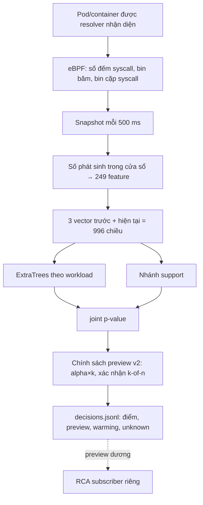

# Sentinel Pulse — trạng thái, kết quả và nhật ký

Cập nhật **22/10/2026 15:25 (UTC+7)** từ SSH vào cụm. Giờ trong file là UTC+7, trừ khi ghi UTC.

Đây là một trong ba báo cáo hiện hành:
- Sentinel Pulse — phát hiện bằng ML (file này; gồm cả hạ tầng chung và nhật ký);
- [thí nghiệm chọn syscall](SYSCALL_FEATURE_EXPERIMENT_STATUS.md);
- [RCA — dựng đồ thị điều tra](RCA_RUNTIME_STATUS.md).

Danh sách việc cần làm nằm ở [TODO.md](TODO.md); đánh giá tổng thể và ý tưởng ở [RESEARCH_IDEAS.md](RESEARCH_IDEAS.md).


## Tên gọi và đường dẫn thật trên cụm

Báo cáo dùng tên mô tả. Thư mục và unit có từ trước giữ tên cũ trên đĩa, vì config và hash bằng chứng tham chiếu tới chúng. Trên NFS có symlink tên mô tả trỏ tới từng thư mục, nên đường dẫn trong báo cáo dùng được trực tiếp.

| Tên trong báo cáo | Là gì | Thư mục / unit thật |
|---|---|---|
| `pulse-soak-baseline` | Soak 48 giờ của candidate gốc | `/mnt/sentinel-pulse-archive/matched-parallel-20261015` |
| `pulse-attack-dev` | Ma trận tấn công development 315 cặp | `matched-parallel-r3-20261015` |
| `pulse-attack-dev-rabbitmq` | 15 cặp RabbitMQ bổ sung | `matched-parallel-r5-rabbit-20261015` |
| `syscall-arms` | Thí nghiệm 11 cấu hình syscall (693 model) | `matched-parallel-r4-20261015` |
| `pulse-candidate-baseline` / `pulse-candidate-recalibrated` | Candidate gốc / candidate hiệu chỉnh lại | `runtime-f95867d-20261012` / `runtime-recal-c1-20261018` |
| `pulse-live-recalibrated` | Lượt live: candidate hiệu chỉnh lại + `policy-1win-a3` (xong 20/10 02:22; `features`/`decisions` đã nén gzip có kiểm seal) | `matched-r6-20261018`; unit `pulse-matched-worker-r6-20261018` |
| `…/campaign-main`, `…/campaign-rca` | Campaign 315 cặp / campaign 105 cặp đánh giá RCA | `coordinator-runtime-r6-d791d24-20261019` / `coordinator-rca-followup-20261019` |
| `policy-1win-a3` | Chính sách 1 cửa sổ, alpha×3 | `sentinel_pulse/protocol/policy-1win-a3.json` (SHA-256 `f6107351…`) |
| `policy-2of2-a10` | Chính sách xác nhận 2/2 cửa sổ, alpha×10 (chọn theo luật 5.7) | `sentinel_pulse/protocol/policy-2of2-a10.json` (SHA-256 `a51e5abc…`) |
| `pulse-stable-candidate` | Lượt live ứng viên cho bản stable: candidate hiệu chỉnh lại + `policy-2of2-a10`, chấm điểm nhanh (20/10 10:14 → 21/10 10:25) | `/mnt/sentinel-pulse-archive/pulse-stable-candidate`; unit `pulse-matched-worker-pulse-stable-candidate` (worker), `pulse-matched-{traffic,campaign}-pulse-stable-candidate` (.234) |
| `pulse-stable-refreshed` | Lượt live kiểm cấu hình luật v2: candidate hiệu chỉnh lại (`4bad16dc…`) + `policy-2of2-a10-refreshed` (đang chạy 21/10 12:22 → 22/10 ~12:30) | `/mnt/sentinel-pulse-archive/pulse-stable-refreshed`; unit `pulse-matched-worker-pulse-stable-refreshed` (worker) |
| `policy-2of2-a10-refreshed` | k2of2, α×10, gắn với candidate hiệu chỉnh lại bằng calibration làm mới | `sentinel_pulse/protocol/policy-2of2-a10-refreshed.json` (`9c41ebc0…`) |
| `rca-pulse-stable-candidate` | RCA của lượt pulse-stable-candidate (đã dừng khi lượt mới khởi động) | `/var/lib/sentinel-pulse-rca/rca-pulse-stable-candidate` |
| `rca-pulse-stable-refreshed` | RCA của lượt pulse-stable-refreshed, có luật hạ quyền lúc khởi chạy (đang chạy) | unit `rca-pulse-stable-refreshed`, `/var/lib/sentinel-pulse-rca/rca-pulse-stable-refreshed` |
| `rca-subscriber` | RCA đọc decision qua SSH trên pulse-live-recalibrated (dừng 20/10 10:16) | unit `rca-subscriber`, `/var/lib/sentinel-pulse-rca/rca-subscriber` |
| `rca-followup`, `rca-followup-v1`, `rca-flow`, `rca-runtime-v1` | Các bản RCA cũ (lịch sử) | `/var/lib/sentinel-pulse-rca/runtime-events-…` (có symlink cùng tên) |

## 1. Tóm tắt

- **Pulse làm gì.** Pulse đếm syscall của từng container Kubernetes bằng eBPF. Cứ 0,5 giây, nó tạo một vector 249 số cho mỗi container. Một model riêng cho từng workload chấm điểm xem cửa sổ đó "lạ hay không" so với lúc bình thường. Toàn bộ chạy ở chế độ **shadow**: chỉ ghi `candidate_alert_preview` (cảnh báo thử), không phát cảnh báo vận hành, không cách ly pod.
- **Kết quả mới nhất: lượt live pulse-stable-refreshed** (campaign 21/10, dữ liệu mới, cấu hình luật v2 chọn: `k2of2_a10` + calibration làm mới, chấm nhanh; mục 5.13a):

  | Chỉ số | Kỳ vọng | Kết quả | Lượt trước (pulse-stable-candidate) |
  |---|---|---|---|
  | Precision | ≥ 95% | **96,0%** | 92,2% |
  | Recall | ≥ 95% | **100%** | 97,8% |
  | Control idle dương | ≤ 5% | **4,2%** | 8,4% |
  | p95 kernel → preview | < 2 s ưu tiên, ≤ 3 s chấp nhận | **2,26 s** (đạt mức chấp nhận) | 1,85 s |
  | Đợt cảnh báo trên normal | ≤ 0,1/giờ | chờ giai đoạn final (22/10) | 6,5 (replay, calibration làm mới) |

  Đây là lần đầu đạt cả 4 kỳ vọng trên một lượt live mới, ở mức độ trễ ≤ 3 s. CUSUM và Cauchy (kiểm blind) đưa p95 về 1,70 / 1,46 s trên cùng campaign; kết luận chờ gánh cảnh báo (5.11a).
- **Phát hiện quan trọng nhất.** Một binary vô hại chạy cùng đường khởi chạy với attack bị gắn cờ **khoảng 94%**. Nghĩa là Pulse phát hiện "process bất thường", chưa phân biệt được ác ý. Tín hiệu bổ sung có triển vọng là syscall lạ ngoài tập exec: tách 100% / 0,3% cho các attack dùng `ptrace`/`setns`/`execveat` (5.8h); đang kiểm blind (5.16).
- **So với baseline trên cùng dữ liệu (5.15a):** autoencoder bắt attack ngang hoặc hơn, với gánh cảnh báo thấp hơn và nhanh hơn, nhưng gắn cờ binary vô hại khoảng 100%. Bộ chấm của Pulse chỉ hơn ở khả năng tách binary vô hại. Đang lặp lại trên dữ liệu mới (5.15b).
- **So với luật Falco (5.15d):** Falco bắt `ptrace` 100% trong vài mili-giây, nhưng các hành vi khác chỉ 19–21% (nhờ rule drift). Rule nhanh cho hành vi đã biết, Pulse thấy cả hành vi chưa có rule. Tích hợp rule là bước cuối, chạy song song với ML (5.19).
- **Cảnh báo trên normal đã được review (5.20):** 4.766 case, không case nào có dấu hiệu độc hại. 54% trùng probe exec của Kubernetes, 23% có probe trước đó, 23% không có nguyên nhân cấp process. Người gán nhãn không độc lập.
- **Bằng chứng cho bộ feature (syscall 5B.2, tạm thời):** không thành phần nào bỏ được; log-count, bin cặp, rolling, lịch sử 3 cửa sổ và cả hai nhánh p-value đều cần.
- **Nút thắt kéo dài: gánh cảnh báo trên dữ liệu bình thường.** Các chính sách khả thi cho khoảng 4–7 đợt/replica-giờ, xa ngân sách 0,1; chỉnh ngưỡng không giải được (biên Pareto 5.8j). Calibration lệch dần theo thời gian; làm mới calibration giảm khoảng 23% (5.7b). Thí nghiệm syscall cho thấy thay bộ syscall cũng không giải được.

## 2. Trạng thái cụm và job (15:25 ngày 22/10)

| Thành phần | Trạng thái |
|---|---|
| Lượt live **pulse-stable-refreshed** (3 worker) | **Xong** 22/10 12:26–12:31 (đủ 24 giờ). Final đã đọc (5.13b). Không còn loader Pulse nào gắn trên node |
| RCA | `rca-pulse-stable-refreshed` đã dừng sau lượt live; giữ case (1,4 GB) |
| Phân tích sau lượt | Unit `after-stable-refreshed` trên `.234` (snapshot `bd457a7`, chạy tuần tự). Giai đoạn campaign xong. Khi 3 worker xong: final → lặp lại baseline (5.15b) → chiến lược calibration (5.17) → giai đoạn B nhóm feature trên holdout chính và 5.7d → nén dữ liệu (8c) |
| Giai đoạn B nhóm feature, holdout thứ hai | **Xong** 22/10 06:40 (syscall 5B.2) |
| Ngay sau lượt live (làm tay) | **Xong**: dừng collector 1 s; overhead A/B (5.21); Falco phần normal (5.15d), log Falco đã xóa |
| Chốt ML stable (5.19) | Bước 1 xong: chỉ đổi luật thời gian sang CUSUM b3/h6. Unit `pulse-stable-selection-1022` (snapshot `9b7c813`) chờ bước nén xong rồi chạy replay cấu hình gộp (bước 3), sau đó chạy lại chuỗi nặng (nhóm feature trên holdout chính, 5.7d) |
| Theo dõi | Không dùng watcher (theo yêu cầu). Sức khỏe lượt live được kiểm khi được nhắc và trong phân tích sau lượt |
| Bộ nhớ VM (vSphere) | Balloon trên 3 worker giữ ~84 GB mỗi VM, còn 27–33 GB khả dụng; chưa có áp lực bộ nhớ hay swap. Xem mục 8 |
| Đĩa | NFS dùng 352 / 685 GB (khoảng 200 GB sẽ được thu lại khi nén). `.234` dùng 61 GB sau khi dọn (8c). Worker 41% / 41% / 29% |
| Quy tắc | Không chạy job NFS hoặc bộ nhớ nặng trên bất kỳ node nào khi lượt live đang chạy; không chạy trên master 2/3 |

## 3. Thuật ngữ

| Thuật ngữ | Nghĩa trong triển khai này |
|---|---|
| syscall | Lời gọi hệ thống (read, connect, execve…); đếm ở entry nên chưa chứng minh thành công |
| eBPF | Chương trình chạy trong kernel, ở đây dùng để đếm syscall theo cgroup |
| cgroup / resolver | Nhóm tài nguyên của container / tiến trình ánh xạ Pod UID → container → cgroup → revision |
| cửa sổ (window) | 0,5 giây; mỗi container có một vector cho mỗi cửa sổ |
| vector 249 số | Gồm:<br>• log-count và tỷ lệ của 29 syscall;<br>• 5 tổng hợp;<br>• 64 bin băm syscall;<br>• 64 bin băm cặp syscall liền nhau;<br>• trung bình và độ lệch trượt (rolling-10) |
| ngữ cảnh (context) | 3 cửa sổ trước + cửa sổ hiện tại = 996 số đưa vào model |
| ExtraTrees | Họ cây quyết định ngẫu nhiên (không phải deep learning), học phân biệt normal với normal bị làm hỏng |
| nhánh support | Phát hiện tọa độ nằm ngoài vùng từng thấy khi bình thường |
| p-value (conformal) | Vị trí điểm của cửa sổ so với điểm normal dùng để hiệu chỉnh; p nhỏ là hiếm gặp. Chỉ đúng nghĩa khi normal lúc chạy giống normal lúc hiệu chỉnh |
| joint_p, alpha | joint_p = min(1, 2·min(tree_p, support_p)); alpha = 0,05/30 ≈ 0,00167 mỗi cửa sổ |
| hệ số alpha (alpha×k) | Nới ngưỡng thành k·alpha |
| xác nhận k-of-n | Chỉ báo khi ít nhất k trong n cửa sổ liên tiếp vượt ngưỡng; ví dụ k2of2_a10 là 2/2 cửa sổ với alpha×10 |
| hiệu chỉnh lại (recalibration) | Thay tập điểm normal dùng để tính p-value bằng normal gần hơn; giữ nguyên model |
| cảnh báo thử (preview) | `candidate_alert_preview=true`; tín hiệu để đánh giá, **không phải** cảnh báo vận hành |
| đóng băng (freeze) / frozen_source | Khóa source, model, chính sách bằng SHA-256. Worker từ chối chạy nếu các file chấm điểm khác bản đóng băng |
| kiểm tra tương đương | Replay segment đã niêm phong qua code mới, yêu cầu điểm giống **từng bit** với điểm đã ghi |
| soak | Chạy liên tục nhiều giờ trên tải bình thường |
| cặp attack/control | Control 15 s (không làm gì) → binary vô hại 15 s → attack 15 s, trên cùng container |
| binary vô hại (benign-exec control) | Cùng file, cùng đường `kubectl exec` như attack, chỉ gọi `getpid` lặp lại. Dùng để tách "có process mới" khỏi hành vi tấn công |
| TP / FN / FP / TN | Bắt đúng / bỏ sót / báo nhầm / im lặng đúng. "FP kỳ vọng" vì nhãn control chưa được review |
| unknown | Thiếu dữ liệu hoặc bằng chứng; không bao giờ tự đổi thành TN/FN |
| đợt cảnh báo (episode) | Các cửa sổ dương của một container cách nhau < 15 s gộp thành một đợt |
| replica-giờ | Một giờ dữ liệu đã chấm của một container (replica) |
| development / blind | Dữ liệu đã nhìn khi phát triển / dữ liệu mới chưa dùng để chỉnh. Chỉ blind mới dùng để kết luận cuối |
| cadence gap | Hai snapshot cách nhau ngoài 0,35–0,8 s; history bị reset, cửa sổ sau đó không tính là normal |

## 4. Luồng ML đang chạy



- **Model.** Mỗi workload/container có model riêng; bundle hiện hành có 21 key trong namespace `production` của ứng dụng AIMS. Cửa sổ của container chưa có model không được tính là TN.
- **Phạm vi giám sát** (kiểm tra trên cụm 19/10 19:50):
  - *Được chấm điểm:* mọi replica của 21 workload trên, trên cả 3 worker (worker1, worker3, worker4). Mỗi worker có một matched worker chấm các pod trên node của nó. Lúc kiểm tra có 79 pod `production` (27 / 32 / 20 pod theo node).
  - *Không được chấm điểm:*
    - 3 pod tạo traffic `aims-sentinel-*-loadgen`;
    - các namespace hạ tầng (`kube-system`, `istio-system`, `longhorn-system`, `monitoring`, `vault`, `argocd`…);
    - cả 3 master, vì không có pod `production` nào chạy trên master.
  - *Lịch tấn công thử:* 315 lượt rải qua cả 21 workload; mỗi lượt nhắm một replica.
  - *RCA:* Tetragon chạy trên 6 node, nhưng policy RCA là `TracingPolicyNamespaced` trong `production`, và case chỉ được dựng khi Pulse cảnh báo. Vì vậy RCA có cùng phạm vi.
  - *Mở rộng:* muốn giám sát cả hạ tầng thì phải thu normal và huấn luyện model cho các workload đó trước.
- **Chính sách v2** (`detector/candidate_policy.py`, schema `sentinel-pulse-candidate-preview-policy-v2`) có hai tham số đăng ký trong file JSON có SHA-256:
  - hệ số alpha;
  - số cửa sổ xác nhận k-of-n.
- **Chấm điểm batch** (`detector/idle_batch.py`): gom các context cùng workload trong một frame rồi chấm một lần.
- **Đường chấm điểm nhanh** (`detector/fast_forest.py`, bật bằng `fast_scoring: true`) cho kết quả giống hệt từng bit. Batch đầu tiên của mỗi model được so với sklearn; nếu lệch thì tự quay về đường cũ.

## 4b. Bằng chứng cho bộ feature của Pulse (từ thí nghiệm syscall)

Thí nghiệm syscall ([SYSCALL_FEATURE_EXPERIMENT_STATUS.md](SYSCALL_FEATURE_EXPERIMENT_STATUS.md)) có mục đích chọn bộ syscall cho Pulse và làm bằng chứng cho lựa chọn đó.
- **Cách làm:** 11 cấu hình feature được fit đúng như Pulse: cùng snapshot 500 ms, ExtraTrees + nhánh support theo workload, conformal p-value, cùng cách hiệu chỉnh lại. Tổng 693 model = 21 workload × 11 cấu hình × 3 seed. Các cấu hình chỉ khác nhau ở phần syscall tường minh.
- **So sánh:** ở cùng ngân sách cảnh báo nhầm trên normal, có khoảng tin cậy bootstrap theo workload.

| Thành phần trong vector 249 feature của Pulse | Quyết định | Bằng chứng (thí nghiệm syscall) |
|---|---|---|
| 29 syscall tường minh (log-count + tỉ lệ) | **Giữ nguyên `base29`** | Không cấu hình nào tốt hơn base29 có ý nghĩa thống kê: CI 95% của chênh recall chứa 0 với mọi cấu hình bỏ hoặc thêm syscall; riêng `plus_all_*` ở ngân sách rộng tăng recall nhưng kéo theo binary vô hại (xem dưới). Mục 5.7 |
| Cặp exec (`execve`, `execveat`) | **Bắt buộc giữ** | Bỏ cặp này làm recall giảm 6,7–10,6 điểm, CI loại trừ 0 ở cả 2 tập dữ liệu và 2 ngân sách. Toàn bộ mức giảm nằm ở kịch bản `execveat` (100% → 49–66%). Mục 5.7, 5.8 |
| Syscall hiếm trong normal (`ptrace`, `setns`, `execveat`, `mount`, `unshare`, `pivot_root`, `recvmmsg`) | **Giữ dù bằng 0 trên normal** | Đây chính là tín hiệu tấn công: mọi cấu hình 29 syscall bắt `ptrace`/`setns` 100%. Bảy kênh này bằng 0 trên 185 triệu lượt gọi normal (C3) nên không làm tăng cảnh báo nhầm. Mục 3, 5.8 |
| Thêm syscall theo tần suất (top-8/16/32) | **Không thêm** | Không tăng recall; ở ngân sách 5, `seccomp_api_probe` còn kém đi 6–11 điểm (60–64% so với 70%) và không đạt tiêu chí không-kém-hơn. Mục 5.7, 5.8 |
| Thêm 15 syscall bảo mật hiếm (`plus_security`) | **Không thêm** | Không khác base29 (chênh recall −0,4 đến +0,3 điểm, CI chứa 0); bộ attack hiện tại không dùng các syscall này. Mục 5.7 |
| Mọi syscall ID (`plus_all_*`, ~300 feature) | **Không dùng** | Ở ngân sách rộng recall tăng 6–8 điểm, nhưng binary vô hại bị gắn cờ 96–100% (base29: 72–78%), nên khoảng cách attack − vô hại giảm 17–23 điểm (CI loại trừ 0). Ở ngân sách chặt mất recall ở `ptrace` (82%) và `execveat` (75%). Mục 5.5, 5.7, 5.8 |
| Nhánh support (vector hiện tại) | **Bắt buộc giữ** | Chỉ dùng tree: recall −28,2 [−42,5; −15,2] và −31,2 [−45,4; −17,4] điểm ở ngân sách 1, p95 chậm thêm 1,1–1,6 s (syscall 5B.1) |
| Nhánh tree (lịch sử → hiện tại) | **Giữ** | Chỉ dùng support: recall −5,2 [−10,6; −1,1] và −7,1 [−14,9; −0,8] điểm ở ngân sách 1. Ở ngân sách 5 thì không kém hơn, nên lợi ích nằm ở vùng ngưỡng chặt (syscall 5B.1) |
| 64 bin băm syscall, 64 bin băm cặp, 5 tổng hợp, rolling-10, log-count/tỉ lệ, số cửa sổ lịch sử | **Giữ** (tạm thời; holdout chính chạy sau lượt live) | Syscall 5B.2, holdout thứ hai, ngân sách 1: không thành phần nào bỏ được. **Cần thiết:** log-count (−1,4 điểm recall), bin cặp (−2,8), rolling (−4,1), lịch sử 3 cửa sổ (bỏ đi kém tách 3–5 điểm). **Chưa kết luận:** tỉ lệ, tổng hợp, bin syscall. Chỉ giữ bin + tổng hợp mất 15 điểm recall. Bỏ bin cặp hoặc rolling tách binary vô hại tốt hơn 14–20 điểm, đổi lại mất recall |

**Giới hạn của bằng chứng (ghi trong báo cáo đồ án):**
- Development: các kịch bản tấn công đã dùng khi phát triển; normal chưa review nhãn.
- Theo luật protocol v2, kết quả chính thức là **inconclusive**, vì không cấu hình nào đạt ngân sách 0,1 đợt/giờ. Bằng chứng trên là so sánh ở ngân sách 5 và 18 đợt/giờ.
- Hai kịch bản dùng syscall phổ biến (`mprotect`, `seccomp`) là điểm yếu chung của mọi bộ syscall (70–83%). Đổi bộ syscall không sửa được; cần thông tin khác ngoài tần suất, ví dụ tham số syscall.
- **Đã kiểm dưới k2of2, đúng chính sách Pulse đang chạy (syscall 5.9, 20/10):**
  - với k2of2, ngân sách 1 đợt/replica-giờ đạt được cho cả 11 cấu hình;
  - base29 không bị cấu hình nào vượt: recall 91,2%, control 1,0%, p95 2,27 s;
  - `drop_exec_pair` vẫn kém có ý nghĩa: −7,1 [−11,5; −2,7] điểm.
  
  Kết luận trong bảng giữ nguyên.
- **Lý do thứ hai không mở rộng bộ syscall: độ trễ.** Ở cùng ngân sách 1, `plus_top*` có p95 2,9–3,1 s và `plus_all_*` 5,0 s, so với base29 2,3 s. Mục tiêu của Pulse là p95 < 2 s.

**Kết quả đưa vào Pulse:**
- candidate `ec72d9ea…` và lượt pulse-stable-candidate dùng `base29`;
- không fit lại model, vì không có thay đổi feature nào được chứng minh là tốt hơn;
- kết quả k2of2 không đổi kết luận, nên không fit lại;
- phát hiện phụ: calibration mới + k2of2 đạt ~1 đợt/replica-giờ trong thí nghiệm syscall, so với ~8 ở lượt live (calibration cũ). Phép thử làm mới định kỳ + k2of2 cho Pulse đã được đăng ký ở 5.7d.

## 5. Kết quả

### 5.1 Soak 48 giờ của candidate đóng băng (15–17/10, normal chưa review nhãn)

| Worker | Cửa sổ đã chấm | Cảnh báo thử | Tỷ lệ | Issue |
|---|---:|---:|---:|---:|
| worker1 (.237) | 9.011.856 | 673.825 | 7,5% | 146 |
| worker4 (.238) | 8.051.218 | 950.765 | 11,8% | 381 |
| worker3 (.239) | 4.408.203 | 90.161 | 2,0% | 65 |
| **Tổng** | **21.471.277** | **1.714.751** | **8,0%** | 592 |

- Model `747c4eed…`, chính sách `fd0be94a…`.
- Nếu p-value đúng nghĩa, tỷ lệ cửa sổ dương phải quanh 0,17%; thực tế cao gấp ~47 lần, tương ứng 37,1 đợt mỗi replica-giờ.
- Bằng chứng: `validation-evidence/results-20261018/pulse-soak-48h-*-TERMINAL.json`.

**Lưu ý (phát hiện ngày 19/10, mục 5.5).** Trong thời gian soak, Tetragon trên worker1/worker3 đang gánh hàng trăm client mồ côi. Điều này có thể đã gây cadence gap và làm lệch một phần số đo; worker4 có 7–9 gap mỗi segment trong 6 giờ đầu.

### 5.2 Ma trận attack/control phát triển pulse-attack-dev (+ rabbitmq) (14–15/10)

pulse-attack-dev gồm 315 cặp (21 key × 5 kịch bản × 3 tốc độ):

| | Bắt được | Không bắt | Unknown |
|---|---:|---:|---:|
| Attack | TP 284 | FN 2 | 29 |
| Control | FP kỳ vọng 72 | TN kỳ vọng 237 | 6 |

- Precision 79,8%, recall 99,3% (cận dưới khi tính cả unknown: 90,2%), control dương 23,3%.
- Kernel → preview p50 / p95 / p99 = 1,07 / 1,61 / 4,75 s.
- pulse-attack-dev-rabbitmq (RabbitMQ, 15 cặp): TP 13, FN 0, FP 1, TN 14, unknown 2.
- Đây là dữ liệu development, thiết kế 1:1. pulse-attack-dev **chưa có** đối chứng binary vô hại.

### 5.3 Xác nhận k-of-n trên p-value gốc (18/10, development)

Số đợt mỗi giờ tính trên toàn bộ soak 48 giờ (3.199,7 replica-giờ):

| Chính sách | Đợt/giờ normal | Precision pulse-attack-dev | Recall pulse-attack-dev | Control dương | p95 |
|---|---:|---:|---:|---:|---:|
| 1 cửa sổ | 37,1 | 79,8% | 99,3% | 23,3% | 1,61 s |
| 2 of 2 | 22,3 | 87,3% | 98,3% | 13,3% | 2,25 s |
| 4 of 6 | 19,5 | 90,6% | 98,3% | 9,4% | 3,42 s |
| 4 of 6, alpha/4 | 12,0 | 94,7% | 69,2% | 3,6% | 5,94 s |

Chỉ dùng k-of-n thì không đưa gánh cảnh báo về gần ngân sách, và làm p95 vượt 2 s.

### 5.4 Hiệu chỉnh lại p-value (18/10, development)

- **Tập hiệu chỉnh:** điểm của chính model đóng băng trên normal 15/10 00:30–07:30 UTC (bỏ khoảng pulse-attack-dev-rabbitmq); model giữ nguyên.
- **Tập kiểm tra:** soak từ 15/10 08:40 UTC (2.206,6 replica-giờ) và pulse-attack-dev.
- Bằng chứng: `validation-evidence/results-20261018/confirmation-study/recalibrated-c1/`.

| | P-value gốc | Hiệu chỉnh lại |
|---|---:|---:|
| Cửa sổ normal bị gắn cờ | 8,11% | **0,35%** |
| Đợt cảnh báo / replica-giờ | 36,3 | **9,1** |
| Precision pulse-attack-dev | 79,8% | **97,8%** |
| Recall pulse-attack-dev | 99,3% | 91,3% (mất `seccomp_api_probe` 14, `anonymous_mprotect_churn` 11) |
| Control dương pulse-attack-dev | 23,3% | **1,9%** |
| p95 / p99 | 1,61 / 4,75 s | 2,91 / 5,87 s |

Lưới alpha nới rộng (pulse-attack-dev):

| Chính sách | Precision | Recall | Control | p95 | Đợt/giờ |
|---|---:|---:|---:|---:|---:|
| 1 cửa sổ, alpha×3 | 94,3% | 93,4% | 5,2% | 1,97 s | 18,0 |
| 2 of 3, alpha×5 | 98,9% | 97,9% | 1,0% | 3,39 s | 9,9 |
| 2 of 3, alpha×10 | 96,9% | 99,0% | 2,9% | 2,32 s | 17,1 |

- Kết quả này tạo ra candidate `ec72d9ea…` (`pulse-candidate-recalibrated/model-bundle`).
- Chính sách `policy-1win-a3` (`policy-1win-a3.json`, SHA-256 `f6107351…`) là 1 cửa sổ, alpha×3: chính sách duy nhất có p95 < 2 s.
- Kiểm tra tương đương sau refactor: 214.449 cửa sổ, 0 sai khác (`scorer-equivalence-0117901.json`).

### 5.5 Lượt live pulse-live-recalibrated (19/10)

| Thành phần | Giá trị |
|---|---|
| Candidate / chính sách | `ec72d9ea…` / pulse-live-recalibrated (`f6107351…`) |
| Capture | 3 worker, 24 giờ, không ghi `raw.jsonl` (NFS không đủ chỗ cho kiểu 48 giờ ~4,9 GB/giờ) |
| Source worker | snapshot `4ba303a`; kiểm tra tương đương trên snapshot này: 27.840 dòng, 0 sai khác |
| Campaign | 315 cặp control → binary vô hại → attack; fixture `testbed/attack/runtime_attack_with_benign_control.c`; coordinator `d791d24` |
| Thư mục | `/mnt/sentinel-pulse-archive/pulse-live-recalibrated/` |

**Kết thúc chu kỳ 24 giờ** (`STATUS.json` của từng worker, đọc lúc 20/10 02:30). Cả 3 worker tự chuyển sang `completed_capture` sau đúng 86.400 s và không bị dừng giữa chừng:

| Worker | Bắt đầu → kết thúc | Segment | Dòng được chấm | Preview dương | Issue |
|---|---|---:|---:|---:|---:|
| worker1 | 19/10 02:03:58 → 20/10 02:21:55 | 50 | 4.519.681 | 58.269 (1,29%) | 404 |
| worker4 | 19/10 02:04:06 → 20/10 02:12:54 | 49 | 1.698.686 | 15.630 (0,92%) | 32 |
| worker3 | 19/10 02:04:18 → 20/10 02:22:21 | 49 | 4.618.168 | 142.105 (3,08%) | 430 |
| Tổng | | | 10.836.535 | 216.004 (1,99%) | |

- Thời điểm kết thúc muộn hơn mốc 24 giờ 9–18 phút vì phần đóng segment cuối (đếm thời gian capture, không tính lúc ghi xong).
- Tỷ lệ preview dương ở đây là số thô dưới policy-1win-a3. Nó gồm cả cửa sổ campaign và cả khoảng sự cố 18:25–19:20, nên **không phải** tỷ lệ báo động nhầm. Gánh nặng normal sạch sẽ do job chọn (mục 5.7) tính lại, có loại trừ.
- Hệ quả thấy được ở RCA: `rca-subscriber` dựng khoảng 330 case mỗi giờ từ 20:00 đến 02:00. Mức này bị chặn trên bởi cooldown 300 s cho mỗi container (xem RCA_RUNTIME_STATUS.md). Đây là lý do cần một policy chặt hơn cho pulse-stable-candidate.

**Sự cố khi khởi động (02:04–02:20).**
- **Triệu chứng.** Worker1/worker3 báo `cadence_gap` khoảng mỗi 5 s.
- **Nguyên nhân.** Bên trong container Tetragon có **301 / 18 / 59 tiến trình `tetra getevents` mồ côi** (worker1 / worker4 / worker3), đã chạy từ 10 giờ đến 25 ngày. Chúng được sinh ra mỗi khi `kubectl exec` phía `.234` bị giết mà tiến trình trong container vẫn sống. Nguồn rò gồm:
  - campaign cũ;
  - subscriber RCA;
  - v8.
- **Tác động.** Tetragon tốn 5,3 core và 11,5 GB RAM ở worker1, 7,0 core ở worker3, làm matched worker thiếu CPU.
- **Xử lý.**
  - Sửa code (`d791d24`): bọc lệnh trong container bằng `timeout`.
  - Dọn toàn bộ client mồ côi.
- **Sau khi xử lý.** Tetragon worker1 còn 0,6 core / 2,8 GB; CPU node từ 62% xuống 35%; không còn cadence gap. Khoảng 02:04–02:13 không được tính là normal.

**Kết quả campaign (xong 09:52, 315/315 cặp).** Chính sách đúng như đăng ký, không chỉnh sau khi xem kết quả.

| Chỉ số | pulse-live-recalibrated live | Dự đoán development |
|---|---|---|
| Precision (attack : control idle = 1:1) | **89,1%** | 94,3% |
| Recall | **92,8%** (TP 285, FN 22, unknown 11) | 93,4% |
| Control idle dương | 11,2% (35/312) | 5,2% |
| **Binary vô hại dương** | **80,7%** (251/311) | — |
| Kernel → preview p50 / p95 / p99 | 1,03 / **1,90** / 5,39 s | p95 1,97 s |
| Đợt cảnh báo normal (02:07–02:20) | 17,2 / replica-giờ | 18 |

Tỉ lệ dương theo kịch bản:

| Kịch bản | Attack | Binary vô hại | Control idle |
|---|---|---|---|
| `child_ptrace_handshake` | 1,00 | 0,81 | 0,10 |
| `execveat_resolution_probe` | 1,00 | 0,79 | 0,11 |
| `invalid_setns_burst` | 1,00 | 0,81 | 0,11 |
| `anonymous_mprotect_churn` | 0,84 | 0,83 | 0,11 |
| `seccomp_api_probe` | 0,80 | 0,81 | 0,15 |

- Với attack, trung vị **100%** cửa sổ trong 15 s là dương. Với binary vô hại là 33%, với control là ~0%. Tín hiệu bền là dấu hiệu tách mạnh, nhưng đợi tín hiệu bền thì chậm.
- Precision 1:1 ở trên chỉ tính control idle. Nếu coi binary vô hại là âm tính thì precision thấp hơn nhiều. Báo cáo đồ án phải trình bày cả hai cách tính.

**Campaign tiếp nối (105 cặp, 7 workload, xong ~12:50):**
- TP 93, FN 11, FP 7, TN 98, unknown 1.
- Precision 93,0%, recall 89,4%, control idle 6,7%, **binary vô hại 70,6%** (72/102).
- **p95 kernel → preview 2,17 s, vượt ngưỡng 2 s** (p50 1,02 s, p99 5,19 s; 93 mẫu).
- Cùng xu hướng với campaign chính. Mẫu nhỏ hơn và chỉ có 7 workload, nên p95 không so trực tiếp được với 1,90 s của campaign chính.

**Cadence gap trong thời gian chạy:**

| Khoảng | worker1 | worker4 | worker3 | Nguyên nhân |
|---|---:|---:|---:|---|
| 02:00–03:00 | 230 | 0 | 296 | Tranh chấp CPU do client Tetragon mồ côi |
| 03:00–04:00 | 36 | 0 | 25 | Phần còn lại của sự cố trên |
| 13:00–14:00 | 17 | 5 | 18 | Job syscall đọc NFS |
| Các giờ khác | 0–5 | 0–5 | 0–5 | — |

Các cửa sổ sau gap tự động không tính là normal.

**Replay chính sách trên pulse-live-recalibrated** (`analysis/policy-replay-{default,looser}.json`).
- Replay k1of1_a3 tái lập đúng kết quả live.
- Các chính sách khác được chọn sau khi đã xem pulse-live-recalibrated, nên chỉ là development.

| Chính sách | Precision | Recall | Control | Binary vô hại | p95 |
|---|---|---|---|---|---|
| k1of1_a1 | 94,9% | 91,2% | 4,8% | 72% | 2,54 s |
| k1of1_a3 (`policy-1win-a3`) | 89,1% | 92,8% | 11,2% | 81% | 1,90 s |
| k1of1_a5 | 85,7% | 97,7% | 16,0% | 93% | 1,67 s |
| **k2of2_a5** | **97,4%** | **95,8%** | **2,6%** | 82% | 2,88 s |
| k2of2_a10 | 95,0% | 98,0% | 5,1% | 89% | 2,30 s |
| k2of3_a10 | 94,4% | 98,7% | 5,8% | 94% | 2,27 s |

**Độ trễ xử lý: từ cuối cửa sổ đến preview.**

| Node | Container/frame | p50 | p95 |
|---|---:|---:|---:|
| worker1 | 82 | 0,46 s | 0,54 s |
| worker3 | 85 | 0,50 s | 0,58 s |
| worker4 | 28 | 0,25 s | 0,30 s |

Profile trên frame thật cho thấy ~85% thời gian nằm ở `predict_proba` của sklearn, chủ yếu là overhead Python theo từng cây.

**Tăng tốc chấm điểm (`0913446`).**
- **Cách làm.** `fast_forest.py` cộng `tree_.predict` của từng cây theo đúng thứ tự trong float64 như sklearn, nhưng bỏ phần overhead.
- **Kiểm chứng.** Replay 2 segment pulse-live-recalibrated (40.000 dòng):
  - 13.505 dòng có điểm, **0 sai khác**;
  - CPU **42,4 s so với 208,9 s** (nhanh ~4,9×).
- **Ước tính.** Thời gian từ cuối cửa sổ đến preview giảm xuống ~0,1 s, nên p95 của k2of2_a10 có thể còn ~1,95 s. Con số thật phải đo live ở pulse-stable-candidate.

### 5.5b Giả thuyết "syscall chưa từng thấy" (đăng ký tiêu chí 19/10 18:47, trước khi có kết quả)

- **Câu hỏi.** Gắn cờ khi container gọi một syscall ID không có trong normal của workload đó: cách này có tách attack khỏi process vô hại mới không? Binary vô hại chỉ gọi `getpid`/`nanosleep`; attack `ptrace`/`setns`/`execveat` dùng các syscall mà thí nghiệm C3 thấy bằng 0 trên normal.
- **Dữ liệu.**
  - Normal tham chiếu: tập ID theo workload trên pulse-live-recalibrated 13:00–~18:30 (các segment đã niêm phong; không có campaign).
  - Interval: hai campaign pulse-live-recalibrated (420 cặp).
  - Script: `scripts/analysis/novel_syscalls.py`; job `pulse-novel-syscalls-20261019` trên `.235`.
- **Tiêu chí "hữu ích", ghi trước:**
  1. Tỉ lệ binary vô hại có ID mới ≤ 10%.
  2. Tỉ lệ attack có ID mới ≥ 90% với ít nhất 2/3 kịch bản `ptrace`/`setns`/`execveat`.
  3. Tỉ lệ control idle có ID mới ≤ 5%.

  Không đạt cả ba thì ghi là không hữu ích như một bộ dò riêng.
- **Giới hạn biết trước.**
  - Tham chiếu và interval cùng lấy từ một lượt capture (khác khoảng thời gian), nên đây là development.
  - Kịch bản không dùng syscall lạ (`mprotect`, `seccomp`) dự kiến không bị bắt.

**Kết quả (job chạy 20/10 02:20–02:45 trên `.234`; biên nhận `pulse-live-recalibrated/novel-syscalls.json`):**

| Kịch bản | Attack có ID mới | Binary vô hại có ID mới | Control idle có ID mới | ID mới hay gặp nhất ở attack |
|---|---:|---:|---:|---|
| `child_ptrace_handshake` | 84/84 (100%) | 37/84 (44%) | 0/84 | 101 `ptrace` (84), 56 `clone` |
| `execveat_resolution_probe` | 84/84 (100%) | 37/84 (44%) | 0/84 | 322 `execveat` (84) |
| `invalid_setns_burst` | 84/84 (100%) | 35/84 (42%) | 0/84 | 308 `setns` (84) |
| `seccomp_api_probe` | 39/84 (46%) | 35/84 (42%) | 0/84 | 317 `seccomp` (30) |
| `anonymous_mprotect_churn` | 32/84 (38%) | 36/84 (43%) | 0/84 | 230 `clock_nanosleep` (27) |
| **Tổng** | **76,9%** | **42,9%** | **0%** | |

- **Kết luận theo tiêu chí đăng ký:** tiêu chí 1 không đạt (43% so với ngưỡng ≤ 10%), tiêu chí 2 không đạt khi tính tổng (77% so với ≥ 90%, dù 3/3 kịch bản `ptrace`/`setns`/`execveat` đạt 100%), tiêu chí 3 đạt (0%). Vì vậy **không hữu ích như một bộ dò riêng**.
- **Nhận xét (rút ra sau khi xem số, chưa phải kết quả):**
  - ID mới ở binary vô hại chủ yếu là 230 `clock_nanosleep`, 138 `fstatfs`, 317 `seccomp`, 125 `capget`. Đây là các syscall của chính cơ chế exec vào container (runtime dựng process), không phải của binary.
  - ID đặc trưng attack (101/322/308) không xuất hiện ở binary vô hại.
  - Giả thuyết bổ sung "novelty có xét exec" được đăng ký ở mục 5.7c để kiểm trên dữ liệu mới.
- **Lệch so với đăng ký:** khoảng tham chiếu thực tế là 13:00–19:00, không phải 13:00–~18:30. Phần dôi ra gồm cả đoạn sự cố 18:25–19:00. Khoảng tham chiếu rộng hơn chỉ thêm ID vào tập normal, nên làm tỉ lệ "có ID mới" của **cả** attack và binary vô hại thấp hơn hoặc bằng; nó không thể làm kết luận "không đạt" tốt lên.

### 5.6 Hiệu chỉnh lại định kỳ (job `pulse-calibration-refresh-study`, 20/10 02:15–02:40)

- **Module:** `attack/rolling_recalibration.py`. Biên nhận: `validation-evidence/results-20261019/pulse-calibration-refresh-study.json`.
- **Cách làm:** replay soak 48 giờ (pulse-soak-baseline) với model giữ nguyên, chỉ đổi calibration:
  - `static`: calibration c1 suốt thời gian đánh giá;
  - `rolling-W-1`: mỗi giờ calibration lại bằng W giờ trước đó;
  - `guarded`: như rolling nhưng bỏ các cửa sổ đã dương ra khỏi lần calibration sau.
  
  Đánh giá trên 33,4 giờ normal (loại 647 khoảng campaign). Attack: pulse-attack-dev, mỗi trial dùng calibration đang hiệu lực lúc trial bắt đầu. Đây là development; normal chưa review nhãn.

| Chiến lược | Đợt/replica-giờ α×1 | Đợt/replica-giờ α×3 | Recall α×1 / α×3 | Precision α×1 / α×3 | Control α×3 | p95 α×3 |
|---|---:|---:|---:|---:|---:|---:|
| static (c1) | 6,41 | 16,16 | 91,6% / 93,6% | 97,9% / 94,3% | 5,5% | 1,92 s |
| rolling-3-1 | 5,65 | 13,93 | 91,6% / 93,0% | 97,9% / 93,3% | 6,5% | 1,93 s |
| rolling-6-1 | 5,39 | 13,37 | 92,0% / 93,3% | 97,9% / 93,6% | 6,1% | 2,18 s |
| rolling-12-1 | **4,94** | **12,69** | 92,0% / 94,3% | 97,9% / 94,3% | 5,5% | 2,31 s |
| guarded-6-1 | 21,21 | 27,93 | 93,0% / 96,0% | 96,5% / 91,7% | 8,4% | 2,16 s |

- **Kết luận:**
  - Làm mới calibration mỗi giờ bằng 6–12 giờ trước đó giảm gánh cảnh báo **16–23%** mà recall và precision giữ nguyên.
  - Mức giảm này nhỏ so với khoảng cách tới ngân sách 0,1 đợt/replica-giờ (vẫn ~50–130 lần). Calibration không giải quyết được gánh cảnh báo.
  - Biến thể `guarded` **hỏng**: gánh cảnh báo tăng dần từ 14,6 lên 30,1 đợt/replica-giờ (6 giờ đầu so với 6 giờ cuối). Bỏ cửa sổ dương khiến calibration chỉ còn phần đuôi "yên" nhất, nên ngưỡng ngày càng chặt hơn so với normal thật.
  - Gánh cảnh báo của `static` ở α×3 không tăng đều theo thời gian (20,9 lên 12,7 từ 6 giờ đầu tới 6 giờ cuối). Nó phụ thuộc vào chế độ tải nhiều hơn là trôi đơn điệu.
- Trên pulse-live-recalibrated, phép thử một lần làm mới (mục 5.7) cho kết quả tương tự: gánh cảnh báo không giảm, nhưng recall và precision tăng.

### 5.6b Gánh cảnh báo theo workload và theo node (20/10 11:42)

- **Dữ liệu:** normal của pulse-live-recalibrated 19:20–02:04 (467 replica-giờ, đã loại campaign và sự cố). Đầu vào là 12 file `normal-*` của job chọn; mỗi file có số đợt cảnh báo, số cửa sổ dương và số replica-giờ theo từng workload trên từng node.
- **Script:** `scripts/analysis/burden_by_workload.py`. **Biên nhận:** `pulse-stable-candidate-selection/burden-by-workload.json`, đầu vào ở `pulse-stable-candidate-selection/normal/`.
- **Nhãn:** normal chưa review; cảnh báo dương chưa được xác nhận là báo nhầm.

**Gánh cảnh báo theo node** (đợt/replica-giờ):

| Calibration / chính sách | worker1 | worker3 | worker4 | Bỏ 3 workload nặng nhất | Trung vị theo workload |
|---|---:|---:|---:|---:|---:|
| as_run, k1of1_a3 (pulse-live-recalibrated) | 8,29 | **18,87** | 9,11 | 9,36 | 9,22 |
| as_run, k2of2_a10 (pulse-stable-candidate) | 4,65 | **12,58** | 3,83 | 5,46 | 4,65 |
| as_run, k2of2_a5 | 2,53 | **8,49** | 1,81 | 2,85 | 2,69 |
| refreshed, k2of2_a10 | 6,40 | 7,84 | 4,50 | 5,33 | 5,29 |
| refreshed, k2of2_a5 | 3,81 | 4,36 | 2,43 | 3,26 | 3,55 |

**Workload nặng nhất (as_run, k2of2_a10):**

| Workload | Đợt/replica-giờ | Theo node | Cửa sổ dương/đợt |
|---|---:|---|---:|
| `auth-service` | 20,3 | worker1 3,8 · **worker3 36,7** | **46,7** (đợt dài ~23 s) |
| `aims-kafka-entity-operator:user-operator` | 73,9 | chỉ có trên worker3 | 3,0 |
| `aims-kafka-entity-operator:topic-operator` | 45,9 | chỉ có trên worker3 | 1,5 |
| `order-service`, `payment-service`, `security-telemetry-service` | 7,7–9,4 | gần nhau giữa các node | ~4 |
| `aims-redis` | 9,1 | worker1 5,0 · **worker3 19,9** · worker4 2,2 | 2,2 |

**Kết luận:**
1. **Gánh cảnh báo phân bố rộng.** Không workload nào có 0 đợt. Trung vị theo workload là 4,65 đợt/replica-giờ, và bỏ cả 3 workload nặng nhất vẫn còn 5,46. Vấn đề không nằm ở vài workload hỏng: phân phối điểm normal lệch so với lúc calibration ở hầu hết workload. Điều này khớp với kết luận ở 5.6 và ở thí nghiệm syscall.
2. **Có hiệu ứng node rõ rệt.** Với calibration as_run, replica trên worker3 có gánh cảnh báo gấp 2,7–4,7 lần replica của cùng workload trên node khác. Worker3 chạy nhiều pod `production` nhất (32) và là nơi duy nhất có các operator Kafka. Calibration làm mới thu hẹp khoảng cách này (worker3 7,84 so với 4,50–6,40). Phần dư của worker3 vì vậy chủ yếu là **calibration cũ không còn khớp môi trường của worker3**, không phải do model.
3. **Workload chiếm ưu thế đổi theo calibration.** Với as_run, nặng nhất là `auth-service` và các operator Kafka. Với calibration làm mới, chúng hết nặng, thay vào đó là `order`/`payment`/`postgres`. Mỗi workload trôi theo hướng và tốc độ riêng, nên làm mới chung một lần không đủ.
4. **Phần lớn đợt cảnh báo ngắn** (1–5 cửa sổ, 0,5–2,5 s). Ngoại lệ là `auth-service` trên worker3: trung bình 47 cửa sổ mỗi đợt, tức một trạng thái kéo dài khác normal. Trường hợp này đáng được review nhãn trước khi coi là báo nhầm.

**Giả thuyết rút ra sau khi xem số (chưa phải kết quả):** calibration theo cặp (workload, node), làm mới định kỳ, sẽ bỏ được phần dư của worker3. Ước lượng thô: gánh cảnh báo chung có thể về mức worker1/worker4, khoảng 4–5 đợt/replica-giờ với k2of2_a10. Mức này **vẫn cách ngân sách 0,1 khoảng 40–50 lần**. Nếu kiểm, sẽ đăng ký trước rồi kiểm trên dữ liệu pulse-stable-candidate.

### 5.7 Kế hoạch chọn candidate và chính sách pulse-stable-candidate (đăng ký trước, 19/10 10:52)

Job `pulse-stable-candidate-selection` chạy sau khi pulse-live-recalibrated kết thúc. Mỗi khoảng thời gian đều loại trừ hai campaign (±60 s) và đoạn tranh chấp lúc khởi động.

1. **Gánh cảnh báo như pulse-live-recalibrated đã chạy:** normal 19:00–02:04, mọi chính sách trong 2 lưới.
2. **Làm mới calibration:** hiệu chỉnh lại candidate `ec72d9ea…` bằng normal pulse-live-recalibrated 13:00–19:00 (19/10). Đây chính là bước "làm mới định kỳ" trong vận hành thật.
3. **Đo với calibration mới:** gánh cảnh báo trên 19:00–02:04, và replay cả hai campaign pulse-live-recalibrated.

**Sửa đổi 19/10 19:17** (do sự cố hạ tầng, đưa ra trước khi xem bất kỳ kết quả normal nào của pulse-live-recalibrated):
- Loại khoảng **18:25–19:20** khỏi cả khoảng hiệu chỉnh (thực tế còn 13:00–18:25) lẫn khoảng đánh giá (thực tế 19:20–02:04). Xem mục 8b.

**Luật chọn, đăng ký trước khi có số:**
- Ưu tiên calibration làm mới nếu nó giảm số đợt cảnh báo mà không làm giảm recall quá 2 điểm phần trăm.
- Trong các chính sách có p95 replay ≤ 2,3 s (đường nhanh dự kiến bớt ~0,35 s), precision và recall ≥ 95%, control ≤ 5%, chọn chính sách có **ít đợt cảnh báo/giờ nhất**.
- Nếu không chính sách nào đạt các điều kiện trên, chọn chính sách đạt p95 thấp nhất trong số có precision ≥ 95%, và ghi rõ là không đạt kỳ vọng.

- **Luật chọn đã viết thành code** (`attack/select_policy.py`, `3e2d2e4`, có test). Code đọc output của job, ghi `SELECTION.json` gồm calibration, chính sách, số liệu, cờ đạt kỳ vọng và hash đầu vào, rồi sinh file chính sách v2 gắn với hash candidate pulse-stable-candidate. Nhờ vậy việc chọn tái lập được, không có phán đoán thủ công sau khi đã xem số.

Sau đó chạy `scripts/prepare_pulse_stable_candidate.sh`. Script tạo bundle bằng `detector/recalibrate_bundle.py` (nếu chọn calibration làm mới), sinh file chính sách, và kiểm tra file đó nạp được với candidate qua loader thật. Đã thử với một lựa chọn giả lập trên candidate `ec72d9ea…`: nạp đúng `ConfirmedPreviewPolicy(k=2, n=2, alpha_scale=5.0)`. Cuối cùng commit file chính sách vào `sentinel_pulse/protocol/`, tạo snapshot, rồi chạy `scripts/launch_run.sh` với `FAST=1` (chấm điểm nhanh) và RCA cấu hình đầy đủ.

### 5.7a Kết quả chọn (job chạy 20/10 02:10–03:14; `SELECTION.json`)

Biên nhận: `validation-evidence/results-20261019/pulse-stable-candidate-selection/SELECTION.json`. Normal đánh giá: 466,95 replica-giờ (19:20–02:04, đã loại trừ campaign và sự cố). Attack: hai campaign pulse-live-recalibrated.

**Bước 1. Calibration nào?** So sánh ở chính sách tham chiếu k1of1_a3:

| Calibration | Đợt/replica-giờ | Precision | Recall | Control | Binary vô hại dương | p95 |
|---|---:|---:|---:|---:|---:|---:|
| as_run (c1) | **13,01** | 90,0% | 92,0% | 10,1% | 78,2% | 1,96 s |
| refreshed (13:00–18:25) | 13,65 | 94,7% | 99,3% | 5,5% | 91,3% | 1,97 s |

Theo luật, calibration làm mới chỉ được chọn nếu nó giảm số đợt cảnh báo. Ở đây nó **không giảm** (tăng 5%), nên giữ **as_run**.

**Bước 2. Chính sách nào?** Trên as_run không chính sách nào đạt đủ p95 ≤ 2,3 s, precision ≥ 95%, recall ≥ 95% và control ≤ 5% (danh sách `eligible` rỗng). Theo luật dự phòng, chọn chính sách có p95 thấp nhất trong các chính sách có precision ≥ 95%: **k2of2_a10**, và ghi là **không đạt kỳ vọng**.

| Chính sách (as_run) | Precision | Recall | Control | Binary vô hại | p95 | Đợt/replica-giờ |
|---|---:|---:|---:|---:|---:|---:|
| k1of1_a3 (pulse-live-recalibrated) | 90,0% | 92,0% | 10,1% | 78,2% | 1,96 s | 13,01 |
| k2of3_a10 | 94,8% | 97,8% | 5,3% | 92,0% | 2,28 s | 8,65 |
| **k2of2_a10 (được chọn)** | **95,2%** | **97,3%** | **4,8%** | 87,7% | **2,43 s** | **7,98** |
| k2of2_a5 | 97,7% | 94,9% | 2,2% | 78,9% | 2,88 s | 5,02 |

- **Nhận xét thẳng:**
  - Nếu dùng calibration làm mới, k2of2_a10 đạt đủ cả 4 tiêu chí: precision 96,7%, recall 99,3%, control 3,4%, p95 2,29 s, 6,75 đợt/replica-giờ.
  - Luật đăng ký trước đã dùng số đợt của k1of1_a3 làm cổng chọn calibration, và cổng này loại calibration làm mới. Mình **không đổi lựa chọn sau khi xem số**. Thay vào đó, việc so sánh hai calibration được đăng ký làm phép đo phụ trên dữ liệu mới (mục 5.7b).
  - Chính sách được chọn có p95 2,43 s, vượt mục tiêu 2 s. Mọi chính sách có p95 < 2 s đều có precision ≤ 90%.
  - Gánh cảnh báo vẫn ~80 lần ngân sách 0,1/h.
  - Binary vô hại bị gắn cờ ở 88%: detector tách hoạt động *mới*, không tách hoạt động *độc hại*. Ba giới hạn này được ghi trong file chính sách (`selection_basis.known_gaps`).
- **File chính sách:** `sentinel_pulse/protocol/policy-2of2-a10.json` (SHA-256 `a51e5abc…`), sinh bằng `select_policy --from-selection`. Đã kiểm tra nạp được với candidate `ec72d9ea…` qua loader thật (21 model). Candidate giữ nguyên `ec72d9ea…`, không tạo bundle mới vì không chọn calibration làm mới.

### 5.7b Phép đo phụ trên pulse-stable-candidate (đăng ký 20/10 09:50, trước khi lượt chạy bắt đầu)

- **Câu hỏi:** calibration làm mới (`calibration-r6-1300-1900.npz`, normal 13:00–18:25 ngày 19/10) có tốt hơn as_run trên dữ liệu **mới** không?
- **Cách làm:** sau khi pulse-stable-candidate kết thúc, chấm lại offline normal và campaign của nó bằng calibration làm mới (`confirmation_study normal|attack --calibration`). Hai bên đều dùng k2of2_a10 và đều loại trừ như nhau.
- **Tiêu chí, ghi trước:** calibration làm mới được dùng cho bản stable nếu cùng lúc đạt 3 điều kiện:
  1. giảm số đợt/replica-giờ ít nhất 10%;
  2. recall không giảm quá 2 điểm phần trăm;
  3. precision ≥ 95%.
  
  Nếu không đạt thì giữ as_run.
- **Giới hạn:** calibration làm mới lấy từ normal của một ngày trước, nên cách làm này mô phỏng làm mới với độ trễ khoảng 1 ngày, không phải làm mới mỗi giờ.

### 5.7c Giả thuyết "novelty có xét exec" (đăng ký 20/10 09:50, sau khi thấy kết quả 5.5b, trước khi có dữ liệu kiểm tra)

- **Giả thuyết:** bỏ đi các syscall ID do chính cơ chế exec vào container sinh ra thì ID mới sẽ tách attack khỏi binary vô hại.
- **Tập exec E:** mọi ID xuất hiện trong interval binary vô hại của pulse-live-recalibrated nhưng không có trong normal tham chiếu. Tập E học trên pulse-live-recalibrated rồi **đóng băng**. E chỉ dùng dữ liệu pulse-live-recalibrated, nên có thể tính sau khi pulse-stable-candidate kết thúc mà không rò dữ liệu kiểm tra; làm vậy cũng tránh đọc NFS nặng trong lúc lượt live đang chạy. Script: `scripts/analysis/novel_syscalls.py` (`novel_ids_by_label` cho E, `--exec-set` cho phép kiểm tra).
- **Kiểm tra:** chạy trên campaign của pulse-stable-candidate. Normal tham chiếu là normal của chính lượt đó trong khoảng không có campaign. Một interval được tính "có ID mới" khi có ít nhất một ID không thuộc normal tham chiếu và không thuộc E.
- **Tiêu chí:** giữ nguyên 3 tiêu chí của 5.5b:
  1. binary vô hại ≤ 10%;
  2. attack ≥ 90% với ít nhất 2/3 kịch bản `ptrace`/`setns`/`execveat`;
  3. control ≤ 5%.
- **Giới hạn biết trước:** `seccomp_api_probe` và `anonymous_mprotect_churn` gần như chắc chắn không đạt, vì syscall của chúng nằm trong E hoặc trong normal. Tiêu chí tổng 90% vì vậy có thể không đạt ngay cả khi các kịch bản dùng syscall lạ đạt 100%. Sẽ báo cáo cả hai mức.

### 5.7d Làm mới calibration định kỳ kết hợp k2of2 (đăng ký 20/10 11:48, trước khi có số)

- **Lý do:**
  - Trong thí nghiệm syscall (5.7 bản k2of2, 20/10), model được calibration trên chính đầu khoảng holdout, tức là calibration mới. Kết hợp k2of2, base29 đạt **ngân sách 1 đợt/replica-giờ** với recall 91–93%, control 0–1%, precision 99–100%.
  - Lượt live của Pulse dùng calibration c1 từ 15/10, và với k2of2_a10 ở mức ~8 đợt/replica-giờ.
  - Nghiên cứu 5.6 mới thử làm mới calibration với **1 cửa sổ**, chưa thử kết hợp với k2of2.
- **Cách làm:** chạy lại `attack/rolling_recalibration.py` trên soak 48 giờ (cùng đầu vào, cùng loại trừ như 5.6), thêm `--confirm-k 2 --confirm-n 2` và `--scale 3 --scale 5 --scale 10`. Các chiến lược: `static`, `rolling-6-1`, `rolling-12-1`. Attack là pulse-attack-dev, mỗi trial dùng calibration đang hiệu lực khi trial bắt đầu.
- **Tiêu chí "hữu ích", ghi trước:** có ít nhất một chiến lược rolling, ở một hệ số alpha nào đó, đồng thời đạt 3 điều kiện:
  1. ≤ 1 đợt/replica-giờ trên normal;
  2. recall ≥ 90%;
  3. control ≤ 5%.
  
  Báo cáo kèm p95 kernel → preview, và so với `static` ở cùng hệ số.
- **Lịch:** job đọc ~200 GB từ NFS, nên chạy sau khi pulse-stable-candidate kết thúc (21/10). Code đã sẵn từ commit thêm `confirmation` vào `rolling_recalibration.py`, có test.
- **Giới hạn biết trước:** đây là development; các kịch bản pulse-attack-dev đã dùng khi phát triển. Nếu đạt, bước kiểm tiếp theo là bật làm mới định kỳ trong lượt live.

### 5.8 Lượt live pulse-stable-candidate (20/10 10:14 → 21/10 10:25)

| Thành phần | Giá trị |
|---|---|
| Candidate / chính sách | `ec72d9ea…` / `policy-2of2-a10` (`a51e5abc…`): xác nhận 2/2 cửa sổ, alpha×10 |
| Source | snapshot `runtime-6a3a0b5-20261020` (commit `6a3a0b5`); CONFIG SHA-256 `6da03fa8…` |
| Chấm điểm | Đường nhanh (`fast_scoring: true`): batch đầu của mỗi model được so với sklearn và tự quay về sklearn nếu lệch |
| Capture | 3 worker, 86.400 s, không `raw.jsonl` |
| Lịch | Tạo 10:14:29; pha chọn 10:17:29–11:47:29; attack từ 11:49:29; 315 cặp control → binary vô hại → attack trên 21 workload |
| RCA | `rca-pulse-stable-candidate`, cấu hình như `rca-subscriber` |
| Kỳ vọng (ghi trong file chính sách, chỉ để so) | precision ≥ 95%, recall ≥ 95%, control ≤ 5%, p95 ≤ 2,0 s |
| Phép đo phụ đã đăng ký | 5.7b (calibration làm mới so với as_run), 5.7c (novelty có xét exec) |

- **Khởi chạy:**
  - 10:14 plan; 10:14:53 worker; 10:16 RCA (`rca-subscriber` dừng, `rca-pulse-stable-candidate` chạy); 10:16 traffic + campaign.
  - 10:17: cả 3 worker `running`, 0 issue; RCA đã có 12 case, 6 stream Tetragon.
- **Khởi động lại 2 pod Pulse lúc 10:41:50 (pha chọn, trước attack):**
  - `aims-redis-0` và `aims-minio-pool-0-0` (cùng `vault-2` và `observability/tempo-0`, ngoài Pulse) được xóa để StatefulSet tạo lại.
  - Lý do: volume Longhorn của chúng bị ext4 hỏng journal trong sự cố 19/10 19:24 (mục 8b). Redis CrashLoopBackOff (`AOF manifest ... I/O error`, 102 lần), minio đọc 2 ổ bị lỗi I/O, dù volume đã healthy trở lại.
  - Pod mới Ready lúc ~10:44, không còn lỗi I/O.
  - Khi đánh giá normal sẽ **loại 10:41–10:50 cho hai workload này**. Pod mới có định danh mới nên cần cửa sổ khởi động lại.
- **CPU:** sau 90 s, mỗi worker dùng 26 s CPU (28–31% một core). Lượt trước dùng 22,5–23,5 giờ CPU cho 24 giờ (~94%). Đường nhanh đang hoạt động; chưa có bằng chứng model nào phải quay về sklearn. Sẽ kiểm tra lại offline bằng `scorer_equivalence --fast` trên segment đã niêm phong.

**Kết thúc chu kỳ 24 giờ** (21/10; `STATUS.json` từng worker):

| Worker | Bắt đầu → kết thúc | Segment | Dòng được chấm | Preview dương (thô) | Issue | CPU worker |
|---|---|---:|---:|---:|---:|---:|
| worker1 | 20/10 10:14:53 → 21/10 10:23:55 | 48 | 4.621.537 | 113.928 | 2 | 7,3 giờ |
| worker4 | 20/10 10:14:57 → 21/10 10:18:50 | 48 | 1.699.790 | 22.174 | 4 | 3,1 giờ |
| worker3 | 20/10 10:15:02 → 21/10 10:25:09 | 49 | 4.788.878 | 154.593 | 1 | 7,5 giờ |

- **Ổn định:** chỉ 7 issue trên cả 3 worker, so với 404/32/430 ở pulse-live-recalibrated (lượt đó có sự cố hạ tầng 19/10 và tiến trình `tetra getevents` mồ côi).
- **CPU:** 13–31% một core, so với ~94% ở lượt trước. Đường chấm nhanh giảm CPU khoảng 3 lần trong vận hành thật.
- Preview dương thô là 2,6% số dòng, gồm cả campaign. Gánh cảnh báo normal sạch nằm trong phân tích final.

### 5.8a Kết quả campaign pulse-stable-candidate (campaign xong 20/10 ~18:00; phân tích 21/10 02:17)

- **Dữ liệu:** 315 cặp control → binary vô hại → attack trên 21 workload, dữ liệu mới, nhãn kỳ vọng.
- **Chính sách:** `policy-2of2-a10` với calibration c1 (as_run), chấm điểm nhanh.
- **Biên nhận:** `validation-evidence/results-20261021/pulse-stable-candidate/` (`campaign-RESULTS.json`, `attack-vs-benign.json`).

| Chỉ số | Kỳ vọng (file chính sách) | Dev dự đoán (5.7a) | **Live** | pulse-live-recalibrated (k1of1_a3) |
|---|---|---|---|---|
| Precision | ≥ 95% | 95,2% | **92,2%** ✗ (306 TP / 26 FP control) | 89,1% |
| Recall | ≥ 95% | 97,3% | **97,8%** ✓ (306/313; 2 unknown) | 92,8% |
| Control idle dương | ≤ 5% | 4,8% | **8,4%** ✗ (26/309; 6 unknown) | 11,2% |
| Binary vô hại dương | (báo cáo riêng) | 87,7% | **92,0%** (286/311) | 80,7% |
| p95 kernel → preview | càng nhanh càng tốt: < 2 s ưu tiên, ≤ 3 s chấp nhận | 2,43 s | **1,85 s** ✓ (p50 0,96 s; p99 4,88 s) | 1,90 s |

**Theo kịch bản:**

| Kịch bản | Recall | Binary vô hại dương | p95 |
|---|---|---|---|
| `ptrace`, `execveat`, `setns` | 63/63 (100%) mỗi kịch bản | 85–95% | 1,1–1,3 s |
| `mprotect` | 60/63 (95%) | 89% | 2,49 s |
| `seccomp` | 57/61 (93%) | 95% | 2,65 s |

**Đánh giá thẳng:**
1. **Đạt 2/4 kỳ vọng** (recall, p95); không đạt precision và control. So với lượt trước, cả 4 chỉ số đều tốt hơn.
2. **p95 tốt hơn dự đoán development 0,6 s** (1,85 s so với 2,43 s). Đó là nhờ chấm điểm nhanh, nên p95 lần đầu xuống dưới 2 s với chính sách 2 cửa sổ. Đuôi p99 vẫn 4,9 s, đến từ `mprotect`/`seccomp`.
3. **Control 8,4%, cao hơn development (4,8%).** Điều này khớp với 5.6b và syscall 5.9: calibration c1 đã cũ 5 ngày và đang trôi. Phép thử làm mới định kỳ + k2of2 (5.7d) nhắm đúng vào điểm này.
4. **Binary vô hại bị gắn cờ 92%:** k2of2 không giúp tách process vô hại mới.

**Giả thuyết rút ra sau khi xem số (chưa phải kết quả):** độ bền tín hiệu trong khoảng 15 s tách được attack khỏi binary vô hại.

| Loại khoảng | Tỉ lệ cửa sổ dương trung bình (trung vị) | Khoảng có ≥ 50% cửa sổ dương |
|---|---|---|
| Attack | 89% (96%) | 94,6% |
| Binary vô hại | 51% (48%) | 49,5% |
| Control idle | 1,8% | 0,6% |

Đây có thể là một mức **xác nhận thứ hai sau vài giây**, đứng sau preview < 2 s, chứ không thay preview. Nếu làm, sẽ đăng ký tiêu chí trước rồi kiểm trên lượt sau.

- Gánh cảnh báo normal và các phép đo 5.7b/5.7c chờ giai đoạn final (sau 21/10 ~10:30).

### 5.8b Xác nhận mức 2 bằng độ bền tín hiệu (21/10 02:26)

- **Ý tưởng:**
  - Mức 1 là preview đang chạy: k2of2_a10, < 2 s.
  - Mức 2 chờ thêm T giây sau preview đầu tiên, chỉ xác nhận nếu ít nhất f phần cửa sổ trong [preview, preview + T] là dương.
  - Attack bắn liên tục; binary vô hại chủ yếu bắn quanh lúc khởi chạy.
- **Cách làm:** `scripts/analysis/persistence_stage.py`; cờ mức 1 được tính lại từ joint p-value lưu sẵn với k2of2_a10.
  - **Luật chọn (T, f) viết sẵn trong code trước khi chạy:** chỉ dùng dữ liệu development (hai campaign của pulse-live-recalibrated); trong các cặp có tỉ lệ xác nhận attack ≥ 90% và T ≤ 5 s, chọn cặp có khoảng cách attack − vô hại lớn nhất.
  - Cặp được chọn áp nguyên cho pulse-stable-candidate.
  - Lượt stable **không phải blind**: mình đã thấy số tổng hợp về độ bền ở 5.8a trước khi viết luật.
- **Biên nhận:** `results-20261021/pulse-stable-candidate/persistence-stage.json`.

**Cặp được chọn: T = 5 s, f = 0,7.**

| | Mức 1 dev | Mức 2 dev | Mức 1 stable | **Mức 2 stable** |
|---|---|---|---|---|
| Attack được xác nhận (recall) | 97,3% | 92,0% | 97,8% | **93,3%** |
| Binary vô hại bị gắn cờ | 87,3% | 57,8% | 92,0% | **64,6%** |
| Control idle dương | 5,0% | 1,0% | 8,7% | **2,6%** |
| Precision (attack / attack + control dương) | | | 91,9% | **97,3%** (293 / 301) |
| Khoảng cách attack − vô hại | 0,10 | 0,34 | 0,06 | **0,29** |
| p95 kernel → xác nhận | 1,9 s | 6,6 s | 1,7 s | 6,5 s |

**Đánh đổi theo T** (lượt stable, f = 0,7): T 2,5 s → control 4,5%, vô hại 72%, p95 4,1 s; T 7,5 s → control 0,6%, vô hại 46%, recall 90,8%, p95 9,1 s; T 10 s → vô hại 38%, recall 89,2%, p95 11,4 s. Với T = 5 s, f = 0,5 trên lượt stable: recall 95,9%, control 3,9%, precision ~96%. Cặp này đạt cả 3 kỳ vọng không liên quan độ trễ, nhưng **không** phải cặp mà luật đã chọn.

**Cập nhật mục tiêu độ trễ (21/10 08:52):** bạn làm rõ là kernel → alert *không* có ràng buộc cứng 2 s: càng nhanh càng tốt, < 2 s ưu tiên, **tới 3 s vẫn chấp nhận**.

**Kiểm trong ngân sách 3 s** (`persistence-stage-3s.json`): luật trong code, chọn chỉ trên dev, với ràng buộc p95 ≤ 3 s. Kết quả: **T = 1,0 s, f = 0,9** (sau preview đầu tiên chờ thêm 1 s; cần ≥ 90% cửa sổ dương).

| | Alert k2of2_a10, dev | + chờ 1 s, dev | Alert k2of2_a10, stable | **+ chờ 1 s, stable** |
|---|---|---|---|---|
| Recall | 97,3% | 95,2% | 97,8% | **95,5%** |
| Control idle dương | 5,0% | 2,6% | 8,7% | **5,2%** |
| Precision | | | 91,9% | **94,9%** (300 / 316) |
| Binary vô hại bị gắn cờ | 87,3% | 75,3% | 92,0% | 85,2% |
| p95 kernel → alert | 1,90 s | 2,88 s | 1,71 s | **2,64 s** |

- Trong 3 s, bước chờ 1 s đưa control và precision lên **sát kỳ vọng** (5,2% so với ≤ 5%; 94,9% so với ≥ 95%). Đổi lại mất ~2 điểm recall và thêm ~0,9 s.
- Lượt stable không phải blind: luật được viết sau khi đã thấy số tổng hợp ở 5.8a.
- Về bản chất, bước này là xác nhận theo thời gian trên ~3–4 cửa sổ sau alert đầu tiên. Nó sẽ được so ngang với các chính sách k-of-n trong lưới (k2of3…) bằng luật v2 (5.8d), trên cùng dữ liệu final.

**Đính chính trước đó (21/10 08:42, theo mục tiêu < 2 s):**
- **Mức 2 ở 5 s (p95 6,5 s) không phải là alert**, và không được dùng để nói precision hay control đã đạt.
- Các kỳ vọng của Pulse được đánh giá trên alert < 2 s: trên lượt stable, precision 92,2% và control 8,4%, **không đạt** (5.8a).
- Bản nháp 02:26 đề xuất "cảnh báo xác nhận sau ~5 s" là sai hướng; đã rút lại.
- **Kiểm trong ngân sách 2 s** (`persistence-stage-2s.json`, chọn trên dev với ràng buộc p95 ≤ 2 s ngay từ đầu):
  - T = 0,25–1 s: p95 lên 2,15–2,9 s.
  - Trên dev, mức 1 (k2of2_a10) đã ở p95 1,90 s, nên không còn chỗ chờ thêm. Không cặp (T, f) nào giữ recall ≥ 90% với p95 ≤ 2 s.
  - Trong 2 s, độ bền tín hiệu chỉ là k-of-n với n ≤ 3, và lưới chọn chính sách (5.7a) đã đo phương án đó.
- **Vai trò còn lại hợp lệ:** sau alert, chỉ báo độ bền (≥ 70% cửa sổ dương sau 5 s) có thể dùng làm *ngữ cảnh triage* để RCA hay người trực xếp ưu tiên. Nó không thay alert và không tính vào kỳ vọng.
- **Hướng trong 2 s:**
  1. làm cho calibration luôn mới (5.7b, 5.7d);
  2. calibration theo (workload, node) (5.6b);
  3. tận dụng phần thời gian chấm nhanh đã tiết kiệm (live 1,85 s so với dev 2,43 s), ví dụ k2of3 với calibration làm mới: dev precision 96,2%, recall 99,8%, control 3,8%, p95 2,23 s trước khi chấm nhanh.
  
  Hướng 3 là ứng viên đăng ký cho lượt sau, nếu 5.7b xác nhận calibration làm mới tốt hơn trên dữ liệu mới.

### 5.8c Đuôi độ trễ trên pulse-stable-candidate: vì sao 4,9% attack vượt 2 s (21/10 08:44)

- **Số liệu:** 15/306 attack bắt được có kernel → preview > 2 s (p99 4,9 s). Theo kịch bản: `mprotect` 7/60, `seccomp` 5/57, `execveat` 2/63, `ptrace` 1/63. Rải đều worker1/worker3 và nhiều workload ứng dụng.
- **Giả thuyết reset lịch sử (cadence gap → rolling-10 cần 5 s mới chấm lại) bị bác bỏ:** trong cả 15 trial, mọi cửa sổ đều được chấm liên tục đúng nhịp 0,5 s.
- **Nguyên nhân thật**, đọc từ chuỗi `joint_p` từng cửa sổ (ngưỡng α×10 = 0,0167):
  - *Qua ngưỡng so le:* `mprotect` qua ở 1,2 / 2,2 / 3,3 s nhưng các cửa sổ xen giữa trượt; `ptrace` qua ở 0,9 và 2,4 s, cửa sổ kề là 0,0168 và 0,0171. k2of2 đòi **2 cửa sổ liên tiếp** nên bỏ lỡ; k2of3 (2 trong 3 cửa sổ gần nhất) sẽ báo sớm hơn 1–3 s ở các trial này.
  - *Đứng sát ngưỡng:* `execveat` ở cart-service có `joint_p` 0,0209–0,0221 suốt 4,5 s, chỉ trên ngưỡng 25–30%, rồi mới xuống 0,0006.
- **Hệ quả cho mục tiêu < 2 s:**
  - Đuôi trễ do luật k2of2 liên tiếp và do ngưỡng, không do hạ tầng hay tốc độ chấm điểm.
  - Trên development (5.7a), k2of3_a10 có p95 thấp hơn k2of2_a10 0,15 s, precision thấp hơn 0,4 điểm.
  - Giai đoạn final (21/10) sẽ replay cả lưới chính sách trên chính campaign này (`attack-asrun.json`), cho phép so k2of2_a10 với k2of3_a10 trên dữ liệu mới. Lựa chọn cho lượt sau sẽ đăng ký trước, dựa trên số đó và 5.7b.

### 5.8d Luật chọn chính sách cho lượt live kế tiếp, v2 (đăng ký 21/10 08:46, trước khi có số final)

- **Code:** `attack/select_policy.py --rule v2` (`select_v2`, có test).
- **Đầu vào:** giai đoạn final của `pulse_stable_candidate_analysis.sh`. Lưới **`latency3s`** (đăng ký 21/10 09:55, trước khi có số final) gồm lưới looser (k1of1/k2of2/k2of3 × α 1–10), thêm k3of3/k3of4/k4of4/k4of5 × α 3/5/10/20 và k1of1/k2of2/k2of3 × α 20; tổng 34 chính sách. k4of4 xấp xỉ "chờ 1 s sau preview đầu" ở 5.8b. Lưới được replay trên campaign pulse-stable-candidate, nên độ trễ đã phản ánh chấm điểm nhanh; kèm normal của lượt này với calibration as_run và calibration làm mới.

**Luật (sửa 21/10 08:52, vẫn trước khi có số final, theo mục tiêu "< 2 s ưu tiên, ≤ 3 s chấp nhận"):**
1. **Calibration:** dùng calibration làm mới khi và chỉ khi nó đạt tiêu chí 5.7b ở chính sách đang chạy k2of2_a10, tức là cùng lúc: số đợt cảnh báo giảm ≥ 10%, recall mất ≤ 2 điểm, precision ≥ 95%. Ngược lại dùng as_run.
2. **Chính sách, xét theo hai mức độ trễ:**
   - mức ưu tiên: p95 replay ≤ 2,0 s;
   - mức chấp nhận: p95 ≤ 3,0 s;
   - không xét chính sách nào trên 3 s.
   
   Đạt yêu cầu nghĩa là precision ≥ 95%, recall ≥ 95%, control ≤ 5%. Lấy mức nhanh nhất có chính sách đạt yêu cầu; trong mức đó chọn chính sách có **ít đợt cảnh báo normal nhất**.
3. **Nếu trong 3 s không có chính sách nào đạt:** trong 3 s, với recall ≥ 95%, chọn precision cao nhất (rồi p95 thấp hơn); ghi là **không đạt kỳ vọng**.

**Khác luật v1 (5.7):** v1 cho p95 tới 2,3 s, và khi không đạt thì chọn p95 thấp nhất. Bản v2 đầu tiên (08:46) coi 2 s là giới hạn cứng; đã sửa thành hai mức như trên.

### 5.8e Vì sao chỉ số không đổi "tuyến tính" theo alpha và theo calibration (21/10 11:09)

**Câu hỏi:** khi hiệu chỉnh lại p-value hay nới lưới alpha, recall và precision trông như thay đổi không theo quy luật. Kiểm trên bảng của job chọn (`SELECTION.json`): 2 calibration × 8 họ k-of-n, 467 replica-giờ normal, 420 cặp attack.

**1. Có quy luật: trong cùng calibration và cùng dạng k-of-n, các chỉ số đơn điệu.** Trên 40 dãy (5 chỉ số × 8 họ, mỗi calibration):
- recall, control và tỉ lệ binary vô hại **tăng đơn điệu** theo alpha (40/40);
- precision **giảm đơn điệu** (39/40; dãy còn lại bằng nhau ở 2 chữ số).

Ví dụ k1of1 với as_run: recall 87,6 → 89,5 → 90,5 → 91,5 → 92,0 → 96,6 → 98,1%; precision 99,4 → 98,7 → 95,6 → 92,4 → 90,0 → 86,9 → 82,1%.

**2. "Gãy" ở số đợt cảnh báo là lỗi đếm của mình, không phải dữ liệu.**
- Số đợt/replica-giờ gãy đúng tại α 1 → 2 ở mọi họ, cả hai calibration (ví dụ k1of1: 15,03 ở α1 nhưng 8,33 ở α2).
- Nguyên nhân: các chính sách α×1 có mặt trong cả hai lưới (default và looser), và `select_policy.normal_rates` (luật v1) cộng số đợt trên cả hai lưới. Dòng α1 vì vậy bị nhân đôi.
- Số đúng của k1of1_a1 là 7,52; dãy k1of1 thành 2,86 → 4,36 → **7,52** → 8,33 → 13,0 → 18,0 → 31,9, tức là đơn điệu.
- **Lựa chọn 20/10 không bị ảnh hưởng:** k2of2_a10 được chọn theo luật dự phòng (p95 thấp nhất, không dùng số đợt), và bước chọn calibration so ở k1of1_a3, chính sách không bị nhân đôi.
- Đã sửa (đếm mỗi chính sách một lần mỗi node, có test). Luật v2 đọc một lưới duy nhất nên không mắc lỗi này. Phân tích 5.6b dùng script riêng đã khử trùng, nên đúng.

**3. Quan hệ giữa alpha và tỉ lệ dương không tuyến tính, vì 3 cơ chế:**

a) **Đơn vị đánh giá là khoảng 15 s, không phải cửa sổ.** Một khoảng được tính dương nếu có ít nhất một cửa sổ (hoặc một chuỗi k-of-n) dương. So control idle quan sát với mức danh nghĩa 1 − (1 − α)^28 nếu các cửa sổ độc lập (k1of1, as_run):

| α | α mỗi cửa sổ | Danh nghĩa mỗi khoảng | Quan sát | Tỉ lệ |
|---|---:|---:|---:|---:|
| ×0,25 | 0,0004 | 1,2% | 0,5% | 0,41 |
| ×1 | 0,0017 | 4,6% | 4,1% | 0,89 |
| ×3 | 0,0050 | 13,1% | 10,1% | 0,77 |
| ×10 | 0,0167 | 37,5% | 21,1% | 0,56 |

- Ở α lớn, cửa sổ dương **dồn cụm** trong cùng khoảng (các cửa sổ liền nhau tương quan), nên số khoảng dương tăng chậm hơn danh nghĩa: đường cong bão hòa.
- Recall bão hòa gần 100%, nên tăng α thêm chỉ đẩy control và binary vô hại lên. Precision vì vậy giảm nhanh dần.
- Ở α rất nhỏ, p-value conformal rời rạc và đuôi calibration thưa, nên tỉ lệ thực thấp hơn danh nghĩa.

b) **p95 độ trễ chỉ tính trên các attack bắt được, nên không đơn điệu ở α nhỏ.** Hạ ngưỡng thêm đưa vào nhóm "bắt được" những attack vốn bắt chậm. p95 có thể tăng dù mọi attack cũ đều được bắt sớm hơn. Các chỗ gãy ở p95 nằm ở α 0,25 → 0,5, nơi p95 đã 5–6 s.

c) **Hiệu chỉnh lại calibration không phải là dịch đều một ngưỡng.** Mỗi workload có calibration riêng, và mỗi workload trôi theo hướng riêng (5.6b: thay calibration thì nhóm workload nặng nhất đổi hẳn).
- Chỉ số tổng là trung bình có trọng số của 21 đường cong khác nhau, nên đổi calibration có thể làm recall và precision cùng tăng (refreshed ở k2of2: recall +2–7 điểm, precision ≥ 96%), trong khi số đợt lúc giảm lúc tăng.
- Ví dụ: refreshed ít đợt hơn ở k2of2 α ≥ 2, nhưng nhiều đợt hơn ở k1of1 α ≥ 5.

**4. Nhiễu mẫu lớn hơn nhiều chênh lệch đang so.**
- Khoảng tin cậy 95% nhị thức: recall ±1,6 điểm (411 attack), control ±2,1 điểm (417 khoảng), precision live ±3,0 điểm.
- Khi tính tương quan trong cùng workload (bootstrap theo workload, syscall 5.7/5.9), CI của recall rộng tới ±7 điểm.
- Chênh 1–2 điểm giữa hai chính sách kề nhau, hay giữa dev và live, thường nằm trong nhiễu, nên trông như "không có quy luật".

**Hệ quả:**
- Tối ưu theo một chỉ số đơn lẻ trên một lưới là không ổn định.
- Phải so ở cùng ngân sách (số đợt hoặc control) kèm CI, như thí nghiệm syscall đã làm.
- Lựa chọn nên dựa trên luật đăng ký trước, không dựa trên một ô đẹp nhất của lưới.

### 5.8f Alpha và p-value đang dùng: đã có bằng chứng gì, chưa có gì (21/10 11:12)

**Định nghĩa trong code:**
- **p-value conformal** của một cửa sổ (`detector/support_model.py: pvalues`): p = (1 + số điểm calibration ≥ điểm cửa sổ) / (n + 1).
  - Tập calibration là điểm của chính model trên normal không dùng để fit.
  - Có hai p-value: `tree_p` (model ExtraTrees học quan hệ lịch sử → hiện tại) và `support_p` (khoảng cách tới vùng normal của vector hiện tại).
- **joint_p** = min(1, 2·min(tree_p, support_p)). Lấy p nhỏ hơn rồi nhân 2 là hiệu chỉnh Bonferroni cho hai nhánh.
- **alpha gốc** = 0,05 / 30 ≈ 0,00167 mỗi cửa sổ (`PulseSupportEnsemble(interval_fpr_budget=.05, horizon_windows=30)`). Ý nghĩa: ngân sách thiết kế 5% báo nhầm cho một khoảng 15 s (30 cửa sổ), chia đều cho từng cửa sổ.
  - Yêu cầu tối thiểu 1.200 điểm calibration (`ceil(2/alpha) − 1`) để p-value có thể nhỏ tới mức alpha.
- **Hệ số alpha** (×0,25 … ×20) nới hoặc siết ngưỡng; **k-of-n** đòi k trong n cửa sổ gần nhất cùng qua ngưỡng. Ví dụ `k2of2_a10`: joint_p ≤ 0,0167 ở 2 cửa sổ liên tiếp.

**Đã có bằng chứng:**
1. **Cấu trúc gộp hai nhánh là cần thiết:** bỏ nhánh support thì recall giảm 28–31 điểm; bỏ nhánh tree thì giảm 5–7 điểm ở ngân sách chặt (syscall 5B.1).
2. **Quan hệ giữa alpha và chỉ số là đơn điệu** trong mỗi họ (5.8e). Mỗi hệ số alpha là một điểm trên đường đánh đổi recall ↔ precision/control ↔ độ trễ.
3. **Lựa chọn hệ số theo luật đăng ký trước**, trên lưới rời rạc, với dữ liệu development (5.7, 5.7a), rồi kiểm trên dữ liệu mới (5.8a).
4. **Mức thiết kế 5% không giữ trên live:** control 8,4% với α×10 trên lượt stable, cao hơn dev 4,8%. p-value chỉ hợp lệ khi normal lúc chạy giống normal lúc calibration, và calibration c1 đã trôi (5.6, 5.6b, syscall 5.9).

**Chưa có bằng chứng tối ưu:**
- **Alpha gốc 0,05/30** là một ngân sách thiết kế (chia đều kiểu Bonferroni), chưa từng được tối ưu. Trong vận hành, hệ số alpha mới là thứ quyết định.
- **Hệ số alpha** chỉ là "tốt nhất trong lưới theo luật". Lưới thưa (bước ~2×: 0,25, 0,5, 1, 2, 3, 5, 10), nên giữa các nút chưa đo.
- **Không có một "tối ưu" duy nhất.** Đây là bài toán nhiều mục tiêu: recall, precision, control, độ trễ, gánh cảnh báo. "Tối ưu" chỉ có nghĩa sau khi cố định mục tiêu, ví dụ: tối thiểu gánh cảnh báo với recall ≥ 95%, precision ≥ 95%, control ≤ 5%, p95 < 2 s ưu tiên / ≤ 3 s chấp nhận. Luật v2 (5.8d) chính là mục tiêu đó.
- **Cách gộp 2·min** chưa được so với cách khác (Fisher, tích, trọng số), và số cửa sổ calibration (≥ 1.200) chưa được dò.
- **Nhiễu:** CI ±2–7 điểm, nên các nút kề nhau thường không phân biệt được (5.8e).

**Bằng chứng cần có để nói "gần tối ưu"** (đăng ký 21/10 11:12, chạy khi giai đoạn final có số):
1. **Biên Pareto** trên dữ liệu pulse-stable-candidate với lưới `latency3s` (34 chính sách) cho cả hai calibration. Xác định chính sách luật v2 chọn có nằm trên biên không, và chính sách kề có tốt hơn có ý nghĩa không (bootstrap theo workload).
2. **Lưới alpha mịn quanh điểm được chọn** (×4, 6, 7, 8, 12, 15) cho các họ đi tiếp. Mục đích là kiểm mức thưa của lưới có che mất điểm tốt hơn không.
3. **Ổn định giữa các lượt:** cùng một chính sách phải giữ thứ hạng trên dev, lượt stable và lượt kế tiếp. Lượt kế tiếp là phép kiểm thật.

### 5.8g Kết quả luật v2 và phép đo 5.7b trên dữ liệu pulse-stable-candidate (21/10 11:20)

- **Dữ liệu:** replay lưới `latency3s` (34 chính sách) trên campaign pulse-stable-candidate (315 cặp); normal của lượt này 1.210,9 replica-giờ (đã loại campaign và đoạn khởi động lại pod 10:41–10:50).
- **Biên nhận:** `results-20261021/pulse-stable-candidate/SELECTION-v2.json`, `final/normal-*.json`, `final/attack-*.json`.
- **Kiểm nhất quán:** với calibration as_run, replay k2of2_a10 cho precision 92,2%, recall 97,8%, control 8,4%, **trùng đúng** số đo trực tiếp của campaign (5.8a).

**5.7b, calibration làm mới so với as_run, ở chính sách đang chạy k2of2_a10:**

| | as_run (c1, 15/10) | làm mới (19/10 13:00–18:25) | Tiêu chí đăng ký | Đạt? |
|---|---|---|---|---|
| Đợt/replica-giờ | 8,43 | **6,51** (−22,8%) | giảm ≥ 10% | ✓ |
| Recall | 97,8% | **99,4%** | mất ≤ 2 điểm | ✓ |
| Precision | 92,2% | **96,3%** | ≥ 95% | ✓ |
| Control | 8,4% | 3,9% | (báo cáo) | |
| p95 | 1,85 s | 1,96 s | (báo cáo) | |

→ **Calibration làm mới tốt hơn trên dữ liệu mới.** Nó cũ hơn dữ liệu này 2 ngày mà vẫn hơn c1 (cũ 6 ngày). Điều này khớp với 5.6, 5.6b và syscall 5.9: độ mới của calibration là đòn bẩy chính.

**Luật v2:**
- Mức < 2 s có 2 chính sách đạt đủ 4 kỳ vọng, đều với calibration làm mới: **k2of2_a10** (6,51 đợt/replica-giờ, p95 1,96 s) và k2of3_a10 (7,05; p95 1,87 s).
- Luật chọn **k2of2_a10 + calibration làm mới**: precision **96,3%**, recall **99,4%**, control **3,9%**, p95 **1,96 s**; binary vô hại dương 94,2%.

| Calibration làm mới, chính sách đạt đủ 4 kỳ vọng | p95 | Precision | Recall | Control | Đợt/replica-giờ |
|---|---|---|---|---|---|
| k2of3_a10 | 1,87 s | 95,7% | 99,7% | 4,5% | 7,05 |
| **k2of2_a10** (chọn) | 1,96 s | 96,3% | 99,4% | 3,9% | 6,51 |
| k3of3_a20 | 2,13 s | 95,4% | 100% | 4,9% | 6,90 |
| k2of3_a5 | 2,24 s | 97,5% | 99,0% | 2,6% | 4,56 |
| k3of4_a10 | 2,62 s | 97,2% | 99,4% | 2,9% | **4,02** |

**Nói rõ:**
- Đây là replay trên **chính campaign đã dùng để chọn**, nên với lượt sau nó là development; lượt live kế tiếp mới là phép kiểm.
- Mức ≤ 3 s có chính sách ít cảnh báo hơn (k3of4_a10: 4,02 đợt, nhưng p95 2,62 s). Luật ưu tiên mức < 2 s theo mục tiêu "càng nhanh càng tốt".
- **Gánh cảnh báo vẫn ~65 lần ngân sách 0,1/giờ**, và binary vô hại vẫn bị gắn cờ 94%. Hai vấn đề này không giải được bằng chọn chính sách.

**Kế hoạch lượt live kế tiếp:**
- candidate hiệu chỉnh lại bằng calibration làm mới (`scripts/prepare_next_run.sh` với `SELECTION-v2.json`) + `policy-2of2-a10-refreshed`;
- chấm điểm nhanh; RCA có luật hạ quyền;
- khởi chạy sau khi chuỗi phân tích nặng xong (không đọc NFS nặng song song lượt live).

### 5.8h Kết quả 5.7c: novelty có xét exec (phân tích final 21/10 11:50)

- **Biên nhận:** `results-20261021/pulse-stable-candidate/final/novel-syscalls-exec-aware.json` (có tập E) và `novel-syscalls-plain.json` (không trừ E, để so).
- **Tập exec E:** 59 syscall ID. Học trên pulse-live-recalibrated rồi đóng băng trước khi chạy kiểm tra.
- **Normal tham chiếu:** normal của chính pulse-stable-candidate sau campaign. Đọc 32,4 triệu dòng feature.

| Interval có ít nhất 1 ID mới | Attack | Binary vô hại | Control |
|---|---|---|---|
| Novelty thường (không trừ E) | 77,1% | 46,0% | 0% |
| **Novelty trừ tập exec E** | **60,0%** | **0,3% (1/315)** | **0%** |

Theo kịch bản (trừ E):
- `ptrace`, `execveat`, `setns`: **100%** mỗi kịch bản (63/63). ID mới là 101 (`ptrace`), 322 (`execveat`), 308 (`setns`), kèm 56 (`clone`) và 61 (`wait4`).
- `anonymous_mprotect_churn` và `seccomp_api_probe`: 0%. Syscall của hai kịch bản này nằm trong normal hoặc trong E, đúng như giới hạn đã ghi lúc đăng ký.
- Interval vô hại duy nhất bị bắt có ID 56 (`clone`).

**Đối chiếu tiêu chí đăng ký (5.7c):**
1. Binary vô hại ≤ 10%: **đạt** (0,3%).
2. Attack ≥ 90% với ít nhất 2/3 kịch bản `ptrace`/`setns`/`execveat`: **không đạt** ở mức tổng (60%). Ở lớp syscall hiếm thì cả 3/3 kịch bản đạt 100%.
3. Control ≤ 5%: **đạt** (0%).

**Đọc kết quả:**
- Trừ tập exec khiến binary vô hại gần như hết bị gắn cờ (46% → 0,3%), trong khi lớp tấn công dùng syscall hiếm vẫn được bắt đủ. Đây là tín hiệu đầu tiên giải được một phần vấn đề "process mới vô hại" (G5 trong `RESEARCH_IDEAS.md`).
- Tín hiệu này **không thay** detector đếm. Hai kịch bản không dùng syscall lạ vẫn phải dựa vào Pulse.
- Bước tiếp: dùng nó như một tripwire chạy cạnh detector (A1). Cần đăng ký trước, rồi kiểm trên dữ liệu chưa xem.
- Giới hạn: kịch bản là fixture tự viết; E học từ một lượt (pulse-live-recalibrated); dữ liệu kiểm tra là development, không blind.

### 5.8i Chấm nhanh khớp từng bit với sklearn trên dữ liệu live (21/10 12:19)

- **Biên nhận:** `results-20261021/pulse-stable-candidate/final/scorer-equivalence-sklearn-vs-live-fast.json`.
- **Cách làm:** replay feature của 6 segment (s00003 và s00030 trên mỗi worker) qua đường chấm sklearn tham chiếu. Mỗi segment lấy khoảng 20.000 dòng đầu, tức khoảng 2 phút đầu. So từng điểm với decision mà worker (chấm nhanh) đã ghi.
- **Kết quả:** 41.250 dòng có điểm, **0 dòng lệch**. Chênh tuyệt đối lớn nhất của tree_score, support_score, tree_p, support_p, joint_p đều bằng 0.
- **Ghi chú:**
  - hai segment của cùng worker cho số đếm giống hệt nhau. Lý do: tập container cố định, và cả worker lẫn replay đều bắt đầu lịch sử mới ở đầu segment. Đã kiểm hai file khác nhau (khoảng thời gian khác nhau);
  - phạm vi là phần đầu segment, không phải toàn bộ 24 giờ.

### 5.8j Biên Pareto của lưới chính sách trên pulse-stable-candidate (5.8f mục 1; 21/10 15:50)

- **Script:** `scripts/analysis/policy_pareto.py` (có test).
- **Biên nhận:** `results-20261021/pulse-stable-candidate/final/policy-pareto-{refreshed,asrun}.json`.
- **Cách làm:** với cả 34 chính sách của lưới `latency3s`, ở cả hai calibration:
  - recall, control và binary vô hại kèm CI Wilson. CI tính ở mức trial, vì file attack không tách theo workload;
  - gánh cảnh báo kèm CI bootstrap theo workload (10.000 lần), và CI của hiệu so với `k2of2_a10` (ghép cặp theo workload).
- **Bốn mục tiêu cùng lúc** (gánh, recall, control, p95): gần như chính sách nào cũng nằm trên biên (25/34 và 30/34). Vì vậy kết luận dựa trên tập thỏa ràng buộc luật v2: recall ≥ 95%, precision ≥ 95%, control ≤ 5%, p95 ≤ 3 s.

Calibration làm mới: 9 chính sách thỏa ràng buộc, xếp theo gánh cảnh báo.

| Chính sách | Đợt/replica-giờ (CI) | Hiệu so với k2of2_a10 (CI) | Recall | Precision | Control | Binary vô hại | p95 |
|---|---|---|---|---|---|---|---|
| k3of4_a10 | 4,02 (2,36–5,96) | **−2,49 (−3,60; −1,63)** | 99,4% | 97,2% | 2,9% | 93,2% | 2,62 s |
| k3of3_a10 | 4,10 (2,19–6,37) | — | 99,4% | 97,2% | 2,9% | 91,3% | 2,95 s |
| k2of2_a5 | 4,40 (2,95–6,45) | −2,11 (−3,44; −0,87) | 98,7% | 97,8% | 2,3% | 89,4% | 2,44 s |
| k2of3_a5 | 4,56 (3,04–6,61) | −1,95 (−3,11; −0,85) | 99,0% | 97,5% | 2,6% | 94,2% | 2,24 s |
| k4of4_a20 | 5,67 | (−2,56; +0,67) | 99,7% | 95,7% | 4,5% | 94,9% | 2,84 s |
| k4of5_a20 | 6,06 | (−2,26; +1,20) | 100% | 95,7% | 4,5% | 96,5% | 2,79 s |
| **k2of2_a10 (đang chạy)** | **6,51 (4,51–8,80)** | — | 99,4% | 96,3% | 3,9% | 94,2% | **1,96 s** |
| k3of3_a20 | 6,90 | (−1,68; +2,43) | 100% | 95,4% | 4,9% | 97,7% | 2,13 s |
| k2of3_a10 | 7,05 | (−0,25; +1,15) | 99,7% | 95,7% | 4,5% | 96,8% | 1,87 s |

Calibration như lúc chạy (cũ): chỉ 2 chính sách thỏa ràng buộc (`k2of2_a5`, `k2of3_a5`), cả hai đều có p95 > 2 s.

**Đọc kết quả:**
- **Ở mức ưu tiên < 2 s:** chỉ `k2of2_a10` và `k2of3_a10` thỏa. Hai cái không khác nhau có ý nghĩa về gánh, vì CI của hiệu chứa 0. Lựa chọn của luật v2 nằm trên biên; ở mức độ trễ này lưới không còn điểm nào tốt hơn.
- **Nếu chấp nhận mức ≤ 3 s:** `k3of4_a10` giảm gánh cảnh báo 38% (có ý nghĩa thống kê), recall như cũ, control thấp hơn, đổi lại p95 tăng thêm 0,66 s (2,62 s). Đây là đánh đổi thật giữa độ trễ và gánh, và chính luật hai mức của v2 quyết định chọn bên nào.
- **Calibration làm mới mở rộng tập khả thi từ 2 lên 9 chính sách.** Bằng chứng này nhất quán với 5.7b.
- **Không chính sách nào đưa gánh xuống gần 0,1 đợt/giờ.** Mức thấp nhất trong tập khả thi là khoảng 4, gấp 40 lần ngân sách. Ngưỡng không giải được gánh cảnh báo, đúng như gap đã ghi.
- **Mục 2 (lưới alpha mịn ×4, 6, 7, 8, 12, 15 cho `k2of2`/`k2of3`/`k3of3`/`k3of4`):** thêm vào giai đoạn final của `pulse-stable-refreshed` dưới dạng lưới `latency3s_fine`. Lưới này chứa trọn 34 chính sách đã đăng ký, nên không phép đo nào bị đổi.
- **Mục 3 (ổn định giữa các lượt):** sẽ so biên này với biên của `pulse-stable-refreshed`.

### 5.9 Đã đăng ký để kiểm ở lượt live kế tiếp (tổng hợp 21/10 02:27)

| Phép kiểm | Đăng ký ở | Tiêu chí |
|---|---|---|
| Chỉ báo độ bền (ngữ cảnh triage sau alert, không phải alert) | 5.8b | T = 5 s, f = 0,7; báo riêng, không tính vào kỳ vọng < 2 s |
| Chọn calibration + chính sách cho lượt sau | 5.8d | luật v2: p95 < 2 s ưu tiên, ≤ 3 s chấp nhận; calibration làm mới chỉ khi đạt 5.7b |
| Bước chờ 1 s sau alert đầu (T = 1,0 s, f = 0,9) như một lựa chọn alert ≤ 3 s | 5.8b | báo recall, precision, control, binary vô hại, p95; so với chính sách v2 chọn |
| Luật xếp hạng RCA bỏ qua hạ quyền lúc khởi chạy | RCA 5.10 | top-1 trên attack có case, so với luật cũ |
| Làm mới calibration định kỳ + k2of2 | 5.7d | nếu đạt tiêu chí trên soak (chạy 21/10) thì bật trong lượt live |
| Calibration theo (workload, node) | 5.6b (giả thuyết) | cần đăng ký đầy đủ trước khi kiểm |
| Novelty có xét exec | 5.7c | chạy tự động trong phân tích final 21/10 |

### 5.11 Ý tưởng từ tài liệu cho các vấn đề còn tồn đọng (research 21/10)

Đã chuyển sang [RESEARCH_IDEAS.md](RESEARCH_IDEAS.md), mục 1: 8 hướng R1–R8 cùng nguồn. Kết quả các phép thử đã chạy vẫn ghi ở báo cáo này (5.11a).

### 5.11a Sàng lọc offline R4 (gộp Cauchy) và R5 (CUSUM) trên khoảng campaign (21/10 11:32)

- **Script:** `scripts/analysis/ideas_screen.py`. Luật trong code, viết trước khi chạy.
- **Cách làm:**
  - mọi phương án dùng cùng điểm từng cửa sổ, tính lại với calibration làm mới (luật v2);
  - chọn tham số chỉ trên dev (hai campaign pulse-live-recalibrated): lấy recall cao nhất trong các tham số có control idle ≤ mức của cấu hình chuẩn (joint + k2of2_a10);
  - áp nguyên tham số cho campaign pulse-stable-candidate. Campaign này không blind, vì đã xem số tổng hợp.
- **Biên nhận:** `results-20261021/pulse-stable-candidate/ideas-screen-v1.json`, có cả lưới đầy đủ.

| Phương án (tham số chọn trên dev) | Dev: attack / vô hại / control / p95 | Stable: attack / vô hại / control | Stable p50 / p95 |
|---|---|---|---|
| Chuẩn: joint + k2of2, α×10 | 99,3% / 91,4% / 4,3% / 1,92 s | 99,4% / 94,0% / 4,4% | 0,84 / 1,98 s |
| Cauchy(tree_p, support_p) + k2of2, α×10 | 99,5% / 94,0% / 4,3% / 1,81 s | 99,7% / 95,9% / 5,1% | 0,84 / **1,59 s** |
| CUSUM trên −ln joint_p, b = 3, h = 6 | **100% / 93,3% / 1,9%** / 2,23 s | 99,7% / 96,8% / 4,1% | **0,56** / 1,89 s |

**Đọc kết quả:**
- **CUSUM:**
  - trên dev, control giảm còn một nửa mà vẫn bắt 100% attack;
  - trên stable, control tương đương chuẩn và nhanh hơn ở trung vị (0,56 s so với 0,84 s);
  - đúng như phân tích 5.8c: CUSUM không đòi 2 cửa sổ liên tiếp nên bắt được kiểu qua ngưỡng so le.
- **Cauchy:** p95 nhanh hơn 0,4 s nhưng control nhích lên 5,1%, sát ngưỡng kỳ vọng.
- **Cả hai không giúp tách binary vô hại** (94–97%).
- Chênh lệch control nằm trong nhiễu (±2 điểm), và **chưa đo gánh cảnh báo trên toàn bộ normal**. Gánh cảnh báo mới là chỉ số quyết định.

**Đăng ký (21/10 11:32, đóng băng tham số):**
- `cusum_b3_h6` và `cauchy_a10` sẽ được đánh giá **blind** trên lượt live `pulse-stable-refreshed` (dữ liệu chưa tồn tại lúc đăng ký), so với cấu hình đang chạy. Đo: attack, binary vô hại, control, p50/p95 và **đợt cảnh báo/replica-giờ trên toàn bộ normal**.
- Tiêu chí "tốt hơn": gánh cảnh báo thấp hơn ≥ 10% với recall không giảm quá 1 điểm, control không cao hơn, và p95 không chậm hơn 0,2 s; hoặc p95 nhanh hơn ≥ 0,2 s với gánh cảnh báo không tăng.
- Đánh giá chạy sau lượt live, cùng chuỗi phân tích nặng.

### 5.12 Ý tưởng tối ưu mô hình và kiến trúc hệ thống (research 21/10)

Đã chuyển sang [RESEARCH_IDEAS.md](RESEARCH_IDEAS.md), mục 2: tripwire, CUSUM, calibration tự làm mới, so sánh replica, so họ model, model dùng chung, triage hai tầng, FDR, LID-DS, kèm sơ đồ kiến trúc đề xuất.

### 5.20 Review nhãn cảnh báo trên normal (Arp et al. P2; 22/10 01:55–02:00)

- **Protocol:** `sentinel_pulse/protocol/label-review-v1.json`, đăng ký trước khi gán nhãn.
- **Người gán nhãn:** Claude, tức chính bên đã làm hệ thống. Vì vậy đây **không phải adjudication độc lập**; một người khác review lại một mẫu sẽ mạnh hơn.
- **Tập review:** toàn bộ 4.766 case RCA của `pulse-stable-candidate` nằm ngoài khoảng campaign, tức các cảnh báo trên normal.
- **Script:** `scripts/analysis/label_review.py`, có test.
- **Biên nhận:** `label-review.json` (nhãn theo luật cho mọi case) và `label-review-manual.json` (33 case đọc tay).

| Nhãn theo luật | Case | Tỉ lệ (CI 95%) | Nghĩa |
|---|---|---|---|
| benign_probe | 2.573 | 54,0% (52,6–55,4) | Exec trong cửa sổ, và mọi exec đều là probe exec đã khai báo |
| benign_routine_exec | 1.071 | 22,5% (21,3–23,7) | Có exec (hầu hết vẫn là probe) nhưng không trùng cửa sổ; mọi binary đều có trong baseline |
| benign_no_process_cause | 1.119 | 23,5% (22,3–24,7) | Không có exec: do traffic, trôi phân phối hoặc thay đổi bên trong process (ví dụ MinIO xóa 300 file) |
| suspicious | 3 | 0,06% (0,02–0,18) | Binary mới sau thời điểm đóng băng: khi đọc tay, đều là lưu trữ WAL của CloudNativePG |
| unclear | 0 | | |

**Đọc tay** (mọi case suspicious, cộng 10 case ngẫu nhiên mỗi nhãn benign, seed 20261022):
- **30/30 case benign khớp với luật.**
- **3/3 case suspicious là báo nhầm của luật:** cây process `postgres → sh → /controller/manager` (uid 26) chính là `archive_command`/`restore_command` của CloudNativePG (`manager wal-archive`/`wal-restore`; đã kiểm `pg_settings` trên cụm). Không có đích mạng công cộng, chỉ có thao tác mở file.

**Kết luận:**
- **Không case nào trong 4.766 cảnh báo trên normal có dấu hiệu hoạt động độc hại**, trong phạm vi quan sát của policy Tetragon. Cận dưới CI 95% của tỉ lệ này là 99,92%.
- Nhãn "FP kỳ vọng" của cảnh báo trên normal vì vậy được xác nhận là báo nhầm, theo phân loại trên.
- **Nguyên nhân:** khoảng 54% trùng probe exec của Kubernetes; khoảng 23% có probe trước đó nhưng không trùng cửa sổ; khoảng 23% không có nguyên nhân cấp process.

**Sửa lỗi trong lúc chạy:** lần chạy đầu gắn 3.679 case là suspicious, vì tính `unknown_binary` cho cả process chạy lâu (`uvicorn`, `java`). Baseline RCA chỉ học binary được exec, nên process khởi động từ nhiều ngày trước luôn là "unknown". Luật đã sửa để chỉ xét binary **được exec trong case**, đúng ý định ghi trong protocol. Việc sửa được ghi trong code và có test.

**Hệ quả cho RCA:** binary định kỳ hiếm như WAL archive (khoảng 5 phút một lần khi có ghi) có thể bị xếp đầu danh sách nghi phạm như "binary mới". Pha học baseline 90 phút ngắn hơn chu kỳ của chúng; có thể kéo dài pha học hoặc giữ baseline qua các lượt (RCA 5.11).

**Giới hạn:**
- hành vi độc hại không qua exec, không chạm hook bảo mật và không kết nối ra ngoài sẽ trông vô hại theo luật này;
- mỗi container chỉ có một case mỗi 5 phút, nên case là mẫu của các đợt cảnh báo.

### 5.13 Lượt live pulse-stable-refreshed (hẹn 21/10 11:28, chạy từ 12:22)

| Thành phần | Giá trị |
|---|---|
| Mục đích | Kiểm trên dữ liệu mới cấu hình luật v2 chọn (5.8g), cấu hình đạt cả 4 kỳ vọng trên replay |
| Candidate | `pulse-candidate-recalibrated` hiệu chỉnh lại bằng calibration làm mới (normal 19/10 13:00–18:25): `/mnt/sentinel-pulse-archive/pulse-next-run-model/model-bundle`, manifest `4bad16dc…`; estimator không đổi |
| Chính sách | `policy-2of2-a10-refreshed.json` (`9c41ebc0…`): k2of2, α×10 |
| Kỳ vọng (ghi trong file chính sách) | precision ≥ 95%, recall ≥ 95%, control ≤ 5%, p95 < 2 s ưu tiên / ≤ 3 s chấp nhận |
| Khác lượt trước | calibration làm mới; RCA có luật hạ quyền lúc khởi chạy (`d388b02`); timer dọn `tetra getevents` mồ côi trên worker |
| Kiểm thêm (đăng ký) | CUSUM và Cauchy blind (5.11a); luật RCA hạ quyền; chỉ báo độ bền làm ngữ cảnh triage |
| Khởi chạy | unit `pulse-stable-refreshed-launcher` chờ `pulse-stable-candidate-analysis` xong rồi chạy `scripts/launch_run.sh all` (snapshot `0c5096d`). Biến môi trường để trong file chỉ root đọc được |
| Sau lượt live (kế hoạch cũ, thay lúc 13:55) | ~~`after-stable-candidate-chain` (`WAIT_RUN=pulse-stable-refreshed`): giai đoạn B nhóm feature + 5.7d; sau đó đánh giá blind CUSUM/Cauchy~~ |
| Khởi chạy thật | 21/10 12:22 từ snapshot `0c5096d`; 13:08 khỏe: 0 issue, RCA ok; kết thúc dự kiến 22/10 ~12:25–12:45 |
| Phân tích sau lượt | unit `after-stable-refreshed` (snapshot `bf35f5e`; 14:58 `819f46f` thêm tripwire 5.16; 15:05 `094afc4` thêm lặp lại baseline 5.15b sau giai đoạn final; 15:14 `4f36ec5` sửa lỗi và chịu lỗi từng bước, smoke test giai đoạn campaign đạt; 15:51 `399676c` thêm lưới `latency3s_fine` và Pareto 5.8j; 22:06 `d12a961` thêm chiến lược calibration 5.17; 22:14 `57c89b2` thêm phân loại cảnh báo 5.18) chạy tuần tự: (1) khi campaign xong: kết quả live, RCA luật mới và luật cũ, CUSUM/Cauchy blind theo interval, độ bền tín hiệu; (2) khi capture xong: gánh cảnh báo toàn normal, replay `latency3s`, gánh cảnh báo CUSUM/Cauchy và kết luận theo tiêu chí 5.11a (`ideas_verdict.py`, có test), cadence; (3) giai đoạn B nhóm feature và 5.7d |

### 5.13a Kết quả campaign pulse-stable-refreshed (campaign xong 21/10 ~19:45; phân tích 19:47)

- **Biên nhận:** `validation-evidence/results-20261021/pulse-stable-refreshed/` (11 file của giai đoạn campaign).
- **Cấu hình:** luật v2 chọn `k2of2_a10` với calibration làm mới (5.8g), chạy live với chấm nhanh. Lượt live chưa kết thúc (capture tới 22/10 ~12:30), nên gánh cảnh báo trên normal chưa có.

| Kỳ vọng (file chính sách) | pulse-stable-refreshed (live) | CI 95% (Wilson) | Dự đoán từ replay (5.8g) | Lượt trước pulse-stable-candidate |
|---|---|---|---|---|
| precision ≥ 95% | **96,0%** (310/323) ✓ | 93,2–97,6% | 96,3% | 92,2% |
| recall ≥ 95% | **100%** (310/310; 5 unknown) ✓ | 98,8–100% | 99,4% | 97,8% |
| control ≤ 5% | **4,2%** (13/310) ✓ | 2,5–7,0% | 3,9% | 8,4% |
| p95 kernel → preview < 2 s (ưu tiên) / ≤ 3 s (chấp nhận) | **2,26 s**: ✗ mức ưu tiên, ✓ mức chấp nhận | — | 1,96 s | 1,85 s |
| Binary vô hại (không phải kỳ vọng) | 94,1% (289/307) | 90,9–96,3% | 94,2% | 92,0% |

- p50 0,94 s, p99 5,49 s.
- Theo kịch bản: attack 100% ở cả 5 kịch bản; control 3–6%; binary vô hại 92–97%.

**Đọc kết quả:**
- **Lần đầu đạt cả 4 kỳ vọng trên một lượt live mới**, nếu tính mức ≤ 3 s cho độ trễ. Precision, recall, control và binary vô hại khớp dự đoán từ replay trong vòng 0,5 điểm. Calibration làm mới đưa control từ 8,4% xuống 4,2%, đúng như 5.7b dự đoán.
- **p95 2,26 s cao hơn dự đoán 1,96 s.** Đây không phải độ trễ do chạy live: replay trên chính dữ liệu lượt này (`ideas-screen-blind.json`, cùng luật, mốc cuối cửa sổ) cũng cho p95 2,28 s. Đuôi độ trễ dao động giữa các lượt. Nguyên nhân như 5.8c: k2of2 đòi 2 cửa sổ liên tiếp, nên attack qua ngưỡng so le bị chờ thêm.
- **Binary vô hại vẫn 94%.** Vấn đề cốt lõi chưa đổi (G5).
- Control CI chạm 7,0%: kỳ vọng control ≤ 5% đạt ở điểm ước lượng, chưa đạt chắc chắn về thống kê.

**CUSUM và Cauchy trên khoảng campaign của lượt này** (5.11a, blind; tham số đóng băng; lựa chọn trên dev lặp lại đúng `cauchy_a10`, `cusum_b3_h6`):

| Phương án | Attack | Binary vô hại | Control | p50 | p95 |
|---|---|---|---|---|---|
| Chuẩn: joint + k2of2, α×10 | 100% | 94,3% | 4,1% | 0,83 s | 2,28 s |
| Cauchy + k2of2, α×10 | 100% | 97,1% | 4,4% | 0,81 s | **1,46 s** |
| CUSUM b = 3, h = 6 | 100% | 98,1% | **2,9%** | **0,59 s** | **1,70 s** |

- Cả hai nhanh hơn chuẩn ≥ 0,2 s ở p95 trên dữ liệu chưa xem, và cả hai đưa p95 về dưới 2 s. Lặp lại hướng của 5.11a.
- Kết luận theo tiêu chí đã đăng ký phải chờ gánh cảnh báo trên toàn normal (giai đoạn final, 22/10). Điều khoản "p95 nhanh hơn ≥ 0,2 s với gánh không tăng" là điều khoản có khả năng quyết định.
- Cả hai gắn cờ binary vô hại nhiều hơn chuẩn (97–98%).

**Độ bền tín hiệu** (5.8b/5.9; tham số đóng băng trước lượt này, nên ở đây là blind; ghi chú "not blind" trong file là văn bản cũ của script):
- **Ngữ cảnh triage T = 5 s, f = 0,7:** attack 94,2%, binary vô hại 58,8%, control 1,6%, p95 6,45 s. Lặp lại đúng lượt trước (93,3% / 57,8% / 2,6%): tín hiệu bền tách được khoảng 35 điểm giữa attack và binary vô hại, nhưng mất 6,5 s.
- **Chờ 1 s sau preview đầu (T = 1 s, f = 0,9) như một lựa chọn alert ≤ 3 s:** attack 97,4%, binary vô hại 79,4%, control 3,5%, p95 3,23 s. **Không đạt** mức ≤ 3 s.

**RCA:** luật hạ quyền đạt trên dữ liệu mới: top-1 100% (273/273), luật cũ 91,9% (RCA 5.11).

### 5.13b Kết quả final pulse-stable-refreshed (giai đoạn final 22/10 12:46–13:31; đọc 15:20)

- **Biên nhận:** `validation-evidence/results-20261021/pulse-stable-refreshed/final/`.
- **Lượt live:** chạy hết 24 giờ trên cả 3 worker. 12 issue, tất cả là cadence gap (worker1 4, worker3 3, worker4 5), rải rác từng giờ; không có khoảng nào phải loại thêm.
- **Normal chấm được:** 1.219,3 replica-giờ (pha chọn tới hết capture, trừ khoảng campaign).

**Gánh cảnh báo trên toàn normal và kết luận blind CUSUM/Cauchy** (tiêu chí 5.11a, tham số đóng băng 21/10 11:32; `ideas-verdict.json`):

| Phương án | Đợt/replica-giờ | Attack | Precision | Control | Binary vô hại | p50 / p95 | Kết luận 5.11a |
|---|---|---|---|---|---|---|---|
| Chuẩn: joint + k2of2, α×10 (đang chạy) | 6,74 | 100% | 96,0% | 4,1% | 94,3% | 0,83 / 2,28 s | tham chiếu |
| Cauchy + k2of2, α×10 | 7,84 (+16%) | 100% | — | 4,4% | 97,1% | 0,81 / 1,46 s | **không đạt** (gánh tăng) |
| **CUSUM b = 3, h = 6** | **5,32 (−21%)** | 100% | 97,2% (315/324) | **2,9%** | 98,1% | **0,59 / 1,70 s** | **đạt cả hai điều khoản** |

- **CUSUM đạt trên dữ liệu chưa xem:** gánh giảm 21% (ngưỡng 10%), recall giữ 100%, control thấp hơn, p95 nhanh hơn 0,59 s. Đây là cấu hình đầu tiên đạt cả bốn kỳ vọng **ở mức ưu tiên < 2 s**, đồng thời giảm gánh cảnh báo.
- **Đánh đổi:** gắn cờ binary vô hại nhiều hơn 3,8 điểm (98,1% so với 94,3%). Tiêu chí không xét chỉ số này; G5 vẫn chưa có lời giải.
- **Cauchy** nhanh nhất ở p95 nhưng tăng gánh 16%, nên bị loại theo đúng luật.

**Tripwire A1, kiểm blind** (5.16, `tripwire-verdict.json`): **đạt cả 4 tiêu chí**, ở cả bản chính lẫn bản phụ.
- `ptrace`, `setns`, `execveat`: bắt 100%, p95 0,76–0,79 s.
- Binary vô hại 0%, control 0%. Tổng trên mọi attack 60% (không bắt `mprotect`/`seccomp`, như đã nêu trước).
- Bản phụ chỉ dùng 90 phút pha chọn làm tham chiếu mà vẫn không nhiễu, nên tripwire live dùng được tham chiếu của chính lượt chạy.
- Theo quyết định của chủ đồ án, tripwire chỉ báo song song và được tích hợp sau khi ML stable (5.19).

**Biên Pareto trên dữ liệu mới** (5.8j mục 3, lưới `latency3s_fine` 58 chính sách, `policy-pareto.json`):
- Có 20 chính sách thỏa ràng buộc luật v2 (lượt trước 9).
- `k2of2_a10` **không còn nằm trên biên**. `k2of3_a7` trội hơn nó: cùng recall và p95, control 2,6%, gánh 5,82 (CI của hai chính sách chồng nhau).
- Ở mức < 2 s, chỉ `k2of3_a10` (1,79 s; 7,27 đợt) và `k2of3_a12` (1,63 s; 8,86 đợt) thỏa ràng buộc, cả hai có gánh cao hơn. CUSUM (1,70 s; 5,32 đợt) tốt hơn mọi chính sách k-of-n ở mức độ trễ này.
- Gánh thấp nhất trong tập thỏa ràng buộc vẫn là `k3of4_a10`: 4,08 đợt (p95 2,84 s). Lượt trước là 4,02 (p95 2,62 s), tức ổn định giữa hai lượt.
- Không chính sách nào xuống gần 0,1 đợt/giờ.

**Cảnh báo trên normal trùng với gì** (5.18 trên dữ liệu mới, `alarm-taxonomy.json`, 4.867 case RCA ngoài campaign):
- Exec trong cửa sổ: 55,9%; không exec: 23,1%; exec chỉ trong case: 21,0%.
- **Probe-only: 50,3%** (2.449 case). Lượt trước là 54%, tức lặp lại.
- Binary hay gặp nhất: `python` (1.820), các script readiness/liveness của Kafka, `redis-cli`, `pg_isready`.

### 5.14 So sánh với công trình liên quan (research 21/10)

Đã chuyển sang [RESEARCH_IDEAS.md](RESEARCH_IDEAS.md), mục 3: BoSC, CDL, CHIDS, REPLICAWATCHER, FedMon, KubAnomaly, sentinel-ebpf, conformal IDS. Kết luận ngắn: chưa có công trình trùng toàn bộ hướng của Pulse; các kết quả cao trong tài liệu được đo offline trên trace 30 s cân bằng, không có độ trễ, gánh cảnh báo hay đối chứng process vô hại.

### 5.15 Baseline trên cùng dữ liệu (G1; đăng ký 21/10 11:55, trước khi fit)

- **Protocol:** `sentinel_pulse/protocol/baseline-evaluation-v1.json` (commit `036d784`).
- **Nguyên tắc:** chỉ khác bộ chấm điểm. Feature, dữ liệu fit, conformal, k2of2 và ngân sách cảnh báo dùng chung với Pulse.

| Nhánh | Bộ chấm điểm |
|---|---|
| `base29` (Pulse) | ExtraTrees lịch sử → hiện tại + nhánh support, joint p-value |
| `iforest` | Isolation Forest 200 cây trên vector 249 cột chuẩn hóa |
| `autoencoder` | MLP 249-64-16-64-249; điểm = sai số tái tạo |
| `freq_profile` | Kiểu BoSC: khoảng cách L1 của phần tần suất (29 tỉ lệ + 64 bin) tới trung bình huấn luyện, chia MAD |

- **Fit:** dữ liệu chọn của thí nghiệm syscall, cùng train context và cùng chỉ số giới hạn 3.000 như Pulse. Workload không đủ 1.200 context thì bỏ, như Pulse.
- **Đánh giá:**
  - normal là pulse-live-recalibrated từ 19/10 13:00 tới hết capture. Bỏ sự cố 18:25–19:20 và khoảng hai campaign ±60 s, như lúc chọn policy;
  - 42% đầu làm calibration (tới ~18:25);
  - attack là 420 trial của hai campaign pulse-live-recalibrated.
- **So sánh:** k2of2; ngân sách 1 và 5 đợt/replica-giờ; bootstrap ghép cặp theo workload (10.000 lần) cho hiệu với base29. Kết luận theo CI 95%: hơn / không khác / kém. Không chọn người thắng sau khi xem số.
- **Không tái lập được STIDE trên cùng dữ liệu:** STIDE cần chuỗi syscall, mà Pulse chỉ ghi số đếm mỗi cửa sổ. STIDE thuộc phần LID-DS (G3).
- **Code:** `sentinel_pulse/syscall_study/baselines.py`, có test end-to-end. base29 được chấm bằng `VerifiedFastScorer`: đường chấm nhanh, tự so khớp từng bit với sklearn ở lô đầu của mỗi model.
- **Job:** unit `pulse-baselines-1021` trên .234, chỉ đọc bản chép local, CPU 300%. Script: `scripts/pulse_baselines.sh`.
- Mức bằng chứng: development (cùng capture đã dùng để chọn).

### 5.15a Kết quả baseline (job xong 21/10 14:42)

- **Biên nhận:** `validation-evidence/results-20261021/baselines/`. Gồm `RESULTS-budget.json`, `BOOTSTRAP.json`, `arm-scenarios.json`, `FIT.json` (hash 21 model baseline), `RESULTS-replay.json`.
- **Dữ liệu:** 5,60 triệu cửa sổ holdout (42% đầu làm calibration) và 1.260 interval (420 attack, 420 binary vô hại, 420 control); 63 model mỗi nhánh (freq_profile: 21).
- **Kiểm chấm nhanh:** đường chấm nhanh không bị tắt ở model nào, tức lô đầu của mọi model base29 trùng từng bit với sklearn.

**Ở ngân sách khớp** (k2of2; số trong ngoặc là CI 95% của hiệu so với base29, bootstrap ghép cặp theo workload):

| Ngân sách | Nhánh | α× | Đợt/replica-giờ | Recall | Binary vô hại | Control | Tách (recall − vô hại) | p95 |
|---|---|---|---|---|---|---|---|---|
| 1 | **base29 (Pulse)** | 3 | 0,89 | 98,3% | 79,5% | 0,6% | 0,188 | 2,79 s |
| 1 | autoencoder | 10 | 0,96 | **100%** (+1,7 [+0,5; +3,1]) | 99,3% | 1,2% | 0,007 (−0,181 [−0,301; −0,068]) | **1,09 s** |
| 1 | freq_profile | 30 (trần lưới) | 0,99 | 63,1% (−35,2 [−47,0; −22,4]) | **16,2%** | 1,2% | **0,469** (+0,281 [+0,076; +0,467]) | 6,25 s |
| 1 | iforest | 5 | 0,64 | 2,4% (−95,9) | 1,3% | 0,6% | 0,011 (−0,177 [−0,304; −0,058]) | 8,80 s |
| 5 | **base29** | 10 | 4,68 | 100% | 94,5% | 2,3% | 0,055 | 1,51 s |
| 5 | autoencoder | 20 | 2,98 | 100% (0 [0; 0]) | 99,9% | 1,9% | 0,001 (−0,054 [−0,102; −0,014]) | 1,08 s |
| 5 | freq_profile | 30 (trần lưới) | 0,99 | 63,1% (−36,9) | 16,2% | 1,2% | 0,469 (+0,414 [+0,266; +0,566]) | 6,25 s |
| 5 | iforest | 15 | 4,61 | 11,2% (−88,8) | 8,0% | 3,8% | 0,033 (−0,022 [−0,091; +0,044]) | 11,3 s |

**Kết luận theo cách đã đăng ký** (dấu so sánh theo CI 95% của hiệu recall và hiệu tách):

| Baseline | Ngân sách 1 (chính) | Ngân sách 5 (phụ) |
|---|---|---|
| iforest | base29 **hơn** cả recall lẫn tách | base29 hơn về recall; tách không khác |
| autoencoder | base29 **kém** về recall (−1,7 điểm), **hơn** về tách | recall không khác; base29 hơn về tách |
| freq_profile | base29 **hơn** về recall, **kém** về tách | như ngân sách 1 (freq_profile chạm trần lưới α×30, gánh chỉ 0,99) |

**Đọc kết quả** (phần dưới là khám phá sau khi xem số, không thuộc kết luận đăng ký):
- **Autoencoder mạnh hơn dự kiến ở trục gánh cảnh báo và độ trễ.**
  - Ở ngân sách 0,1, AE vẫn bắt 97,3% attack với p95 1,38 s. base29 không xuống được 0,1 ở bất kỳ α nào: mức thấp nhất là 0,10 đợt/giờ ở α×0,5, với recall 86,7%.
  - Ở cùng mức recall khoảng 97–98%, gánh của AE thấp hơn khoảng 9 lần (0,10 so với 0,89 đợt/giờ).
  - Đổi lại, AE gắn cờ binary vô hại gần như 100%.
- **base29 tách binary vô hại tốt hơn AE ở ngân sách thấp** (79,5% so với 99,3% ở ngân sách 1). Đây là điểm cộng duy nhất có ý nghĩa thống kê của bộ chấm Pulse so với AE.
- **freq_profile (kiểu BoSC) tách tốt nhất** (binary vô hại 16%), nhưng bỏ sót 37% attack và chậm (p95 6,3 s). Nó dựa vào phân bố tỉ lệ syscall, ít nhạy với số đếm tuyệt đối.
- **Isolation Forest gần như không bắt được gì** trên vector 249 chiều chuẩn hóa.
- **Hệ quả cho paper:** đóng góp của Pulse không nằm ở bản thân bộ chấm điểm. Nó nằm ở khung đánh giá vận hành (độ trễ, gánh cảnh báo, đối chứng binary vô hại) và ở tín hiệu bổ sung (tripwire A1). Bộ chấm điểm cần một ứng viên tốt hơn: AE, hoặc AE thay nhánh support. Ứng viên đó phải được kiểm trên dữ liệu mới (5.15b).
- **Giới hạn:**
  - development: cùng capture đã dùng để chọn policy, và các kịch bản attack đã lộ khi phát triển;
  - lưới α dừng ở 30 nên freq_profile chưa tới ngân sách 5;
  - 3 seed của AE và iforest khác nhau, freq_profile chỉ có 1 model;
  - không có kiểm định nhiều so sánh.

### 5.15b Lặp lại baseline trên dữ liệu mới, kèm ứng viên `tree_ae` (đăng ký 21/10 15:04, commit `094afc4`)

- **Protocol:** `sentinel_pulse/protocol/baseline-fresh-replication-v1.json`.
- **Thời điểm đăng ký:** trước khi đọc dữ liệu `pulse-stable-refreshed` và trước khi có bất kỳ số nào của `tree_ae`.
- **Model đóng băng, không fit lại:** base29, iforest, autoencoder, freq_profile. Biên nhận fit có hash (`FIT.json`, sha `ecf76289…`).
- **Nhánh mới `tree_ae`:** giữ nhánh tree (lịch sử → hiện tại) của Pulse, thay nhánh support bằng điểm AE cùng seed; joint p = min(1, 2·min(tree_p, ae_p)). Ý tưởng này có **sau khi** xem kết quả AE ở 5.15a, nên số development của nó (đang tính, job `pulse-baselines-tree-ae-dev`, ghép từ dump sẵn có, không chấm lại) chỉ để tham khảo.
- **Dữ liệu:**
  - normal của `pulse-stable-refreshed` từ lúc campaign xong +60 s tới hết capture, 42% đầu làm calibration;
  - attack là campaign của lượt đó.
- **Cách so:** k2of2; ngân sách 1 (chính), 5 (phụ), 0,1 (mô tả); bootstrap ghép cặp so với base29.
- **Luật chọn bộ chấm cho candidate kế tiếp** (`scripts/analysis/adoption_verdict.py`, có test). Ở ngân sách 1, AE hoặc `tree_ae` chỉ thay base29 khi:
  - hiệu recall ≥ 0 và cận dưới CI ≥ −0,01;
  - hiệu tách ≥ 0 và cận dưới CI ≥ −0,05;
  - p95 ≤ 2 s.

  Nếu cả hai đạt, chọn nhánh tách tốt hơn. Dù được chọn, vẫn phải có một lượt live trước khi nói gì về hành vi live.
- **Chạy:** `scripts/pulse_baselines_fresh.sh`, trong unit `after-stable-refreshed`, ngay sau giai đoạn final và trước giai đoạn B nhóm feature.
- **Kết quả (job xong 22/10 14:45; biên nhận `results-20261021/baselines/fresh/`):** **không thay bộ chấm**, `next_scorer = base29`.

  | Ứng viên (ngân sách 1) | Hiệu recall so với base29 (CI 95%) | Hiệu tách (CI 95%) | p95 | Luật |
  |---|---|---|---|---|
  | autoencoder | +4,9 điểm [+2,0; +8,4] ✓ | **−25,9 điểm [−38,9; −13,3]** ✗ | 1,08 s ✓ | không chọn |
  | `tree_ae` | +4,9 điểm [+2,0; +8,4] ✓ | **−25,6 điểm [−38,6; −13,2]** ✗ | 1,08 s ✓ | không chọn |

  - Lặp lại đúng 5.15a trên dữ liệu mới: AE bắt nhiều attack hơn và nhanh hơn, nhưng gắn cờ binary vô hại nhiều hơn hẳn, nên khoảng cách attack − vô hại tụt khoảng 26 điểm.
  - `tree_ae` cho kết quả gần như trùng AE: nhánh AE quyết định joint p, nhánh tree không cứu được phần tách.
- **Số development của `tree_ae`** (pulse-live-recalibrated, ghép từ dump, xong 15:07; biên nhận `baselines/tree-ae-*.json`; chỉ tham khảo):

| Ngân sách | Nhánh | α× | Đợt/replica-giờ | Recall | Binary vô hại | Control | p95 | Hiệu tách so với base29 |
|---|---|---|---|---|---|---|---|---|
| 1 | base29 | 3 | 0,89 | 98,3% | 79,5% | 0,6% | 2,79 s | — |
| 1 | tree_ae | 3 | 0,71 | 99,9% (+1,6 [+0,5; +2,9]) | 98,5% | 0,2% | 1,13 s | −0,173 [−0,292; −0,065] |
| 5 | tree_ae | 10 | 3,99 | 100% | 99,5% | 2,2% | 1,06 s | −0,050 [−0,096; −0,011] |

  - `tree_ae` hành xử gần như AE: min của hai p-value bị nhánh AE chi phối.
  - Nếu áp luật chọn lên số development (chỉ để tham khảo), cả AE lẫn `tree_ae` đều **không đạt**: recall và độ trễ đạt, nhưng khả năng tách kém hơn base29 quá mức cho phép. Lần lặp lại trên dữ liệu mới vẫn chạy như đã đăng ký.
  - Các nhánh này đều nhanh hơn (p95 khoảng 1,1 s so với 2,8 s) và có gánh cảnh báo thấp hơn ở cùng recall. Muốn tận dụng điều đó mà không mất khả năng tách thì nhiều khả năng cần tín hiệu khác cho binary vô hại, chẳng hạn tripwire A1 hay độ bền tín hiệu, chứ không phải thêm một bộ chấm tần suất.

### 5.15c Recall và độ trễ theo tốc độ attack (G4 một phần; 21/10 15:14)

- **Nguồn:** cùng lần đánh giá baseline 5.15a (pulse-live-recalibrated, k2of2, ngân sách khớp), tách theo tốc độ của fixture: 6, 12, 24 lần/giây. Mỗi mức có khoảng 405–414 lượt attack, gộp 3 seed.
- **Biên nhận:** `baselines/arm-rates.json`, tạo bằng `arm_scenarios.py --by rate`.

| Ngân sách | Nhánh | 6/s: recall / p95 | 12/s: recall / p95 | 24/s: recall / p95 |
|---|---|---|---|---|
| 1 | base29 (Pulse) | **95,6% / 3,75 s** | 99,5% / 2,35 s | 99,8% / 2,22 s |
| 1 | autoencoder | 100% / 1,37 s | 100% / 1,07 s | 100% / 1,05 s |
| 1 | freq_profile | 43,0% / 6,45 s | 63,8% / 6,28 s | 82,4% / 5,24 s |
| 5 | base29 | 100% / 2,59 s | 100% / 1,40 s | 100% / 1,24 s |
| 5 | autoencoder | 100% / 1,17 s | 100% / 1,07 s | 100% / 1,05 s |

**Đọc kết quả:**
- Pulse nhạy với tốc độ attack. Ở 6/s, recall giảm khoảng 4 điểm ở ngân sách 1, và p95 vượt mức chấp nhận 3 s (3,75 s). Ở ngân sách 5, recall vẫn đủ nhưng p95 là 2,59 s.
- AE gần như không đổi theo tốc độ.
- freq_profile phụ thuộc mạnh vào tốc độ, đúng như kỳ vọng với một bộ chấm chỉ nhìn tỉ lệ syscall.
- Mức thấp nhất đã đo là 6/s. Kẻ tấn công chậm thật (1–3/s, hoặc trải dài) chưa được kiểm; cần đưa vào campaign của lượt live sau (G4).
- Đây là phân tích theo nhóm trên dữ liệu development, không đăng ký trước.

### 5.17 Chiến lược giữ calibration luôn mới, lấy từ tài liệu (đăng ký 21/10 22:04)

- **Protocol:** `sentinel_pulse/protocol/calibration-strategies-v1.json`. Đăng ký trước khi đọc bất kỳ dòng decision nào của `pulse-stable-refreshed`, và trước khi chạy bất kỳ chiến lược mới nào.
- **Chiến lược** (`sentinel_pulse/attack/rolling_recalibration.py`, có test, kể cả một test end-to-end):

  | Tên | Cách làm | Nguồn |
  |---|---|---|
  | `asrun` | p-value ghi lúc chạy live, không hiệu chỉnh lại | tham chiếu trên dữ liệu mới |
  | `static` | Một lần, trên một khoảng đầu cố định | 5.6 |
  | `rolling-6-1` | Mỗi giờ, hiệu chỉnh trên 6 giờ trước | 5.6, 5.7d |
  | `weighted-24-6-1` | Mỗi giờ, 24 giờ trước, trọng số 0,5^(tuổi/6 giờ), điểm test trọng số 1 | NexCP, Barber et al., Ann. Stat. 2023 |
  | `mondrian-6-1` | Như `rolling-6-1` nhưng theo (workload, node); ô < 1.200 điểm thì dùng cấp workload | Mondrian conformal; giả thuyết 5.6b |
  | `aci-*` | α_{t+1} = α_t + γ(α* − err_t) theo từng workload, γ = 0,01·α*; cập nhật trên mọi cửa sổ (kể cả campaign, như live) | ACI, Gibbs & Candès, NeurIPS 2021 |

- **Bản chính (dữ liệu mới):** `pulse-stable-refreshed`, đánh giá từ cuối pha chọn tới hết capture.
  - Chiến lược: asrun, static (pha chọn 90 phút), rolling-6-1, weighted-24-6-1, mondrian-6-1, aci-asrun, aci-rolling-6-1.
  - Tham chiếu: `asrun`.
- **Bản development:** soak 48 giờ (5.7d), tham chiếu `static`. Bản này chỉ để báo cùng, không quyết định.
- **Luật quyết định** (k2of2, α×10): một chiến lược thắng tham chiếu nếu
  - đợt/replica-giờ thấp hơn ≥ 10%;
  - recall không giảm quá 2 điểm;
  - control không tăng quá 1 điểm;
  - p95 không chậm hơn 0,2 s.

  Trong các chiến lược thắng, chọn gánh thấp nhất. Nếu chênh nhau trong 5% thì chọn cái đơn giản hơn: aci-asrun < rolling < weighted < mondrian.
- **Chạy:** tự động trong `after-stable-refreshed`, sau lặp lại baseline. Bản soak chạy trong 5.7d.
- **Không khẳng định gì về live:** muốn áp dụng phải cài vào đường chấm điểm và chạy thêm một lượt live.
- **Kết quả bản chính (job xong 22/10 14:56; `results-20261021/pulse-stable-refreshed/final/calibration-strategies.json`), k2of2, α×10, 1.075 replica-giờ đánh giá:**

  | Chiến lược | Đợt/replica-giờ | Recall | Precision | Control | Binary vô hại | p95 | Thắng `asrun`? |
  |---|---|---|---|---|---|---|---|
  | **`asrun` (tham chiếu)** | 5,17 | 100% | 96,0% | 4,2% | 94,1% | 2,26 s | — |
  | `static` | 4,40 | 93,5% | 97,3% | 2,6% | 67,8% | 3,68 s | không (recall −6,5; p95 +1,4 s) |
  | `weighted-24-6-1` | 4,42 | 93,5% | 97,3% | 2,6% | 67,8% | 3,68 s | không (như trên) |
  | `rolling-6-1` | 7,17 | 93,5% | 97,3% | 2,6% | 67,4% | 3,68 s | không (gánh tăng) |
  | `mondrian-6-1` | 7,00 | 93,5% | 97,3% | 2,6% | 70,4% | 3,87 s | không |
  | `aci-asrun` | 7,53 | 98,4% | 98,1% | 1,9% | 88,9% | 2,21 s | không (gánh tăng) |
  | `aci-rolling-6-1` | 10,53 | 94,5% | 97,3% | 2,6% | 73,9% | 3,18 s | không |

  - **Không chiến lược nào thắng.** Calibration giữ như lúc chạy (làm mới một lần trước lượt live).
  - Hai chiến lược giảm gánh (`static`, `weighted`) đổi lấy mất 6,5 điểm recall và chậm thêm 1,4 s. Chúng tách binary vô hại tốt hơn (68% so với 94%), nhưng vì ngưỡng chặt hơn, không phải vì phân biệt tốt hơn.
  - Số đợt của `asrun` ở đây (5,17) thấp hơn 6,74 ở 5.13b vì khoảng đánh giá bắt đầu sau pha chọn; cả hai đều so đúng với tham chiếu của chính nó.
  - Bản development trên soak 48 giờ (5.7d) chạy lại sau bước nén (xem 5.19).

### 5.18 Cảnh báo trên normal trùng với gì: phân loại case RCA và triage nhận ra probe (21/10 21:55–22:12)

- **Ý tưởng:** Alahmadi et al. (USENIX Security 2022) cho thấy phần lớn "báo nhầm" là **benign trigger**: detector thấy đúng một sự kiện, chỉ là sự kiện vô hại. Mình dùng cây bằng chứng RCA của từng case (exec từ Tetragon, cùng container) để chia cảnh báo trên normal của `pulse-stable-candidate`.
- **Script:** `scripts/analysis/alarm_taxonomy.py`, có test. Định nghĩa cố định trước lần chạy đầu.
- **Biên nhận:** `results-20261021/pulse-stable-candidate/alarm-taxonomy.json`; probe khai báo trong pod spec ở `results-20261021/exec-probe-spec.json`.
- **Dữ liệu:** 4.765 case ngoài khoảng campaign (mỗi container tối đa một case mỗi 5 phút, nên case là mẫu của các đợt, không phải tổng số đợt).

| Loại | Case | Tỉ lệ |
|---|---|---|
| Có exec trong [đầu cửa sổ − 2,5 s, cuối cửa sổ + 0,5 s] | 2.758 | **57,9%** |
| Chỉ có exec sớm hơn, trong 30 s của case | 888 | 18,6% |
| Không có exec nào trong case | 1.119 | 23,5% |

**Theo workload:**
- **10 service Python** có probe `exec: python -c "import urllib.request…"`, readiness mỗi 5 s và liveness mỗi 15 s. Ở đây 54–94% case có exec trong cửa sổ, binary chủ yếu là `python`.
- **kafka** (`kafka_*.sh` → `bash`/`grep`/`curl`) 93,5%; **redis** (`sh` → `hostname`/`redis-cli`) 73,5%; **sentinel** 65,1%.
- **postgres** (`pg_isready` do instance manager chạy) và **rabbitmq** (`df`) cũng có exec định kỳ, nhưng là lệnh nội bộ của ứng dụng, không phải probe.
- **Workload chỉ có probe HTTP/TCP hoặc không có probe** (frontend, istio-proxy, kafka operator, minio) thì 100% case không có exec. Cảnh báo ở đây không có nguyên nhân cấp process nhìn thấy được.

**Triage nhận ra probe** (theo ý NoDoze, NDSS 2019, và exception của Falco). Một case bị giữ lại khi:
- trong cửa sổ có exec;
- **mọi** exec trong 30 s nhìn lại thuộc cây process của một probe exec đã khai báo, với binary gốc khớp lệnh probe và cha là container runtime.

| | Bị giữ lại |
|---|---|
| Case trên normal | **2.573/4.765 (54,0%)**; theo workload 54–94% ở các workload có probe exec |
| Attack có case trong campaign | **0/273** |
| Binary vô hại có case | 0/263 |

**Đọc kết quả:**
- **Hơn nửa gánh cảnh báo mà người trực thấy** đến từ probe exec mà chính Kubernetes chạy định kỳ. Probe đi đúng đường với binary vô hại của campaign (runtime exec vào container). Điều này giải thích cùng lúc hai hiện tượng: binary vô hại bị gắn cờ 94%, và gánh cảnh báo cao ở các workload có probe exec.
- **Một bước triage rẻ, dùng dữ liệu RCA sẵn có, bỏ được hơn nửa số case mà không mất attack nào trên campaign này.** Preview vẫn giữ nguyên, nên độ trễ không đổi.

**Giới hạn:**
- development: chính lượt đã dùng để chọn cấu hình;
- luật khớp theo binary, không khớp argv (case không lưu tham số). Kẻ tấn công chạy `python` qua `kubectl exec` trong service Python sẽ bị giữ lại theo luật này. Bản triển khai phải khớp đủ dòng lệnh của probe;
- 23,5% case không có exec cần cách khác (calibration 5.17, so sánh replica).

**Sửa lỗi trong lần chạy đầu:** luật ban đầu đòi cha là `runc` và không khớp case nào. Tetragon ghi cha của một số lần chạy probe là `containerd-shim` (sau khi `runc exec` bàn giao process). Mình đã sửa để chấp nhận cả hai, dùng đúng regex container runtime của `rca.ranking`, đúng như ý định đã nêu. Việc sửa được ghi trong docstring.

**Lặp lại trên dữ liệu mới:** đã gắn vào giai đoạn final của `pulse-stable-refreshed` (snapshot `57c89b2`).

### 5.15d Baseline luật Falco trên cùng campaign (22/10 00:58–01:00; phần normal xong 22/10 15:15)

- **Falco:** 0.44.1, DaemonSet trên cả 6 node từ 84 ngày nay, bộ rule mặc định đúng như đang triển khai, không chỉnh gì. Log stdout, kể cả file đã xoay vòng, được chép khỏi node lúc 22/10 00:50 (5.13, nhật ký 22/10).
- **Script:** `scripts/analysis/falco_baseline.py`, có test. Định nghĩa cố định trước lần chạy đầu:
  - một trial được tính là phát hiện khi có event Falco của đúng container trong [bắt đầu, bắt đầu + 15 s];
  - độ trễ = event đầu tiên − thời điểm sự kiện kernel.
- **Biên nhận:** `results-20261021/pulse-stable-refreshed/falco-baseline-final.json`. Phần trial trùng đúng bản tạm thời; bản tạm thời đã bỏ khỏi repo.

| Trial (campaign `pulse-stable-refreshed`) | Falco (mọi rule) | Pulse live (5.13a) |
|---|---|---|
| Attack | 35,6% (112/315) | 100% (310/310) |
| ↳ `ptrace` | **100% (63/63)**, rule "PTRACE_TRACEME anti-debug" | 100% |
| ↳ `setns`, `execveat`, `mprotect`, `seccomp` | 19–21%, chỉ nhờ rule drift | 100% |
| Binary vô hại | 21,0% (66/315), rule drift | 94,1% |
| Control idle | 3,2% (10/315), toàn bộ là rule "API Server" bắn trùng lúc | 4,2% |
| Độ trễ attack (p50 / p95) | **0,003 / 0,005 s** (thời điểm event) | 0,94 / 2,26 s (tới preview) |

**Đọc kết quả:**
- **Rule drift** ("Executing binary not part of base image") chỉ bắn ở **10/65** container có trial. Rule chỉ nhận ra file thực thi nằm ở lớp upper của overlayfs (blog Sysdig); ở các container còn lại, binary nhiều khả năng nằm trên volume. Khi bắn, rule drift gắn cờ cả binary vô hại lẫn attack như nhau.
- **Falco bắt tức thì và gần như không nhiễu** với hành vi có rule riêng (`ptrace`), nhưng **không thấy** các hành vi không có rule (thử namespace, exec bất thường, đổi quyền vùng nhớ, seccomp). Pulse thấy tất cả, đổi lại chậm hơn khoảng 1–2 s và gắn cờ binary vô hại nhiều hơn.
- Đây là bổ sung cho nhau chứ không thay nhau: rule cho hành vi đã biết, nhanh; Pulse cho hành vi chưa có rule. Điều này ủng hộ kiến trúc tripwire + ML (A1).
- **Normal (tạm thời):** 6,65 giờ của lượt này (pha chọn và sau campaign tới 17:50 UTC), 520 đợt Falco trong namespace `production` (78 đợt/giờ cho cả cụm). 518 đợt đến từ rule "Unexpected connection to K8s API Server", bắn trên **một pod** là Strimzi entity-operator, một operator K8s hợp lệ.
- **Normal (bản cuối, 22/10 15:15):** đúng khoảng normal của Pulse ở 5.13b (pha chọn tới hết capture, trừ campaign; 18,3 giờ), log chép lần cuối lúc 12:48.
  - 1.449 đợt Falco, tức **1,19 đợt/replica-giờ** khi chia cho 1.219,3 replica-giờ của Pulse. Pulse trên cùng khoảng: 6,74 (k2of2) hoặc 5,32 (CUSUM).
  - 1.439/1.449 đợt (99,3%) là rule "Unexpected connection to K8s API Server", trên **một pod** Strimzi entity-operator. 10 đợt còn lại là "Shell spawned by untrusted binary" trên Postgres CNPG.
  - Nếu thêm một exception cho entity-operator (việc một đội vận hành sẽ làm), Falco còn khoảng 0,01 đợt/replica-giờ.
  - Phép chia cho replica-giờ của Pulse chỉ gần đúng: Falco xem mọi container `production` trên 3 worker, còn Pulse chỉ tính các container nó chấm.

**Giới hạn:**
- Falco dùng rule mặc định chưa tinh chỉnh cho cụm này; một đội vận hành sẽ thêm exception cho entity-operator.
- Độ trễ của Falco là thời điểm event, chưa phải lúc cảnh báo tới người nhận.
- "Phát hiện" tính mọi rule, kể cả rule bắn trùng lúc (control 3,2%).

### 5.16 Tripwire syscall lạ ngoài tập exec (A1): kiểm blind (đăng ký 21/10 14:56)

- **Protocol:** `sentinel_pulse/protocol/tripwire-a1-blind-v1.json`.
- **Thời điểm đăng ký:** sau khi campaign của `pulse-stable-refreshed` bắt đầu (13:56), nhưng chưa đọc bất kỳ file feature, decision hay trial nào của lượt này.
- **Luật:** interval có ít nhất một syscall ID không có trong normal tham chiếu của workload và không thuộc tập exec E đóng băng (59 ID, `exec-set-E.json`, sha `a3266613…`). Giống 5.7c.
- **Bản chính:** tham chiếu là normal từ lúc campaign xong +60 s tới khi worker đầu tiên kết thúc, như 5.7c. Tiêu chí:
  1. binary vô hại ≤ 10%;
  2. control ≤ 5%;
  3. mỗi kịch bản `ptrace`/`setns`/`execveat` ≥ 90%;
  4. **mới:** p95 độ trễ của tripwire ≤ 2 s ở 3 kịch bản đó. Độ trễ = cuối cửa sổ 500 ms đầu tiên có ID lạ − thời điểm sự kiện kernel.
- **Bản phụ (chỉ mô tả):** tham chiếu chỉ gồm 90 phút pha chọn trước attack, tức tham chiếu mà một tripwire live có được. Nếu nhiễu, tripwire live cần tham chiếu dài hơn, mang từ các lượt trước.
- **Không khẳng định:** tripwire không bắt `mprotect`/`seccomp`. Nó là tín hiệu mức nghiêm trọng đặt cạnh Pulse, không thay Pulse.
- **Code:**
  - `scripts/analysis/novel_syscalls.py` thêm độ trễ và `--secondary-reference-span`. Kết quả các trường cũ trùng bản cũ trên dữ liệu thử; có test.
  - `scripts/analysis/tripwire_verdict.py` áp tiêu chí từ file protocol; có test.
  - Chạy tự động trong giai đoạn final (unit `after-stable-refreshed`).

### 5.19 Chốt cấu hình ML stable (luật đăng ký 22/10 01:07)

- **Protocol:** `sentinel_pulse/protocol/stable-selection-v1.json`. Đăng ký trước khi giai đoạn final, lần lặp lại baseline (5.15b) hay các chiến lược calibration (5.17) có bất kỳ số nào.
- **Phạm vi: chỉ Pulse ML.** Theo quyết định của chủ đồ án (22/10):
  - Falco và tripwire A1 chỉ được báo **song song**;
  - chúng không chặn trước, không lọc trước, không ghi đè quyết định của ML;
  - phần tích hợp theo rule làm sau cùng, khi ML đã stable. Thứ tự rule có quyết định trước hay không sẽ do chủ đồ án định.
- **Điểm xuất phát:** base29 + k2of2 α×10 + calibration làm mới. Trên campaign `pulse-stable-refreshed`, cấu hình này đạt precision 96,0%, recall 100%, control 4,2%, p95 2,26 s (5.13a).
- **Ba thành phần có thể đổi, mỗi cái theo luật đã đăng ký riêng:**
  - bộ chấm: AE hoặc `tree_ae`, theo 5.15b;
  - luật thời gian: CUSUM hoặc Cauchy, theo 5.11a;
  - chiến lược calibration: theo 5.17.
- **Nếu có từ hai thay đổi trở lên:** replay cấu hình gộp trên `pulse-stable-refreshed` trước khi nhận. Chỉ nhận nếu đồng thời đạt cả 4 kỳ vọng, với p95 ≤ 3 s, và gánh cảnh báo không cao hơn điểm xuất phát. Nếu không đạt, bỏ dần thay đổi theo thứ tự calibration → luật thời gian → bộ chấm.
- **Sau khi chốt:** đóng băng bằng SHA-256, rồi xác nhận bằng một lượt live mới có campaign mới.
- **Công cụ replay cấu hình gộp (bước 3) đã sẵn sàng** (22/10, có test): `rolling_recalibration --temporal cauchy|cusum-<b>-<h>` ghép mọi chiến lược calibration của 5.17 (asrun, static, rolling, weighted, mondrian) với Cauchy hoặc CUSUM. Công cụ dùng đúng các lớp `cauchy_p` và `CusumState` của chính sách live. Test: CUSUM trùng từng cửa sổ với `ideas_screen.py`, p-value từng nhánh tái tạo đúng joint_p. Chế độ mặc định `kofn` không đổi.
- **Đường live đã sẵn sàng cho mọi lựa chọn** (22/10, có test): chính sách preview v2 nhận thêm `"combination": "cauchy"` và `"temporal_rule": {"kind": "cusum", …}`. Khi file chính sách không có các khóa này, hành vi giữ nguyên. Test so từng cửa sổ: luật live trùng kết quả với cả `ideas_screen.py` (interval) lẫn `ideas_burden.py` (toàn normal), tức đúng định nghĩa đã đánh giá ở 5.11a. `confirmation.py` được thêm vào danh sách file chấm điểm phải khớp bản đóng băng.
- **Giới hạn nêu trước:**
  - không cấu hình nào được kỳ vọng đạt ngân sách 0,1 đợt/replica-giờ;
  - binary vô hại vẫn bị gắn cờ;
  - recall là cận trên với đường vào qua exec.

**Áp luật (22/10 15:20):**

| Bước | Thành phần | Luật riêng | Kết quả |
|---|---|---|---|
| 1 | Bộ chấm | 5.15b (`FRESH-ADOPTION.json`) | Giữ **base29**: AE và `tree_ae` trượt điều khoản tách |
| 1 | Luật thời gian | 5.11a (`ideas-verdict.json`) | **Đổi sang CUSUM b = 3, h = 6**: đạt cả hai điều khoản. Cauchy trượt |
| 1 | Calibration | 5.17 | Giữ **làm mới một lần trước lượt chạy** (`asrun`): không chiến lược nào thắng |
| 3 | Cấu hình gộp | replay trên `pulse-stable-refreshed` | Đang chạy (xem dưới) |

- **Chỉ một thành phần đổi**, nên cấu hình gộp chính là cấu hình đã đo blind ở 5.13b: recall 100%, precision 97,2%, control 2,9%, p95 1,70 s, gánh 5,32 so với 6,74. Theo số đó, cấu hình đạt cả 4 điều kiện của bước 3.
- **Bước 3 vẫn chạy bằng công cụ replay cấu hình gộp** (`rolling_recalibration --strategy asrun --temporal cusum-3-6`, so với `--temporal kofn`), để có phép kiểm độc lập với `ideas_burden.py`:
  - unit `pulse-stable-selection-1022` trên `.234`, script `scripts/stable_selection_replay.sh`, snapshot `9b7c813`;
  - chạy sau khi bước nén của `after-stable-refreshed` xong, để hai job không cùng đọc NFS;
  - biên nhận: `pulse-stable-refreshed/analysis/stable-selection-{kofn,cusum-3-6}.json`.
- **Bước 4 (sau khi bước 3 đạt):**
  - file chính sách đã soạn sẵn: `sentinel_pulse/protocol/policy-cusum-b3-h6.json` (candidate `4bad16dc…` giữ nguyên; CUSUM drift 3, ngưỡng 6, khoảng hở tối đa 1 s). Test bảo đảm luật trong file đúng là luật đã kiểm từng cửa sổ với `ideas_screen.py` và `ideas_burden.py`;
  - đóng băng bằng SHA-256 khi bước 3 đạt, ghi số replay vào `combined_replay` trước khi đóng băng;
  - xác nhận bằng một lượt live mới có campaign mới, báo đủ các chỉ số của điều 4.

### 5.21 Overhead của probe eBPF (G7; protocol `overhead-ab-v1`, đo 22/10 12:47–12:58, đọc 15:15)

- **Cách đo:** microbenchmark syscall tĩnh (`testbed/bench/syscall_bench.c`) trên worker4, trong cgroup riêng. Ba điều kiện luân phiên thứ tự, 5 vòng, 10 s mỗi chế độ:
  - `off`: không gắn probe Pulse;
  - `filtered`: probe gắn nhưng cgroup benchmark không nằm trong danh sách theo dõi;
  - `monitored`: cgroup benchmark được theo dõi.
- **Điều kiện:** cụm chạy bình thường (Tetragon, Falco vẫn chạy), không còn lượt live, collector 1 s đã dừng.
- **Biên nhận:** `results-20261021/overhead/` (`k8s-worker4.jsonl` 60 dòng, `OVERHEAD-AB.json`; `scripts/analysis/overhead_ab.py`).

| Chế độ | ns/op `off` | Thêm khi `filtered` (CI 95%) | Thêm khi `monitored` (CI 95%) | ns thêm mỗi syscall khi monitored |
|---|---|---|---|---|
| `getpid` (1 syscall) | 1.069 | +15,6% [+5,3; +18,5] | +24,0% [+17,0; +31,1] | ~250 |
| `read4k` (1 syscall) | 1.531 | +5,5% [−0,2; +8,9] | +16,7% [+11,2; +19,2] | ~253 |
| `openclose` (2 syscall) | 8.134 | +6,3% [+0,5; +10,8] | +9,4% [+4,6; +17,0] | ~451 |
| `mmapunmap` (2 syscall) | 11.378 | +3,3% [−1,1; +13,7] | +8,8% [+1,3; +10,5] | ~400 |

**Đọc kết quả:**
- **Chi phí cố định khoảng 250–450 ns mỗi syscall** của container được theo dõi; với container không theo dõi khoảng 80–230 ns.
- Tỉ lệ phần trăm phụ thuộc syscall nặng hay nhẹ: syscall gần rỗng (`getpid`) +24%, syscall có việc thật (mở file, cấp phát vùng nhớ) +9%.
- Mốc `off` đã cao (getpid ~1,07 µs). Nhiều khả năng do VM, các biện pháp chống Spectre và các probe khác của cụm như Tetragon; chưa tách riêng từng nguyên nhân. Vì vậy ns tuyệt đối mới là con số so được, không phải phần trăm.
- **Probe vẫn tốn cho container không theo dõi**, vì nó gắn vào `sys_enter` của cả node rồi mới lọc theo cgroup.
- **Ước tính cho ứng dụng:** chi phí bằng tốc độ syscall nhân ~0,3 µs. Ví dụ 50.000 syscall/s chiếm ~1,5% một core. Đây là ước tính, không phải số đo trên ứng dụng thật.
- **Giới hạn:**
  - microbenchmark: cận dưới tỉ lệ cho ứng dụng ít syscall, cận trên cho ứng dụng nhiều syscall;
  - một worker, một kernel (Ubuntu 24.04, 6.8);
  - chưa đo độ trễ request của ứng dụng thật.
- Chi phí đầu-cuối ở tầng user space đã có từ trước: worker Pulse dùng 13–31% một core khi chấm nhanh (5.8).
- **Dọn:** đã xóa binary benchmark và dữ liệu thô trên worker4; cgroup benchmark không còn.

### 5.22 Giảm control, gánh cảnh báo và false positive (protocol `burden-reduction-v1`, đăng ký 22/10 15:34; bổ sung 15:39)

**Yêu cầu của chủ đồ án (22/10):** giảm control, gánh cảnh báo và false positive càng nhiều càng tốt, mà vẫn đạt kỳ vọng confusion matrix (precision, recall ≥ 95%, control ≤ 5%, p95 < 2 s ưu tiên / ≤ 3 s chấp nhận).

**Research (22/10), cái gì áp dụng được:**

| Tài liệu | Ý chính | Áp dụng cho Pulse |
|---|---|---|
| Page 1954; Lorden 1971; **Moustakides 1986** (Ann. Stat.) | CUSUM tối ưu minimax giữa độ trễ phát hiện và tần suất báo nhầm, **khi đã cho trước bằng chứng từng cửa sổ** | Đổi luật dừng không giúp thêm nhiều; muốn giảm báo nhầm ở cùng độ trễ phải **làm bằng chứng tốt hơn**. Lưới CUSUM mịn hơn vẫn thử (L1) |
| Mondrian conformal (Vovk et al.); class-conditional conformal cho anomaly detection mất cân bằng (MDPI *Make* 2026) | Hiệu chỉnh p-value **theo từng lớp** để mỗi lớp có ngưỡng riêng | **L3:** p-value của cửa sổ có exec chỉ so với các cửa sổ có exec lúc bình thường. Probe chiếm phần lớn các cửa sổ có exec, nên probe hết "hiếm" |
| **ReplicaWatcher** (El Khairi et al., NDSS 2024) | Các replica cùng workload hành xử giống nhau; hành vi chỉ một replica có là đáng ngờ. Precision 91%, recall 98%, chịu được drift khi cập nhật image. Dùng snapshot 30 s | **L5:** cửa sổ không mang syscall ID nào mới so với replica khác trong 30–60 s thì không tính là bằng chứng. Pulse vẫn chấm 0,5 s, chỉ dùng replica để chiết khấu |
| **NoDoze** (Hassan et al., NDSS 2019) | Hành vi lặp lại nhiều trong lịch sử thì ít đáng ngờ; giảm 86% báo nhầm | **L6:** cửa sổ không có ID mới so với chính container đó trong 60–300 s thì không tính là bằng chứng (probe chạy mỗi vài giây) |
| Alahmadi et al. (USENIX Security 2022) | Phần lớn "báo nhầm" là benign trigger: detector thấy đúng sự kiện thật nhưng vô hại | Khớp 5.18: khoảng 50% case là probe. L3/L5/L6 nhắm đúng lớp này |
| Bates et al. (Ann. Stat. 2023): BH trên conformal p-value | Kiểm soát FDR khi kiểm nhiều điểm cùng lúc | **Không đăng ký:** khi không có attack, BH tương đương một ngưỡng chặt hơn mỗi cửa sổ, mà lưới alpha/CUSUM đã quét |
| Online FDR: LORD, SAFFRON, ADDIS; Krönert et al. 2023 | Kiểm soát FDR trên luồng | **Không đăng ký:** ngưỡng co dần khi lâu không có phát hiện ("alpha-death"), không hợp với giám sát 24/7 |
| Carbon Filter (2024); phần chấm đồ thị của NoDoze | Phân loại cảnh báo theo command line / đồ thị nguồn gốc | Hoạt động **sau** ML, dựa trên ngữ cảnh RCA. Để chủ đồ án quyết định cách tổ chức đường cảnh báo |

**Các hướng đã đăng ký** (chi tiết trong hai file protocol):
- **L1:** lưới CUSUM 8 × 8 (drift 2–6, ngưỡng 1–12).
- **L2:** p-value "cả hai nhánh" = max(tree_p, support_p), với CUSUM và k2of2.
- **L3:** calibration Mondrian theo lớp launch (có execve/execveat trong 4 cửa sổ ngữ cảnh).
- **L5, L6:** chiết khấu theo replica và theo lịch sử của chính container, 7 chế độ.
- **L4:** gộp cảnh báo thành incident (60 s, 300 s). Chỉ báo cùng, không dùng để chọn.

**Dữ liệu và luật chọn:**
- Development: `pulse-stable-candidate` và `pulse-stable-refreshed` (normal và campaign).
- Một cấu hình phải đạt cả 4 kỳ vọng trên **cả hai** lượt. Trong số đó chọn cấu hình có gánh lớn nhất (giữa hai lượt) thấp nhất, cho từng mức độ trễ.
- Chỉ đề xuất nếu gánh ≤ 0,9 lần tham chiếu (CUSUM b3/h6) trên cả hai lượt.
- **Test blind:** lượt live xác nhận kế tiếp. Chỉ nhận nếu đạt lại ở đó.
- **Nêu trước:**
  - L5/L6 chỉ nhìn tập ID syscall, không nhìn số đếm, nên attack chỉ khác về số đếm có thể mất bằng chứng; recall được kiểm theo từng kịch bản;
  - L5 không bắt được attack đồng thời trên mọi replica.

**Công cụ (có test):**
- `sentinel_pulse/attack/window_table.py`: một lượt đọc decision và feature, cho mỗi cửa sổ được chấm: điểm, p-value lúc chạy, cờ launch, số ID mới so với replica/lịch sử.
- `scripts/analysis/burden_levers.py`: p-value, mọi luật, metric, luật chọn.
- `scripts/burden_levers.sh`: chạy tuần tự.
- Test: CUSUM vector hóa trùng từng cửa sổ với `ideas_screen.py`; k2of2 cũng vậy; đếm đợt trùng `EpisodeCounter`; tín hiệu replica/lịch sử đúng định nghĩa.
- Kiểm tái lập khi chạy:
  - bảng calibration phải tái lập đúng từng điểm của `calibration-r6-1300-1900.npz`;
  - tham chiếu phải tái lập 5,32 đợt/replica-giờ (5.13b).

**Trạng thái:**
- Bảng calibration đang dựng từ bản chép local (`burden-cal-table-1022`).
- Hai bảng development và phép chọn chạy sau bước nén (đọc NFS khi không có lượt live).

## 6. Tiến độ và việc còn lại (cập nhật 22/10 15:25)

| Việc | Trạng thái |
|---|---|
| Capture chính xác, 249 feature, chấm điểm batch, preview | Chạy trên 3 worker |
| Soak 48 giờ, development attack pulse-attack-dev | Có kết quả (5.1–5.2) |
| Hiệu chỉnh lại p-value, chính sách v2 (alpha×k, k-of-n) | Có (5.3–5.4) |
| Lượt live pulse-live-recalibrated + đối chứng binary vô hại | **Xong** (5.5): precision 89,1%, recall 92,8%, p95 1,90 s; binary vô hại bị gắn cờ 80,7% |
| Làm mới calibration định kỳ | **Xong** (5.6, 5.17): trên dữ liệu mới không chiến lược nào thắng calibration làm mới một lần. 5.7d (soak, development) chạy lại sau bước nén |
| Chọn chính sách theo luật đăng ký trước | **Xong**: luật v1 (5.7a), luật v2 hai mức độ trễ (5.8d, 5.8g) |
| Chấm điểm nhanh, khớp từng bit | **Chạy live** (CPU worker ~30% so với ~94%); kiểm lại trên dữ liệu live: 0 lệch (5.8i) |
| Lượt pulse-stable-candidate (k2of2_a10, chấm nhanh, RCA) | **Xong** (5.8–5.8j) |
| Lượt pulse-stable-refreshed (luật v2: k2of2_a10 + calibration làm mới) | **Xong** (5.13a, 5.13b): đạt 4/4 kỳ vọng ở mức ≤ 3 s; 6,74 đợt/replica-giờ trên normal |
| Bằng chứng gần tối ưu cho chính sách | **Xong** (5.8j, 5.13b): lưới mịn 58 chính sách trên 2 lượt; gánh thấp nhất trong tập khả thi ổn định (~4 đợt) |
| CUSUM / Cauchy (ý tưởng từ tài liệu) | **Xong, blind** (5.13b): CUSUM đạt (gánh −21%, control 2,9%, p95 1,70 s); Cauchy trượt (gánh +16%) |
| Baseline trên cùng dữ liệu (G1) | **Xong**: development (5.15a, 5.15c), lặp lại trên dữ liệu mới (5.15b: AE/`tree_ae` không thay base29), luật Falco đủ cả trial lẫn normal (5.15d: 1,19 đợt/replica-giờ, 99% từ một pod) |
| Tách attack khỏi process vô hại mới | Tripwire A1 **đạt blind** (5.13b): 3 kịch bản syscall hiếm 100%, p95 ≤ 0,79 s, 0% vô hại và control. Lớp `mprotect`/`seccomp` chưa có lời giải |
| Giảm gánh cảnh báo về gần 0,1 đợt/giờ | Chưa đạt (~4–7 đợt/replica-giờ ở các chính sách khả thi) |
| Review nhãn cảnh báo trên normal | **Xong** (5.20): 4.766 case, không case nào có dấu hiệu độc hại; người gán không độc lập |
| Bằng chứng cho bộ feature | Tạm thời (syscall 5B.2): giữ nguyên; holdout chính chạy sau lượt live |
| Chốt cấu hình ML stable | Bước 1 xong (5.19): base29 + CUSUM b3/h6 + calibration làm mới. Replay cấu hình gộp đang chờ chạy; sau đó đóng băng và lượt live xác nhận |
| Overhead (G7) | **Xong** (5.21): ~250–450 ns mỗi syscall khi theo dõi, ~80–230 ns khi không theo dõi (microbenchmark, một worker) |
| Chính sách giữ dữ liệu | Bộ đệm điểm vòng và chế độ ghi vận hành (bật theo config); dọn tài nguyên 22/10 (8c) |
| Độ trễ tới người nhận cảnh báo (không chỉ preview) | Chưa đo |
| Thử reboot, mất NFS, backlog | **Không làm** theo quyết định của bạn (không tác động infra) |

Kỳ vọng đã đăng ký: precision và recall ≥ 95%, control dương ≤ 5%, p95 kernel → alert < 2 s ưu tiên / ≤ 3 s chấp nhận. pulse-stable-refreshed là lượt live đầu tiên đạt cả bốn ở mức ≤ 3 s; mức < 2 s chưa có chính sách nào đạt trên live cùng với ba kỳ vọng còn lại.

## 7. Đánh giá thẳng và chiến lược

**Hướng đi đúng:**
- eBPF đếm syscall rẻ và khó né.
- Model riêng cho từng workload, chỉ học normal.
- Ngưỡng dựa trên p-value.
- RCA tách khỏi đường phát hiện.
- Kỷ luật thí nghiệm: đóng băng, đăng ký trước, giữ unknown.

**Điểm yếu đã được xác nhận bằng số liệu:**
1. **Calibration lệch theo thời gian.** Đây là nguyên nhân chính của cảnh báo nhầm; hiệu chỉnh lại giảm mạnh nhưng chưa đủ.
2. **Pulse phát hiện tính bất thường, không phát hiện ác ý.** Process vô hại mới bị gắn cờ 81%. Đặc trưng chỉ là tần suất syscall, không có tham số.
3. **Ràng buộc 2 s xung đột với xác nhận nhiều cửa sổ.** Mỗi cửa sổ xác nhận thêm ~0,5 s, và độ trễ xử lý 0,25–0,5 s/frame làm việc đó khó hơn.
4. **Đánh giá 1:1 không phản ánh precision vận hành.** Chỉ số vận hành chính phải là số đợt cảnh báo mỗi giờ trên normal độc lập.
5. **Bộ chấm điểm của Pulse không vượt một autoencoder đơn giản** trên cùng dữ liệu và cùng khung quyết định (5.15a). Nó chỉ hơn ở khả năng tách binary vô hại. Đóng góp nên đặt vào khung đánh giá vận hành và các tín hiệu bổ sung, không đặt vào bộ chấm (RESEARCH_IDEAS, mục đề xuất).

| Điểm yếu cũ | Điều chỉnh đã làm |
|---|---|
| Calibration tĩnh | Hiệu chỉnh lại (đã chứng minh hiệu quả); làm mới trước lượt live giảm control 8,4% → 4,2% (5.13a); làm mới định kỳ đang kiểm (5.7d) |
| Recall có thể bị thổi phồng do "có process mới" | Fixture pulse-live-recalibrated + binary vô hại (pulse-live-recalibrated xác nhận đúng là bị thổi phồng) |
| Độ trễ xử lý | Chấm điểm nhanh, khớp từng bit |
| Chỉ báo precision 1:1 | Báo song song số đợt/giờ và tỉ lệ dương của binary vô hại |

## 8. Hạ tầng chung

**Đã gỡ khỏi cụm:**
- `sentinel-detector` (.234, worker1);
- unit/timer v8 (`agent-runtime-gat-trainer`, `aims-*`);
- TracingPolicy `aims-sensitive-exec`, `sentinel-aims-syscalls`;
- namespace `sentinel-system`;
- thư mục `ml-service*`, `v8-*-staging`, `aims-training-fit-*` (~6,3 GB);
- 378 client `tetra getevents` mồ côi (19/10).

**Đã dọn ngày 19/10 18:30** (bạn yêu cầu trực tiếp; lần này lệnh xóa chạy được):
- `/var/lib/sentinel-pulse-*` thế hệ cũ (`-500ms`, `-detector`, `-normal-normal-a1-20261013`, smoke/canary…);
- archive 45–50 GB/node của collector 1 s (104 file gzip từ 20/08, không thí nghiệm nào dùng);
- checkout/bundle cũ trong `/home/dat`;
- 15 unit file thế hệ cũ (gồm 5 oneshot còn `enabled`) và các unit lỗi.

Kết quả: worker1 81% → 40%, worker4 85% → 41%, worker3 56% → 29%. Matched worker pulse-live-recalibrated, collector, resolver vẫn `active`.

**Tài nguyên v8 trên k8s** (admission lock `sentinel-experiment-resource-lock`, 2 `sentinel-syscalls`, nginx/redis/loadgen/postgres): **đã không còn** (kiểm tra 19/10 19:11 và 20/10 10:50).

**Vì sao NFS đầy nhanh.**
- Lượt live ghi ~3,2 GB/giờ (pulse-live-recalibrated: 53 GB sau 16,5 giờ). Mỗi 0,5 s, mỗi container sinh một dòng `features.jsonl` (249 feature + full-ID delta) và một dòng `decisions.jsonl`, đều là JSON text.
- Soak 48 giờ cũ chiếm 218 GB.
- Biện pháp:
  1. Nén `raw.jsonl` cũ (đang chạy).
  2. **Đã làm (`3bb0e74`, có test):**
     - `common.open_sealed` / `sealed_sha256` đọc trong suốt file `.gz` đã kiểm tra seal;
     - `bounds()` lấy mốc thời gian từ biên nhận;
     - bộ nén tổng quát ghi `COMPRESSION.json`.

     Job trên `.236` nén `features`/`decisions` của soak 48 giờ khi không còn job nào đọc chúng bằng code cũ.
  3. Lượt mới không ghi `raw.jsonl`.
  4. 20/10: nén `features`/`decisions` của pulse-live-recalibrated (thu lại 73,4 GB), rồi **mở rộng NFS lên 685 GB** (đĩa vSphere 800 GB; LV `ubuntu-vg/sentinel_pulse_archive` nhận toàn bộ phần trống, LV hệ điều hành giữ 100 GB). Làm online, không reboot. Đủ chỗ cho khoảng 5 lượt 24 giờ không nén.
- **NFS server:** `10.1.16.233` (hostname `tndat`), export `/srv/nfs` → `10.1.16.233:/sentinel-pulse`. `scripts/ssh_lab.py` đã có host này.
- **Balloon của vSphere (phát hiện 20/10 11:10):**
  - `vmw_balloon` trên mọi VM đang giữ RAM: 81 GB trên mỗi VM master2/master3/worker (125 GB), 51 GB trên `.234`, và 2 GB trên NFS server (chỉ có 3,9 GB).
  - Nghĩa là host ESXi đang thiếu RAM và thu hồi từ các VM. Linux tính phần này là "used", nên `free` trên `.234` báo 66 GB dùng dù tiến trình chỉ chiếm ~9 GB.
  - Hiện chưa ảnh hưởng: không swap, PSI bộ nhớ và IO bằng 0, lượt live 0 issue.
  - Rủi ro: NFS server chỉ còn ~0,9 GB khả dụng, gần như không còn page cache cho NFS. Nếu host thiếu thêm RAM, NFS server chậm đi thì cả 3 worker bị ảnh hưởng.
  - Sự cố master2 ngày 19/10 (kernel dồn bộ nhớ, soft lockup) có thể liên quan đến balloon, nhưng chưa có bằng chứng.
  - **Đề xuất trong vCenter:** đặt memory reservation cho VM NFS server (và nên tăng lên 8 GB); kiểm tra mức dùng RAM của host; đặt reservation cho 3 worker nếu host vẫn overcommit. Không gỡ `vmw_balloon` trong guest, vì khi đó ESXi sẽ swap VM ở tầng hypervisor, còn tệ hơn.

**Đồng bộ code:**
- GitHub `main` là nguồn chính; push thẳng, commit chỉ mang danh tính tndat-dev.
- Tag `archive/pre-refactor-20261018` giữ cây code trước đợt dọn ngày 18/10.
- Mỗi job trên cụm chạy từ một snapshot git trên NFS (`/mnt/sentinel-pulse-archive/runtime-<commit>-<ngày>/source`), không chạy từ checkout đang sửa.

### 8b. Sự cố cụm 19/10 18:40–19:12 và cách khôi phục

**Diễn biến:**
- **Từ 18:30**, ba job phân tích nặng của mình chạy cùng lúc:
  - nén `raw.jsonl` trên `.236`;
  - replay 693 model syscall trên master2 (`.235`, MemoryMax 48 GB);
  - phân tích "syscall chưa từng thấy" cũng trên `.235`.
- **Cadence gap của worker pulse-live-recalibrated tăng** (18:40–18:59): worker1 +73, worker4 +23, worker3 +66 (biên nhận `receipts/cadence-gaps-pulse-live-recalibrated.json` sẽ được tính lại). Lý do: tải dồn lên chính NFS server, nên chuyển job sang node khác không cô lập được tải.
- **Master2 `NotReady` từ 19:01:39:**
  - kernel dồn bộ nhớ liên tục (`kcompactd` ~80% CPU), soft lockup tới 73 s trong `clear_page_orig`;
  - ~90 GB RAM không thuộc tiến trình nào sau khi job đã dừng; etcd 100–180% CPU;
  - đây là hệ quả của job replay cấp phát/giải phóng hàng chục GB.
- **Cùng lúc:** Longhorn rebuild hàng loạt (11 volume degraded), worker1 load 321, CSI Longhorn khởi động lại 8–11 lần; `aims-postgres-cnpg-2`, `keycloak`, `redis-ha` khởi động lại.
- **Mười hai pod app AIMS trên worker4 bị evict vì ổ đầy** (ephemeral-storage, ngưỡng ~95 GB còn trống; worker4 lúc đó 85%). Việc này xảy ra *trước* đợt dọn ổ 18:30. Các rollout tự tạo pod thay thế, 10/10 rollout luôn 4/4 available.

**Khôi phục (không khởi động lại node nào):**
- 18:55: dừng cả 3 job.
- 19:08: `sync; drop_caches` trên master2 (chỉ bỏ cache sạch).
- **19:09:48: master2 `Ready`.**
- Longhorn tự rebuild (degraded 11 → 8 lúc 19:11).
- `redis-ha` tự hồi phục.
- Cadence gap của pulse-live-recalibrated đứng lại; pulse-live-recalibrated tiếp tục chạy hết chu kỳ, không bị dừng.

**Ảnh hưởng tới pulse-live-recalibrated:**
- **Không ảnh hưởng:** kết quả hai campaign (03:47–12:50) và tính liên tục của capture 24 giờ (worker không dừng).
- **Ảnh hưởng:** normal 18:30–19:15.
  - ~200 cadence gap thêm, mỗi lần reset history của node.
  - Workload đang giám sát khởi động lại hoặc đổi pod: `aims-kafka-entity-operator` và pod mới `aims-kafka-dual-role-0` (18:51); `cart-service` và pod mới `aims-redis-2` (18:52); `aims-postgres-cnpg-1/2` (19:00).
  - Hành vi ứng dụng lúc cụm đang hồi phục không phải normal.
- **Xử lý:** loại khoảng **18:25–19:20** khỏi mọi phân tích normal của pulse-live-recalibrated, kể cả job chọn pulse-stable-candidate (mục 5.7).

**Đã đổi:**
- Mọi job phân tích nặng (đọc NFS hoặc tốn RAM) chạy sau khi pulse-live-recalibrated kết thúc: 20/10 02:20, trên `.234`, MemoryMax 32 GB.
- Không bao giờ chạy job nặng trên master2/master3. Đã ghi vào bộ nhớ làm việc.

**Kiểm tra lại 20/10 10:50** (sau khi bạn chạy script cũ và nó dừng ở dòng đầu, vì `validatingadmissionpolicybinding` đã bị xóa từ trước):
- Bookinfo và `default/keycloak` **đã không còn**; namespace `default` chỉ còn service `kubernetes`.
- Ba deployment `aims-sentinel-*-loadgen` là traffic của AIMS, giữ nguyên.
- Còn sót **bản ghi pod đã chết**: 12 pod `Completed` cũ (8–23 ngày) của các ReplicaSet trong `production`, và pod `velero-846bbd7474-9w57b` (`Completed`, 41 ngày; ReplicaSet đã có pod Running khác).
- Hai script cũ đã được xóa. 10:58: đã dọn xong (bản ghi pod cũ đã không còn; pod job kopia lỗi đã xóa); không còn script chạy tay nào.

Tài nguyên v8 (admission lock, 2 `sentinel-syscalls`, nginx/redis/loadgen/postgres) **đã không còn trên cụm**.


**Hậu quả phát hiện muộn (20/10 10:30):**
- Lúc 19/10 19:24, ext4 trên 4 volume Longhorn ở worker1 bị hỏng journal (`Detected aborted journal`, `Remounting filesystem read-only` trong `dmesg`). Bốn volume: redis, minio pool-0-0, vault-2 data/audit, tempo.
- Longhorn rebuild xong thì volume báo healthy, nhưng pod vẫn giữ mount cũ: redis và vault-2 CrashLoopBackOff suốt đêm; tempo và minio vẫn báo Ready trong khi ghi hoặc đọc bị lỗi I/O.
- Cách sửa: xóa pod để kubelet chạy fsck và mount lại (20/10 10:41). Không cần reboot.
- Bài học: sau sự cố storage, kiểm tra `dmesg` tìm lỗi EXT4 và log I/O error của pod, không chỉ nhìn trạng thái Ready.

### 8c. Chính sách giữ dữ liệu và dọn tài nguyên (22/10 01:30–01:48)

**Nguyên tắc:** chỉ giữ cái mà một phân tích, protocol, config lượt chạy, unit đang chạy hay mục báo cáo hiện hành còn tham chiếu. Kết quả của các thế hệ cũ đã có biên nhận trong repo; code cũ tra bằng tag `archive/pre-refactor-20261018`.

**Đã dọn** (chủ đồ án cho phép xóa hàng loạt các tài nguyên không còn dùng):

| Chỗ | Đã xóa | Thu lại |
|---|---|---|
| NFS | 30 snapshot source của job đã xong (giữ 12 snapshot mà config lượt chạy hoặc unit đang chạy còn tham chiếu); 16 thư mục thế hệ cũ (`syscall-addition-*`, `syscall-variant-*`, `syscall-feature-profile-repair-c6`, `syscall-development-distribution-c5`, `syscall-id-histogram`, `matched-smoke`, `matched-parallel-r2`, `matched-parallel-r3-replay`, `rca-*-validation-*`, `nodes` rỗng) | 8,4 GB |
| .234 `/home/dat` | 253 mục thế hệ trước 18/10: snapshot `eBPF-project-*`, `old-checkouts`, dữ liệu `sentinel-pulse-*` và `pulse-*` (77 GB `sentinel-pulse-evidence`, 17 GB `sentinel-pulse-terminal`…), bundle git, log và pid cũ, venv cũ, bản sao script đã có trong repo | 141 GB |
| .234 khác | `/var/tmp/syscall-k2of2` (kết quả đã commit), case RCA thế hệ trước v1 (`parallel-20261015*`, `rca-1019d`), file tạm trong `/tmp`, source chép của job đã xong | 4,8 GB |
| 3 worker | `old-checkouts`, pilot histogram trong `/var/tmp`, bản log Falco đã chép đủ về .234 | ~1,5 GB |

- **Giữ nguyên:** cấu hình, công cụ và file cá nhân của chủ đồ án (`.kube`, `.ssh`, backup cụm, Vault, Longhorn, source ứng dụng AIMS, YAML cá nhân).
- **Sự cố khi dọn:** mẫu xóa ban đầu dính 3 file cá nhân trên .234 (`raw_t1.jsonl`, `raw_t2.jsonl`, `ENV_DIR`). Mình đã khôi phục ngay từ bản giống hệt trên worker1 (cùng kích thước, cùng ngày; `raw_tetragon.jsonl` trên hai máy trùng SHA-256).
- **Sau khi dọn:** .234 dùng 60 GB, trống 506 GB; NFS dùng 325 GB, trống 361 GB.

**Còn lại, có lý do:**

| Tài nguyên | Vì sao còn | Khi nào xử lý |
|---|---|---|
| `pulse-stable-candidate` (81 GB), `pulse-stable-refreshed`, soak 48 giờ (168 GB) trên NFS | Các phân tích đã đăng ký còn đọc | **Tự nén** (gzip có kiểm seal, không mất dữ liệu) ở cuối chuỗi `after-stable-refreshed`, thu lại khoảng 200 GB |
| Collector 1 s trên 3 worker (`sentinel-pulse-collector`, ~6 GB mỗi node, thêm một chương trình eBPF trên mọi syscall) | Không thí nghiệm nào đọc dữ liệu của nó; nhưng dừng giữa lượt live sẽ đổi điều kiện đo | Dừng, tắt và xóa dữ liệu ngay sau khi lượt live kết thúc (22/10 ~12:30) |
| `/var/tmp/pulse-live-copy` (9,9 GB), `/var/tmp/feature-groups`, `/var/tmp/baselines` trên .234 | Job nhóm feature đang chạy; lặp lại baseline và replay cấu hình gộp còn dùng | Xóa sau khi chốt ML stable (5.19) |
| `/var/tmp/falco-baseline` (56 MB) | Còn phần normal của baseline Falco | Xóa sau 5.15d |

**Code cho chế độ vận hành** (`sentinel_pulse/pipeline/retention.py`, có test, chỉ bật khi config của lượt chạy có khóa tương ứng):
- **Bộ đệm điểm vòng** (`score_buffer`): một file mỗi giờ, bản ghi 31 byte, điểm giữ nguyên float64. Bộ đệm tự xóa file quá hạn (1–48 giờ), khoảng 75 MB mỗi worker cho 12 giờ. Calibration dựng từ bộ đệm trùng từng bit với calibration dựng từ `decisions.jsonl` (có test). Đây là nguồn dữ liệu cho recalibration định kỳ khi 5.17 chọn chiến lược.
- **Chế độ ghi** (`outputs`): `features: off`, `decisions: positives` (chỉ cửa sổ dương, cộng một mẫu mỗi N dòng). Chế độ thí nghiệm hiện tại không đổi.

## 9. Bằng chứng trong repo

[`validation-evidence/results-20261019/`](validation-evidence/results-20261019/README.md) chứa các file kết quả nhỏ và biên nhận JSON cho mọi con số ngày 19/10. README của thư mục nối từng con số trong 3 báo cáo với file tương ứng. Dữ liệu lớn vẫn nằm trên NFS.

## 10. Source, artifact và lệnh kiểm tra

- **Code:**
  - `sentinel_pulse/collector/` — capture, feature;
  - `sentinel_pulse/detector/` — model, chính sách, hiệu chỉnh lại, chấm điểm nhanh;
  - `sentinel_pulse/pipeline/` — matched worker, plan/derive run, kiểm tra tương đương;
  - `sentinel_pulse/attack/` — campaign, đánh giá, nghiên cứu xác nhận và hiệu chỉnh.
- **Khởi chạy:** `scripts/launch_pulse_live_recalibrated.sh`, `scripts/launch_rca_subscriber.sh`, `scripts/pulse_stable_candidate_selection.sh`.

```bash
export LAB_SSH_PASSWORD=...      # mật khẩu lab
python3 scripts/ssh_lab.py --list
python3 scripts/ssh_lab.py --host 10.1.16.237 systemctl show pulse-live-recalibrated (unit `pulse-matched-worker-r6-20261018`) -p ActiveState -p NRestarts
python3 scripts/ssh_lab.py python3 -m json.tool /mnt/sentinel-pulse-archive/pulse-live-recalibrated/workers/k8s-worker1.local/STATUS.json
python3 scripts/ssh_lab.py --put LOCAL REMOTE   # upload qua SFTP
```

## 11. Nhật ký làm việc

Ghi theo thứ tự thời gian. Nhật ký riêng của thí nghiệm syscall và RCA nằm trong file tương ứng.

### 18/10/2026

| Giờ | Việc đã làm | Kết quả / bằng chứng |
|---|---|---|
| sáng | Đọc toàn bộ repo, SSH đối chiếu cụm, kiểm tra đồng bộ GitHub ↔ local ↔ cụm | mục 8 |
| ~11:45 | Tái cấu trúc: gỡ các thế hệ code đã kết thúc, chia `sentinel_pulse/` thành 6 package | `bbce323`, `3a38319` |
| ~11:50 | Nghiên cứu xác nhận k-of-n và hiệu chỉnh lại p-value (offline) | `a8b25b7`, `9c56fc8`; mục 5.3–5.4 |
| ~12:10 | Sửa lỗi nạp pickle model cũ; kiểm tra tương đương: 214.449 cửa sổ, 0 sai khác | `1853a69` |
| ~12:10 | Gọn `validation-evidence/` từ 59 xuống 11 thư mục | `a6612a3` |
| 12:13–12:18 | Hợp nhất vào `main`, push thẳng; viết lại 10 commit để bỏ dòng Co-Authored-By | `22f365a`, `4d6dfbf` |
| ~15:07 | Lưới alpha nới rộng sau hiệu chỉnh (c2) | `e2807ec` |
| ~15:26 | Bundle candidate hiệu chỉnh lại `ec72d9ea…` và chính sách preview v2 | `ae25e6c` |
| ~15:41 | Đối chứng binary vô hại (fixture pulse-live-recalibrated + campaign) | `3a1c04f` |
| ~15:46 | Đăng ký chính sách `policy-1win-a3` (1 cửa sổ, alpha×3), SHA-256 `f6107351…` | `51f019b` |
| chiều | Gỡ tài nguyên v8 | mục 8 |
| 15:56 | `kubectl delete` phần v8 còn sót | Bị bộ kiểm duyệt quyền chặn (lần 2) → chạy tay |
| 16:00 | Xóa dữ liệu thô cũ và unit cũ trên worker | Bị chặn 2 lần → soạn script chạy tay |
| 16:00 | Đo dung lượng: 48 giờ tốn 219 GB, NFS còn 102 GB | pulse-live-recalibrated chạy 24 giờ, không ghi `raw.jsonl` |
| 16:01 | Profile `pulse-live-recalibrated` trong `plan_matched_run` + cờ `write_raw_frames` | `4ba303a` |
| 16:05 | Snapshot `4ba303a` lên NFS; nạp thử candidate pulse-live-recalibrated bằng runtime-venv của worker | 21 model, hash khớp |
| 16:10 | Thêm `--put` cho `ssh_lab.py`; viết `scripts/launch_pulse_live_recalibrated.sh` | `ee69863` |

### 19/10/2026

| Giờ | Việc đã làm | Kết quả / bằng chứng |
|---|---|---|
| 02:03 | Kiểm tra tương đương trên snapshot pulse-live-recalibrated: 27.840 dòng, 0 sai khác; `launch_pulse_live_recalibrated.sh plan` | `pulse-live-recalibrated/CONFIG.json` |
| 02:04 | Cài matched worker pulse-live-recalibrated trên 3 worker | chạy |
| 02:05–02:10 | Phát hiện cadence gap; truy ra 301/18/59 client `tetra getevents` mồ côi | mục 5.5 |
| 02:10 | Bọc lệnh trong container bằng `timeout` (campaign + RCA); snapshot `d791d24` | `d791d24` |
| 02:13 | `pkill -KILL` mọi `tetra getevents` trên worker | CPU Tetragon giảm ~9 lần |
| 02:15 | Derive coordinator trên `d791d24`; cài traffic + campaign | attack từ 03:47 |
| 02:16 | Sửa `launch_pulse_live_recalibrated.sh` (`cp -a` lỗi ACL trên NFS; unit file rỗng do stdin của sudo) | `a9cc061` |
| 02:20 | Đo pulse-live-recalibrated sau khi dọn: 17,2 đợt/replica-giờ, p99 cuối cửa sổ → preview 0,64 s | mục 5.5 |
| 02:22 | Viết `rolling_recalibration.py` (289 test pass), chạy job | `5f9a705` |
| 02:30 | Job rolling làm RCA kẹt IO → dừng, hẹn 10:30 | — |
| 10:04 | Campaign pulse-live-recalibrated xong: precision 89,1%, recall 92,8%, binary vô hại 80,7%, p95 1,90 s | mục 5.5 |
| 10:10 | Phân tích attack vs binary vô hại theo kịch bản và theo độ bền tín hiệu | mục 5.5 |
| 10:12 | `confirmation_study --model-hash/--policy-hash`; replay lưới k-of-n trên pulse-live-recalibrated (khớp live) | `f0b18af` |
| 10:16 | Phân rã độ trễ xử lý theo node | mục 5.5 |
| 10:17 | Profile frame thật: 85% thời gian ở overhead sklearn | mục 5.5 |
| 10:19 | `fast_forest.py` (khớp từng bit, tự kiểm tra từng model); 293 test pass | `0913446` |
| 10:22 | Kiểm tra tương đương đường nhanh trên pulse-live-recalibrated: 0 sai khác, CPU 42,4 s so với 208,9 s | `runtime-0913446-20261019/EQUIVALENCE-*.json` |
| 10:27 | Hẹn job `pulse-stable-candidate-selection` (02:10 ngày 20/10) | `scripts/pulse_stable_candidate_selection.sh` |
| 10:33 | Dừng job rolling (lần chạy theo timer) để ưu tiên RCA live | sẽ chạy lại sau campaign tiếp nối |
| 10:41 | Chuyển báo cáo về 3 file theo thí nghiệm; xóa `docs/STATUS.md` | file này |
| 10:52 | `calibrate --model-hash`; job chọn pulse-stable-candidate (calibration như đã chạy so với làm mới trên normal pulse-live-recalibrated) thay cho job đo gánh cảnh báo; profile `custom` cho `plan_matched_run`; `scripts/launch_run.sh`; dời job rolling sang 20/10 03:30 | `6f0e6be`, `a4a8529`; mục 5.7 |
| 16:23 | Kiểm tra sau khi phiên khởi động lại: campaign tiếp nối và job syscall đã xong; pulse-live-recalibrated vẫn chạy | mục 2, 5.5 |
| 16:27 | Ghi quy tắc: soak/lượt live phải chạy hết chu kỳ, không dừng hay đánh fail giữa chừng | mục 2 |
| 16:35 | Policy RCA thu hẹp: lưu lượng Tetragon worker1 giảm ~8× (17.393 → 2.096 sự kiện / 10 s), giảm cả overhead trên node đang chạy pulse-live-recalibrated | [RCA](RCA_RUNTIME_STATUS.md) mục 5.8 |
| 17:16 | Kiểm tra sức khỏe: 3 worker pulse-live-recalibrated cập nhật đều; RCA rca-followup 2.453 case; NFS còn 52 GB → không đủ cho pulse-stable-candidate | mục 2 |
| 17:18 | Hẹn nén `raw.jsonl` soak 48 giờ lúc 02:05 (kiểm tra seal, không mất dữ liệu); dời rolling sang 02:15 để không chạy cùng pulse-stable-candidate; bật watcher kiểm tra 5 phút/lần (heartbeat, cadence gap, RCA, NFS) | `scripts/compress_raw_frames.py` |
| 17:52 | Luật chọn pulse-stable-candidate thành code + test; job chọn gọi nó ở bước cuối; sửa watcher (dấu hiệu xong = `SELECTION.json`) | `3e2d2e4` |
| 17:57 | Gom bằng chứng: 21 file kết quả + 8 biên nhận JSON (`scripts/analysis/*.py`) vào `validation-evidence/results-20261019/`; đối chiếu lại số liệu: bổ sung p95 2,17 s của campaign tiếp nối | mục 9 |
| 17:59 | `prepare_pulse_stable_candidate.sh` + chế độ `--from-selection`; thử sinh chính sách và nạp với loader thật trên `ec72d9ea…` | `89f606e` |
| 18:30 | Dọn ổ worker theo yêu cầu: ~530 GB dữ liệu thô và checkout cũ, 15 unit cũ; `kubectl delete` phần v8 vẫn bị chặn | mục 8 |
| 18:36 | Chạy nén `raw.jsonl` trên `.236` ngay (tỉ lệ 4,4×); chạy job syscall trên `.235` (venv đúng sklearn 1.9.0) | mục 2 |
| 18:41 | Đọc trong suốt file nén đã kiểm tra seal (`open_sealed`, `sealed_sha256`, `bounds`) + bộ nén tổng quát, 305 test pass; xếp job nén `features`/`decisions` 48 giờ sau các bước phụ thuộc; job rolling dùng snapshot mới | `3bb0e74` |
| 18:47 | Đăng ký tiêu chí cho giả thuyết "syscall chưa từng thấy" trước khi có số; chạy phân tích trên `.235` | mục 5.5b, `5471a5d` |
| 18:55 | Phát hiện cadence gap tăng do 3 job nặng chạy cùng lúc (NFS server dùng chung) → dừng cả 3 | mục 8b |
| 19:01–19:09 | Master2 NotReady (kernel dồn bộ nhớ, soft lockup) → `drop_caches`, Ready lúc 19:09:48; Longhorn tự rebuild | mục 8b |
| 19:11 | Kiểm kê: v8 đã không còn; còn Bookinfo, `default/keycloak` (không phục vụ AIMS) và bản ghi pod chết → script chạy tay (`kubectl delete` bị chặn); dời các job nặng sang `.234` lúc 02:20, MemoryMax 32 GB | mục 8b |
| 19:17 | Đánh giá ảnh hưởng sự cố tới pulse-live-recalibrated (campaign không bị ảnh hưởng; normal 18:30–19:15 bị) → thêm loại trừ 18:25–19:20 vào job chọn pulse-stable-candidate | mục 5.7, 8b |
| 19:50 | Kiểm tra phạm vi giám sát trên cụm: 21 workload `production`, mọi replica, cả 3 worker; không giám sát loadgen, namespace hạ tầng, master | mục 4 |
| 23:55 | Rà khô `launch_run.sh` và `prepare_pulse_stable_candidate.sh` cho pulse-stable-candidate: cú pháp đúng, CLI của planner có đủ flag, tên file calibration khớp với job chọn | — |

### 20/10/2026

| Giờ | Việc đã làm | Kết quả / bằng chứng |
|---|---|---|
| 02:12–02:22 | pulse-live-recalibrated chạy hết 24 giờ trên cả 3 worker (`completed_capture`); tổng 10,8 triệu dòng được chấm, 216.004 preview dương (số thô, gồm cả campaign và khoảng sự cố) | mục 5.5 |
| 02:10–02:20 | 4 job hẹn giờ trên `.234` khởi động đúng giờ: chọn candidate, refresh calibration, bootstrap syscall, kiểm tra novel-syscall; nén soak trên `.236` | — |
| 02:35 | `rca-subscriber`: 2.364 case qua đêm, preview → case p50 2,22 s / p95 2,47 s | RCA_RUNTIME_STATUS.md mục 6 |
| 03:14 | Job chọn xong: giữ calibration as_run (calibration làm mới không giảm số đợt ở k1of1_a3); không chính sách nào đạt đủ 4 tiêu chí → k2of2_a10 theo luật dự phòng, ghi là không đạt kỳ vọng | mục 5.7a, `SELECTION.json` |
| 02:40 / 02:45 | Refresh calibration: rolling 6–12 giờ giảm 16–23% gánh cảnh báo, recall giữ nguyên; `guarded` hỏng. Novel-syscall: không đạt tiêu chí (binary vô hại 43%, attack 77%) | mục 5.6, 5.5b |
| 09:44 | Phiên bị đóng qua đêm nên watcher không báo; phát hiện `syscall-arms-bootstrap` lỗi lúc 03:18 (xem file syscall) | — |
| 09:47 | Sinh `policy-2of2-a10.json`, kiểm tra nạp được với candidate qua loader thật; thêm `known_gaps` vào file chính sách (p95 > 2 s, gánh cảnh báo ~80 lần ngân sách, binary vô hại 88%) | `a51e5abc…`; test `test_written_policy_states_known_gaps` |
| 09:50 | Đăng ký trước phép đo phụ refresh-vs-as_run và giả thuyết novelty có xét exec, sẽ kiểm trên pulse-stable-candidate | mục 5.7b, 5.7c |
| 09:58–10:14 | Bootstrap syscall xong; nén `features`/`decisions` của pulse-live-recalibrated (296 file, 0 sai seal, thu lại 73,4 GB) để đủ chỗ cho lượt 24 giờ | mục 2 |
| 10:14–10:16 | Khởi chạy **pulse-stable-candidate** (`scripts/launch_run.sh`, snapshot `6a3a0b5`, `FAST=1`): plan, 3 worker, RCA `rca-pulse-stable-candidate`, traffic + campaign; watcher sức khỏe mỗi 5 phút | mục 5.8 |
| 10:41 | 4 pod giữ mount hỏng từ sự cố 19/10 19:24 (`aims-redis-0` CrashLoop, `aims-minio-pool-0-0` lỗi I/O, `vault-2`, `tempo-0`) → xóa pod để mount lại; 3 pod Ready ~10:44, `vault-2` chạy nhưng sealed (Shamir, cần unseal bằng tay). Loại 10:41–10:50 của redis/minio khỏi normal | mục 5.8, 8b |
| 10:46 | Mở rộng NFS online trên `10.1.16.233` sau khi đĩa vSphere được nâng 500 → 800 GB: rescan `sda` → `growpart /dev/sda 3` → `pvresize` → `lvextend -r -l +100%FREE ubuntu-vg/sentinel_pulse_archive` (ext4 resize online). `/srv/nfs` từ 344 GB lên 685 GB, trống 476 GB. Không lỗi trong `dmesg`; cả 4 client thấy dung lượng mới; lượt live vẫn chạy, 0 issue | mục 2, 8 |
| 10:50 | Script dọn cũ dừng vì tài nguyên đã bị xóa từ trước; kiểm tra: v8, Bookinfo, `default/keycloak` đều đã không còn. Thay 2 script cũ bằng `cleanup-k8s.sh` (chỉ còn bản ghi pod `Completed` cũ) | mục 8 |
| 10:58 | Chạy `cleanup-k8s.sh`: các bản ghi pod `Completed` cũ đã không còn; xóa pod job velero kopia-maintain lỗi lúc 10:40 (lỗi do minio đang hỏng I/O; lần chạy 10:45 thành công, repo `Ready`). Cụm không còn pod lỗi, chỉ `vault-2` chờ unseal bằng tay (Shamir). Xóa script dọn | mục 8 |
| 11:04 | `vault-2` đã được unseal (bạn chạy tay): Vault 3/3 Ready (1 active, 2 standby). **Toàn cụm không còn pod nào chưa Ready.** Lượt live vẫn chạy, 0 issue | mục 8 |
| 11:10 | Phát hiện balloon vSphere giữ 51–81 GB RAM trên mọi VM, 2/3,9 GB trên NFS server; hiện chưa có áp lực bộ nhớ | mục 2, 8 |
| 11:15 | Hẹn `pulse-stable-candidate-analysis` (snapshot `9758e15`): tự chạy giai đoạn campaign khi campaign xong, giai đoạn final khi 3 worker xong | mục 2 |
| 11:21 | Thêm mục 4b: bằng chứng từ thí nghiệm syscall cho từng phần của vector feature Pulse (giữ base29, cặp exec bắt buộc, giữ syscall hiếm, không thêm top-N/security/all-ID), kèm giới hạn và việc cập nhật khi có kết quả k2of2 | mục 4b |
| 11:42 | Phân tích gánh cảnh báo theo workload và node trên normal pulse-live-recalibrated: phân bố rộng (trung vị 4,65 đợt/replica-giờ, không workload nào bằng 0); worker3 gấp 2,7–4,7 lần với calibration as_run, thu hẹp khi làm mới; giả thuyết calibration theo (workload, node) | mục 5.6b |
| 11:48 | Kết quả syscall dưới k2of2: calibration mới + k2of2 đạt 1 đợt/replica-giờ. Đăng ký trước phép thử "làm mới định kỳ + k2of2" cho Pulse (5.7d); thêm `confirmation` vào `rolling_recalibration.py` (313 test pass) | mục 5.7d |
| 11:50 | Bootstrap k2of2 ở ngân sách 1 xong: base29 giữ nguyên; cập nhật bảng bằng chứng 4b (kèm lý do độ trễ) | mục 4b |
| 12:03 | Bắt đầu thí nghiệm nhóm feature để mọi phần của vector Pulse có bằng chứng, không chỉ 29 syscall (syscall 5B) | mục 4b |
| 12:11 | Nhánh p-value: support bắt buộc, tree cần ở ngân sách 1; bảng 4b cập nhật | mục 4b |
| 15:20–15:29 | Phiên được mở lại: fit nhóm feature xong 12:33 (kiểm tái lập: điểm trùng từng bit); dọn 28 tiến trình `tetra getevents` mồ côi, cài timer reaper; hẹn `after-stable-candidate-chain` (giai đoạn B nhóm feature + 5.7d) tự chạy sau lượt live. Watcher và script chờ đưa vào repo | RCA nhật ký; syscall 5B.0 |

### 21/10/2026

| Giờ | Việc đã làm | Kết quả / bằng chứng |
|---|---|---|
| 02:15 | Phát hiện giai đoạn campaign của phân tích bị lỗi lúc ~18:00 (script gọi `python3` hệ thống không có numpy); sửa sang venv, chạy lại, hẹn lại giai đoạn final | `6a08b5f` |
| 02:17 | Kết quả campaign: precision 92,2%, recall 97,8%, control 8,4%, binary vô hại 92,0%, p95 1,85 s (đạt 2/4 kỳ vọng) | mục 5.8a |
| 02:26 | Xác nhận mức 2 bằng độ bền tín hiệu: chọn T = 5 s, f = 0,7 trên dev; trên lượt stable precision 97,3%, control 2,6%, recall 93,3%, p95 6,5 s; đăng ký để kiểm trên lượt sau | mục 5.8b |
| 08:42 | Đính chính 5.8b theo yêu cầu kernel → alert < 2 s: mức 2 (p95 6,5 s) không phải alert; trong ngân sách 2 s độ bền tín hiệu không thêm được gì so với k2of2 (`persistence-stage-2s.json`); hướng còn lại là calibration mới + phần thời gian chấm nhanh tiết kiệm được | mục 5.8b |
| 08:44 | Phân rã đuôi độ trễ: 15/306 attack > 2 s là do k2of2 đòi 2 cửa sổ liên tiếp (qua ngưỡng so le) và `joint_p` đứng sát ngưỡng; không do reset lịch sử | mục 5.8c |
| 08:46 | Đăng ký luật chọn v2 cho lượt sau (p95 ≤ 2,0 s là ràng buộc cứng), code + test (322 test pass), trước khi có số final | mục 5.8d |
| 08:52 | Mục tiêu độ trễ được làm rõ: < 2 s ưu tiên, ≤ 3 s chấp nhận. Sửa luật v2 thành hai mức (trước khi có số final); kiểm lại độ bền tín hiệu trong 3 s: bước chờ 1 s cho precision 94,9%, control 5,2%, recall 95,5%, p95 2,64 s trên lượt stable | mục 5.8b, 5.8d |
| 09:55 | Thêm lưới replay `latency3s` (34 chính sách, gồm 3–4 cửa sổ) cho giai đoạn final trước khi có số; khởi động lại unit phân tích trên snapshot `7dcc780` | mục 5.8d |
| 10:25 | pulse-stable-candidate chạy hết 24 giờ trên cả 3 worker; 7 issue tổng; CPU worker 3,1–7,5 giờ/24 giờ (chấm nhanh) | mục 5.8 |
| 11:09 | Phân tích vì sao chỉ số không đổi tuyến tính: trong cùng calibration/họ, recall, precision và control đơn điệu; chỗ gãy ở số đợt là lỗi cộng đôi chính sách α×1 trong `select_policy` v1 (đã sửa, lựa chọn 20/10 không đổi); còn lại là bão hòa theo khoảng 15 s, chọn mẫu ở p95, calibration theo workload, nhiễu mẫu | mục 5.8e |
| 11:12 | Ghi rõ alpha và p-value là gì; bằng chứng hiện có (cấu trúc 2 nhánh, đơn điệu, luật chọn) và chưa có (alpha gốc là ngân sách thiết kế, lưới thưa, chưa có biên Pareto + CI); đăng ký phân tích Pareto và lưới alpha mịn | mục 5.8f |
| 11:18 | Research tài liệu cho 5 vấn đề tồn đọng: 8 hướng (ACI/PID, Mondrian, so sánh replica, gộp Cauchy, CUSUM/martingale conformal, FDR, đặc trưng theo tham số/ngữ cảnh, LID-DS); xếp ưu tiên theo chi phí kiểm offline | mục 5.11 |
| 11:20 | Áp luật v2 trên số final: 5.7b đạt (−22,8% đợt, recall +1,6, precision 96,3%); chọn k2of2_a10 + calibration làm mới, đạt cả 4 kỳ vọng trên replay (precision 96,3%, recall 99,4%, control 3,9%, p95 1,96 s); replay as_run khớp đúng số live | mục 5.8g |
| 11:22 | Research tối ưu mô hình và kiến trúc: tripwire syscall hiếm, CUSUM, calibration tự làm mới, so sánh replica, so họ model, model dùng chung cho cold start, triage hai tầng, FDR, LID-DS; sơ đồ kiến trúc đề xuất và thứ tự ưu tiên | mục 5.12 |
| 11:28 | Dời chuỗi phân tích nặng ra sau lượt live kế tiếp; dựng candidate hiệu chỉnh lại bằng calibration làm mới (`4bad16dc…`, cả 21 workload có ≥ 35.817 điểm calibration nên khớp đúng replay); đăng ký `policy-2of2-a10-refreshed.json` (`9c41ebc0…`); hẹn unit tự khởi chạy `pulse-stable-refreshed` khi phân tích final xong | mục 5.13 |
| 11:32 | Sàng lọc offline Cauchy và CUSUM trên khoảng campaign: CUSUM giảm control trên dev (1,9% so với 4,3%) và nhanh hơn ở trung vị; Cauchy nhanh hơn ở p95 nhưng control nhích lên; đóng băng tham số để kiểm blind trên lượt live mới | mục 5.11a |
| 11:39 | So sánh với công trình liên quan: không có công trình trùng toàn bộ; gần nhất là BoSC (2015), CHIDS (CCSW 2022), REPLICAWATCHER (NDSS 2024), FedMon (2025). Kết quả của họ cao nhưng đo offline trên trace 30 s cân bằng, không có độ trễ, gánh cảnh báo hay đối chứng process vô hại | mục 5.14 |
| 11:50 | 5.7c: novelty trừ tập exec bắt 100% kịch bản `ptrace`/`execveat`/`setns`, binary vô hại 0,3%, control 0%; tổng attack 60% (tiêu chí 90% không đạt vì 2 kịch bản không dùng syscall lạ) | mục 5.8h |
| 11:55 | Đăng ký protocol baseline (G1) trước mọi fit | mục 5.15; `036d784` |
| 12:19 | Chấm nhanh khớp từng bit với sklearn: 41.250 dòng, 0 lệch | mục 5.8i |
| 12:22 | `pulse-stable-refreshed` tự khởi chạy; 13:08 khỏe (0 issue, RCA ok) | mục 5.13 |
| 13:44 | Code baseline + test (327 test pass); chạy job `pulse-baselines-1021` (fit 21/21 workload xong 13:53, rồi chấm 3 node song song) | mục 5.15; `58a891e` |
| 13:55 | Dựng phân tích cho `pulse-stable-refreshed` (giai đoạn campaign và final) và gộp chuỗi nặng thành một unit tuần tự `after-stable-refreshed` | mục 5.13; `bf35f5e` |
| 14:05 | Khôi phục báo cáo này từ bản commit (bản đang mở bị ghi đè lúc 11:49 bằng phiên bản cũ; không mất nội dung mới) rồi chèn 5.8h, 5.8i, 5.15, cập nhật 5.13. Bỏ toàn bộ watcher theo yêu cầu: xóa `scripts/watch_live_run.sh`, `scripts/wait_remote.sh` và `health-run.py` trên .234 | `ce3bd2f` và commit này |
| 14:56–14:58 | Đăng ký kiểm blind tripwire A1 (5.16) trước khi đọc dữ liệu `pulse-stable-refreshed`; thêm độ trễ và tham chiếu chỉ pha chọn vào `novel_syscalls.py` (kết quả cũ không đổi, có test), `tripwire_verdict.py`; khởi động lại `after-stable-refreshed` trên snapshot `819f46f` (unit vẫn đang chờ campaign, chưa chạy bước nào) | mục 5.16; `819f46f` |
| 14:42 | Job baseline xong (2 giờ CPU). Ở ngân sách 1: iforest kém hẳn; AE recall 100% (+1,7 điểm), p95 1,09 s nhưng binary vô hại 99%; freq_profile tách tốt nhất nhưng bỏ sót 37%; base29 tách binary vô hại tốt hơn AE (79,5% so với 99,3%). Khám phá: AE đạt ngân sách 0,1 với recall 97%, base29 thì không | mục 5.15a |
| 15:04–15:05 | Đăng ký lặp lại trên dữ liệu mới, kèm `tree_ae` và luật chọn bộ chấm; thêm `combine`; khởi động lại `after-stable-refreshed` trên `094afc4` (vẫn chờ campaign); chạy `pulse-baselines-tree-ae-dev` (nhẹ, dữ liệu local) | mục 5.15b; `094afc4` |
| 15:07 | `tree_ae` development: giống AE (recall +1,6 điểm, p95 1,13 s, tách −0,173). Luật chọn áp lên số development: AE và `tree_ae` đều không đạt vì khả năng tách | mục 5.15b |
| 15:10 | Kiểm lại chuỗi sau lượt live trước khi để nó tự chạy. (1) `adoption_verdict.py` đọc sai khóa trong `BOOTSTRAP.json`; nếu chạy thật sẽ dừng cả giai đoạn B nhóm feature và 5.7d. Đã sửa, test trên biên nhận thật. (2) Một phân tích lỗi không còn chặn các phân tích độc lập phía sau (ghi `FAILED` vào journal). (3) `ideas_verdict.py` ghi cờ thay vì thoát khi lựa chọn trên dev khác bản đóng băng. Smoke test giai đoạn campaign trên dữ liệu `pulse-stable-candidate`: đủ 11 file, 0 lỗi; luật RCA cũ cho lại đúng 91,9% (bằng số lưu lúc chạy), luật mới 99,6%; lựa chọn CUSUM/Cauchy trên dev lặp lại đúng bản đóng băng. Unit `after-stable-refreshed` chạy lại trên `4f36ec5` (vẫn chờ campaign) | `4f36ec5` |
| 15:14 | Tách recall theo tốc độ attack: Pulse ở 6/s còn 95,6%, p95 3,75 s (ngân sách 1); AE không đổi theo tốc độ; freq_profile phụ thuộc mạnh. Cần mức 1–3/s ở campaign sau (G4) | mục 5.15c |
| 15:15 | Chuẩn bị G4 cho lượt live sau: `plan_matched_run --attack-rates` (mặc định vẫn 6,12,24) và biến `ATTACK_RATES` trong `launch_run.sh`; có test. Chưa đổi lượt nào đang chạy | mục 5.15c |
| 15:50 | Biên Pareto 5.8f mục 1: ở mức < 2 s, `k2of2_a10` nằm trên biên, ngang `k2of3_a10`; ở mức ≤ 3 s, `k3of4_a10` giảm gánh 38% (có ý nghĩa), đổi lại p95 2,62 s. Thêm lưới `latency3s_fine` (mục 2) và Pareto vào giai đoạn final của lượt mới | mục 5.8j |
| 20:13–20:15 | Kết quả campaign `pulse-stable-refreshed`: precision 96,0%, recall 100%, control 4,2%, p95 2,26 s. Đạt 4/4 kỳ vọng ở mức ≤ 3 s, chưa đạt mức ưu tiên < 2 s. CUSUM/Cauchy blind trên interval: p95 1,70 / 1,46 s so với 2,28 s; chờ gánh cảnh báo để kết luận. Luật RCA hạ quyền: 100% so với 91,9% | mục 5.13a; RCA 5.11 |
| 21:05–21:12 | Quét đồng bộ repo: GitHub = host = 4 VM ở `64d8d81`, không thay đổi cục bộ; gỡ worktree mồ côi. Sửa đường dẫn evidence cũ trong 2 README; mục lục tài liệu thêm `RESEARCH_IDEAS.md` và thư mục evidence 19–21/10; ghi chú bố cục cũ ở snapshot 15–16/10. Viết lại TODO.md và các mục 1, 2, 6 của báo cáo này theo trạng thái hiện tại | commit này |
| 21:13–21:18 | Hình cho luận văn và paper từ biên nhận đã commit (`docs/figures/{vi,en}`): 3 lượt live có CI, phân bố độ trễ, biên Pareto, baseline theo gánh cảnh báo. Bảng màu đã qua kiểm mù màu; venv vẽ hình tách khỏi bộ thư viện đã pin (`requirements-figures.txt`). `persistence_stage.py --test-note` để biên nhận ghi đúng mức blind | `docs/figures/README.md` |
| 21:20–22:15 | Research đợt 2 (`RESEARCH_IDEAS.md` mục 4): 20 nguồn; áp dụng ngay chiến lược calibration (5.17) và phân loại/triage cảnh báo (5.18); phần còn lại ghi "để sau" kèm lý do; bảng tự kiểm P1–P10 theo Arp et al. | `RESEARCH_IDEAS.md` |
| 22:04 | Đăng ký `calibration-strategies-v1` trước khi đọc dữ liệu lượt mới; cài NexCP có trọng số, Mondrian theo node, ACI, `asrun`, có test | mục 5.17; `d12a961` |
| 21:55–22:12 | Phân loại 4.765 case trên normal: 57,9% trùng exec trong cửa sổ, phần lớn là probe exec của Kubernetes; triage nhận ra probe giữ lại 54% case, 0/273 attack | mục 5.18; `2f04538`, `ddadb23` |
| 22:17 | Ưu tiên mới: hoàn thiện luận văn trước, cải tiến sau; chỉ research khi cần. Tiến độ ước lượng: luận văn ~72% (thí nghiệm ~90%, viết ~10%), sẵn sàng cho paper hàng đầu ~35% | `RESEARCH_IDEAS.md` |

### 22/10/2026

| Giờ | Việc đã làm | Kết quả / bằng chứng |
|---|---|---|
| 00:50 | Giữ lại log Falco (Falco 0.44.1 chạy DaemonSet trên cả 6 node từ 84 ngày; log xoay vòng nhanh, worker3 chỉ còn log từ 21/10 18:58 qua `kubectl logs`). Đã chép cả file đã xoay vòng trong `/var/log/pods/falco_*` về `/var/tmp/falco-logs-20261022` trên mỗi worker (36 / 8,5 / 12 MB); file còn phủ trọn campaign `pulse-stable-refreshed`. Dùng cho baseline luật Falco (G1) sau lượt live | — |
| 00:45–00:56 | Research độ phủ của mô phỏng tấn công so với REPLICAWATCHER (13 kịch bản qua mạng), LID-DS (15), ATT&CK for Containers (10 chiến thuật): đủ cho luận văn nếu nêu rõ mô hình đe dọa, chưa đủ cho paper. Thiếu nhất là đường vào qua chính ứng dụng; recall hiện là cận trên vì mọi attack đi qua exec | `RESEARCH_IDEAS.md` mục 5 |
| 00:58–01:00 | Baseline luật Falco (rule mặc định, như đang chạy) trên campaign `pulse-stable-refreshed`: attack 35,6% (`ptrace` 100%, còn lại 19–21% chỉ nhờ drift), binary vô hại 21%, control 3,2%, trễ p95 5 ms; drift chỉ bắn ở 10/65 container (overlayfs). Normal tạm thời: 518/520 đợt từ một pod Strimzi entity-operator | mục 5.15d; `c2d02a0` |
| 01:07 | Chủ đồ án quyết định: framework theo rule (Falco, tripwire) tích hợp sau cùng, chỉ quyết định song song với ML, không chặn trước ML; hoàn thiện ML ra stable trước. Đăng ký luật chốt cấu hình ML stable (`stable-selection-v1`), không dùng tín hiệu rule | mục 5.19 |
| 01:12–01:11 | Chuẩn bị đường live cho CUSUM/Cauchy (mặc định tắt). Test: live trùng từng cửa sổ với hai script offline đã dùng để đánh giá. Ghim `confirmation.py` vào tập file chấm điểm đóng băng | mục 5.19 |
| 01:30–01:48 | Dọn tài nguyên theo chính sách giữ dữ liệu: thu lại 8,4 GB trên NFS, 146 GB trên .234, ~1,5 GB trên worker. Khôi phục 3 file cá nhân bị xóa nhầm. Thêm bộ đệm điểm vòng và chế độ ghi vận hành vào worker (bật theo config). Gắn bước nén vào cuối chuỗi; chuỗi chạy lại trên snapshot `bd457a7` | mục 8c |
| 01:50–01:52 | Rà lại việc làm được ngay: viết công cụ replay cấu hình gộp (calibration × Cauchy/CUSUM) cho bước 3 của 5.19, có test; replay giai đoạn B trên `pulse-live-recalibrated` xong (30 phút CPU); job holdout thứ hai đang chạy | mục 5.19 |
| 01:55–02:00 | Review nhãn (P2): luật đăng ký trước, áp cho 4.766 cảnh báo trên normal, đọc tay 33 case. Không case nào có dấu hiệu độc hại; 3 case luật gắn suspicious là WAL archive của CloudNativePG (đã kiểm cấu hình). Sửa luật `unknown_binary` sau lần chạy đầu (process chạy lâu) | mục 5.20 |
| 09:41 | Bảng 4b: nhóm feature có kết quả tạm thời (syscall 5B.2), bộ feature giữ nguyên | mục 4b |
| 09:45–09:46 | Chép log Falco lần 2 (đủ; worker4 không có sự kiện Falco mới từ 21/10 20:18 UTC). Đăng ký protocol đo overhead `overhead-ab-v1` (G7), kèm benchmark syscall tĩnh, runner 3 điều kiện (off / filtered / monitored, xoay vòng thứ tự) và script phân tích có test. Đo khi cụm rảnh, ngay sau lượt live và sau khi dừng collector 1 s | protocol `overhead-ab-v1` |
| 09:58 | Rà đồng bộ: GitHub = host = 4 VM ở `637cafd`, CI xanh. Cập nhật đầu báo cáo và các mục 1, 2, 6 theo trạng thái 22/10 | mục 1, 2, 6 |
| 12:26–12:31 | `pulse-stable-refreshed` chạy hết 24 giờ trên cả 3 worker; số issue: worker1 4, worker4 5, worker3 3 | mục 5.13 |
| 12:45–12:50 | Sau lượt live: dừng `rca-pulse-stable-refreshed` (giữ case, 1,4 GB); dừng, tắt tự khởi động và xóa dữ liệu collector 1 s cùng timer xoay vòng của nó trên 3 worker (thu lại 4,7 / 1,4 / 4,6 GB); không còn loader Pulse nào gắn trên node; resolver giữ lại cho lượt sau. Chép log Falco lần cuối (worker3 tới 22/10 12:48). Chạy đo overhead `overhead-ab-v1` trên worker4. Lần chạy đầu bị chặn vì phép kiểm loader khớp nhầm dòng lệnh SSH; đã sửa sang kiểm theo tên process (`d8d034a`). Chuỗi `after-stable-refreshed` đã vào giai đoạn final | mục 8c, G7 |
| 12:46–14:56 | Chuỗi `after-stable-refreshed` chạy nhanh hơn dự kiến: final 12:46–13:31, lặp lại baseline xong 14:45, chiến lược calibration xong 14:56. Bước giai đoạn B nhóm feature lỗi ngay (`matched model dimension mismatch`); 5.7d vì thế chưa chạy; chuỗi sang bước nén | mục 5.13b, 5.15b, 5.17 |
| 15:05–15:15 | Sửa lỗi: phép kiểm số chiều trong `score_segment` cố định 4 cửa sổ, nên `history1`/`history2` trượt; nay dùng độ sâu lịch sử của từng nhánh, có test (`8497505`). Overhead A/B đọc xong (5.21). Phần normal của Falco tính theo replica-giờ (5.15d). Xóa log Falco trên `.234`, binary benchmark và dữ liệu thô trên worker4 | mục 5.15d, 5.21 |
| 15:20 | Đọc final và áp luật 5.19 bước 1: bộ chấm giữ base29, calibration giữ như lúc chạy, luật thời gian đổi sang CUSUM b3/h6 (đạt blind 5.11a). Khởi chạy unit `pulse-stable-selection-1022` (snapshot `9b7c813`): chờ bước nén xong, replay cấu hình gộp, rồi chạy lại chuỗi nặng | mục 5.13b, 5.19 |
| 15:20 | Máy host có khóa SSH riêng cho lab; public key đặt trên 7 máy, SSH không cần password | — |
