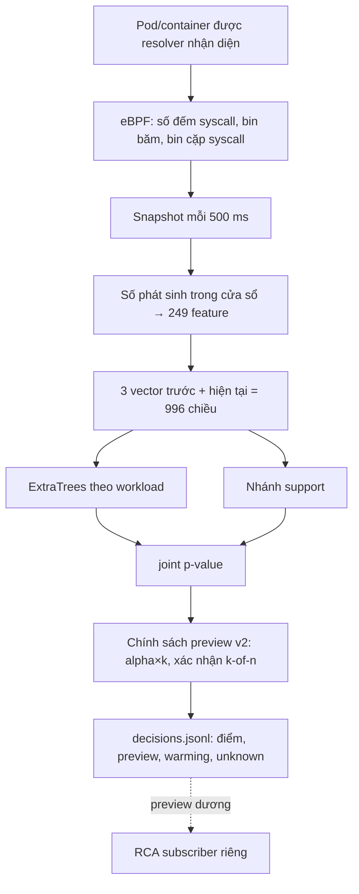

# Sentinel Pulse — trạng thái, kết quả và nhật ký

Cập nhật **19/10/2026 10:41 (UTC+7)** từ SSH vào cụm. Giờ trong file là UTC+7, trừ khi ghi UTC.

Đây là một trong ba báo cáo hiện hành:
- Sentinel Pulse — phát hiện bằng ML (file này; gồm cả hạ tầng chung và nhật ký);
- [thí nghiệm chọn syscall](SYSCALL_FEATURE_EXPERIMENT_STATUS.md);
- [RCA — dựng đồ thị điều tra](RCA_RUNTIME_STATUS.md).

Danh sách việc cần làm nằm ở [TODO.md](TODO.md).


## Tên gọi và đường dẫn thật trên cụm

Báo cáo dùng tên mô tả. Thư mục và unit có từ trước giữ tên cũ trên đĩa, vì config và hash bằng chứng tham chiếu tới chúng. Trên NFS có symlink tên mô tả trỏ tới từng thư mục, nên đường dẫn trong báo cáo dùng được trực tiếp.

| Tên trong báo cáo | Là gì | Thư mục / unit thật |
|---|---|---|
| `pulse-soak-baseline` | Soak 48 giờ của candidate gốc | `/mnt/sentinel-pulse-archive/matched-parallel-20261015` |
| `pulse-attack-dev` | Ma trận tấn công development 315 cặp | `matched-parallel-r3-20261015` |
| `pulse-attack-dev-rabbitmq` | 15 cặp RabbitMQ bổ sung | `matched-parallel-r5-rabbit-20261015` |
| `syscall-arms` | Thí nghiệm 11 cấu hình syscall (693 model) | `matched-parallel-r4-20261015` |
| `pulse-candidate-baseline` / `pulse-candidate-recalibrated` | Candidate gốc / candidate hiệu chỉnh lại | `runtime-f95867d-20261012` / `runtime-recal-c1-20261018` |
| `pulse-live-recalibrated` | Lượt live: candidate hiệu chỉnh lại + `policy-1win-a3` (đang chạy) | `matched-r6-20261018`; unit `pulse-matched-worker-r6-20261018` |
| `…/campaign-main`, `…/campaign-rca` | Campaign 315 cặp / campaign 105 cặp đánh giá RCA | `coordinator-runtime-r6-d791d24-20261019` / `coordinator-rca-followup-20261019` |
| `policy-1win-a3` | Chính sách 1 cửa sổ, alpha×3 | `sentinel_pulse/protocol/policy-1win-a3.json` (SHA-256 `f6107351…`) |
| `pulse-stable-candidate` | Lượt kế tiếp, ứng viên cho bản stable | `/mnt/sentinel-pulse-archive/pulse-stable-candidate` (tạo khi chạy) |
| `rca-subscriber` | Bản RCA tốt nhất, đang chạy | unit `rca-subscriber`, `/var/lib/sentinel-pulse-rca/rca-subscriber` |
| `rca-followup`, `rca-followup-v1`, `rca-flow`, `rca-runtime-v1` | Các bản RCA cũ (lịch sử) | `/var/lib/sentinel-pulse-rca/runtime-events-…` (có symlink cùng tên) |

## 1. Tóm tắt

- **Pulse làm gì.** Pulse đếm syscall của từng container Kubernetes bằng eBPF. Cứ 0,5 giây, nó tạo một vector 249 số cho mỗi container. Một model riêng cho từng workload chấm điểm xem cửa sổ đó "lạ hay không" so với lúc bình thường. Toàn bộ chạy ở chế độ **shadow**: chỉ ghi `candidate_alert_preview` (cảnh báo thử), không phát cảnh báo vận hành, không cách ly pod.
- **Kết quả mới nhất — lượt live pulse-live-recalibrated (19/10), dữ liệu mới, nhãn kỳ vọng:**

  | Chỉ số | Kết quả |
  |---|---|
  | Precision | 89,1% |
  | Recall | 92,8% |
  | Control idle dương | 11,2% |
  | p95 kernel → preview | 1,90 s (campaign tiếp nối 105 cặp: 2,17 s) |
  | Đợt cảnh báo trên normal | ~17 mỗi replica-giờ (**sơ bộ**, mẫu 7,3 replica-giờ; số chính thức từ job 20/10 02:10) |

- **Phát hiện quan trọng nhất.** Một binary vô hại chạy cùng đường khởi chạy với attack bị gắn cờ **80,7%**. Nghĩa là Pulse phát hiện "process bất thường", chưa phân biệt được ác ý. Nó chỉ tách rõ các attack dùng syscall hiếm: ptrace, setns, execveat.
- **Hướng gần nhất.** Replay trên pulse-live-recalibrated cho thấy chính sách xác nhận 2 cửa sổ (k2of2) đạt precision và recall ≥ 95%, control ≤ 5%, nhưng p95 là 2,3–2,9 s. Chấm điểm đã được tăng tốc ~4,9× và cho kết quả khớp từng bit, để lượt pulse-stable-candidate thử đưa k2of2 xuống dưới 2 s.
- **Nút thắt kéo dài: gánh cảnh báo trên dữ liệu bình thường.**
  - Calibration lệch dần theo thời gian.
  - Hiệu chỉnh lại p-value giảm tỉ lệ cửa sổ bị gắn cờ từ 8,1% xuống 0,35%.
  - Dù vậy vẫn còn 6–17 đợt mỗi replica-giờ, xa ngân sách 0,1.
  - Thí nghiệm syscall cho thấy thay bộ syscall không giải quyết được vấn đề này.

## 2. Trạng thái cụm và job (10:41 ngày 19/10)

| Thành phần | Trạng thái |
|---|---|
| Lượt live pulse-live-recalibrated: `pulse-live-recalibrated (unit `pulse-matched-worker-r6-20261018`)` (3 worker) | Đang chạy từ 02:04, **chạy hết chu kỳ** đến 20/10 02:04 (không dừng giữa chừng); chấm điểm bằng đường sklearn cũ |
| Campaign pulse-live-recalibrated (315 cặp) | **Xong** 09:52 (mục 5.5) |
| Traffic pulse-live-recalibrated | Đã xong lịch các chế độ tải; hiện ở steady |
| Campaign tiếp nối cho RCA `campaign-rca (unit `pulse-matched-campaign-r6-rca-followup-20261019`)` | **Xong** ~12:50 (105/105 cặp), mục 5.5 |
| RCA | rca-followup đang chạy từ 10:48 (xem [RCA](RCA_RUNTIME_STATUS.md)) |
| `syscall-arms-on-pulse-live (job)` | **Xong** ~13:40 (xem [syscall](SYSCALL_FEATURE_EXPERIMENT_STATUS.md) mục 5.5) |
| `pulse-compress-raw-48h-20261019` (**.236**) | **Đang chạy từ 18:36** (dời từ 02:05 sang node rảnh): nén gzip 292 file `raw.jsonl` của soak 48 giờ (68,7 GB), kiểm tra SHA-256 khớp seal trước khi xóa bản gốc. Tỉ lệ 4,4×, dự kiến thu lại ~53 GB |
| `pulse-compress-48h-rest-20261019` (**.236**) | Chờ nén `raw` xong và job syscall replay xong pulse-attack-dev, rồi nén `features`/`decisions` của soak 48 giờ (~150 GB → ~35 GB) |
| `pulse-calibration-refresh-study` | Timer 20/10 02:15 (snapshot `3bb0e74`, đọc được file `.gz`), trong khoảng không có lượt live; pulse-stable-candidate chỉ khởi chạy sau khi job này xong |
| `pulse-stable-candidate-selection` | Timer 20/10 02:10 (`scripts/pulse_stable_candidate_selection.sh`), mục 5.7; bước cuối áp luật chọn bằng code → `SELECTION.json` |
| `pulse-syscall-bootstrap-20261019` (**.235**) | **Đang chạy từ 18:30** (không cần chờ pulse-live-recalibrated; chạy trên node rảnh để không tranh IO với `.234`): replay syscall với khóa trial đã sửa, rồi bootstrap |
| Collector 1 s + resolver trên worker | Chạy; resolver bắt buộc phải có cho matched worker |
| Detector v8 cũ | Đã gỡ; phần còn sót chờ chạy tay (mục 8) |
| NFS `/mnt/sentinel-pulse-archive` | Còn 52 GB lúc 17:16. pulse-live-recalibrated cần thêm ~32 GB nên sẽ còn ~20 GB lúc kết thúc, trong khi pulse-stable-candidate 24 giờ cần ~82 GB → nén `raw.jsonl` của soak 48 giờ trả lại ~60 GB |
| Ổ đĩa worker | **Đã dọn 19/10 18:30**: worker1 81% → 40%, worker4 85% → 41%, worker3 56% → 29% (~530 GB) |

## 3. Thuật ngữ

| Thuật ngữ | Nghĩa trong triển khai này |
|---|---|
| syscall | Lời gọi hệ thống (read, connect, execve…); đếm ở entry nên chưa chứng minh thành công |
| eBPF | Chương trình chạy trong kernel, ở đây dùng để đếm syscall theo cgroup |
| cgroup / resolver | Nhóm tài nguyên của container / tiến trình ánh xạ Pod UID → container → cgroup → revision |
| cửa sổ (window) | 0,5 giây; mỗi container có một vector cho mỗi cửa sổ |
| vector 249 số | Gồm:<br>• log-count và tỷ lệ của 29 syscall;<br>• 5 tổng hợp;<br>• 64 bin băm syscall;<br>• 64 bin băm cặp syscall liền nhau;<br>• trung bình và độ lệch trượt (rolling-10) |
| ngữ cảnh (context) | 3 cửa sổ trước + cửa sổ hiện tại = 996 số đưa vào model |
| ExtraTrees | Họ cây quyết định ngẫu nhiên (không phải deep learning), học phân biệt normal với normal bị làm hỏng |
| nhánh support | Phát hiện tọa độ nằm ngoài vùng từng thấy khi bình thường |
| p-value (conformal) | Vị trí điểm của cửa sổ so với điểm normal dùng để hiệu chỉnh; p nhỏ là hiếm gặp. Chỉ đúng nghĩa khi normal lúc chạy giống normal lúc hiệu chỉnh |
| joint_p, alpha | joint_p = min(1, 2·min(tree_p, support_p)); alpha = 0,05/30 ≈ 0,00167 mỗi cửa sổ |
| hệ số alpha (alpha×k) | Nới ngưỡng thành k·alpha |
| xác nhận k-of-n | Chỉ báo khi ít nhất k trong n cửa sổ liên tiếp vượt ngưỡng; ví dụ k2of2_a10 là 2/2 cửa sổ với alpha×10 |
| hiệu chỉnh lại (recalibration) | Thay tập điểm normal dùng để tính p-value bằng normal gần hơn; giữ nguyên model |
| cảnh báo thử (preview) | `candidate_alert_preview=true`; tín hiệu để đánh giá, **không phải** cảnh báo vận hành |
| đóng băng (freeze) / frozen_source | Khóa source, model, chính sách bằng SHA-256. Worker từ chối chạy nếu các file chấm điểm khác bản đóng băng |
| kiểm tra tương đương | Replay segment đã niêm phong qua code mới, yêu cầu điểm giống **từng bit** với điểm đã ghi |
| soak | Chạy liên tục nhiều giờ trên tải bình thường |
| cặp attack/control | Control 15 s (không làm gì) → binary vô hại 15 s → attack 15 s, trên cùng container |
| binary vô hại (benign-exec control) | Cùng file, cùng đường `kubectl exec` như attack, chỉ gọi `getpid` lặp lại. Dùng để tách "có process mới" khỏi hành vi tấn công |
| TP / FN / FP / TN | Bắt đúng / bỏ sót / báo nhầm / im lặng đúng. "FP kỳ vọng" vì nhãn control chưa được review |
| unknown | Thiếu dữ liệu hoặc bằng chứng; không bao giờ tự đổi thành TN/FN |
| đợt cảnh báo (episode) | Các cửa sổ dương của một container cách nhau < 15 s gộp thành một đợt |
| replica-giờ | Một giờ dữ liệu đã chấm của một container (replica) |
| development / blind | Dữ liệu đã nhìn khi phát triển / dữ liệu mới chưa dùng để chỉnh. Chỉ blind mới dùng để kết luận cuối |
| cadence gap | Hai snapshot cách nhau ngoài 0,35–0,8 s; history bị reset, cửa sổ sau đó không tính là normal |

## 4. Luồng ML đang chạy



- **Model.** Mỗi workload/container có model riêng; bundle hiện hành có 21 key trong namespace `production` của ứng dụng AIMS. Cửa sổ của container chưa có model không được tính là TN.
- **Phạm vi giám sát** (kiểm tra trên cụm 19/10 19:50):
  - *Được chấm điểm:* mọi replica của 21 workload trên, trên cả 3 worker (worker1, worker3, worker4). Mỗi worker có một matched worker chấm các pod trên node của nó. Lúc kiểm tra có 79 pod `production` (27 / 32 / 20 pod theo node).
  - *Không được chấm điểm:*
    - 3 pod tạo traffic `aims-sentinel-*-loadgen`;
    - các namespace hạ tầng (`kube-system`, `istio-system`, `longhorn-system`, `monitoring`, `vault`, `argocd`…);
    - cả 3 master, vì không có pod `production` nào chạy trên master.
  - *Lịch tấn công thử:* 315 lượt rải qua cả 21 workload; mỗi lượt nhắm một replica.
  - *RCA:* Tetragon chạy trên 6 node, nhưng policy RCA là `TracingPolicyNamespaced` trong `production`, và case chỉ được dựng khi Pulse cảnh báo. Vì vậy RCA có cùng phạm vi.
  - *Mở rộng:* muốn giám sát cả hạ tầng thì phải thu normal và huấn luyện model cho các workload đó trước.
- **Chính sách v2** (`detector/candidate_policy.py`, schema `sentinel-pulse-candidate-preview-policy-v2`) có hai tham số đăng ký trong file JSON có SHA-256:
  - hệ số alpha;
  - số cửa sổ xác nhận k-of-n.
- **Chấm điểm batch** (`detector/idle_batch.py`): gom các context cùng workload trong một frame rồi chấm một lần.
- **Đường chấm điểm nhanh** (`detector/fast_forest.py`, bật bằng `fast_scoring: true`) cho kết quả giống hệt từng bit. Batch đầu tiên của mỗi model được so với sklearn; nếu lệch thì tự quay về đường cũ.

## 5. Kết quả

### 5.1 Soak 48 giờ của candidate đóng băng (15–17/10, normal chưa review nhãn)

| Worker | Cửa sổ đã chấm | Cảnh báo thử | Tỷ lệ | Issue |
|---|---:|---:|---:|---:|
| worker1 (.237) | 9.011.856 | 673.825 | 7,5% | 146 |
| worker4 (.238) | 8.051.218 | 950.765 | 11,8% | 381 |
| worker3 (.239) | 4.408.203 | 90.161 | 2,0% | 65 |
| **Tổng** | **21.471.277** | **1.714.751** | **8,0%** | 592 |

- Model `747c4eed…`, chính sách `fd0be94a…`.
- Nếu p-value đúng nghĩa, tỷ lệ cửa sổ dương phải quanh 0,17%; thực tế cao gấp ~47 lần, tương ứng 37,1 đợt mỗi replica-giờ.
- Bằng chứng: `validation-evidence/results-20261018/pulse-soak-48h-*-TERMINAL.json`.

**Lưu ý (phát hiện ngày 19/10, mục 5.5).** Trong thời gian soak, Tetragon trên worker1/worker3 đang gánh hàng trăm client mồ côi. Điều này có thể đã gây cadence gap và làm lệch một phần số đo; worker4 có 7–9 gap mỗi segment trong 6 giờ đầu.

### 5.2 Ma trận attack/control phát triển pulse-attack-dev (+ rabbitmq) (14–15/10)

pulse-attack-dev gồm 315 cặp (21 key × 5 kịch bản × 3 tốc độ):

| | Bắt được | Không bắt | Unknown |
|---|---:|---:|---:|
| Attack | TP 284 | FN 2 | 29 |
| Control | FP kỳ vọng 72 | TN kỳ vọng 237 | 6 |

- Precision 79,8%, recall 99,3% (cận dưới khi tính cả unknown: 90,2%), control dương 23,3%.
- Kernel → preview p50 / p95 / p99 = 1,07 / 1,61 / 4,75 s.
- pulse-attack-dev-rabbitmq (RabbitMQ, 15 cặp): TP 13, FN 0, FP 1, TN 14, unknown 2.
- Đây là dữ liệu development, thiết kế 1:1. pulse-attack-dev **chưa có** đối chứng binary vô hại.

### 5.3 Xác nhận k-of-n trên p-value gốc (18/10, development)

Số đợt mỗi giờ tính trên toàn bộ soak 48 giờ (3.199,7 replica-giờ):

| Chính sách | Đợt/giờ normal | Precision pulse-attack-dev | Recall pulse-attack-dev | Control dương | p95 |
|---|---:|---:|---:|---:|---:|
| 1 cửa sổ | 37,1 | 79,8% | 99,3% | 23,3% | 1,61 s |
| 2 of 2 | 22,3 | 87,3% | 98,3% | 13,3% | 2,25 s |
| 4 of 6 | 19,5 | 90,6% | 98,3% | 9,4% | 3,42 s |
| 4 of 6, alpha/4 | 12,0 | 94,7% | 69,2% | 3,6% | 5,94 s |

Chỉ dùng k-of-n thì không đưa gánh cảnh báo về gần ngân sách, và làm p95 vượt 2 s.

### 5.4 Hiệu chỉnh lại p-value (18/10, development)

- **Tập hiệu chỉnh:** điểm của chính model đóng băng trên normal 15/10 00:30–07:30 UTC (bỏ khoảng pulse-attack-dev-rabbitmq); model giữ nguyên.
- **Tập kiểm tra:** soak từ 15/10 08:40 UTC (2.206,6 replica-giờ) và pulse-attack-dev.
- Bằng chứng: `validation-evidence/results-20261018/confirmation-study/recalibrated-c1/`.

| | P-value gốc | Hiệu chỉnh lại |
|---|---:|---:|
| Cửa sổ normal bị gắn cờ | 8,11% | **0,35%** |
| Đợt cảnh báo / replica-giờ | 36,3 | **9,1** |
| Precision pulse-attack-dev | 79,8% | **97,8%** |
| Recall pulse-attack-dev | 99,3% | 91,3% (mất `seccomp_api_probe` 14, `anonymous_mprotect_churn` 11) |
| Control dương pulse-attack-dev | 23,3% | **1,9%** |
| p95 / p99 | 1,61 / 4,75 s | 2,91 / 5,87 s |

Lưới alpha nới rộng (pulse-attack-dev):

| Chính sách | Precision | Recall | Control | p95 | Đợt/giờ |
|---|---:|---:|---:|---:|---:|
| 1 cửa sổ, alpha×3 | 94,3% | 93,4% | 5,2% | 1,97 s | 18,0 |
| 2 of 3, alpha×5 | 98,9% | 97,9% | 1,0% | 3,39 s | 9,9 |
| 2 of 3, alpha×10 | 96,9% | 99,0% | 2,9% | 2,32 s | 17,1 |

- Kết quả này tạo ra candidate `ec72d9ea…` (`pulse-candidate-recalibrated/model-bundle`).
- Chính sách `policy-1win-a3` (`policy-1win-a3.json`, SHA-256 `f6107351…`) là 1 cửa sổ, alpha×3: chính sách duy nhất có p95 < 2 s.
- Kiểm tra tương đương sau refactor: 214.449 cửa sổ, 0 sai khác (`scorer-equivalence-0117901.json`).

### 5.5 Lượt live pulse-live-recalibrated (19/10)

| Thành phần | Giá trị |
|---|---|
| Candidate / chính sách | `ec72d9ea…` / pulse-live-recalibrated (`f6107351…`) |
| Capture | 3 worker, 24 giờ, không ghi `raw.jsonl` (NFS không đủ chỗ cho kiểu 48 giờ ~4,9 GB/giờ) |
| Source worker | snapshot `4ba303a`; kiểm tra tương đương trên snapshot này: 27.840 dòng, 0 sai khác |
| Campaign | 315 cặp control → binary vô hại → attack; fixture `testbed/attack/runtime_attack_with_benign_control.c`; coordinator `d791d24` |
| Thư mục | `/mnt/sentinel-pulse-archive/pulse-live-recalibrated/` |

**Kết thúc chu kỳ 24 giờ** (`STATUS.json` của từng worker, đọc lúc 20/10 02:30). Cả 3 worker tự chuyển sang `completed_capture` sau đúng 86.400 s và không bị dừng giữa chừng:

| Worker | Bắt đầu → kết thúc | Segment | Dòng được chấm | Preview dương | Issue |
|---|---|---:|---:|---:|---:|
| worker1 | 19/10 02:03:58 → 20/10 02:21:55 | 50 | 4.519.681 | 58.269 (1,29%) | 404 |
| worker4 | 19/10 02:04:06 → 20/10 02:12:54 | 49 | 1.698.686 | 15.630 (0,92%) | 32 |
| worker3 | 19/10 02:04:18 → 20/10 02:22:21 | 49 | 4.618.168 | 142.105 (3,08%) | 430 |
| Tổng | | | 10.836.535 | 216.004 (1,99%) | |

- Thời điểm kết thúc muộn hơn mốc 24 giờ 9–18 phút vì phần đóng segment cuối (đếm thời gian capture, không tính lúc ghi xong).
- Tỷ lệ preview dương ở đây là số thô dưới policy-1win-a3. Nó gồm cả cửa sổ campaign và cả khoảng sự cố 18:25–19:20, nên **không phải** tỷ lệ báo động nhầm. Gánh nặng normal sạch sẽ do job chọn (mục 5.7) tính lại, có loại trừ.
- Hệ quả thấy được ở RCA: `rca-subscriber` dựng khoảng 330 case mỗi giờ từ 20:00 đến 02:00. Mức này bị chặn trên bởi cooldown 300 s cho mỗi container (xem RCA_RUNTIME_STATUS.md). Đây là lý do cần một policy chặt hơn cho pulse-stable-candidate.

**Sự cố khi khởi động (02:04–02:20).**
- **Triệu chứng.** Worker1/worker3 báo `cadence_gap` khoảng mỗi 5 s.
- **Nguyên nhân.** Bên trong container Tetragon có **301 / 18 / 59 tiến trình `tetra getevents` mồ côi** (worker1 / worker4 / worker3), đã chạy từ 10 giờ đến 25 ngày. Chúng được sinh ra mỗi khi `kubectl exec` phía `.234` bị giết mà tiến trình trong container vẫn sống. Nguồn rò gồm:
  - campaign cũ;
  - subscriber RCA;
  - v8.
- **Tác động.** Tetragon tốn 5,3 core và 11,5 GB RAM ở worker1, 7,0 core ở worker3, làm matched worker thiếu CPU.
- **Xử lý.**
  - Sửa code (`d791d24`): bọc lệnh trong container bằng `timeout`.
  - Dọn toàn bộ client mồ côi.
- **Sau khi xử lý.** Tetragon worker1 còn 0,6 core / 2,8 GB; CPU node từ 62% xuống 35%; không còn cadence gap. Khoảng 02:04–02:13 không được tính là normal.

**Kết quả campaign (xong 09:52, 315/315 cặp).** Chính sách đúng như đăng ký, không chỉnh sau khi xem kết quả.

| Chỉ số | pulse-live-recalibrated live | Dự đoán development |
|---|---|---|
| Precision (attack : control idle = 1:1) | **89,1%** | 94,3% |
| Recall | **92,8%** (TP 285, FN 22, unknown 11) | 93,4% |
| Control idle dương | 11,2% (35/312) | 5,2% |
| **Binary vô hại dương** | **80,7%** (251/311) | — |
| Kernel → preview p50 / p95 / p99 | 1,03 / **1,90** / 5,39 s | p95 1,97 s |
| Đợt cảnh báo normal (02:07–02:20) | 17,2 / replica-giờ | 18 |

Tỉ lệ dương theo kịch bản:

| Kịch bản | Attack | Binary vô hại | Control idle |
|---|---|---|---|
| `child_ptrace_handshake` | 1,00 | 0,81 | 0,10 |
| `execveat_resolution_probe` | 1,00 | 0,79 | 0,11 |
| `invalid_setns_burst` | 1,00 | 0,81 | 0,11 |
| `anonymous_mprotect_churn` | 0,84 | 0,83 | 0,11 |
| `seccomp_api_probe` | 0,80 | 0,81 | 0,15 |

- Với attack, trung vị **100%** cửa sổ trong 15 s là dương. Với binary vô hại là 33%, với control là ~0%. Tín hiệu bền là dấu hiệu tách mạnh, nhưng đợi tín hiệu bền thì chậm.
- Precision 1:1 ở trên chỉ tính control idle. Nếu coi binary vô hại là âm tính thì precision thấp hơn nhiều. Báo cáo đồ án phải trình bày cả hai cách tính.

**Campaign tiếp nối (105 cặp, 7 workload, xong ~12:50):**
- TP 93, FN 11, FP 7, TN 98, unknown 1.
- Precision 93,0%, recall 89,4%, control idle 6,7%, **binary vô hại 70,6%** (72/102).
- **p95 kernel → preview 2,17 s, vượt ngưỡng 2 s** (p50 1,02 s, p99 5,19 s; 93 mẫu).
- Cùng xu hướng với campaign chính. Mẫu nhỏ hơn và chỉ có 7 workload, nên p95 không so trực tiếp được với 1,90 s của campaign chính.

**Cadence gap trong thời gian chạy:**

| Khoảng | worker1 | worker4 | worker3 | Nguyên nhân |
|---|---:|---:|---:|---|
| 02:00–03:00 | 230 | 0 | 296 | Tranh chấp CPU do client Tetragon mồ côi |
| 03:00–04:00 | 36 | 0 | 25 | Phần còn lại của sự cố trên |
| 13:00–14:00 | 17 | 5 | 18 | Job syscall đọc NFS |
| Các giờ khác | 0–5 | 0–5 | 0–5 | — |

Các cửa sổ sau gap tự động không tính là normal.

**Replay chính sách trên pulse-live-recalibrated** (`analysis/policy-replay-{default,looser}.json`).
- Replay k1of1_a3 tái lập đúng kết quả live.
- Các chính sách khác được chọn sau khi đã xem pulse-live-recalibrated, nên chỉ là development.

| Chính sách | Precision | Recall | Control | Binary vô hại | p95 |
|---|---|---|---|---|---|
| k1of1_a1 | 94,9% | 91,2% | 4,8% | 72% | 2,54 s |
| k1of1_a3 (`policy-1win-a3`) | 89,1% | 92,8% | 11,2% | 81% | 1,90 s |
| k1of1_a5 | 85,7% | 97,7% | 16,0% | 93% | 1,67 s |
| **k2of2_a5** | **97,4%** | **95,8%** | **2,6%** | 82% | 2,88 s |
| k2of2_a10 | 95,0% | 98,0% | 5,1% | 89% | 2,30 s |
| k2of3_a10 | 94,4% | 98,7% | 5,8% | 94% | 2,27 s |

**Độ trễ xử lý: từ cuối cửa sổ đến preview.**

| Node | Container/frame | p50 | p95 |
|---|---:|---:|---:|
| worker1 | 82 | 0,46 s | 0,54 s |
| worker3 | 85 | 0,50 s | 0,58 s |
| worker4 | 28 | 0,25 s | 0,30 s |

Profile trên frame thật cho thấy ~85% thời gian nằm ở `predict_proba` của sklearn, chủ yếu là overhead Python theo từng cây.

**Tăng tốc chấm điểm (`0913446`).**
- **Cách làm.** `fast_forest.py` cộng `tree_.predict` của từng cây theo đúng thứ tự trong float64 như sklearn, nhưng bỏ phần overhead.
- **Kiểm chứng.** Replay 2 segment pulse-live-recalibrated (40.000 dòng):
  - 13.505 dòng có điểm, **0 sai khác**;
  - CPU **42,4 s so với 208,9 s** (nhanh ~4,9×).
- **Ước tính.** Thời gian từ cuối cửa sổ đến preview giảm xuống ~0,1 s, nên p95 của k2of2_a10 có thể còn ~1,95 s. Con số thật phải đo live ở pulse-stable-candidate.

### 5.5b Giả thuyết "syscall chưa từng thấy" (đăng ký tiêu chí 19/10 18:47, trước khi có kết quả)

- **Câu hỏi.** Gắn cờ khi container gọi một syscall ID không có trong normal của workload đó: cách này có tách attack khỏi process vô hại mới không? Binary vô hại chỉ gọi `getpid`/`nanosleep`; attack `ptrace`/`setns`/`execveat` dùng các syscall mà thí nghiệm C3 thấy bằng 0 trên normal.
- **Dữ liệu.**
  - Normal tham chiếu: tập ID theo workload trên pulse-live-recalibrated 13:00–~18:30 (các segment đã niêm phong; không có campaign).
  - Interval: hai campaign pulse-live-recalibrated (420 cặp).
  - Script: `scripts/analysis/novel_syscalls.py`; job `pulse-novel-syscalls-20261019` trên `.235`.
- **Tiêu chí "hữu ích", ghi trước:**
  1. Tỉ lệ binary vô hại có ID mới ≤ 10%.
  2. Tỉ lệ attack có ID mới ≥ 90% với ít nhất 2/3 kịch bản `ptrace`/`setns`/`execveat`.
  3. Tỉ lệ control idle có ID mới ≤ 5%.

  Không đạt cả ba thì ghi là không hữu ích như một bộ dò riêng.
- **Giới hạn biết trước.**
  - Tham chiếu và interval cùng lấy từ một lượt capture (khác khoảng thời gian), nên đây là development.
  - Kịch bản không dùng syscall lạ (`mprotect`, `seccomp`) dự kiến không bị bắt.

**Kết quả (job chạy 20/10 02:20–02:45 trên `.234`; biên nhận `pulse-live-recalibrated/novel-syscalls.json`):**

| Kịch bản | Attack có ID mới | Binary vô hại có ID mới | Control idle có ID mới | ID mới hay gặp nhất ở attack |
|---|---:|---:|---:|---|
| `child_ptrace_handshake` | 84/84 (100%) | 37/84 (44%) | 0/84 | 101 `ptrace` (84), 56 `clone` |
| `execveat_resolution_probe` | 84/84 (100%) | 37/84 (44%) | 0/84 | 322 `execveat` (84) |
| `invalid_setns_burst` | 84/84 (100%) | 35/84 (42%) | 0/84 | 308 `setns` (84) |
| `seccomp_api_probe` | 39/84 (46%) | 35/84 (42%) | 0/84 | 317 `seccomp` (30) |
| `anonymous_mprotect_churn` | 32/84 (38%) | 36/84 (43%) | 0/84 | 230 `clock_nanosleep` (27) |
| **Tổng** | **76,9%** | **42,9%** | **0%** | |

- **Kết luận theo tiêu chí đăng ký:** tiêu chí 1 không đạt (43% so với ngưỡng ≤ 10%), tiêu chí 2 không đạt khi tính tổng (77% so với ≥ 90%, dù 3/3 kịch bản `ptrace`/`setns`/`execveat` đạt 100%), tiêu chí 3 đạt (0%). Vì vậy **không hữu ích như một bộ dò riêng**.
- **Nhận xét (rút ra sau khi xem số, chưa phải kết quả):**
  - ID mới ở binary vô hại chủ yếu là 230 `clock_nanosleep`, 138 `fstatfs`, 317 `seccomp`, 125 `capget`. Đây là các syscall của chính cơ chế exec vào container (runtime dựng process), không phải của binary.
  - ID đặc trưng attack (101/322/308) không xuất hiện ở binary vô hại.
  - Giả thuyết bổ sung "novelty có xét exec" được đăng ký ở mục 5.7c để kiểm trên dữ liệu mới.
- **Lệch so với đăng ký:** khoảng tham chiếu thực tế là 13:00–19:00, không phải 13:00–~18:30. Phần dôi ra gồm cả đoạn sự cố 18:25–19:00. Khoảng tham chiếu rộng hơn chỉ thêm ID vào tập normal, nên làm tỉ lệ "có ID mới" của **cả** attack và binary vô hại thấp hơn hoặc bằng; nó không thể làm kết luận "không đạt" tốt lên.

### 5.6 Hiệu chỉnh lại định kỳ (job `pulse-calibration-refresh-study`, 20/10 02:15–02:40)

- **Module:** `attack/rolling_recalibration.py`. Biên nhận: `validation-evidence/results-20261019/pulse-calibration-refresh-study.json`.
- **Cách làm:** replay soak 48 giờ (pulse-soak-baseline) với model giữ nguyên, chỉ đổi calibration:
  - `static`: calibration c1 suốt thời gian đánh giá;
  - `rolling-W-1`: mỗi giờ calibration lại bằng W giờ trước đó;
  - `guarded`: như rolling nhưng bỏ các cửa sổ đã dương ra khỏi lần calibration sau.
  
  Đánh giá trên 33,4 giờ normal (loại 647 khoảng campaign). Attack: pulse-attack-dev, mỗi trial dùng calibration đang hiệu lực lúc trial bắt đầu. Đây là development; normal chưa review nhãn.

| Chiến lược | Đợt/replica-giờ α×1 | Đợt/replica-giờ α×3 | Recall α×1 / α×3 | Precision α×1 / α×3 | Control α×3 | p95 α×3 |
|---|---:|---:|---:|---:|---:|---:|
| static (c1) | 6,41 | 16,16 | 91,6% / 93,6% | 97,9% / 94,3% | 5,5% | 1,92 s |
| rolling-3-1 | 5,65 | 13,93 | 91,6% / 93,0% | 97,9% / 93,3% | 6,5% | 1,93 s |
| rolling-6-1 | 5,39 | 13,37 | 92,0% / 93,3% | 97,9% / 93,6% | 6,1% | 2,18 s |
| rolling-12-1 | **4,94** | **12,69** | 92,0% / 94,3% | 97,9% / 94,3% | 5,5% | 2,31 s |
| guarded-6-1 | 21,21 | 27,93 | 93,0% / 96,0% | 96,5% / 91,7% | 8,4% | 2,16 s |

- **Kết luận:**
  - Làm mới calibration mỗi giờ bằng 6–12 giờ trước đó giảm gánh cảnh báo **16–23%** mà recall và precision giữ nguyên.
  - Mức giảm này nhỏ so với khoảng cách tới ngân sách 0,1 đợt/replica-giờ (vẫn ~50–130 lần). Calibration không giải quyết được gánh cảnh báo.
  - Biến thể `guarded` **hỏng**: gánh cảnh báo tăng dần từ 14,6 lên 30,1 đợt/replica-giờ (6 giờ đầu so với 6 giờ cuối). Bỏ cửa sổ dương khiến calibration chỉ còn phần đuôi "yên" nhất, nên ngưỡng ngày càng chặt hơn so với normal thật.
  - Gánh cảnh báo của `static` ở α×3 không tăng đều theo thời gian (20,9 lên 12,7 từ 6 giờ đầu tới 6 giờ cuối). Nó phụ thuộc vào chế độ tải nhiều hơn là trôi đơn điệu.
- Trên pulse-live-recalibrated, phép thử một lần làm mới (mục 5.7) cho kết quả tương tự: gánh cảnh báo không giảm, nhưng recall và precision tăng.

### 5.7 Kế hoạch chọn candidate và chính sách pulse-stable-candidate (đăng ký trước, 19/10 10:52)

Job `pulse-stable-candidate-selection` chạy sau khi pulse-live-recalibrated kết thúc. Mỗi khoảng thời gian đều loại trừ hai campaign (±60 s) và đoạn tranh chấp lúc khởi động.

1. **Gánh cảnh báo như pulse-live-recalibrated đã chạy:** normal 19:00–02:04, mọi chính sách trong 2 lưới.
2. **Làm mới calibration:** hiệu chỉnh lại candidate `ec72d9ea…` bằng normal pulse-live-recalibrated 13:00–19:00 (19/10). Đây chính là bước "làm mới định kỳ" trong vận hành thật.
3. **Đo với calibration mới:** gánh cảnh báo trên 19:00–02:04, và replay cả hai campaign pulse-live-recalibrated.

**Sửa đổi 19/10 19:17** (do sự cố hạ tầng, đưa ra trước khi xem bất kỳ kết quả normal nào của pulse-live-recalibrated):
- Loại khoảng **18:25–19:20** khỏi cả khoảng hiệu chỉnh (thực tế còn 13:00–18:25) lẫn khoảng đánh giá (thực tế 19:20–02:04). Xem mục 8b.

**Luật chọn, đăng ký trước khi có số:**
- Ưu tiên calibration làm mới nếu nó giảm số đợt cảnh báo mà không làm giảm recall quá 2 điểm phần trăm.
- Trong các chính sách có p95 replay ≤ 2,3 s (đường nhanh dự kiến bớt ~0,35 s), precision và recall ≥ 95%, control ≤ 5%, chọn chính sách có **ít đợt cảnh báo/giờ nhất**.
- Nếu không chính sách nào đạt các điều kiện trên, chọn chính sách đạt p95 thấp nhất trong số có precision ≥ 95%, và ghi rõ là không đạt kỳ vọng.

- **Luật chọn đã viết thành code** (`attack/select_policy.py`, `3e2d2e4`, có test). Code đọc output của job, ghi `SELECTION.json` gồm calibration, chính sách, số liệu, cờ đạt kỳ vọng và hash đầu vào, rồi sinh file chính sách v2 gắn với hash candidate pulse-stable-candidate. Nhờ vậy việc chọn tái lập được, không có phán đoán thủ công sau khi đã xem số.

Sau đó chạy `scripts/prepare_pulse_stable_candidate.sh`. Script tạo bundle bằng `detector/recalibrate_bundle.py` (nếu chọn calibration làm mới), sinh file chính sách, và kiểm tra file đó nạp được với candidate qua loader thật. Đã thử với một lựa chọn giả lập trên candidate `ec72d9ea…`: nạp đúng `ConfirmedPreviewPolicy(k=2, n=2, alpha_scale=5.0)`. Cuối cùng commit file chính sách vào `sentinel_pulse/protocol/`, tạo snapshot, rồi chạy `scripts/launch_run.sh` với `FAST=1` (chấm điểm nhanh) và RCA cấu hình đầy đủ.

### 5.7a Kết quả chọn (job chạy 20/10 02:10–03:14; `SELECTION.json`)

Biên nhận: `validation-evidence/results-20261019/pulse-stable-candidate-selection/SELECTION.json`. Normal đánh giá: 466,95 replica-giờ (19:20–02:04, đã loại trừ campaign và sự cố). Attack: hai campaign pulse-live-recalibrated.

**Bước 1. Calibration nào?** So sánh ở chính sách tham chiếu k1of1_a3:

| Calibration | Đợt/replica-giờ | Precision | Recall | Control | Binary vô hại dương | p95 |
|---|---:|---:|---:|---:|---:|---:|
| as_run (c1) | **13,01** | 90,0% | 92,0% | 10,1% | 78,2% | 1,96 s |
| refreshed (13:00–18:25) | 13,65 | 94,7% | 99,3% | 5,5% | 91,3% | 1,97 s |

Theo luật, calibration làm mới chỉ được chọn nếu nó giảm số đợt cảnh báo. Ở đây nó **không giảm** (tăng 5%), nên giữ **as_run**.

**Bước 2. Chính sách nào?** Trên as_run không chính sách nào đạt đủ p95 ≤ 2,3 s, precision ≥ 95%, recall ≥ 95% và control ≤ 5% (danh sách `eligible` rỗng). Theo luật dự phòng, chọn chính sách có p95 thấp nhất trong các chính sách có precision ≥ 95%: **k2of2_a10**, và ghi là **không đạt kỳ vọng**.

| Chính sách (as_run) | Precision | Recall | Control | Binary vô hại | p95 | Đợt/replica-giờ |
|---|---:|---:|---:|---:|---:|---:|
| k1of1_a3 (pulse-live-recalibrated) | 90,0% | 92,0% | 10,1% | 78,2% | 1,96 s | 13,01 |
| k2of3_a10 | 94,8% | 97,8% | 5,3% | 92,0% | 2,28 s | 8,65 |
| **k2of2_a10 (được chọn)** | **95,2%** | **97,3%** | **4,8%** | 87,7% | **2,43 s** | **7,98** |
| k2of2_a5 | 97,7% | 94,9% | 2,2% | 78,9% | 2,88 s | 5,02 |

- **Nhận xét thẳng:**
  - Nếu dùng calibration làm mới, k2of2_a10 đạt đủ cả 4 tiêu chí: precision 96,7%, recall 99,3%, control 3,4%, p95 2,29 s, 6,75 đợt/replica-giờ.
  - Luật đăng ký trước đã dùng số đợt của k1of1_a3 làm cổng chọn calibration, và cổng này loại calibration làm mới. Mình **không đổi lựa chọn sau khi xem số**. Thay vào đó, việc so sánh hai calibration được đăng ký làm phép đo phụ trên dữ liệu mới (mục 5.7b).
  - Chính sách được chọn có p95 2,43 s, vượt mục tiêu 2 s. Mọi chính sách có p95 < 2 s đều có precision ≤ 90%.
  - Gánh cảnh báo vẫn ~80 lần ngân sách 0,1/h.
  - Binary vô hại bị gắn cờ ở 88%: detector tách hoạt động *mới*, không tách hoạt động *độc hại*. Ba giới hạn này được ghi trong file chính sách (`selection_basis.known_gaps`).
- **File chính sách:** `sentinel_pulse/protocol/policy-2of2-a10.json` (SHA-256 `a51e5abc…`), sinh bằng `select_policy --from-selection`. Đã kiểm tra nạp được với candidate `ec72d9ea…` qua loader thật (21 model). Candidate giữ nguyên `ec72d9ea…`, không tạo bundle mới vì không chọn calibration làm mới.

### 5.7b Phép đo phụ trên pulse-stable-candidate (đăng ký 20/10 09:50, trước khi lượt chạy bắt đầu)

- **Câu hỏi:** calibration làm mới (`calibration-r6-1300-1900.npz`, normal 13:00–18:25 ngày 19/10) có tốt hơn as_run trên dữ liệu **mới** không?
- **Cách làm:** sau khi pulse-stable-candidate kết thúc, chấm lại offline normal và campaign của nó bằng calibration làm mới (`confirmation_study normal|attack --calibration`). Hai bên đều dùng k2of2_a10 và đều loại trừ như nhau.
- **Tiêu chí, ghi trước:** calibration làm mới được dùng cho bản stable nếu cùng lúc đạt 3 điều kiện:
  1. giảm số đợt/replica-giờ ít nhất 10%;
  2. recall không giảm quá 2 điểm phần trăm;
  3. precision ≥ 95%.
  
  Nếu không đạt thì giữ as_run.
- **Giới hạn:** calibration làm mới lấy từ normal của một ngày trước, nên cách làm này mô phỏng làm mới với độ trễ khoảng 1 ngày, không phải làm mới mỗi giờ.

### 5.7c Giả thuyết "novelty có xét exec" (đăng ký 20/10 09:50, sau khi thấy kết quả 5.5b, trước khi có dữ liệu kiểm tra)

- **Giả thuyết:** bỏ đi các syscall ID do chính cơ chế exec vào container sinh ra thì ID mới sẽ tách attack khỏi binary vô hại.
- **Tập exec E:** mọi ID xuất hiện trong interval binary vô hại của pulse-live-recalibrated nhưng không có trong normal tham chiếu. Tập E học trên pulse-live-recalibrated rồi **đóng băng**. E chỉ dùng dữ liệu pulse-live-recalibrated, nên có thể tính sau khi pulse-stable-candidate kết thúc mà không rò dữ liệu kiểm tra; làm vậy cũng tránh đọc NFS nặng trong lúc lượt live đang chạy. Script: `scripts/analysis/novel_syscalls.py` (`novel_ids_by_label` cho E, `--exec-set` cho phép kiểm tra).
- **Kiểm tra:** chạy trên campaign của pulse-stable-candidate. Normal tham chiếu là normal của chính lượt đó trong khoảng không có campaign. Một interval được tính "có ID mới" khi có ít nhất một ID không thuộc normal tham chiếu và không thuộc E.
- **Tiêu chí:** giữ nguyên 3 tiêu chí của 5.5b:
  1. binary vô hại ≤ 10%;
  2. attack ≥ 90% với ít nhất 2/3 kịch bản `ptrace`/`setns`/`execveat`;
  3. control ≤ 5%.
- **Giới hạn biết trước:** `seccomp_api_probe` và `anonymous_mprotect_churn` gần như chắc chắn không đạt, vì syscall của chúng nằm trong E hoặc trong normal. Tiêu chí tổng 90% vì vậy có thể không đạt ngay cả khi các kịch bản dùng syscall lạ đạt 100%. Sẽ báo cáo cả hai mức.

## 6. Tiến độ và việc còn lại

| Việc | Trạng thái |
|---|---|
| Capture chính xác, 249 feature, chấm điểm batch, preview | Chạy trên 3 worker |
| Soak 48 giờ, development attack pulse-attack-dev | Có kết quả |
| Hiệu chỉnh lại p-value, chính sách v2 (alpha×k, k-of-n) | Có; dùng trong pulse-live-recalibrated |
| Đối chứng binary vô hại | **Có (pulse-live-recalibrated)**: 80,7% bị gắn cờ |
| Lượt live pulse-live-recalibrated | Campaign xong; capture chạy đến 20/10 02:04 |
| Chấm điểm nhanh, khớp từng bit | Có; chưa chạy live |
| Chọn và đăng ký chính sách pulse-stable-candidate trên normal pulse-live-recalibrated | Chờ job 20/10 02:10 |
| Lượt pulse-stable-candidate: chấm điểm nhanh + 2 cửa sổ + RCA case tiếp nối | Chưa chạy |
| Đặc trưng/luật tách attack khỏi process vô hại mới | Chưa có |
| Giảm gánh cảnh báo về gần 0,1 đợt/giờ | Chưa đạt (tốt nhất ~6–9 đợt/giờ khi hiệu chỉnh lại) |
| Review nhãn, ma trận đã xác nhận, blind attack mới | Chưa |
| Độ trễ tới người nhận cảnh báo (không chỉ preview) | Chưa đo |
| Thử reboot, mất NFS, backlog | **Không làm** theo quyết định của bạn (không tác động infra) |

Kỳ vọng development đã đăng ký: precision và recall ≥ 95%, control dương ≤ 5%, p95 kernel → alert < 2 s. Chưa có chính sách nào đạt cả bốn điều kiện trên dữ liệu live.

## 7. Đánh giá thẳng và chiến lược

**Hướng đi đúng:**
- eBPF đếm syscall rẻ và khó né.
- Model riêng cho từng workload, chỉ học normal.
- Ngưỡng dựa trên p-value.
- RCA tách khỏi đường phát hiện.
- Kỷ luật thí nghiệm: đóng băng, đăng ký trước, giữ unknown.

**Điểm yếu đã được xác nhận bằng số liệu:**
1. **Calibration lệch theo thời gian.** Đây là nguyên nhân chính của cảnh báo nhầm; hiệu chỉnh lại giảm mạnh nhưng chưa đủ.
2. **Pulse phát hiện tính bất thường, không phát hiện ác ý.** Process vô hại mới bị gắn cờ 81%. Đặc trưng chỉ là tần suất syscall, không có tham số.
3. **Ràng buộc 2 s xung đột với xác nhận nhiều cửa sổ.** Mỗi cửa sổ xác nhận thêm ~0,5 s, và độ trễ xử lý 0,25–0,5 s/frame làm việc đó khó hơn.
4. **Đánh giá 1:1 không phản ánh precision vận hành.** Chỉ số vận hành chính phải là số đợt cảnh báo mỗi giờ trên normal độc lập.

| Điểm yếu cũ | Điều chỉnh đã làm |
|---|---|
| Calibration tĩnh | Hiệu chỉnh lại (đã chứng minh hiệu quả); đang thử làm mới định kỳ |
| Recall có thể bị thổi phồng do "có process mới" | Fixture pulse-live-recalibrated + binary vô hại (pulse-live-recalibrated xác nhận đúng là bị thổi phồng) |
| Độ trễ xử lý | Chấm điểm nhanh, khớp từng bit |
| Chỉ báo precision 1:1 | Báo song song số đợt/giờ và tỉ lệ dương của binary vô hại |

## 8. Hạ tầng chung

**Đã gỡ khỏi cụm:**
- `sentinel-detector` (.234, worker1);
- unit/timer v8 (`agent-runtime-gat-trainer`, `aims-*`);
- TracingPolicy `aims-sensitive-exec`, `sentinel-aims-syscalls`;
- namespace `sentinel-system`;
- thư mục `ml-service*`, `v8-*-staging`, `aims-training-fit-*` (~6,3 GB);
- 378 client `tetra getevents` mồ côi (19/10).

**Đã dọn ngày 19/10 18:30** (bạn yêu cầu trực tiếp; lần này lệnh xóa chạy được):
- `/var/lib/sentinel-pulse-*` thế hệ cũ (`-500ms`, `-detector`, `-normal-normal-a1-20261013`, smoke/canary…);
- archive 45–50 GB/node của collector 1 s (104 file gzip từ 20/08, không thí nghiệm nào dùng);
- checkout/bundle cũ trong `/home/dat`;
- 15 unit file thế hệ cũ (gồm 5 oneshot còn `enabled`) và các unit lỗi.

Kết quả: worker1 81% → 40%, worker4 85% → 41%, worker3 56% → 29%. Matched worker pulse-live-recalibrated, collector, resolver vẫn `active`.

**Còn chờ chạy tay** vì `kubectl delete` vẫn bị bộ kiểm duyệt quyền chặn (lần 3): `bash /home/dat/cleanup-manual-20261018.sh` trên `.234`. Script (đã rút gọn chỉ còn phần k8s) xóa:
- **Tài nguyên v8 trên k8s:**
  - ValidatingAdmissionPolicy `sentinel-experiment-resource-lock`;
  - 2 TracingPolicy `sentinel-syscalls`;
  - workload baseline v8: `nginx`, `redis`, `loadgen`, `redis-loadgen` (production) và `postgres`, `postgres-loadgen` (default). Không workload nào trong số này thuộc 21 workload Pulse.
**Vì sao NFS đầy nhanh.**
- Lượt live ghi ~3,2 GB/giờ (pulse-live-recalibrated: 53 GB sau 16,5 giờ). Mỗi 0,5 s, mỗi container sinh một dòng `features.jsonl` (249 feature + full-ID delta) và một dòng `decisions.jsonl`, đều là JSON text.
- Soak 48 giờ cũ chiếm 218 GB.
- Biện pháp:
  1. Nén `raw.jsonl` cũ (đang chạy).
  2. **Đã làm (`3bb0e74`, có test):**
     - `common.open_sealed` / `sealed_sha256` đọc trong suốt file `.gz` đã kiểm tra seal;
     - `bounds()` lấy mốc thời gian từ biên nhận;
     - bộ nén tổng quát ghi `COMPRESSION.json`.

     Job trên `.236` nén `features`/`decisions` của soak 48 giờ khi không còn job nào đọc chúng bằng code cũ.
  3. Lượt mới không ghi `raw.jsonl`.

**Đồng bộ code:**
- GitHub `main` là nguồn chính; push thẳng, commit chỉ mang danh tính tndat-dev.
- Tag `archive/pre-refactor-20261018` giữ cây code trước đợt dọn ngày 18/10.
- Mỗi job trên cụm chạy từ một snapshot git trên NFS (`/mnt/sentinel-pulse-archive/runtime-<commit>-<ngày>/source`), không chạy từ checkout đang sửa.

### 8b. Sự cố cụm 19/10 18:40–19:12 và cách khôi phục

**Diễn biến:**
- **Từ 18:30**, ba job phân tích nặng của mình chạy cùng lúc:
  - nén `raw.jsonl` trên `.236`;
  - replay 693 model syscall trên master2 (`.235`, MemoryMax 48 GB);
  - phân tích "syscall chưa từng thấy" cũng trên `.235`.
- **Cadence gap của worker pulse-live-recalibrated tăng** (18:40–18:59): worker1 +73, worker4 +23, worker3 +66 (biên nhận `receipts/cadence-gaps-pulse-live-recalibrated.json` sẽ được tính lại). Lý do: tải dồn lên chính NFS server, nên chuyển job sang node khác không cô lập được tải.
- **Master2 `NotReady` từ 19:01:39:**
  - kernel dồn bộ nhớ liên tục (`kcompactd` ~80% CPU), soft lockup tới 73 s trong `clear_page_orig`;
  - ~90 GB RAM không thuộc tiến trình nào sau khi job đã dừng; etcd 100–180% CPU;
  - đây là hệ quả của job replay cấp phát/giải phóng hàng chục GB.
- **Cùng lúc:** Longhorn rebuild hàng loạt (11 volume degraded), worker1 load 321, CSI Longhorn khởi động lại 8–11 lần; `aims-postgres-cnpg-2`, `keycloak`, `redis-ha` khởi động lại.
- **Mười hai pod app AIMS trên worker4 bị evict vì ổ đầy** (ephemeral-storage, ngưỡng ~95 GB còn trống; worker4 lúc đó 85%). Việc này xảy ra *trước* đợt dọn ổ 18:30. Các rollout tự tạo pod thay thế, 10/10 rollout luôn 4/4 available.

**Khôi phục (không khởi động lại node nào):**
- 18:55: dừng cả 3 job.
- 19:08: `sync; drop_caches` trên master2 (chỉ bỏ cache sạch).
- **19:09:48: master2 `Ready`.**
- Longhorn tự rebuild (degraded 11 → 8 lúc 19:11).
- `redis-ha` tự hồi phục.
- Cadence gap của pulse-live-recalibrated đứng lại; pulse-live-recalibrated tiếp tục chạy hết chu kỳ, không bị dừng.

**Ảnh hưởng tới pulse-live-recalibrated:**
- **Không ảnh hưởng:** kết quả hai campaign (03:47–12:50) và tính liên tục của capture 24 giờ (worker không dừng).
- **Ảnh hưởng:** normal 18:30–19:15.
  - ~200 cadence gap thêm, mỗi lần reset history của node.
  - Workload đang giám sát khởi động lại hoặc đổi pod: `aims-kafka-entity-operator` và pod mới `aims-kafka-dual-role-0` (18:51); `cart-service` và pod mới `aims-redis-2` (18:52); `aims-postgres-cnpg-1/2` (19:00).
  - Hành vi ứng dụng lúc cụm đang hồi phục không phải normal.
- **Xử lý:** loại khoảng **18:25–19:20** khỏi mọi phân tích normal của pulse-live-recalibrated, kể cả job chọn pulse-stable-candidate (mục 5.7).

**Đã đổi:**
- Mọi job phân tích nặng (đọc NFS hoặc tốn RAM) chạy sau khi pulse-live-recalibrated kết thúc: 20/10 02:20, trên `.234`, MemoryMax 32 GB.
- Không bao giờ chạy job nặng trên master2/master3. Đã ghi vào bộ nhớ làm việc.

**Còn lại (chờ chạy tay, `kubectl delete` bị chặn):** `bash /home/dat/cleanup-k8s-20261019.sh` trên `.234` xóa:
- bản ghi pod đã chết (evicted, debug pod Completed);
- demo Bookinfo trong `default` (7 deployment đã scale về 0, 5 service, có một LoadBalancer);
- `default/keycloak`: AIMS dùng Keycloak trong namespace `keycloak`; `default/keycloak` đang crashloop vì DB `postgres` của nó đã bị xóa cùng v8. Script giữ lại PVC.

Tài nguyên v8 (admission lock, 2 `sentinel-syscalls`, nginx/redis/loadgen/postgres) **đã không còn trên cụm**.

## 9. Bằng chứng trong repo

[`validation-evidence/results-20261019/`](validation-evidence/results-20261019/README.md) chứa các file kết quả nhỏ và biên nhận JSON cho mọi con số ngày 19/10. README của thư mục nối từng con số trong 3 báo cáo với file tương ứng. Dữ liệu lớn vẫn nằm trên NFS.

## 10. Source, artifact và lệnh kiểm tra

- **Code:**
  - `sentinel_pulse/collector/` — capture, feature;
  - `sentinel_pulse/detector/` — model, chính sách, hiệu chỉnh lại, chấm điểm nhanh;
  - `sentinel_pulse/pipeline/` — matched worker, plan/derive run, kiểm tra tương đương;
  - `sentinel_pulse/attack/` — campaign, đánh giá, nghiên cứu xác nhận và hiệu chỉnh.
- **Khởi chạy:** `scripts/launch_pulse_live_recalibrated.sh`, `scripts/launch_rca_subscriber.sh`, `scripts/pulse_stable_candidate_selection.sh`.

```bash
export LAB_SSH_PASSWORD=...      # mật khẩu lab
python3 scripts/ssh_lab.py --list
python3 scripts/ssh_lab.py --host 10.1.16.237 systemctl show pulse-live-recalibrated (unit `pulse-matched-worker-r6-20261018`) -p ActiveState -p NRestarts
python3 scripts/ssh_lab.py python3 -m json.tool /mnt/sentinel-pulse-archive/pulse-live-recalibrated/workers/k8s-worker1.local/STATUS.json
python3 scripts/ssh_lab.py --put LOCAL REMOTE   # upload qua SFTP
```

## 11. Nhật ký làm việc

Ghi theo thứ tự thời gian. Nhật ký riêng của thí nghiệm syscall và RCA nằm trong file tương ứng.

### 18/10/2026

| Giờ | Việc đã làm | Kết quả / bằng chứng |
|---|---|---|
| sáng | Đọc toàn bộ repo, SSH đối chiếu cụm, kiểm tra đồng bộ GitHub ↔ local ↔ cụm | mục 8 |
| ~11:45 | Tái cấu trúc: gỡ các thế hệ code đã kết thúc, chia `sentinel_pulse/` thành 6 package | `bbce323`, `3a38319` |
| ~11:50 | Nghiên cứu xác nhận k-of-n và hiệu chỉnh lại p-value (offline) | `a8b25b7`, `9c56fc8`; mục 5.3–5.4 |
| ~12:10 | Sửa lỗi nạp pickle model cũ; kiểm tra tương đương: 214.449 cửa sổ, 0 sai khác | `1853a69` |
| ~12:10 | Gọn `validation-evidence/` từ 59 xuống 11 thư mục | `a6612a3` |
| 12:13–12:18 | Hợp nhất vào `main`, push thẳng; viết lại 10 commit để bỏ dòng Co-Authored-By | `22f365a`, `4d6dfbf` |
| ~15:07 | Lưới alpha nới rộng sau hiệu chỉnh (c2) | `e2807ec` |
| ~15:26 | Bundle candidate hiệu chỉnh lại `ec72d9ea…` và chính sách preview v2 | `ae25e6c` |
| ~15:41 | Đối chứng binary vô hại (fixture pulse-live-recalibrated + campaign) | `3a1c04f` |
| ~15:46 | Đăng ký chính sách `policy-1win-a3` (1 cửa sổ, alpha×3), SHA-256 `f6107351…` | `51f019b` |
| chiều | Gỡ tài nguyên v8 | mục 8 |
| 15:56 | `kubectl delete` phần v8 còn sót | Bị bộ kiểm duyệt quyền chặn (lần 2) → chạy tay |
| 16:00 | Xóa dữ liệu thô cũ và unit cũ trên worker | Bị chặn 2 lần → soạn script chạy tay |
| 16:00 | Đo dung lượng: 48 giờ tốn 219 GB, NFS còn 102 GB | pulse-live-recalibrated chạy 24 giờ, không ghi `raw.jsonl` |
| 16:01 | Profile `pulse-live-recalibrated` trong `plan_matched_run` + cờ `write_raw_frames` | `4ba303a` |
| 16:05 | Snapshot `4ba303a` lên NFS; nạp thử candidate pulse-live-recalibrated bằng runtime-venv của worker | 21 model, hash khớp |
| 16:10 | Thêm `--put` cho `ssh_lab.py`; viết `scripts/launch_pulse_live_recalibrated.sh` | `ee69863` |

### 19/10/2026

| Giờ | Việc đã làm | Kết quả / bằng chứng |
|---|---|---|
| 02:03 | Kiểm tra tương đương trên snapshot pulse-live-recalibrated: 27.840 dòng, 0 sai khác; `launch_pulse_live_recalibrated.sh plan` | `pulse-live-recalibrated/CONFIG.json` |
| 02:04 | Cài matched worker pulse-live-recalibrated trên 3 worker | chạy |
| 02:05–02:10 | Phát hiện cadence gap; truy ra 301/18/59 client `tetra getevents` mồ côi | mục 5.5 |
| 02:10 | Bọc lệnh trong container bằng `timeout` (campaign + RCA); snapshot `d791d24` | `d791d24` |
| 02:13 | `pkill -KILL` mọi `tetra getevents` trên worker | CPU Tetragon giảm ~9 lần |
| 02:15 | Derive coordinator trên `d791d24`; cài traffic + campaign | attack từ 03:47 |
| 02:16 | Sửa `launch_pulse_live_recalibrated.sh` (`cp -a` lỗi ACL trên NFS; unit file rỗng do stdin của sudo) | `a9cc061` |
| 02:20 | Đo pulse-live-recalibrated sau khi dọn: 17,2 đợt/replica-giờ, p99 cuối cửa sổ → preview 0,64 s | mục 5.5 |
| 02:22 | Viết `rolling_recalibration.py` (289 test pass), chạy job | `5f9a705` |
| 02:30 | Job rolling làm RCA kẹt IO → dừng, hẹn 10:30 | — |
| 10:04 | Campaign pulse-live-recalibrated xong: precision 89,1%, recall 92,8%, binary vô hại 80,7%, p95 1,90 s | mục 5.5 |
| 10:10 | Phân tích attack vs binary vô hại theo kịch bản và theo độ bền tín hiệu | mục 5.5 |
| 10:12 | `confirmation_study --model-hash/--policy-hash`; replay lưới k-of-n trên pulse-live-recalibrated (khớp live) | `f0b18af` |
| 10:16 | Phân rã độ trễ xử lý theo node | mục 5.5 |
| 10:17 | Profile frame thật: 85% thời gian ở overhead sklearn | mục 5.5 |
| 10:19 | `fast_forest.py` (khớp từng bit, tự kiểm tra từng model); 293 test pass | `0913446` |
| 10:22 | Kiểm tra tương đương đường nhanh trên pulse-live-recalibrated: 0 sai khác, CPU 42,4 s so với 208,9 s | `runtime-0913446-20261019/EQUIVALENCE-*.json` |
| 10:27 | Hẹn job `pulse-stable-candidate-selection` (02:10 ngày 20/10) | `scripts/pulse_stable_candidate_selection.sh` |
| 10:33 | Dừng job rolling (lần chạy theo timer) để ưu tiên RCA live | sẽ chạy lại sau campaign tiếp nối |
| 10:41 | Chuyển báo cáo về 3 file theo thí nghiệm; xóa `docs/STATUS.md` | file này |
| 10:52 | `calibrate --model-hash`; job chọn pulse-stable-candidate (calibration như đã chạy so với làm mới trên normal pulse-live-recalibrated) thay cho job đo gánh cảnh báo; profile `custom` cho `plan_matched_run`; `scripts/launch_run.sh`; dời job rolling sang 20/10 03:30 | `6f0e6be`, `a4a8529`; mục 5.7 |
| 16:23 | Kiểm tra sau khi phiên khởi động lại: campaign tiếp nối và job syscall đã xong; pulse-live-recalibrated vẫn chạy | mục 2, 5.5 |
| 16:27 | Ghi quy tắc: soak/lượt live phải chạy hết chu kỳ, không dừng hay đánh fail giữa chừng | mục 2 |
| 16:35 | Policy RCA thu hẹp: lưu lượng Tetragon worker1 giảm ~8× (17.393 → 2.096 sự kiện / 10 s), giảm cả overhead trên node đang chạy pulse-live-recalibrated | [RCA](RCA_RUNTIME_STATUS.md) mục 5.8 |
| 17:16 | Kiểm tra sức khỏe: 3 worker pulse-live-recalibrated cập nhật đều; RCA rca-followup 2.453 case; NFS còn 52 GB → không đủ cho pulse-stable-candidate | mục 2 |
| 17:18 | Hẹn nén `raw.jsonl` soak 48 giờ lúc 02:05 (kiểm tra seal, không mất dữ liệu); dời rolling sang 02:15 để không chạy cùng pulse-stable-candidate; bật watcher kiểm tra 5 phút/lần (heartbeat, cadence gap, RCA, NFS) | `scripts/compress_raw_frames.py` |
| 17:52 | Luật chọn pulse-stable-candidate thành code + test; job chọn gọi nó ở bước cuối; sửa watcher (dấu hiệu xong = `SELECTION.json`) | `3e2d2e4` |
| 17:57 | Gom bằng chứng: 21 file kết quả + 8 biên nhận JSON (`scripts/analysis/*.py`) vào `validation-evidence/results-20261019/`; đối chiếu lại số liệu: bổ sung p95 2,17 s của campaign tiếp nối | mục 9 |
| 17:59 | `prepare_pulse_stable_candidate.sh` + chế độ `--from-selection`; thử sinh chính sách và nạp với loader thật trên `ec72d9ea…` | `89f606e` |
| 18:30 | Dọn ổ worker theo yêu cầu: ~530 GB dữ liệu thô và checkout cũ, 15 unit cũ; `kubectl delete` phần v8 vẫn bị chặn | mục 8 |
| 18:36 | Chạy nén `raw.jsonl` trên `.236` ngay (tỉ lệ 4,4×); chạy job syscall trên `.235` (venv đúng sklearn 1.9.0) | mục 2 |
| 18:41 | Đọc trong suốt file nén đã kiểm tra seal (`open_sealed`, `sealed_sha256`, `bounds`) + bộ nén tổng quát, 305 test pass; xếp job nén `features`/`decisions` 48 giờ sau các bước phụ thuộc; job rolling dùng snapshot mới | `3bb0e74` |
| 18:47 | Đăng ký tiêu chí cho giả thuyết "syscall chưa từng thấy" trước khi có số; chạy phân tích trên `.235` | mục 5.5b, `5471a5d` |
| 18:55 | Phát hiện cadence gap tăng do 3 job nặng chạy cùng lúc (NFS server dùng chung) → dừng cả 3 | mục 8b |
| 19:01–19:09 | Master2 NotReady (kernel dồn bộ nhớ, soft lockup) → `drop_caches`, Ready lúc 19:09:48; Longhorn tự rebuild | mục 8b |
| 19:11 | Kiểm kê: v8 đã không còn; còn Bookinfo, `default/keycloak` (không phục vụ AIMS) và bản ghi pod chết → script chạy tay (`kubectl delete` bị chặn); dời các job nặng sang `.234` lúc 02:20, MemoryMax 32 GB | mục 8b |
| 19:17 | Đánh giá ảnh hưởng sự cố tới pulse-live-recalibrated (campaign không bị ảnh hưởng; normal 18:30–19:15 bị) → thêm loại trừ 18:25–19:20 vào job chọn pulse-stable-candidate | mục 5.7, 8b |
| 19:50 | Kiểm tra phạm vi giám sát trên cụm: 21 workload `production`, mọi replica, cả 3 worker; không giám sát loadgen, namespace hạ tầng, master | mục 4 |
| 23:55 | Rà khô `launch_run.sh` và `prepare_pulse_stable_candidate.sh` cho pulse-stable-candidate: cú pháp đúng, CLI của planner có đủ flag, tên file calibration khớp với job chọn | — |

### 20/10/2026

| Giờ | Việc đã làm | Kết quả / bằng chứng |
|---|---|---|
| 02:12–02:22 | pulse-live-recalibrated chạy hết 24 giờ trên cả 3 worker (`completed_capture`); tổng 10,8 triệu dòng được chấm, 216.004 preview dương (số thô, gồm cả campaign và khoảng sự cố) | mục 5.5 |
| 02:10–02:20 | 4 job hẹn giờ trên `.234` khởi động đúng giờ: chọn candidate, refresh calibration, bootstrap syscall, kiểm tra novel-syscall; nén soak trên `.236` | — |
| 02:35 | `rca-subscriber`: 2.364 case qua đêm, preview → case p50 2,22 s / p95 2,47 s | RCA_RUNTIME_STATUS.md mục 6 |
| 03:14 | Job chọn xong: giữ calibration as_run (calibration làm mới không giảm số đợt ở k1of1_a3); không chính sách nào đạt đủ 4 tiêu chí → k2of2_a10 theo luật dự phòng, ghi là không đạt kỳ vọng | mục 5.7a, `SELECTION.json` |
| 02:40 / 02:45 | Refresh calibration: rolling 6–12 giờ giảm 16–23% gánh cảnh báo, recall giữ nguyên; `guarded` hỏng. Novel-syscall: không đạt tiêu chí (binary vô hại 43%, attack 77%) | mục 5.6, 5.5b |
| 09:44 | Phiên bị đóng qua đêm nên watcher không báo; phát hiện `syscall-arms-bootstrap` lỗi lúc 03:18 (xem file syscall) | — |
| 09:47 | Sinh `policy-2of2-a10.json`, kiểm tra nạp được với candidate qua loader thật; thêm `known_gaps` vào file chính sách (p95 > 2 s, gánh cảnh báo ~80 lần ngân sách, binary vô hại 88%) | `a51e5abc…`; test `test_written_policy_states_known_gaps` |
| 09:50 | Đăng ký trước phép đo phụ refresh-vs-as_run và giả thuyết novelty có xét exec, sẽ kiểm trên pulse-stable-candidate | mục 5.7b, 5.7c |
