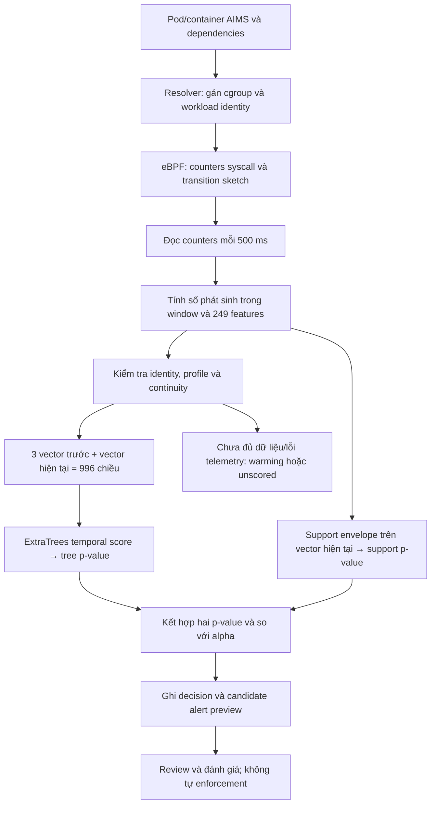

# Sentinel Pulse và thí nghiệm lựa chọn syscall

> **Snapshot cũ (15–16/10/2026), không còn cập nhật.** Trạng thái hiện hành, kết quả mới và nhật ký
> từng bước nằm ở [docs/STATUS.md](docs/STATUS.md) (mục 9 — Nhật ký làm việc) và [TODO.md](TODO.md).

## 1. Phạm vi và cách đọc báo cáo

- **Sentinel Pulse:** phát hiện bất thường hành vi runtime của workload Kubernetes bằng telemetry eBPF và mô hình học máy.
- **Thí nghiệm syscall:** kiểm tra bằng dữ liệu độc lập xem các kênh syscall được chọn làm feature có hữu ích hay không.

Trạng thái hiện hành được kiểm tra SSH ngày **15/10/2026, khoảng 10:48 UTC+7**: sáu node Ready; matched capture/preview 500 ms active trên ba worker; study R4 đang fit 249/693 model, RabbitMQ follow-up R5 đã chạy hết 15 cặp. Capacity vẫn dẫn receipt riêng ngày 14/10. Chi tiết tiến trình: [triển khai song song](PULSE_PARALLEL_EXECUTION.md). [Audit repo/VM](REPO_SYNC_AND_FUTURE_RISKS.md) có findings về resume, provenance, giới hạn cgroup và VMware memory reclamation; chưa hotpatch các findings vào model/source đã freeze.

Artifact là file sản phẩm của một bước (model, histogram, prediction arrays, bundle). Ví dụ: c6-verification.json, selection-frequency-description.json, batch-benchmark.json.

Receipt là file “biên nhận” ghi lại một lần chạy: bắt đầu lúc nào, kết thúc lúc nào, kết quả ra sao, hash là gì. Thường có hai file đi theo cặp:

START.json: ghi lúc job bắt đầu
TERMINAL.json: ghi trạng thái cuối (success hay lỗi, số records, p99 latency...)

Idle-aware nghĩa là model/pipeline có xử lý riêng các window “idle”, tức window mà container gần như không có hoạt động syscall trong phạm vi đếm, thay vì bỏ qua hoặc coi như dữ liệu lỗi.

Scalar ở đây là cách chạy inference từng record một: mỗi feature record (một context 996 chiều của một container) được gọi model riêng, một lần gọi cho một record. Đối lập là batch: gom nhiều context cùng model lại, gọi một lần.

Backlog là hàng việc tồn đọng: record đến nhanh hơn tốc độ xử lý, nên hàng đợi dài ra và càng lúc càng cũ.

Cohort là một nhóm capture được thu cho cùng một mục đích. Ở đây có hai nhóm, mỗi nhóm có vai trò khác nhau.
- Selection: Đếm tần suất syscall, xếp hạng ID, train addition study
- Holdout: Chỉ chạy model đã đóng băng để đo kết quả

Candidate là bản model/bundle đang được thử nghiệm và đánh giá, chưa được công nhận là bản chính thức. Hiểu như “ứng viên” cho vị trí model production, nhưng chưa trúng tuyển.

Raw positive là một context (hoặc record) mà model gắn cờ dương tính, tức p-value ≤ alpha, được đếm thô, chưa có nhãn ground truth và chưa qua review.

Phân biệt: ground truth là nhãn đúng; adjudication là quá trình review để chốt nhãn đó khi chưa chắc.

Ground truth là nhãn đúng đã được xác nhận cho một mẫu: mẫu đó thật sự là attack hay thật sự là benign. Nó là “đáp án” dùng để chấm model, và phải đến từ nguồn độc lập với output của model.

seccomp (secure computing mode) là cơ chế của Linux kernel để lọc syscall của một process: process chỉ được gọi những syscall nằm trong danh sách cho phép, syscall khác bị chặn, báo lỗi hoặc giết process. Container runtime (containerd, Docker) thường gắn sẵn một profile seccomp mặc định để giảm bề mặt tấn công.

Quy ước xuyên suốt:

| Cách ghi | Ý nghĩa |
|---|---|
| Đã đo / đã xác minh | Có artifact hoặc receipt được dẫn ngay tại phần kết quả |
| Ví dụ tính toán | Giải thích công thức, không phải số đo từ cụm |
| Kỳ vọng / cần đánh giá | Mục tiêu hoặc công việc tiếp theo, không phải thành tích đã đạt |
| Preview / raw positive | Model gắn cờ để xem xét, chưa mặc nhiên là attack hoặc false positive |
| Chưa xác định | Chưa có đủ phép đo hoặc nhãn hợp lệ để tính chỉ số |

Đây là báo cáo trạng thái hiện hành, không phải nhật ký checkpoint. Các tài liệu cũ có thể mô tả model/policy khác; kết quả không được chuyển từ candidate này sang candidate khác chỉ vì cùng tên Pulse.

## 2. Tóm tắt kết quả và điểm còn thiếu

### 2.1. Những việc đã hoàn thành

| Hạng mục | Kết quả đã xác minh |
|---|---|
| Hạ tầng | 3 control plane + 3 worker; Kubernetes v1.34.10; cả 6 node Ready |
| Model Pulse idle-aware | Bundle chứa 21 model theo workload/container; chạy đánh giá shadow, chưa tự động phục vụ/enforce |
| Thu thập soak | Đủ biên thời gian 24 giờ trên cả 3 worker; tổng 33.149.479 feature records |
| Đọc kết quả soak | 11.388.831 records được score; 30.412 preview positives giữ nguyên để phân loại sau |
| Phát hiện vấn đề hiệu năng | Luồng scalar cũ bị backlog nghiêm trọng; không đạt realtime trong soak này |
| Tối ưu batch | Kiểm tra tương đương 21/21 model; score và quyết định thử nghiệm trùng khớp |
| Canary batch B2 | Hoàn thành khoảng 30 phút trên từng worker; p99 từ cuối window đến score khoảng 0,213–0,556 giây, tùy node |
| Capture syscall đa chế độ tải | 30 capture hợp lệ, gồm selection và holdout riêng, mỗi cohort có 5 regime × 3 worker |
| Histogram syscall | Cohort selection quan sát 185.303.624 lượt syscall và 135 ID khác nhau |
| Ablation | Có artifact cho 19 workload × 32 biến thể = 608 model |
| Sửa tính tương thích feature | Replay và sửa rolling profile cho 30 capture, tổng 781.239 feature rows; giữ nguyên raw, model và threshold |
| Đánh giá lại C6 | 608/608 model đã chạy trên holdout đã sửa; biến thể full gắn cờ 11.989/334.655 context, tức 3,5825% raw positives |
| Matched syscall study R3 | Đủ 21 key, hoàn tất 627/693 model; 66 model Kafka operator thiếu calibration vì chưa lấy segment cuối selection |
| Study R4 | Đang đọc lại cùng normal selection sau sửa sealed coverage; 11 arm × 3 seed, mục tiêu 693 model |
| Pulse development R3 | Hoàn tất 315 cặp; replay có TP=284/FN=2/FP kỳ vọng=72/TN kỳ vọng=237, unknown=35 |
| Kernel→preview R3 | Trên 284 trial phát hiện: p50/p95/p99 = 1,067/1,609/4,751 s |
| RabbitMQ follow-up R5 | Hoàn tất 15 cặp, TP=13/FN=0/FP kỳ vọng=1/TN kỳ vọng=14, unknown=2; p95 kernel→preview 1,288 s trên 13 trial phát hiện |

### 2.2. Những kết luận chưa thể đưa ra

Candidate idle-aware đã có matrix development theo interval 15 s: precision theo nhãn expected-normal **79,78%**, recall trên attack đánh giá được **99,30%**, lower bound theo toàn bộ attack đăng ký **90,16%**; control-positive rate **23,30%**. Còn 35 interval unknown và control chưa review, nên confirmed precision/FPR vẫn null. Những scenario này đã dùng trong phát triển; kết quả chưa phải fresh blind validation.

Metric latency trên là **kernel→candidate preview**; runtime ghi `alert=false`, `policy_applied=false`, nên kernel-to-alert còn null. p95 dưới 2 s trong tập development, p99 còn 4,751 s. Bằng chứng: [terminal replay](validation-evidence/pulse-matched-r3-r4-20261015/r3-replay-TERMINAL.json), [terminal gốc](validation-evidence/pulse-matched-r3-r4-20261015/r3-campaign-TERMINAL.json). Bộ biến thể syscall chưa có paired blind matrix để kết luận giữ/bỏ/thêm kênh.

Timestamp kernel hiện là `execve` của fixture do Tetragon ghi, chưa phải syscall bảo mật đầu tiên của scenario. Control R3 quan sát hoạt động nền, chưa có benign fixture cùng cách stage/exec; vì vậy chưa tách được launch artifact khỏi tín hiệu attack. Cần matched benign-exec controls trong phép so sánh tiếp theo. Precision của thiết kế attack/control gần 1:1 cũng không suy ra precision khi attack hiếm trong production.

Các con số 30.412 preview trong soak và 3,5825% raw positives của C6 không phải cùng model/policy, không cùng dataset và không được gọi chung là false-positive rate. Kết quả tốc độ tốt hơn cũng không tự chứng minh khả năng phát hiện attack tốt hơn.

Chi tiết bằng chứng nằm ở mục 12–15; danh sách công việc còn thiếu nằm ở mục 20.

## 3. Bài toán: phát hiện bất thường không đồng nghĩa kết luận bị tấn công

Một workload bình thường vẫn thay đổi hành vi khi tăng tải, rollout, reconnect broker, tạo connection pool, chạy health probe hoặc phục hồi database. Ngược lại, một attack có thể phát sinh ít syscall và trông gần với hoạt động bình thường.

Pulse học một **mốc tham chiếu hành vi** rồi tìm điểm lệch khỏi mốc đó. Cần phân biệt:

- **Normal:** hoạt động hợp lệ theo ground truth và phạm vi đánh giá, không chỉ vì model cho điểm thấp.
- **Anomaly:** điểm bất thường so với dữ liệu tham chiếu.
- **Attack:** hành vi có ý đồ/phạm vi tấn công đã được xác nhận hoặc được inject theo protocol.
- **False positive:** mẫu/interval đã xác nhận benign nhưng hệ thống vẫn báo dương tính, theo đúng đơn vị đánh giá đã đăng ký.

Không thể dùng chính output của model để tự gán ground truth rồi tính precision. Một preview Redis trong normal soak cần được đối chiếu traffic, thao tác quản trị, log và tình trạng telemetry; tên Redis không đủ kết luận đúng/sai.

Phạm vi bằng chứng hiện có là **Linux x86-64, kernel và hook đã kiểm chứng, workload được resolver đưa vào phạm vi thu thập**. Chưa có bằng chứng tổng quát cho Windows, mọi ABI Linux hoặc mọi cluster.

## 4. Hạ tầng và phạm vi workload

### 4.1. Cụm đang sử dụng

| IP | Hostname | Vai trò | Ready | Kubernetes |
|---|---|---|---|---|
| 10.1.16.234 | k8s-master.local | Control plane | True | v1.34.10 |
| 10.1.16.235 | k8s-master2.local | Control plane | True | v1.34.10 |
| 10.1.16.236 | k8s-master3.local | Control plane | True | v1.34.10 |
| 10.1.16.237 | k8s-worker1.local | Worker | True | v1.34.10 |
| 10.1.16.238 | k8s-worker4.local | Worker | True | v1.34.10 |
| 10.1.16.239 | k8s-worker3.local | Worker | True | v1.34.10 |

Snapshot capacity do Kubernetes trả về cho **mỗi node**: 24 CPU logic, khoảng 125,9 GiB RAM và 590,3 GiB ephemeral-storage. Đây là capacity OS/Kubernetes nhìn thấy, không phải số CPU/RAM/storage từng được dự kiến cấp trước đây. Không tiếp tục dùng mô tả cũ 32 vCPU/64 GB nếu chưa đối chiếu lại.

NFS tại `10.1.16.233`, export `10.1.16.233:/sentinel-pulse`, mount `/mnt/sentinel-pulse-archive`, dùng lưu evidence/artifact. Không suy ra NFS có HA hoặc backup chỉ từ việc mount thành công.

Nguồn capacity: [receipt cụm 14/10](validation-evidence/pulse-parallel-completion-20261014/report-cluster-20261014-1930.json).

### 4.2. 21 model không có nghĩa 21 microservice

Một **workload key** kết hợp namespace, workload logic và tên container. Nhiều replica có thể dùng cùng một model, nhưng history phải tách theo identity thực tế để không nối hành vi của hai container khác nhau.

| Nhóm | Workload/container key trong bundle idle-aware |
|---|---|
| Frontend | `production/aims-frontend:web` |
| Kafka | `production/aims-kafka-dual-role:kafka` |
| Kafka operator | `production/aims-kafka-entity-operator:topic-operator`; `production/aims-kafka-entity-operator:user-operator` |
| MinIO | `production/aims-minio-pool-0:minio`; `production/aims-minio-pool-0:sidecar` |
| PostgreSQL | `production/aims-postgres-cnpg:postgres` |
| RabbitMQ | `production/aims-rabbitmq-server:rabbitmq` |
| Redis/Sentinel | `production/aims-redis:aims-redis`; `production/aims-redis-sentinel-sentinel:aims-redis-sentinel-sentinel` |
| Istio | `production/aims-waypoint:istio-proxy` |
| API gateway | `production/api-gateway:app` |
| Identity | `production/auth-service:app` |
| Giỏ hàng/catalog | `production/cart-service:app`; `production/catalog-service:app` |
| Kho hàng | `production/inventory-service:app` |
| Thông báo | `production/notification-service:app` |
| Đơn hàng/thanh toán | `production/order-service:app`; `production/payment-service:app` |
| Search/recommendation | `production/search-recommendation-service:app` |
| Security telemetry | `production/security-telemetry-service:app` |

Bundle Pulse có 21 key, trong khi bộ ablation C2 chỉ có **19 workload**, thiếu model notification/payment. Hai phạm vi này không được đánh đồng.

Các key `:pod-slice` là scope cgroup tổ tiên xuất hiện trong capture. Chúng không phải leaf-container model. Việc giữ các dòng đó dưới trạng thái model-unavailable phục vụ minh bạch coverage; không được tính chúng là normal/TN hay cộng trùng với leaf-container để báo số syscall.

## 5. Kiến thức nền về telemetry eBPF

### 5.1. Syscall, kernel và ABI

Ứng dụng chạy ở user space; khi cần thao tác do kernel quản lý, nó gọi system call như `read`, `openat`, `connect`. Một HTTP request có thể dẫn tới nhiều syscall; một syscall cũng không tương ứng một request hay một hành động attack.

ABI quy định cách gọi và số định danh syscall. Danh sách ID của dự án lấy từ **bảng syscall native x86-64 của Linux v6.8**, không phải một thống kê chứng minh 29 syscall đó tối ưu cho bảo mật. Nguồn định danh: [Linux syscall_64.tbl](https://raw.githubusercontent.com/torvalds/linux/v6.8/arch/x86/entry/syscalls/syscall_64.tbl).

Ubuntu, RHEL, Fedora cùng kiến trúc có thể chia sẻ nhiều quy ước ABI, nhưng kernel, thư viện, runtime, seccomp và ứng dụng vẫn thay đổi hành vi. ARM64 dùng bảng ID khác; Windows không dùng ABI syscall Linux. Phải kiểm tra mapping, hook, feature profile và đánh giá lại trước khi mở rộng.

### 5.2. eBPF và sự khác nhau giữa counter với event log

eBPF cho phép chạy chương trình đã qua kiểm tra trong các hook kernel. Pulse dùng map để tăng bộ đếm thay vì xuất một JSON cho từng syscall; userspace định kỳ đọc map. Điều này giảm lượng log vận chuyển nhưng vẫn phải đo overhead thực tế. Xem [tài liệu eBPF của kernel](https://docs.kernel.org/bpf/index.html).

| Kênh | Chứa gì | Dùng cho việc gì | Không tự cung cấp |
|---|---|---|---|
| Exact counters Pulse | Số lượt syscall, histogram, transition sketch theo cgroup | Đầu vào định lượng cho ML |
| Tetragon events | Chi tiết event theo policy, process và một số đối số | Điều tra/ngữ cảnh bổ sung | Phân phối đếm đầy đủ nếu event bị sampling/rate-limit |
| Application logs/traces | Request, span, nghiệp vụ và thông tin ứng dụng chủ động ghi | Đối chiếu hành vi, lỗi nghiệp vụ | Mọi syscall kernel |

Rate-limit Tetragon không đồng nghĩa rate-limit counter Pulse. Đặt mọi loại event cùng một rate-limit cũng không bảo đảm khôi phục đúng tỷ lệ syscall thực tế.

### 5.3. Cgroup resolver làm gì?

Cgroup là cơ chế kernel nhóm và quản lý process/tài nguyên. Resolver nối thông tin Kubernetes/CRI với cgroup trên node:

`Pod UID → container ID → cgroup ID → workload/container key + revision`.

Nhờ vậy, bộ đếm kernel được gán đúng cho container và model. Khi container bị thay thế, UID/cgroup/revision mới không được thừa hưởng tùy tiện history cũ. Xem [cgroup v2 của kernel](https://docs.kernel.org/admin-guide/cgroup-v2.html) và [cgroup_resolver.py](sentinel_pulse/cgroup_resolver.py).

### 5.4. “Exact” có điều kiện gì?

Source kernel chính: [pulse_counter.bpf.c](sentinel_pulse/ebpf/pulse_counter.bpf.c). Có hook `raw_tp/sys_enter`; nhánh mở rộng còn dùng `fexit/__seccomp_filter` cho đường skip/emulation đã kiểm chứng trên kernel hiện tại.

Exact ở đây nghĩa là đếm theo phạm vi cgroup/ABI/hook được hỗ trợ và integrity hợp lệ, **không phải lời cam kết đếm mọi syscall trên mọi OS không bao giờ mất**. Map đầy, cập nhật task state lỗi, projection lỗi, cgroup chưa resolve hoặc collector gián đoạn phải được ghi nhận.

Counter entry không tự chứng minh syscall thành công. `connect=12` không cho biết 12 kết nối thành công, đích đến hoặc payload. Counter skip/emulation không được cộng thêm lần nữa vào tổng syscall đã bao gồm chúng. Tên legacy `seccomp_denied` cũng không đủ để kết luận mọi lượt đó là bị từ chối hoặc là attack.

## 6. Kiến trúc hiện hành của candidate Pulse

Sơ đồ dưới mô tả nhánh idle-aware đang được đánh giá.



Tên ngắn “PulseExtraTrees” chưa mô tả hết candidate mới: artifact hiện hành còn có **support branch**. Nhánh syscall C2/C6 dùng bộ ablation tree-only khác; không được lấy tỷ lệ raw flags của C6 làm kết quả của ensemble idle-aware.

Trong runtime preview đang được đánh giá:

```text
alert = false
policy_applied = false
serving_compatible = false
automatic_promotion = false
```

Đây là **shadow/research candidate trên workload thật**, chưa phải hệ thống đã chứng minh production-ready và tự phát cảnh báo an ninh chính thức.

## 7. Dữ liệu 249 chiều thực sự gồm những gì?

### 7.1. 29 syscall có kênh tường minh

Định nghĩa nằm trong `TRACKED_SYSCALLS` tại [features.py](sentinel_pulse/features.py).

| Nhóm | Syscall và ID native x86-64 |
|---|---|
| File/I/O | `read(0)`, `write(1)`, `open(2)`, `close(3)`, `chmod(90)`, `openat(257)` |
| Memory | `mmap(9)`, `mprotect(10)` |
| Network | `socket(41)`, `connect(42)`, `accept(43)`, `sendto(44)`, `recvfrom(45)`, `accept4(288)`, `recvmmsg(299)`, `sendmmsg(307)` |
| Process/exec | `clone(56)`, `execve(59)`, `execveat(322)`, `clone3(435)` |
| Identity/capability | `setuid(105)`, `setgid(106)`, `capset(126)` |
| Namespace/mount/debug/security | `ptrace(101)`, `pivot_root(155)`, `mount(165)`, `unshare(272)`, `setns(308)`, `seccomp(317)` |

29 là số kênh syscall tường minh hiện tại, **không phải 32** và cũng không phải chỉ có 29 syscall được quan sát. Những ID khác còn đi vào tổng, `other` và hash bins.

### 7.2. Bố cục vector, index bắt đầu từ 0

| Index | Số chiều | Tên | Giá trị |
|---|---:|---|---|
| 0–28 | 29 | `log_count:<syscall>` | `ln(1 + count)` trong window |
| 29–57 | 29 | `ratio:<syscall>` | `count / max(total, 1)` |
| 58 | 1 | `log_count:other` | `ln(1 + số syscall ngoài 29 kênh)` |
| 59 | 1 | `ratio:other` | `other / max(total, 1)` |
| 60 | 1 | `log_total` | `ln(1 + total)` |
| 61 | 1 | `sensitive_ratio` | Tỷ lệ đếm của nhóm sensitive do code định nghĩa |
| 62 | 1 | Metadata seccomp dạng feature | Legacy tên `seccomp_denied`; idle-aware dùng nghĩa skip/emulation trung tính hơn |
| 63–126 | 64 | `syscall_bin:0..63` | Histogram hash syscall, chuẩn hóa theo tổng |
| 127–190 | 64 | `transition_bin:0..63` | Histogram hash cặp syscall liền kề theo task, chuẩn hóa theo số transition |
| 191–219 | 29 | `rolling_mean:<syscall>` | `ln(1 + trung bình rate lịch sử)` |
| 220–248 | 29 | `rolling_std:<syscall>` | `ln(1 + độ lệch chuẩn rate lịch sử)` |

Cộng: `29 + 29 + 5 + 64 + 64 + 29 + 29 = 249`.

Nhóm sensitive hiện gồm ID `{10, 59, 101, 105, 106, 126, 155, 165, 272, 308, 317, 322}`. Đây là nhóm kỹ thuật phục vụ feature, không phải danh sách “syscall xuất hiện là độc hại”. Ví dụ `mprotect` cũng rất phổ biến trong runtime hợp lệ.

### 7.3. Snapshot, delta, count và rate

Snapshot là số đếm tích lũy đọc tại một thời điểm. Lấy số hiện tại trừ số trước đó để biết **trong khoảng vừa qua phát sinh bao nhiêu lượt**. Snapshot đầu tiên chưa có mốc trước nên chưa tạo được delta hợp lệ.

Ví dụ tính toán, không phải số đo cụm:

```text
Tại t0: total = 1.000; read = 200
Tại t1: total = 1.071; read = 210; t1 - t0 = 0,5 giây

Số syscall mới: 71
Số read mới: 10
Rate read: 10 / 0,5 = 20 lượt/giây
log_count:read = ln(11) ≈ 2,397895
ratio:read = 10 / 71 ≈ 0,140845
```

`log_count` là số thực vì đã lấy logarithm; count gốc vẫn là số nguyên. `float32` có sai số biểu diễn nhỏ nên log lưu trong vector không cần trùng từng chữ số với kết quả tính tay bằng float64.

Nếu counter reset hoặc đổi identity, không diễn giải thành traffic âm. Phải xử lý baseline/history tương ứng và ghi nhận discontinuity.

### 7.4. Rolling mean/std khác history của model

Rolling dùng **rate các window trước**, không dùng trực tiếp `log_count`. Với profile rolling-10, tối đa 10 window trước được dùng tính trung bình và độ lệch chuẩn population (`ddof=0`), rồi mới lấy `ln(1+x)`.

Ví dụ rate trước là `[10, 20, 30]`: mean bằng 20; std khoảng 8,165. Feature lưu `ln(21)` và `ln(1+8,165)`. Ví dụ này chỉ minh họa công thức.

Code có fallback khi chưa có history; admission/warm-up cần phân biệt giai đoạn đó. Rolling-10 của collector không đồng nghĩa mọi record đã score đều có đủ 10 window trước: **quy tắc eligible-for-review và quy tắc đủ 4 vector cho scorer là hai việc khác nhau**.

Trong điều kiện cadence 500 ms liên tục, rolling-10 nhìn lại khoảng 5 giây. History ExtraTrees lại lấy **3 vector trước + vector hiện tại**, thành `4 × 249 = 996` chiều. Hai loại history không được gọi chung thành “window 5 giây”.

### 7.5. Hash bins giữ được và mất đi điều gì?

Syscall hash bins nén nhiều ID vào 64 ô; transition bins nén cặp ID liên tiếp theo task vào 64 ô. Chúng giữ thông tin phân bố/quan hệ cục bộ nhưng có **hash collision**: hai ID/cặp khác nhau có thể chung ô.

Vì vậy Pulse không chỉ biết 29 count, nhưng cũng không nhìn thấy nguyên vẹn thứ tự mọi syscall. Không thể giải mã bins thành toàn bộ chuỗi process hoặc nội dung network. Muốn thống kê từng ID chính xác để chọn feature, thí nghiệm sử dụng histogram full-ID riêng.

### 7.6. Record không chỉ có vector

Record còn có schema, timestamp, node/pod/container, cgroup, workload key, revision, exact counts và thống kê integrity. Metadata dùng định tuyến, audit và kiểm tra, không tự trở thành input ML.

Một số capture dùng vector compact `float32-le + zlib + base64` và schema record để giảm lặp. Không được giả định mọi dòng `features.jsonl` đều là một feature có trường `vector` dạng JSON array. Muốn xem đủ 249 giá trị phải giải mã bằng đúng codec trong [encoding.py](sentinel_pulse/encoding.py), không chỉ `grep read` trên chuỗi nén.

## 8. Model học như thế nào?

### 8.1. ExtraTrees là gì, khác Random Forest thế nào?

Decision tree chia dữ liệu bằng các điều kiện trên feature. Random Forest và ExtraTrees đều kết hợp nhiều cây; ExtraTrees tăng tính ngẫu nhiên khi tạo ngưỡng chia. Chúng là ensemble machine learning trên dữ liệu tabular, không phải mạng deep learning. Không có cơ sở nói ExtraTrees luôn tốt hơn RF hoặc LSTM cho mọi bài toán; lựa chọn phải dựa trên đánh giá tách biệt. Xem [ExtraTreesClassifier](https://scikit-learn.org/stable/modules/generated/sklearn.ensemble.ExtraTreesClassifier.html).

Trong [model.py](sentinel_pulse/model.py), cấu hình PulseExtraTrees gồm 192 cây, `max_depth=16`, `min_samples_leaf=4`, `max_features="sqrt"`, `class_weight="balanced"`, seed 73021. Training có thể dùng nhiều core; artifact chuyển `n_jobs=1` để hạn chế chi phí song song cho từng lời gọi online.

Model nhận tabular vector 996 chiều gồm bốn thời điểm. Nó có thông tin thời gian qua feature/history, nhưng không phải LSTM học nguyên chuỗi syscall đầu vào.

### 8.2. Self-supervised: học từ normal và dữ liệu corrupt

Training không đưa attack sample vào làm nhãn attack. Từ context tham chiếu, code tạo negative tổng hợp bằng cách corrupt **current row**, giữ history:

1. Khoảng 15% giá trị được thay bằng giá trị từ donor row.
2. Khoảng 8% giá trị được nhân hệ số theo log-uniform trong khoảng 0,25–4.
3. Model phân biệt context gốc, nhãn 0, với context corrupt, nhãn 1.

`predict_proba(class=1)` là điểm xếp hạng mức giống corruption đã học, **không phải xác suất ứng dụng đang bị tấn công**. Corruption có thể không bao phủ cách attack thật thay đổi hành vi, nên vẫn cần blind attack mới.

Bundle idle-aware ghi `attack_data_used=false`, nhưng reference có nhãn **unadjudicated observation**, `normal_training_admission=false`. Phải gọi chính xác là dữ liệu quan sát tham chiếu chưa được phân loại đầy đủ, không khẳng định toàn bộ đã chứng minh sạch attack.

### 8.3. Train, calibration và holdout

Train dùng để học tham số; calibration dùng chuyển score thành p-value; holdout dùng đo hành vi trên dữ liệu chưa dùng cho hai bước đó.

Idle-aware reference dùng temporal split 70%/15%/15%, có embargo 2 giây tại biên. Embargo tạo khoảng đệm để các context có history chồng lấn không lọt qua ranh giới quá gần nhau. Bộ C2 legacy dùng training/calibration 70%/30% và được đánh giá trên capture mới C3/C6; đây là protocol khác.

Random split từng window có thể để các window sát nhau xuất hiện ở cả train và test, tạo kết quả quá lạc quan. “Temporal split” cũng chưa tự chứng minh cross-version, unseen-workload hoặc cross-cluster generalization.

### 8.4. Conformal p-value

Với score bất thường mới `s` và `n` calibration scores:

```text
p(s) = (1 + số calibration scores >= s) / (n + 1)
```

P-value nhỏ nghĩa score thuộc vùng hiếm so với calibration. Nó không phải xác suất attack và không phải `1 - precision`. Giá trị nhỏ nhất có thể là `1/(n+1)`, nên alpha rất nhỏ đòi hỏi đủ calibration samples.

Ví dụ tree-only dùng alpha 0,001 cần ít nhất 999 calibration scores để có thể chạm ngưỡng đó. Alpha 0,0001 cần ít nhất 9.999. Đây là độ phân giải công thức, không phải lý do mặc định mọi bài toán cần train nhiều ngày.

Các bảo đảm conformal phụ thuộc giả thiết về dữ liệu. Window chồng lấn, drift và reference chưa adjudicate khiến không thể biến alpha thành cam kết FPR thực tế. Nền tảng lý thuyết: [Shafer và Vovk, 2008](https://jmlr.csail.mit.edu/papers/volume9/shafer08a/shafer08a.pdf).

### 8.5. Support branch và cách kết hợp của candidate hiện hành

ExtraTrees có thể ít nhạy với feature gần như không đổi trong training. [support_model.py](sentinel_pulse/support_model.py) bổ sung nhánh kiểm tra độ lệch khỏi miền tham chiếu trên **249 feature của current row**:

```text
low[j]   = quantile 1% trên training
high[j]  = quantile 99% trên training
scale[j] = max(high[j] - low[j], 0,05)

support_score(x) = max_j { max(low[j]-x[j], x[j]-high[j], 0) / scale[j] }
```

Code calibration một score cực đại của cả vector, không làm 249 kiểm định p-value riêng rồi OR không hiệu chỉnh.

Sau khi có `tree_p` và `support_p`:

```text
joint_p = min(1, 2 × min(tree_p, support_p))
alpha_combined = 0,05 / 30 ≈ 0,001666667
preview = joint_p <= alpha_combined
```

Hệ số 2 trả ngân sách cho hai nhánh; mỗi nhánh cần tối thiểu `ceil(2/alpha_combined)-1 = 1.199` calibration examples trong implementation này. Horizon 30 windows là horizon ngân sách, **không phải chờ 30 window mới ra score**.

0,05 là **design budget**, không phải đã đo FPR=5% và không phải bảo đảm chỉ có 5% sai. Preview policy hiện hành đặt `semantic_gate=false`, `temporal_confirmation=false`; không có semantic gate hoặc two-window confirmation trong đường quyết định preview này. Nguồn: [policy đã đăng ký](sentinel_pulse/protocol/idle-aware-candidate-preview-policy-c1.json).

## 9. Luồng runtime, batch và trạng thái output

### 9.1. Một chu kỳ xử lý

1. Resolver xác định container/cgroup và metadata hợp lệ.
2. Collector đọc counters theo cadence danh nghĩa 500 ms, lưu timestamp thực.
3. Feature builder tạo delta, rate, rolling statistics và vector 249 chiều.
4. Runtime kiểm tra schema, contract, identity và continuity.
5. Khi đủ history, ghép context 996 chiều, chọn model đúng workload.
6. Batch runtime nhóm context cùng model để giảm chi phí lời gọi; history từng identity vẫn riêng.
7. Tính hai nhánh, p-value và preview; ghi decision cùng timestamp, model/policy binding.

Batch không có nghĩa cố tình đợi nhiều giây cho đầy queue. Kiểm tra hiệu năng phải tính cả thời gian chờ và xử lý frame; không chỉ chia thời gian model call cho số records rồi gọi đó là realtime latency.

Các trường `batch_inference_ms`/`inference_ms` có thể lặp thời gian **cả batch** trên từng row; `amortized_inference_ms` mới là giá trị chia cho batch size. Không coi các giá trị lặp đó là phép đo độc lập trên từng row.

### 9.2. Warm-up và thiếu telemetry

Ba vector trước cộng current cần bốn vector hợp lệ. Sau khi có vector đầu, cần khoảng 1,5 giây nữa ở cadence 500 ms để đủ history; tính từ lúc bật collector còn cần mốc snapshot ban đầu. Khi đã warm, model có thể cập nhật mỗi 500 ms, không phải đợi lại bốn window cho mỗi lần score.

Cadence/identity sai thì reset history thay vì nối qua khoảng mất dữ liệu. Batch runtime đăng ký max gap mặc định 0,8 giây; không suy ra mọi collector/campaign trong repo dùng cùng cấu hình. Kiểm tra thực tế có cả `task_state_update_fail`, `snapshot_projection_fail` và metadata integrity.

| Trạng thái hiện hành | Diễn giải | Có được tính TN không? |
|---|---|---|
| `candidate-raw-score-only` | Đã score; có thể có preview | Chỉ sau khi có ground truth và đơn vị đánh giá phù hợp |
| `warming` | Chưa đủ history liền kề | Không |
| `candidate-model-unavailable` | Chưa có model cho key | Không |
| `degraded_telemetry` | Telemetry không đáp ứng tính toàn vẹn | Không |
| `record_rejected` | Record sai schema/contract/giá trị | Không |

Các từ `normal`, `suppressed`, `alert`, `collect-only`, `rebaseline-required` còn xuất hiện ở runtime/policy legacy. Chúng không phải danh sách trạng thái đồng nhất của candidate idle-aware hiện hành. “Suppressed” nghĩa một tín hiệu bị gate giữ lại; không tự chứng minh đó là benign.

### 9.3. Candidate và systemd không phải hai model

Candidate là trạng thái một bundle/model đang được đánh giá. Systemd là cơ chế chạy và giám sát process trên VM. Cả collector nền lẫn job đánh giá có thể được systemd quản lý; dùng systemd không biến candidate thành production model.

Job chạy độc lập SSH có thể tiếp tục khi đóng terminal/laptop. Muốn sống qua reboot phải có unit được enable, chính sách restart đúng và checkpoint/resume đã kiểm chứng. Không thể hứa mọi job tự resume chỉ vì từng dùng `nohup` hoặc transient service. Receipt C6 cho thấy đã hoàn tất thành công, không còn là job đang training cần đợi thêm.

## 10. Mô phỏng nhiều chế độ traffic AIMS

Code điều khiển: [set_aims_traffic_regime.sh](ml-service/set_aims_traffic_regime.sh). Nó thay đổi bốn deployment loadgen do Sentinel quản lý trong namespace `production`, không thay tất cả workload khác trong cụm.

| Regime | East-west replicas | Ingress replicas | Read-mix replicas | Dependency replicas | Sleep của loop chung |
|---|---:|---:|---:|---:|---:|
| steady | 1 | 1 | 0 | 1 | 1 s |
| toolmix | 2 | 2 | 4 | 2 | 1 s |
| peak | 4 | 4 | 2 | 3 | 0,25 s |
| burst | 6 | 6 | 2 | 3 | 0 s |
| recovery | 1 | 1 | 0 | 1 | 2 s |

Ingress còn có request/frontend interval riêng; replicas và sleep **không phải số RPS đã đo**. Script có chế độ `idle` với cả bốn nhóm về 0, nhưng C3 đã hoàn thành trên năm regime trong bảng, không được báo sáu regime đã capture.

`peak` mô phỏng kiểu tải giờ cao điểm 20:00; không có nghĩa mọi capture peak thật sự chạy lúc 20:00. `burst` là tải đột ngột mạnh hơn; `recovery` quan sát pha sau tải cao.

High load hợp lệ không được gán attack chỉ vì tổng count tăng. Capture cần bao phủ nhiều tải; ratio, history, calibration và support envelope vẫn có thể phản ứng sai khi traffic ngoài reference. Phải đo theo từng regime, không chỉ báo một tỷ lệ pooled.

[traffic_gate.py](sentinel_pulse/traffic_gate.py) có kiểm tra readiness/health của các microservice, traffic HTTP và điều kiện native runtime để host eBPF thấy được hành vi. Việc code có checker không chứng minh checker vừa chạy thành công tại mọi thời điểm; node Ready cũng không thay thế functional gate.

## 11. Canary, soak và phục hồi hạ tầng

### 11.1. Mỗi loại kiểm tra trả lời câu hỏi khác nhau

| Loại | Mục đích | Không chứng minh được chỉ bằng nó |
|---|---|---|
| Unit/regression test | Công thức, schema, nhánh xử lý, tương thích | Hệ thống chạy đúng trên cụm thật |
| Offline replay | Kiểm tra model trên dữ liệu đã lưu | Latency realtime hoặc khả năng tổng quát với attack chưa thấy |
| Canary | Chạy giới hạn để kiểm tra tích hợp, tốc độ, integrity | Mọi chu kỳ vận hành hiếm đã được bao phủ |
| Normal soak | Quan sát lâu dưới hoạt động hợp lệ, ghi preview và sự cố | Precision/recall attack nếu chưa có nhãn và attack set |
| Blind attack | Đánh giá model frozen bằng attack chưa dùng tune | FPR deployment ở mọi base rate và mọi OS |

24 giờ là lựa chọn vận hành để có cơ hội quan sát chu kỳ ngày và tích lũy exposure, **không phải định lý yêu cầu ML phải soak đúng 24 giờ**. Run 12 giờ vẫn có giá trị nếu báo đúng coverage, không thay tên thành 24 giờ. Chạy lâu nhưng lặp cùng một tải cũng chưa đủ đa dạng.

### 11.2. Không zero-alert gate, không xóa sự cố khỏi dữ liệu

Trong hướng vận hành đang theo đuổi, preview/alert trong normal observation phải được giữ và review sau; không reset toàn bộ elapsed chỉ để có run “0 alert”. DiskPressure, rollout, gap hoặc Longhorn degraded cần ghi episode, ảnh hưởng và cách phục hồi.

Phân biệt ba loại thời gian:

- **Wall time:** đồng hồ chạy bao lâu.
- **Capture/exposure time:** biên thời gian thực sự có capture theo định nghĩa protocol.
- **Eligible/scored exposure:** phần dữ liệu đủ identity, integrity, model và continuity để đánh giá; khi gộp replica phải tránh cộng trùng interval.

Khoảng telemetry hỏng là unknown/quarantine, không phải benign/TN. Có thể tiếp tục raw capture khi an toàn, reset history sau recovery và kéo dài để bù exposure theo protocol. Nếu chỉ báo đạt wall time mà thiếu scored exposure thì phải ghi thiếu, không tự sửa denominator cho đẹp.

Integrity lỗi kiểu model bị thay, artifact hỏng hoặc feature profile sai không thể bỏ qua trong scientific evaluation. Có thể dừng bước score/đánh giá đó để sửa trong khi giữ nguyên raw; điều này khác với fail toàn bộ soak rồi xóa công quan sát trước đó.

### 11.3. Sự cố đã có evidence

C3 từng có vòng retry do HPA waypoint thay replica từ 4 xuống 3 sau bước cooldown 300 giây, làm scope cgroup thay đổi. Có **16 attempt recovery bị reject được giữ**, rồi attempt 17 hợp lệ sau amendment bước chờ ổn định lên 360 giây. Không tắt HPA và không xóa attempt cũ để báo pass.

Kết quả đó cho thấy protocol capture tĩnh có giới hạn với rollout/autoscaling; không chứng minh model đã robust với mọi HPA. Trong B2, worker .238 có chín cadence-gap counts và run vẫn hoàn thành; warming/reset được giữ. Hai tình huống khác nhau, không cộng thành cùng một “soak fail”.

## 12. Kết quả Pulse: soak 24 giờ và sửa backlog

### 12.1. Capture `normal-a1-20261013`

| Worker IP | Biên capture (s) | Feature records | Đã score | Preview positives |
|---|---:|---:|---:|---:|
| .237 | 86.400,249 | 13.928.602 | 4.755.915 | 12.350 |
| .238 | 86.400,297 | 15.096.447 | 5.258.150 | 12.059 |
| .239 | 86.400,390 | 4.124.430 | 1.374.766 | 6.003 |
| Tổng record | Không cộng thành 72 giờ độc lập | **33.149.479** | **11.388.831** | **30.412** |

Mỗi worker hoàn thành một segment; terminal báo capture errors=0 và capacity pauses=0. Tổng decision records là **33.148.914**, gồm scored 11.388.831, model-unavailable 21.759.882 và warming 201. Các key thiếu model trong tổng hợp là `pod-slice` tổ tiên.

Có chênh **565 records** giữa feature count và decision count; chưa có đối soát từng row giải thích hết chênh lệch đó. Vì vậy không công bố coverage hoàn hảo 100%.

Nguồn: [SUMMARY.json](validation-evidence/pulse-parallel-completion-20261014/SUMMARY.json), [worker .237](validation-evidence/pulse-parallel-completion-20261014/pulse-review-237.json), [worker .238](validation-evidence/pulse-parallel-completion-20261014/pulse-review-238.json), [worker .239](validation-evidence/pulse-parallel-completion-20261014/pulse-review-239.json).

### 12.2. Soak đã xong nhưng realtime scalar không đạt

Trong 11.388.831 scored records, **6.660.911 records có tuổi từ cuối window đến score lớn hơn 3.600 giây**. Đây là backlog nghiêm trọng, không được gọi kết quả soak này là detection realtime latency thấp.

Hướng sửa là giảm overhead bằng batch trên cùng frozen model, không tune model theo attack test. Đã benchmark 21/21 model, mỗi model 64 context, hai lần timing, batch sizes 2/4/8/16/32/64:

- Max absolute score error bằng 0; p-value/booleans trùng reference trong phép kiểm tra.
- Với batch size 2, speedup tổng thời gian theo workload khoảng **1,874–2,185 lần**.
- Đây là engineering equivalence/timing test, không phải independent accuracy test hoặc A/B overhead workload.

Nguồn: [batch-benchmark.json](validation-evidence/pulse-parallel-completion-20261014/batch-benchmark.json).

### 12.3. Canary B1 và B2 sau tối ưu

B1 trên .237 chạy 300,206 giây, có 589 frames, 16.380 scored rows, 84 warming và 149 preview positives. Feature-end-to-score p99 bằng 0,474 giây, max 0,667 giây; issues rỗng. Bốn snapshot cuối chưa hoàn chỉnh, 607 bytes, được giữ nhưng không score. Nguồn: [B1 terminal](validation-evidence/pulse-batch-canary-b1-evidence-20261014/237-TERMINAL.json).

B2 đã **hoàn thành trên cả ba worker**, không còn ở trạng thái “đang đợi 30 phút”:

| Worker | Thời lượng (s) | Frames | Scored | Warming | Model unavailable | Preview positives |
|---|---:|---:|---:|---:|---:|---:|
| .237 | 1.800,435 | 3.523 | 98.532 | 84 | 190.188 | 1.220 |
| .238 | 1.805,190 | 3.420 | 104.780 | 930 | 197.780 | 5.824 |
| .239 | 1.800,302 | 3.583 | 27.583 | 24 | 55.214 | 114 |
| Tổng | — | 10.526 | **230.895** | **1.038** | **443.182** | **7.158** |

Thời gian **cuối window → score**, giây:

| Worker | p50 | p95 | p99 | Max |
|---|---:|---:|---:|---:|
| .237 | 0,228 | 0,429 | 0,502 | 0,880 |
| .238 | 0,287 | 0,493 | 0,556 | 0,863 |
| .239 | 0,102 | 0,184 | 0,213 | 0,290 |

Không lấy trung bình ba p99 rồi gọi là p99 toàn cụm. .238 có `collector_cadence_gap=9`; .237/.239 không có issue count trong terminal. .239 còn bốn trailing snapshots chưa hoàn chỉnh, 804 bytes, không được tính score. Các seal raw/features/decisions/loader đã được kiểm tra trên worker.

Kết quả này chứng minh batch runtime xử lý được luồng thử nghiệm với độ trễ cuối-window→score thấp hơn backlog scalar đã quan sát. Nó **chưa chứng minh kernel-to-alert 1–2 giây**, recall tốt hoặc preview đều là false positive.

Nguồn: [B2 .237 terminal](validation-evidence/pulse-batch-canary-b2-evidence-final-20261014/237-TERMINAL.json), [B2 .238 terminal](validation-evidence/pulse-batch-canary-b2-evidence-final-20261014/238-TERMINAL.json), [B2 .239 terminal](validation-evidence/pulse-batch-canary-b2-evidence-final-20261014/239-TERMINAL.json); các file `*-verification.json` cùng thư mục ghi kết quả kiểm tra seal.

## 13. Thiết kế thí nghiệm lựa chọn syscall

### 13.1. Câu hỏi nghiên cứu

Không chỉ hỏi “syscall nào xuất hiện nhiều nhất”, mà hỏi:

1. Các kênh nào bao phủ hoạt động của workload ở nhiều regime?
2. Thêm/bớt kênh nào làm thay đổi khả năng phát hiện attack và số báo nhầm trên normal độc lập?
3. Hash bins có thay thế được các kênh tường minh không, với chi phí mất diễn giải nào?
4. Kết quả có giữ được ở pod version, kernel/distro hoặc workload chưa thấy không?

Tần suất cao không đồng nghĩa quan trọng cho detection; syscall hiếm trong normal có thể quan trọng với attack. Bảng Linux xác nhận **tên/ID**, còn thực nghiệm mới kiểm tra **lý do chọn feature**.

**Mục tiêu không chỉ là bỏ bớt syscall trong tập 29:** phải thử thêm syscall ngoài danh sách, kiểm tra khả năng phát hiện, báo nhầm và chi phí, rồi mới chọn tập phù hợp trong phạm vi workload/threat model đã đăng ký. Bộ 608 model C2 chỉ giải quyết ablation của tập hiện có; nó chưa chứng minh tập 29 đã tối ưu và chưa trả lời đủ có cần thêm syscall hay không.

### 13.2. 32 biến thể, tổng 608 model C2

| Biến thể | Can thiệp |
|---|---|
| `full` | Giữ schema feature đầy đủ |
| 29 biến thể `drop_<syscall>` | Bỏ bốn kênh tường minh của một syscall: count, ratio, rolling mean, rolling std, ở cả bốn vị trí thời gian |
| `no_explicit_channels` | Bỏ các kênh syscall tường minh theo mask thí nghiệm |
| `top16_plus_sensitive` | Giữ nhóm top-16 theo training-prefix và hợp với sensitive set |

Các biến thể vẫn giữ hash bins và các aggregate còn lại theo mask. Vì thế `drop_connect` **không có nghĩa toàn bộ thông tin về connect biến mất khỏi input**. Phải đọc mask khi diễn giải ablation.

Top-16 được suy từ training-prefix bằng count proxy `expm1(log_count float32)`, không phải lựa chọn lại từ holdout C3. Có 19 workload × 32 biến thể = 608 artifact pickle, tổng khoảng 2,36 GB. C1 chỉ có score archives; C2 mới lưu model artifacts. C1/C2 dùng chung nguồn input/core train, không phải hai dataset tái lập độc lập.

Kiểm tra load/replay 608/608 cho max score error 0 trên context đã xem giúp xác nhận artifact thực thi đúng; chưa chứng minh độ chính xác trên dữ liệu mới.

### 13.3. C3: thu normal độc lập nhiều tải

C3 gồm hai cohort tách biệt: **selection** phục vụ phân tích/lựa chọn; **holdout** phục vụ đánh giá. Mỗi cohort có năm regime × ba worker = 15 capture, tổng 30 capture đã sealed. Mỗi capture có baseline 300 giây, probe 600 giây và post 300 giây.

Thu song song histogram full-ID theo cadence 1 giây và sidecar feature legacy 500 ms. Histogram có giới hạn map/cgroup; không suy ra nó là inventory mọi syscall được Linux định nghĩa.

| Cohort | Feature rows | Context đủ điều kiện hình dạng/identity/cadence | Warming | Không có C2 model | Ngoài probe | Gap resets |
|---|---:|---:|---:|---:|---:|---:|
| Selection | 390.195 | 333.877 | 9.191 | 47.096 | 31 | 3.472 |
| Holdout | 391.044 | 334.655 | 9.192 | 47.197 | 0 | 3.401 |

Audit ban đầu chưa kiểm tra hết tính tương thích rolling profile. “Đủ context” trong bảng **không đồng nghĩa đã đủ điều kiện kết luận chất lượng model**; sai lệch này được phát hiện và sửa trong C6.

Nguồn: [C3 terminal](validation-evidence/pulse-parallel-completion-20261014/c3-TERMINAL.json), [selection audit](validation-evidence/pulse-parallel-completion-20261014/c3-selection-preflight-complete-20261014.json), [holdout audit](validation-evidence/pulse-parallel-completion-20261014/c3-holdout-preflight-complete-20261014.json).

### 13.4. Kết quả tần suất selection, không dùng để tune theo holdout

Sau khi bỏ scope pod-slice để tránh cộng trùng, selection ghi nhận **185.303.624 syscall entries**, **135 ID khác nhau**. 29 kênh tường minh đóng góp 66.217.752 lượt, tức **35,7347%**; 119.085.872 lượt còn lại không vì thế mà bị mất khỏi total/hash telemetry.

| Regime | Syscall entries | ID khác nhau | Tỷ lệ thuộc 29 kênh |
|---|---:|---:|---:|
| steady | 28.938.394 | 131 | 33,3054% |
| toolmix | 33.106.382 | 133 | 34,6515% |
| peak | 43.300.587 | 129 | 36,8772% |
| burst | 52.076.508 | 131 | 38,2770% |
| recovery | 27.881.753 | 129 | 33,0198% |

22/29 syscall tường minh có xuất hiện. Bảy kênh chưa quan sát trong selection này là `ptrace`, `pivot_root`, `mount`, `unshare`, `recvmmsg`, `setns`, `execveat`. **Không được loại bảy kênh chỉ từ việc count normal bằng 0**; cần attack evaluation và chi phí/khả năng diễn giải.

Nguồn: [selection-frequency-description.json](validation-evidence/pulse-parallel-completion-20261014/selection-frequency-description.json).

### 13.5. Nhánh thử nghiệm thêm syscall, tách khỏi Pulse frozen

Trong 135 ID đã quan sát ở selection, chỉ 22 ID thuộc tập tường minh, còn **113 ID ngoài danh sách**. Một số ứng viên có cơ sở tần suất để đưa vào thí nghiệm:

| ID | Syscall native x86-64 | Lượt trong selection, không gồm pod-slice |
|---|---|---:|
| 232 | epoll_wait | 18.626.739 |
| 202 | futex | 14.736.697 |
| 262 | newfstatat | 14.328.316 |
| 281 | epoll_pwait | 9.078.932 |
| 233 | epoll_ctl | 8.847.504 |
| 5 | fstat | 7.113.577 |
| 35 | nanosleep | 6.053.772 |
| 8 | lseek | 5.053.365 |

Số lượt trên được cộng từ `counts_by_id` của năm regime trong frequency artifact. Tên/ID đối chiếu [bảng Linux](https://raw.githubusercontent.com/torvalds/linux/v6.8/arch/x86/entry/syscalls/syscall_64.tbl). Đây là **ứng viên cần thử**, không phải bằng chứng cứ thêm là tốt.

Code mới: [syscall_addition_experiment.py](sentinel_pulse/syscall_addition_experiment.py). Thiết kế:

- Năm arms: `base29`, `plus_top8`, `plus_top16`, `plus_top32`, `plus_all_observed`.
- Xếp hạng ID chỉ trên **training prefix**, không dùng calibration/holdout/attack outcomes để chọn.
- Mỗi capture selection tách train/calibration 70/30 theo thời gian, embargo 2 giây; reset history ở biên partition và identity/capture.
- Đọc lại full-ID histogram đã seal; kiểm tra metadata, cadence, drops và SHA-256 trước dùng.
- Mọi arm dùng cùng dữ liệu entry-only 1 giây, rolling-10, history 3, ExtraTrees và alpha 0,005 đã đăng ký cho phép thăm dò này.
- Không có task-transition data trong histogram, nên mọi arm đều **không dùng transition features**. Feature width là `4 × số ID tường minh + 69`; baseline nhánh này là 185 chiều, không phải Pulse 249 chiều.
- Không chia count 1 giây thành hai count 500 ms bằng ước lượng. Kết quả nhánh này cần xác nhận lại ở đúng cadence/observable Pulse trước khi thay runtime.
- Giữ artifact, prediction và checkpoint từng workload/arm; không promotion hoặc thay candidate Pulse.

Đây là **exploratory addition study**, không phải lựa chọn feature kết luận. A1 đọc đủ input nhưng có **0/105 fit**: kiểm tra continuity yêu cầu sai số timestamp ≤100 µs, còn các interval liên tiếp thật có khoảng đọc snapshot 0,6–1,4 ms. Do đó rolling history bị reset liên tục. Terminal A1 giữ nguyên và được phân loại là lỗi pipeline, không phải kết quả model. Đã sửa ngưỡng sang tối đa 50 ms (gap lớn hơn vẫn reset), lấy regime từ traffic receipt theo từng timestamp, và thêm unit tests cho jitter nhỏ, gap lớn và không nối history qua capture. A2 đã kết thúc thành công lúc **16:44:43 UTC ngày 14/10**: terminal `completed_exploratory_addition_study`, **105/105 models**, `unknowns={}`. Các trường precision, recall, FPR, kernel-to-alert đều `null`; `fresh_blind_complete=false`. Đây chỉ xác nhận fit/evaluate exploratory chạy hết trên C3, không phải kết quả detection hoặc lựa chọn syscall.

Holdout C3 đã xem ở C4/C6/A1 nên không thể gọi là blind. C3/A2 chỉ exploratory; normal raw-positive không quyết định recall/FPR. Hơn nữa nó dùng histogram entry-only **1 giây**, không task-transition, feature width phụ thuộc số ID, alpha 0,005; không tương thích Pulse 500 ms/249 chiều và support path. Không chia count 1 giây thành hai count 500 ms. Protocol cuối yêu cầu capture mới đồng bộ 500 ms có full-ID deltas cùng exact counters, 64 syscall bins, 64 transition bins, rolling/history và support path như candidate Pulse trước khi chạy paired blind.

Protocol v2 đăng ký trước endpoint chính là recall theo scenario-trial tại ngân sách false-alert khác 0 (one-sided 95% upper bound ≤0,1 episode/workload-hour), và chọn tập explicit nhỏ nhất có paired 95% lower bound chênh lệch recall so với base29 >−3 điểm phần trăm. Nếu không đủ coverage/power thì kết luận inconclusive. Protocol bổ sung bốn grouped ablation (`accept/accept4`, `open/openat`, `execve/execveat`, `clone/clone3`), rare-security arm, ba seed, block bootstrap và Holm correction. Kế hoạch normal test ≥24 giờ trên 21 keys; blind catalog mới gồm 8 family ×21 key ×3 rates ×5 seeds = **2.520 paired attack intervals**. Ba zero-hit family cũ chỉ được dùng làm development diagnostic, không phải blind. Xem [protocol v2](sentinel_pulse/protocol/syscall-selection-evaluation-v2.json).

### 13.6. Coverage 19 so với 21 workload keys

| Bundle/evidence | Model key | Notification/payment |
|---|---:|---|
| Legacy C2 ablation | 19 | Thiếu cả `notification-service:app` và `payment-service:app` |
| Frozen Pulse idle-aware bundle | 21 artifacts | Có artifact riêng cho cả hai key |
| Protocol v2 | 21 bắt buộc | Mọi arm phải báo coverage từng key; không lấy trung bình 19 key để đại diện 21 |

Bundle có model artifact không đồng nghĩa đã có đủ independent blind exposure.
C3 cohort có row notification/payment nhưng holdout đã xem và chỉ là exploratory.
Final report phải bind row-level key, revision, cgroup, valid exposure và trial
receipt cho từng key/arm; thiếu telemetry được báo rõ, không nội suy.

## 14. Sai lệch rolling profile: root cause và kết quả C6

### 14.1. Vì sao C4 không được dùng làm FPR?

C4 chạy 608 model trên 334.655 context holdout và biến thể full gắn cờ **145.820 context, khoảng 43,57%**. Sau đó phát hiện: C2 training được tạo với **rolling-10**, nhưng sidecar C3 dùng **rolling-5**.

Tên cột và số chiều giống nhau không bảo đảm cùng định nghĩa feature. 58 chiều rolling đã khác cách tính; đưa chúng vào model cũ tạo evaluation không tương thích. Không được diễn giải 43,57% thành FPR, precision hoặc bằng chứng chỉ riêng drift tải gây ra vấn đề.

C5 so sánh moment/phân phối giữa reference và capture giúp phát hiện khác biệt, nhưng so sánh đó chưa tách được nguyên nhân do preprocessing với nguyên nhân do workload. Verdict được giữ riêng, không chỉnh receipt C4 để xóa lỗi. Nguồn: [c4-profile-verdict.json](validation-evidence/pulse-parallel-completion-20261014/c4-profile-verdict.json).

### 14.2. C6 đã sửa gì, không sửa gì?

C6 đã **hoàn thành**, không còn đang đợi training. Với mỗi capture:

1. Replay sealed raw bằng rolling-5, kiểm tra khớp feature gốc và metadata liên quan.
2. Từ cùng raw đó, dựng riêng feature rolling-10 đúng profile training.
3. Giữ nguyên **191 chiều không rolling**; chỉ thay 58 chiều rolling trong artifact dẫn xuất.
4. Không thay raw gốc, model, alpha, threshold hoặc mask theo kết quả holdout.
5. Đánh giá lại 608 model frozen trên holdout dẫn xuất; ghi nguồn và nhãn pending.

Đã xử lý **30/30 capture, 781.239 feature rows**, rồi chạy **608/608 model**. Job kết thúc khoảng 15:53 UTC+7 ngày 14/10, service result=success, NRestarts=0. Đây là sửa sai preprocessing và đánh giá lại, **không phải một blind test mới chưa từng xem**.

Nguồn: [C6 repair START](validation-evidence/pulse-c6-completion-evidence-20261014/START.json), [C6 repair TERMINAL](validation-evidence/pulse-c6-completion-evidence-20261014/TERMINAL.json), [C6 evaluation START](validation-evidence/pulse-c6-completion-evidence-20261014/evaluation-START.json), [C6 evaluation TERMINAL](validation-evidence/pulse-c6-completion-evidence-20261014/evaluation-TERMINAL.json).

### 14.3. Full model sau khi đưa đúng profile

| Regime | Contexts | Raw positives | Tỷ lệ raw positive |
|---|---:|---:|---:|
| steady | 66.336 | 1.000 | 1,5075% |
| toolmix | 67.396 | 1.927 | 2,8592% |
| peak | 68.187 | 3.978 | 5,8340% |
| burst | 67.811 | 4.382 | 6,4621% |
| recovery | 64.925 | 702 | 1,0812% |
| Tổng | **334.655** | **11.989** | **3,5825%** |

Raw negatives: **322.666**. Không đổi nhãn hai cột này thành FP/TN khi adjudication chưa hoàn thành. Chênh lệch theo regime cho thấy vẫn cần đánh giá tải cao kỹ hơn, nhưng chưa đủ để khẳng định nguyên nhân cho từng positive.

Việc tỷ lệ từ khoảng 43,57% về 3,58% chủ yếu phản ánh **đưa đúng transform vào model**, không phải đã train ra model mới tốt hơn. C6 vẫn là C2 tree-only, không phải kết quả preview ensemble Pulse.

### 14.4. Toàn bộ 32 biến thể sau sửa profile

Mỗi dòng có cùng 334.655 context nguồn, nhưng model của biến thể khác nhau. Đây là thống kê mô tả raw output; không xếp hạng “model tốt nhất” theo ít flag nhất.

| Biến thể | Raw positives | Tỷ lệ |
|---|---:|---:|
| full | 11.989 | 3,5825% |
| drop_accept | 11.940 | 3,5679% |
| drop_accept4 | 8.767 | 2,6197% |
| drop_capset | 13.235 | 3,9548% |
| drop_chmod | 11.975 | 3,5783% |
| drop_clone | 11.973 | 3,5777% |
| drop_clone3 | 14.880 | 4,4464% |
| drop_close | 11.314 | 3,3808% |
| drop_connect | 14.949 | 4,4670% |
| drop_execve | 14.209 | 4,2459% |
| drop_execveat | 11.989 | 3,5825% |
| drop_mmap | 13.691 | 4,0911% |
| drop_mount | 11.989 | 3,5825% |
| drop_mprotect | 13.704 | 4,0950% |
| drop_open | 12.027 | 3,5939% |
| drop_openat | 11.996 | 3,5846% |
| drop_pivot_root | 11.989 | 3,5825% |
| drop_ptrace | 11.989 | 3,5825% |
| drop_read | 12.275 | 3,6680% |
| drop_recvfrom | 12.126 | 3,6234% |
| drop_recvmmsg | 11.989 | 3,5825% |
| drop_seccomp | 13.439 | 4,0158% |
| drop_sendmmsg | 11.924 | 3,5631% |
| drop_sendto | 14.713 | 4,3965% |
| drop_setgid | 13.815 | 4,1281% |
| drop_setns | 11.989 | 3,5825% |
| drop_setuid | 12.729 | 3,8036% |
| drop_socket | 12.932 | 3,8643% |
| drop_unshare | 11.989 | 3,5825% |
| drop_write | 11.365 | 3,3960% |
| no_explicit_channels | 7.780 | 2,3248% |
| top16_plus_sensitive | 14.871 | 4,4437% |

Ví dụ `no_explicit_channels` ít flag hơn nhưng có thể bỏ lỡ attack nhiều hơn; chưa có attack outcomes nên không được chọn nó làm bản production. Các biến thể bỏ kênh hiếm có cùng tổng positives cũng chưa chứng minh kênh đó vô ích.

Nguồn kiểm tra prediction arrays, p-values/alpha, context counts và hash: [c6-verification.json](validation-evidence/pulse-parallel-completion-20261014/c6-verification.json).

## 15. Kết quả attack baseline đã có, không phải kết quả candidate mới

Để không bỏ qua kết quả chưa tốt, báo cáo giữ riêng phép đo baseline ngày 08/10/2026. Matrix gồm **19 controller × 5 scenario × 5 seed/rate = 475 interval**, không phải 475 loại attack. Có 475 normal-control receipts đi kèm.

| Nhãn theo protocol cũ | Có alert | Không alert | Unknown/uncertain |
|---|---:|---:|---:|
| Attack | 140 | 257 | 78 |
| Normal theo giả định protocol | 0 | 431 | 44 |

Recall trên observed attack: `140/397 = 35,26%`. Tỷ lệ phát hiện end-to-end trên toàn bộ attack receipts: `140/475 = 29,47%`. Confusion matrix **protocol tạm tính** là TP=140, FN=257, FP=0, TN=431; precision tạm tính 100% và FPR tạm tính 0% chỉ theo giả định normal của protocol. Các chỉ số **adjudicated** vẫn chưa xác định; không được quảng bá precision production 100%.

| Scenario baseline | Hit | Miss observed | Unknown |
|---|---:|---:|---:|
| anonymous_mprotect_churn | 0 | 80 | 15 |
| child_ptrace_handshake | 70 | 8 | 17 |
| execveat_resolution_probe | 70 | 7 | 18 |
| invalid_setns_burst | 0 | 82 | 13 |
| seccomp_api_probe | 0 | 80 | 15 |

Trên riêng **140 hit**, latency từ Tetragon kernel exec-entry của binary thử đến alert: p50=0,650 s, p95=1,538 s, p99=4,511 s. Mốc exec-entry không chứng minh mốc syscall độc hại đầu tiên. Không bỏ qua miss chỉ vì latency của hit thấp; không dùng bộ đã xem này xác nhận lại model sau chỉnh sửa như một blind set mới.

### 15.1. Chẩn đoán sơ bộ ba scenario không hit

Đây là baseline R10 cũ, không phải phép đánh giá trên bundle idle-aware hiện
hành. Vì các outcomes đã xem, mọi kiểm tra sau đây chỉ là **root-cause
diagnostic**, không phải blind retest hay cơ sở tune ngưỡng.

- `anonymous_mprotect_churn`: fixture cô lập ghi 40 lần `mprotect` thành công
  ở raw `sys_enter`, nên syscall này có thể nhìn thấy ở kernel hook. Scenario
  vẫn không tạo alert trong matrix cũ; điều này hướng nghi vấn sang độ phân
  biệt của feature/model/policy hoặc attribution/horizon, không chứng minh
  nguyên nhân nào trong các nguyên nhân đó. Chưa có replay cùng raw per-trial
  qua candidate idle-aware.
- `invalid_setns_burst` và `seccomp_api_probe`: fixture riêng cho thấy 20 lần
  mỗi syscall bị `EPERM`, nhưng raw `sys_enter` đếm 0; counter
  `seccomp_skipped_or_emulated` ghi 20. Probe ghi rõ `not_frozen_candidate_input=true`,
  nên bằng chứng này chỉ chứng minh đường raw `sys_enter` có điểm mù ở fixture;
  nó **không** chứng minh extended hook đang chạy trong model R10 cũ hoặc trong
  mọi workload. Không được kết luận “model bỏ sót” nếu sensor chưa đưa event
  vào input.

Evidence: [seccomp-visibility.json](validation-evidence/pulse-improvement-20261008/seccomp-visibility.json)
và [extended-integrated-proof.json](validation-evidence/pulse-improvement-20261008/extended-integrated-proof.json).
Trước khi thiết kế syscall mới để “sửa recall”, cần tái kiểm tra cùng ba hành
vi trên candidate hiện hành theo bốn điểm: (1) syscall thử có được kernel hook
nhìn thấy không; (2) counter/feature chính xác nào tăng và được ghi trong row
nào; (3) model score/p-value thay đổi thế nào; (4) support/policy suppress ở
điều kiện nào. Cần trial mới đã preregister; không tái dùng matrix R10 làm blind.

Audit đã kiểm tra controller evidence và raw provenance/decision tails trên master; chưa rehash từ xa tất cả raw worker artifacts của phép đo baseline. Nguồn: [paired-final-inspection.json](validation-evidence/pulse-improvement-20261008/paired-final-inspection.json).

Một kết quả visibility riêng giải thích vì sao sửa collector là cần thiết: fixture kiểm chứng `setns`/`seccomp` bị filter có thể không vào sys_enter, trong khi hook seccomp bổ sung quan sát được đường skip. Đây là phép kiểm chứng sensor, **không cộng vào TP của attack matrix**. Nguồn: [seccomp-visibility.json](validation-evidence/pulse-improvement-20261008/seccomp-visibility.json).

## 16. Precision, recall, false positive và confusion matrix

### 16.1. Đơn vị đánh giá phải nhất quán

| Ground truth | Có phát hiện trong horizon | Không phát hiện trong horizon |
|---|---|---|
| Attack | True positive — TP | False negative — FN |
| Benign | False positive — FP | True negative — TN |

```text
precision = TP / (TP + FP)
recall    = TP / (TP + FN)
FPR       = FP / (FP + TN)
F1        = 2 × precision × recall / (precision + recall)
```

Nếu mẫu số bằng 0 hoặc nhãn chưa có thì chỉ số chưa xác định, không tự điền 0/100%. Precision trả lời “trong những lần báo, bao nhiêu là đúng”; recall trả lời “trong những attack có nhãn, phát hiện được bao nhiêu”. FPR có mẫu số là benign, **không phải tổng alerts**. Xem [tài liệu metrics của scikit-learn](https://scikit-learn.org/stable/modules/model_evaluation.html).

Không ghép TP theo attack interval với TN theo hàng triệu window. Phải đăng ký window hay interval/incident, target, horizon, merge rule, coverage tối thiểu, cách xử lý unknown. Nhiều positive window có thể cùng một incident; cần báo cả raw output lẫn incident grouping, không tùy tiện gộp sau khi thấy kết quả để làm đẹp precision.

### 16.2. “Đánh giá false positive ngay trong model” nghĩa gì?

Model không tự biết một alert là false. Có thể đo raw-positive fraction trên tập được coi là normal, nhưng muốn gọi FP cần ground truth/assumption rõ ràng. Sau đó phải phân biệt model-only với policy output vì gate có thể giảm FP đồng thời làm tăng FN.

Calibration đặt ngưỡng kỳ vọng; đo FPR cần normal độc lập. Training accuracy của bài toán gốc/corrupt không phải precision phát hiện attack. P-value cũng không thay được review nhãn.

### 16.3. Kỳ vọng đã đăng ký, không zero-gate

Protocol phát triển đang có mục tiêu **precision ≥95%, recall ≥95%, interval FPR ≤5%, kernel-to-alert p95 ≤2 s**. Đây là kỳ vọng, không phải kết quả đạt được. Đơn vị protocol này là target interval 45 giây với prediction horizon 15 giây; không tự chuyển ngưỡng sang mỗi window 500 ms hoặc sang protocol syscall 30 giây.

Ví dụ kỳ vọng cho 475 positive và 475 negative intervals đầy đủ nhãn là TP≥452, FN≤23, FP≤23, TN≥452. **Không yêu cầu FP=0, không dừng thu chỉ vì chưa đạt quality gate.** Nguồn: [pulse-improvement-expectations-c1.json](sentinel_pulse/protocol/pulse-improvement-expectations-c1.json).

Precision benchmark với tỷ lệ attack/normal cân bằng không tự đại diện deployment có attack rất hiếm. Cùng recall/FPR, số false alerts có thể áp đảo số true alerts khi base rate thấp. Cần báo thêm alerts/workload-hour và chi phí review.

### 16.4. Feature nào ảnh hưởng output nhiều nhất?

1. Impurity importance

ExtraTrees là rừng cây quyết định. Mỗi lần cây chia node theo một feature, độ “lẫn lộn” (impurity) giảm đi một lượng. Cộng lượng giảm đó trên mọi cây, mọi node, theo từng feature, ra điểm importance. Nó có sẵn sau khi fit, không tốn thêm chi phí.

Điểm yếu:

Thiên vị feature có nhiều giá trị khác nhau (liên tục) hơn feature ít giá trị, vì chúng có nhiều ngưỡng chia hơn.
Feature tương quan nhau thì điểm bị chia nhau. Ví dụ log_count:read và ratio:read mang thông tin gần giống nhau, mỗi cái nhận một nửa, trông đều “không quan trọng” dù cặp đó rất quan trọng.
Nó chỉ nói cây đã dùng feature này nhiều, không nói bỏ feature này thì model tệ đi. Và càng không phải nhân quả.
2. Permutation importance

Làm trên tập đánh giá, sau khi model đã train xong:

Đo metric gốc.
Xáo ngẫu nhiên các giá trị của một feature giữa các mẫu (phá quan hệ giữa feature đó và nhãn/hành vi).
Đo lại metric. Metric giảm nhiều nghĩa là model phụ thuộc feature đó.

Điểm đặc biệt của dự án: input là context 996 chiều gồm 4 thời điểm (3 trước + hiện tại). Một syscall như connect xuất hiện ở bốn vị trí lag. Nếu xáo từng chiều riêng lẻ thì phá history một cách vô nghĩa (vector không còn là chuỗi thời gian có thể xảy ra). Nên báo cáo yêu cầu xáo cả nhóm bốn lag của một feature/syscall cùng lúc, giữ cấu trúc thời gian.

Điểm yếu: feature tương quan vẫn làm kết quả sai lệch (xáo cái này, cái kia còn bù lại). Ngoài ra nó cần một metric có nhãn mới đo được, mà hiện chưa có ground truth cho candidate hiện hành.

3. Ablation

Bỏ (hoặc giữ, hoặc thêm) một nhóm feature, train lại model, rồi so sánh kết quả giữa các biến thể trên cùng trial (paired). Đây chính là bộ 608 model C2.

Khác permutation ở chỗ: permutation hỏi “model này dựa vào feature nào”, còn ablation hỏi “thiết kế có cần feature này không”, vì model được train lại và có thể bù bằng feature khác. Vì thế báo cáo nói ablation đo utility của thiết kế.

Điểm yếu: tốn kém (train lại nhiều lần), và hiện mới có raw positives, chưa có attack outcomes, nên chưa kết luận được. Ví dụ no_explicit_channels flag ít nhất nhưng chưa biết có bỏ lỡ attack không.

4. Giải thích từng prediction

Trả lời câu hỏi cục bộ: “với riêng record này, vì sao score cao?” (ví dụ chỉ ra mprotect tăng đột biến đẩy điểm lên). Hữu ích để review một preview cụ thể.

Giới hạn báo cáo nhấn mạnh: nó giải thích model, không giải thích thực tế. Model báo cao vì feature X lạ, không chứng minh process nào là root cause hay đó là attack. Vẫn cần ground truth và RCA.

Nguồn phương pháp: [permutation importance của scikit-learn](https://scikit-learn.org/stable/modules/permutation_importance.html). Chưa có bảng kết luận syscall tối ưu dựa trên fresh blind recall của tất cả biến thể. Tần suất, raw-flag counts và feature importance là ba loại evidence khác nhau.

## 17. Latency và overhead: đo thế nào cho đúng?

| Chỉ số | Mốc thời gian | Trạng thái bằng chứng |
|---|---|---|
| Model inference | Trước/sau lời gọi model bằng đồng hồ monotonic | Có benchmark; không gồm toàn pipeline |
| Feature-end-to-score | `processed_at - window_end` | Có B1/B2 theo từng worker |
| Ingest/queue lag | Tuổi telemetry khi nhận/xử lý | Phải theo dõi riêng; scalar soak đã bộc lộ backlog |
| Kernel-to-decision/preview | Event kernel có attribution → decision/preview đúng target | Cần attack và clock/identity binding phù hợp |
| Kernel-to-alert | Event kernel có attribution → alert đúng nghĩa | Chưa có cho candidate hiện hành; baseline cũ có phép đo giới hạn ở mục 15 |
| Workload overhead | Chênh CPU/RAM/HTTP/throughput khi bật/tắt từng thành phần | Chưa có A/B lặp đầy đủ cho stack hiện hành |

Mục tiêu 1–2 giây cần đồng thời giữ collector cadence, đủ history, queue không tăng, model xử lý kịp và decision được ghi/gửi đúng target. Không cộng p99 của vài công đoạn rồi gọi đó là p99 end-to-end đã đo. Chỉ báo latency trên hit có selection bias; luôn công bố hit/miss/unknown và sample count.

CPUQuota/MemoryMax là giới hạn vận hành, không phải số đo overhead. A/B cần cố định traffic/workload, lặp thứ tự có kiểm soát, tách collector/ML/Tetragon, đo CPU/RAM, throughput và response time p50/p95/p99. So sánh không bật sensor với bật sensor trên hai traffic khác nhau không tạo kết luận đáng tin cậy.

## 18. Luồng code và nơi tìm dữ liệu

| Công đoạn | File chính |
|---|---|
| Workload → cgroup | [cgroup_resolver.py](sentinel_pulse/cgroup_resolver.py) |
| Counter trong kernel | [pulse_counter.bpf.c](sentinel_pulse/ebpf/pulse_counter.bpf.c) |
| Feature/count/rolling | [features.py](sentinel_pulse/features.py) |
| Extended/idle observable | [extended_capture.py](sentinel_pulse/extended_capture.py) |
| Compact vector | [encoding.py](sentinel_pulse/encoding.py) |
| Temporal corruption/ExtraTrees | [model.py](sentinel_pulse/model.py) |
| Reference split/fit | [extended_reference_experiment.py](sentinel_pulse/extended_reference_experiment.py) |
| Support envelope/conformal joint | [support_model.py](sentinel_pulse/support_model.py) |
| Load bundle và verify hash | [idle_candidate.py](sentinel_pulse/idle_candidate.py) |
| History/identity và preview policy | [candidate_shadow.py](sentinel_pulse/candidate_shadow.py), [candidate_policy.py](sentinel_pulse/candidate_policy.py) |
| Batch/canary live | [idle_batch.py](sentinel_pulse/idle_batch.py), [idle_batch_live_canary.py](sentinel_pulse/idle_batch_live_canary.py) |
| Operational/recovery | [operational_soak.py](sentinel_pulse/operational_soak.py), [telemetry_recovery.py](sentinel_pulse/telemetry_recovery.py) |
| Histogram full-ID | [syscall_histogram_loader.c](sentinel_pulse/ebpf/syscall_histogram_loader.c) |
| Campaign/audit/frequency | [syscall_capture_campaign.py](sentinel_pulse/syscall_capture_campaign.py), [syscall_histogram_analysis.py](sentinel_pulse/syscall_histogram_analysis.py), [syscall_frequency_report.py](sentinel_pulse/syscall_frequency_report.py) |
| Ablation artifact/replay | [syscall_ablation.py](sentinel_pulse/syscall_ablation.py), [variant_replay.py](sentinel_pulse/variant_replay.py) |
| Profile provenance/C6 | [feature_profile.py](sentinel_pulse/feature_profile.py), [repair_legacy_profile.py](sentinel_pulse/repair_legacy_profile.py) |
| Independent-normal inference | [variant_independent_normal.py](sentinel_pulse/variant_independent_normal.py) |
| Thêm syscall ngoài danh sách | [syscall_addition_experiment.py](sentinel_pulse/syscall_addition_experiment.py) |

Artifact Pulse: `/mnt/sentinel-pulse-archive/runtime-f95867d-20261012/model-bundle/CANDIDATE_MANIFEST.json`, SHA-256 `747c4eed2a9a74321d0ac3b716c201c449f946665252baa1ca314b1f18278a08`.

Policy preview đã dùng: `/mnt/sentinel-pulse-archive/runtime-2c1a72d-20261013/source/sentinel_pulse/protocol/idle-aware-candidate-preview-policy-c1.json`, SHA-256 `fd0be94a4ca7f2cd64b97bf5c7dc074763405f821ab346e8e19bb5975d10f401`.

C2 artifact root: `/mnt/sentinel-pulse-archive/syscall-variant-artifacts-c2/runs/attempt-000002`; derived model manifest SHA-256 `4c379dcabd8ea2c8ca0c19f9e13e186dfa9fe63f0df1ea1a2d4d591e946c4408`. Sidecar path correction không thay byte pickle gốc.

Pulse frozen dùng Python 3.12.3/NumPy 2.5.2/scikit-learn 1.9.0. C2/C6 dùng Python 3.12.3/NumPy 2.5.3/scikit-learn 1.9.1/joblib 1.6.0. Không load chéo pickle bằng môi trường khác rồi bỏ qua warning. Pickle có thể thực thi code; chỉ load artifact tin cậy, được pin hash từ nguồn ngoài artifact.

### Lệnh đọc bằng chứng, không khởi chạy lại thí nghiệm

Từ root repo trên host:

```bash
python3 -m json.tool validation-evidence/pulse-parallel-completion-20261014/SUMMARY.json
python3 -m json.tool validation-evidence/pulse-batch-canary-b2-evidence-final-20261014/238-TERMINAL.json
python3 -m json.tool validation-evidence/pulse-parallel-completion-20261014/c6-verification.json
```

Trên master đã đăng nhập, lệnh chỉ đọc trạng thái:

```bash
kubectl get nodes -o wide
kubectl get pods -A
systemctl show pulse-syscall-profile-repair-c6.service -p ActiveState -p SubState -p Result -p NRestarts
```

`inactive/dead` sau khi oneshot C6 hoàn thành với Result=success không có nghĩa job đang lỗi. Phải đọc terminal và kết quả, không chỉ dòng active/inactive.

Để xem đủ tên và giá trị feature trong capture, dùng Python có NumPy/codec tương thích; thay đường dẫn ví dụ bằng file thực. Script dừng ở feature đầu tiên, không in toàn bộ dataset:

```bash
python3 - /duong/dan/capture/features.jsonl <<'PY'
import json, sys
from sentinel_pulse.encoding import decode_vector, schema_digest
schemas = {}
with open(sys.argv[1]) as stream:
    for line in stream:
        row = json.loads(line)
        if 'columns' in row and 'vector' not in row:
            schemas[row['feature_schema_sha256']] = row['columns']
            continue
        if 'vector' not in row and 'vector_f32_zlib_b64' not in row:
            continue
        columns = row.get('columns') or schemas[row['feature_schema_sha256']]
        vector = decode_vector(row)
        assert len(columns) == len(vector)
        if 'feature_schema_sha256' in row:
            assert schema_digest(columns) == row['feature_schema_sha256']
        print(row.get('workload_key'), row.get('window_start'), row.get('window_end'))
        print('exact_counts:', row.get('exact_counts'))
        for i, (name, value) in enumerate(zip(columns, vector)):
            print(f'{i:03d} {name:36s} {float(value):.9g}')
        break
PY
```

Muốn chạy từ đầu, cần cấp đúng kernel/BTF/cgroup v2/quyền, build sensor, kiểm chứng visibility trên fixture, đăng ký source/observable, thu normal theo nhiều regime, split/fit/calibrate/freeze, rồi canary → normal/control → blind. Các script trong repo có nhiều thế hệ contract; không chạy đồng loạt hoặc ghi đè checkout frozen. Báo cáo không đưa một lệnh “deploy tất cả” chưa kiểm chứng cho môi trường bất kỳ.

## 19. Thuật ngữ tra cứu

| Thuật ngữ | Giải thích trong dự án |
|---|---|
| Kernel / user space | Phần nhân quản lý tài nguyên / môi trường process ứng dụng |
| Syscall / ABI | Lời gọi vào kernel / quy ước gọi và định danh theo kiến trúc |
| eBPF / verifier / BTF | Chương trình gắn hook / bộ kiểm tra an toàn / thông tin kiểu kernel hỗ trợ build, attach |
| Hook / tracepoint / fexit | Điểm quan sát / tracepoint có sẵn / hook khi hàm kernel trả về |
| Map / per-CPU | Cấu trúc chia sẻ dữ liệu BPF / dữ liệu tách theo CPU, cần tổng hợp khi đọc |
| Cgroup / resolver | Nhóm process kernel / phần nối identity Kubernetes với cgroup |
| Pod UID / revision | ID lần tồn tại cụ thể của Pod / phiên bản workload hoặc cấu hình được nhận diện |
| Observable / telemetry | Cái sensor thật sự nhìn thấy / dữ liệu đo từ hệ thống |
| Counter / snapshot / delta | Đếm tích lũy / ảnh số đếm tại thời điểm / số tăng giữa hai lần đọc |
| Count / rate | Số lượt trong window / số lượt chia thời gian thực |
| Window / cadence / stride | Khoảng gom dữ liệu / nhịp đọc / bước cập nhật giữa cửa sổ |
| History / context | Các vector trước / input thời gian ghép history với hiện tại |
| Rolling mean/std | Trung bình và độ biến thiên của rate trong lịch sử trượt |
| Tabular / feature / vector | Dữ liệu dạng cột / một đại lượng đầu vào / tập các giá trị theo schema |
| Hash bin / collision | Ô nén ID hoặc cặp ID / nhiều đầu vào chung một ô |
| Regime / idle | Chế độ traffic / window không có activity trong phạm vi đếm |
| Self-supervised / corruption | Tự tạo bài toán học từ dữ liệu / thay đổi tổng hợp để tạo negative |
| Decision tree / ensemble | Cây điều kiện chia input / tổ hợp nhiều model hoặc nhánh |
| ExtraTrees / Random Forest | Hai họ ensemble cây; không phải cùng một thuật toán hoặc deep learning |
| LSTM / GAT | Mạng tuần tự / mạng attention trên graph; không nằm trong path Pulse hiện hành |
| Score / threshold | Điểm xếp hạng / ngưỡng ra quyết định, không tự là xác suất attack |
| Support envelope | Miền feature tham chiếu và độ lệch ra ngoài miền đó |
| Calibration / conformal p | Tập đổi score thành mức hiếm / p-value dựa trên thứ hạng calibration |
| Alpha / error budget | Ngưỡng p-value / ngân sách sai số thiết kế, không phải số đo FPR |
| Train / holdout / blind | Dữ liệu học / dữ liệu để đánh giá / đánh giá chưa được dùng xem/tune trước |
| Temporal split / embargo | Tách theo thời gian / bỏ khoảng đệm gần ranh giới |
| Leakage / drift | Thông tin test lọt vào lựa chọn/học / phân phối thay đổi theo thời gian hoặc môi trường |
| Manifest / provenance | Bản kê artifact và contract / nguồn gốc dữ liệu, code và quá trình xử lý |
| SHA-256 / seal / binding | Hash nội dung / receipt hash cố định / liên kết xác minh các thành phần cùng run |
| Frozen / artifact | Không đổi trong evaluation / file model, input hoặc kết quả được lưu |
| Shadow / candidate / promotion | Chạy để quan sát / bản đang thử / đưa lên luồng phục vụ chính thức |
| Preview / alert / enforcement | Gợi ý xem xét / cảnh báo theo định nghĩa policy / hành động chặn hoặc thay đổi hệ thống |
| Semantic gate / corroboration | Gate theo ý nghĩa hoạt động / cần tín hiệu xác nhận bổ sung; không có trong preview policy hiện tại |
| Warming / unscored / unknown | Chưa đủ history / chưa chấm được / không đủ chứng cứ để gán kết quả |
| Adjudication / ground truth | Review có căn cứ để chốt nhãn / nhãn tham chiếu của phép đánh giá |
| Canary / soak | Thử live có giới hạn / quan sát kéo dài qua nhiều hoạt động |
| Episode / quarantine / recovery | Khoảng sự cố / tách dữ liệu không đủ tin cậy / phục hồi và tiếp tục |
| Checkpoint / resume / systemd | Trạng thái tiến trình lưu bền / chạy tiếp / dịch vụ VM quản lý process |
| Queue / backlog / ingest lag | Hàng đợi / việc tồn đọng / độ cũ của telemetry khi vào xử lý |
| p50 / p95 / p99 | Percentile: 50%/95%/99% mẫu không vượt giá trị đó; không phải tỷ lệ phát hiện |
| TP / FP / FN / TN | Phát hiện đúng / báo nhầm / bỏ lỡ / im lặng đúng, khi đã có nhãn |
| Precision / recall / FPR | Độ đúng của báo động / độ bao phủ attack / tỷ lệ benign bị báo nhầm |
| Coverage / exposure | Phạm vi có chứng cứ / lượng quan sát theo đơn vị đăng ký |
| Ablation / augmentation | Bỏ hoặc giữ kênh để đo đóng góp / thêm kênh ngoài tập ban đầu để thử |
| Permutation importance | Xáo trộn feature trên tập đánh giá để xem metric thay đổi |
| Bootstrap / CI / paired | Resample ước lượng biến thiên / khoảng tin cậy / so trên cùng các trial tương ứng |
| McNemar / Holm | Kiểm định khác biệt paired nhị phân / hiệu chỉnh nhiều kiểm định; không tự áp dụng hợp lệ cho window phụ thuộc |
| RCA / MCP / MLOps | Phân tích nguyên nhân gốc / giao thức kết nối tool cho agent / thực hành vận hành vòng đời ML |

## 22. Nguồn và nguyên tắc sử dụng bằng chứng

Mỗi bảng kết quả ở trên dẫn artifact gốc hoặc receipt kiểm tra. `validation-evidence/` là bản kết quả nhỏ đưa vào Git; raw capture/model lớn vẫn ở VM/NFS. Việc có bản receipt trên host không có nghĩa đã copy toàn bộ raw lên repo.

Tài liệu nền chính thống đã dùng: [kernel eBPF](https://docs.kernel.org/bpf/index.html), [cgroup v2](https://docs.kernel.org/admin-guide/cgroup-v2.html), [Linux x86-64 syscall table](https://raw.githubusercontent.com/torvalds/linux/v6.8/arch/x86/entry/syscalls/syscall_64.tbl), [ExtraTrees](https://scikit-learn.org/stable/modules/generated/sklearn.ensemble.ExtraTreesClassifier.html), [conformal tutorial](https://jmlr.csail.mit.edu/papers/volume9/shafer08a/shafer08a.pdf), [classification metrics](https://scikit-learn.org/stable/modules/model_evaluation.html), [permutation importance](https://scikit-learn.org/stable/modules/permutation_importance.html).

Các nguồn đó hỗ trợ định nghĩa/phương pháp, **không xác nhận model của dự án đạt recall, latency hoặc độ ổn định nào**. Những claim của dự án phải truy về capture, code, protocol và evaluation đúng phiên bản. Số tính minh họa chỉ phục vụ giải thích; mục tiêu kỳ vọng chỉ phục vụ đăng ký, không thay được số đo.
