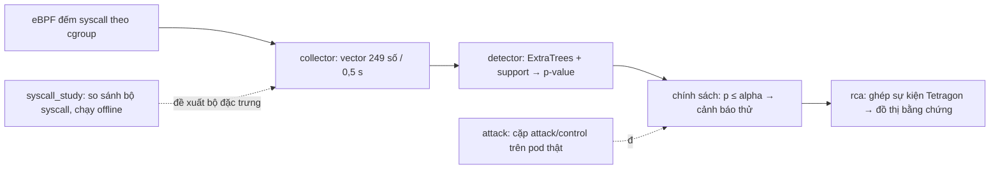

# Trạng thái đồ án Sentinel Pulse

Cập nhật **18/10/2026** từ SSH vào cụm (giờ UTC+7 trừ khi ghi UTC). Đây là báo cáo
duy nhất được cập nhật; việc cần làm nằm ở [../TODO.md](../TODO.md).

## 1. Tóm tắt một trang

- **Đồ án làm gì:** đếm syscall của từng container Kubernetes bằng eBPF, mỗi 0,5 giây
  tạo một vector 249 số, model học trên dữ liệu bình thường chấm điểm "lạ hay không".
  Khi có tín hiệu, một dịch vụ riêng dựng đồ thị bằng chứng (process, file, mạng) để điều tra.
- **Đang ở đâu:** pipeline chạy được end-to-end trên 3 worker thật, ở chế độ shadow
  (chỉ ghi "cảnh báo thử", không cảnh báo thật, không cách ly pod).
- **Kết quả mới nhất:** phát hiện tốt (recall ~98–99% trên tập attack phát triển,
  độ trễ p95 ~1,6 s) nhưng **cảnh báo nhầm quá nhiều**: precision 79,8% trong thiết kế
  1:1, khoảng 8% cửa sổ của dữ liệu bình thường bị gắn cờ (mức thiết kế 0,17%), và
  ~19–20 đợt cảnh báo mỗi workload-giờ so với ngân sách 0,1.
- **Kết luận chính:** nút thắt là **hiệu chỉnh ngưỡng (calibration) không theo kịp
  dữ liệu bình thường thay đổi**, không phải model thiếu nhạy. Chỉ tính lại p-value bằng
  dữ liệu normal gần hơn (không đổi model) đã đưa precision R3 lên 97,8% và giảm cửa sổ
  normal bị gắn cờ từ 8,1% xuống 0,35%, đổi lại recall 91,3% và p95 2,9 s. Chưa có cấu
  hình đạt đồng thời precision/recall ≥ 95%, cảnh báo nhầm theo khoảng ≤ 5%, p95 < 2 s.
- **Phiên 18/10:** dọn và tổ chức lại code; thu kết quả soak 48 giờ và holdout R4;
  chạy nghiên cứu "xác nhận nhiều cửa sổ" và "hiệu chỉnh lại p-value" trên dữ liệu phát triển.

## 2. Thuật ngữ (giải thích ngắn)

| Thuật ngữ | Nghĩa trong đồ án |
|---|---|
| syscall | Lời gọi hệ thống, ví dụ `read`, `connect`, `execve` |
| eBPF | Chương trình nhỏ chạy trong kernel; ở đây dùng để đếm syscall theo cgroup |
| cgroup / resolver | Nhóm tài nguyên của một container / tiến trình ánh xạ pod → container → cgroup |
| cửa sổ (window) | Khoảng 0,5 giây; mỗi container có một vector đặc trưng cho mỗi cửa sổ |
| vector 249 số | Số lần gọi 29 syscall chính, tỷ lệ, nhóm băm syscall khác, cặp syscall liền nhau, trung bình/độ lệch trượt |
| ngữ cảnh (context) | 3 cửa sổ trước + cửa sổ hiện tại = 996 số đưa vào model |
| ExtraTrees | Họ cây quyết định ngẫu nhiên (không phải deep learning) |
| nhánh support | Model phụ phát hiện giá trị nằm ngoài vùng từng thấy khi bình thường |
| p-value (conformal) | Điểm của cửa sổ so với điểm của dữ liệu bình thường dùng để hiệu chỉnh; p nhỏ = hiếm gặp. Chỉ đúng nghĩa khi dữ liệu lúc chạy giống dữ liệu hiệu chỉnh |
| alpha | Ngưỡng p; hiện là 0,05/30 ≈ 0,00167 cho mỗi cửa sổ |
| cảnh báo thử (preview) | Cờ `candidate_alert_preview=true`: tín hiệu để đánh giá, **không phải** cảnh báo vận hành |
| đóng băng (freeze) | Khóa code, model, ngưỡng bằng SHA-256 để không trộn phiên bản khi đánh giá |
| soak | Chạy liên tục nhiều giờ trên tải bình thường để đo độ ổn định và cảnh báo nhầm |
| development / blind | Dữ liệu đã nhìn khi phát triển / dữ liệu mới chưa từng dùng để chỉnh — chỉ kết quả blind mới dùng để kết luận |
| holdout | Dữ liệu để riêng không dùng để fit |
| cặp attack/control | Mỗi lượt gồm 15 s đối chứng (không làm gì) và 15 s chạy binary mô phỏng tấn công trên cùng container |
| TP / FN / FP / TN | Bắt đúng / bỏ sót / báo nhầm / im lặng đúng; "FP kỳ vọng" vì control chưa được review nhãn |
| unknown | Thiếu dữ liệu hoặc bằng chứng nên không chấm; không bao giờ tự đổi thành TN/FN |
| đợt cảnh báo (episode) | Các cửa sổ dương của một container cách nhau < 15 s gộp thành một đợt |
| xác nhận k-of-n | Chỉ báo khi ít nhất k trong n cửa sổ liên tiếp vượt ngưỡng |
| hiệu chỉnh lại (recalibration) | Tính lại p-value bằng tập dữ liệu bình thường gần hơn, không đổi model |
| cấu hình syscall (arm) | Một biến thể bộ đặc trưng: giữ 29 syscall, thêm hoặc bớt nhóm syscall |
| RCA | Điều tra nguyên nhân gốc; ở đây mới là đồ thị bằng chứng liên quan, chưa chứng minh nhân quả |

## 3. Kiến trúc



Mỗi workload/container có model riêng (21 key trong namespace `production` của ứng dụng
AIMS). Code: [../sentinel_pulse/README.md](../sentinel_pulse/README.md).

## 4. Trạng thái cụm (11:30 ngày 18/10)

| Thành phần | Trạng thái |
|---|---|
| Soak Pulse 48 giờ (3 worker) | **Đã kết thúc bình thường** 17/10 00:56–01:06; `NRestarts=0` |
| Chấm holdout R4 (thí nghiệm syscall) | **Đã kết thúc** 16/10 13:03; 147 segment |
| RCA subscriber (`pulse-rca-runtime-events`, .234) | Vẫn chạy nhưng **không có tín hiệu mới** từ khi Pulse dừng; RAM ~966 MB / giới hạn 1 GB |
| Collector + resolver trên worker | Chạy (luồng đối chứng 1 s, có xoay vòng hằng ngày) |
| Detector v8 cũ (`sentinel-detector`) | Vẫn chạy dry-run trên .234 và worker1 từ 01/10 (~750 MB) — đề xuất dừng |
| Job nghiên cứu 18/10 | Đã xong: xác nhận k-of-n, hiệu chỉnh lại c1, kiểm tra tương đương. Đang chạy: `pulse-recalibration-looser-c2-20261018` |
| NFS `/mnt/sentinel-pulse-archive` | 242/344 GB dùng (71%) |

## 5. Kết quả

### 5.1 Soak 48 giờ của candidate đóng băng (dữ liệu bình thường, chưa review nhãn)

| Worker | Cửa sổ đã chấm | Cảnh báo thử | Tỷ lệ | Issue ghi nhận |
|---|---:|---:|---:|---:|
| worker1 (.237) | 9.011.856 | 673.825 | 7,5% | 146 |
| worker4 (.238) | 8.051.218 | 950.765 | 11,8% | 381 |
| worker3 (.239) | 4.408.203 | 90.161 | 2,0% | 65 |
| **Tổng** | **21.471.277** | **1.714.751** | **8,0%** | 592 |

Mỗi worker đủ 172.800 giây đăng ký. Model `747c4eed…`, chính sách `fd0be94a…`.
Nếu p-value đúng nghĩa, tỷ lệ cửa sổ dương trên dữ liệu bình thường phải quanh 0,17%;
thực tế cao gấp ~47 lần. Lưu ý soak có chứa các lượt R3/R5 và giai đoạn bật policy
Tetragon cho RCA (xem 5.5), nhưng các khoảng đó quá ngắn để giải thích tỷ lệ này.

### 5.2 Ma trận attack/control phát triển R3 + R5 (đã công bố, tái lập 18/10)

R3: 315 cặp (21 key × 5 kịch bản × 3 tốc độ), chạy 14/10 19:30 → 15/10 00:17 UTC.

| | Bắt được | Không bắt | Unknown |
|---|---:|---:|---:|
| Attack | TP 284 | FN 2 | 29 |
| Control | FP kỳ vọng 72 | TN kỳ vọng 237 | 6 |

Precision 79,8%, recall 99,3% (cận dưới tính cả unknown: 90,2%), control dương 23,3%,
kernel → cảnh báo thử p50/p95/p99 = 1,07 / 1,61 / 4,75 s. R5 (RabbitMQ, 15 cặp):
TP 13, FN 0, FP 1, TN 14, unknown 2. Đây là dữ liệu **phát triển**, không phải blind,
và tỷ lệ 1:1 nên precision này không phải precision vận hành.

### 5.3 Holdout R4 — thí nghiệm chọn syscall

693 model (21 key × 11 cấu hình × 3 seed) chấm trên 24 giờ dữ liệu bình thường sau khi
đóng băng: 500,8 workload-giờ hợp lệ, đủ 21 key.

| Cấu hình | Đợt cảnh báo / workload-giờ (3 seed) | TB |
|---|---|---:|
| plus_top16 | 16,97 · 18,10 · 20,57 | 18,55 |
| plus_top32 | 17,26 · 20,32 · 18,92 | 18,83 |
| base29 (hiện tại) | 19,77 · 20,17 · 18,48 | 19,47 |
| drop_exec_pair | 19,87 · 21,80 · 20,80 | 20,82 |

(Đủ 11 cấu hình trong evidence.) **Không cấu hình nào gần ngân sách 0,1 đợt/giờ**;
chênh lệch giữa cấu hình nhỏ hơn dao động giữa các seed, nên theo protocol v2 hiện **chưa
chọn được** bộ syscall cho Pulse. Thí nghiệm này chạy song song với Pulse và là đầu vào
chọn feature cho nó: mọi cải tiến ngưỡng/hiệu chỉnh của Pulse cần áp dụng lại cho cả 11
cấu hình trên cùng holdout để so sánh trong điều kiện cảnh báo nhầm thấp hơn.
Workload ồn nhất: Kafka (43,6/giờ), search-recommendation (38,6), istio waypoint (38,2).

Đáng chú ý: model base29 của R4 dùng cùng 29 syscall với Pulse nhưng fit lại trên dữ liệu
15/10; trên normal chúng chỉ gắn cờ **0,64%** cửa sổ, so với 8% của candidate đóng băng
(khoảng thời gian gần nhau nhưng không trùng hoàn toàn). Đây là bằng chứng thứ hai cho thấy
nguyên nhân chính là calibration/drift, không phải bộ syscall.

### 5.4 Xác nhận k-of-n trên p-value gốc (phát triển, 18/10)

Không đổi model; chỉ yêu cầu k trong n cửa sổ liên tiếp vượt ngưỡng (có thể kèm alpha chặt hơn).
Công cụ tái lập đúng ma trận R3/R5 và đúng số cảnh báo thử của soak với chính sách hiện tại
trước khi thử chính sách khác. "Đợt/giờ" tính trên toàn bộ soak 48 giờ (3.199,7 replica-giờ).

| Chính sách | Đợt/giờ normal | Precision R3 | Recall R3 | Control dương | p95 | p99 |
|---|---:|---:|---:|---:|---:|---:|
| hiện tại (1 cửa sổ) | 37,1 | 79,8% | 99,3% | 23,3% | 1,61 s | 4,75 s |
| 2 of 2 | 22,3 | 87,3% | 98,3% | 13,3% | 2,25 s | 5,05 s |
| 3 of 4 | 20,2 | 89,8% | 98,3% | 10,4% | 2,91 s | 5,40 s |
| 4 of 6 | 19,5 | 90,6% | 98,3% | 9,4% | 3,42 s | 5,95 s |
| 4 of 6, alpha/4 | 12,0 | 94,7% | 69,2% | 3,6% | 5,94 s | 8,74 s |

Xác nhận nhiều cửa sổ giảm control dương nhưng không hạ cảnh báo nhầm xuống gần ngân sách
(tốt nhất vẫn 12 đợt/giờ, gấp 120 lần) và làm p95 vượt 2 s. **Riêng k-of-n không giải quyết
được vấn đề.**

### 5.5 Hiệu chỉnh lại p-value (phát triển, 18/10)

Thiết kế (đăng ký trước khi xem kết quả): tập hiệu chỉnh = điểm tree/support của chính
model đóng băng trên soak 15/10 00:30–07:30 UTC (sau R3, trước can thiệp RCA, bỏ khoảng R5
03:00–03:25), 42–88 nghìn cửa sổ mỗi workload, đủ 21 workload. Kiểm tra trên phần soak
từ 15/10 08:40 UTC đến hết (2.206,6 replica-giờ, trùng thời gian bật policy Tetragon cho
RCA) và trên R3/R5. Model không đổi, chỉ tính lại p-value.

Cùng khoảng kiểm tra, chính sách một cửa sổ:

| | P-value gốc | Hiệu chỉnh lại |
|---|---:|---:|
| Cửa sổ normal bị gắn cờ | 8,11% | **0,35%** |
| Đợt cảnh báo / replica-giờ | 36,3 | **9,1** |
| R3 precision | 79,8% | **97,8%** |
| R3 recall | 99,3% | 91,3% |
| R3 control dương | 23,3% | **1,9%** |
| p95 / p99 kernel → cảnh báo | 1,61 / 4,75 s | 2,91 / 5,87 s |
| R5 (15 cặp) | TP 13, FP 1 | TP 13, FP 0 |

- **Cảnh báo nhầm giảm mạnh** (cửa sổ dương giảm 23 lần, đợt cảnh báo giảm 4 lần) → củng cố
  kết luận nút thắt là calibration. Vẫn còn ~9 đợt/giờ, gấp ~90 lần ngân sách 0,1.
- **Recall mất 25 attack**, toàn bộ thuộc hai kịch bản `seccomp_api_probe` (14) và
  `anonymous_mprotect_churn` (11) trên các app service; ba kịch bản còn lại vẫn bắt đủ.
- **Độ trễ tăng chủ yếu ở tốc độ tấn công thấp (6 lần/giây):** trước ~1–2 s, nay ~4–6 s.
  Cách hiểu: với calibration cũ, mỗi interval 15 s có ~23% khả năng bị gắn cờ ngẫu nhiên,
  nên một phần "phát hiện sớm" là trùng hợp.

Lưới thứ hai (alpha nới rộng sau hiệu chỉnh, R3, phát triển):

| Chính sách | Precision | Recall | Control dương | p95 | p99 |
|---|---:|---:|---:|---:|---:|
| 1 cửa sổ, alpha×3 | 94,3% | 93,4% | 5,2% | 1,97 s | 5,50 s |
| 1 cửa sổ, alpha×5 | 89,2% | 97,9% | 11,0% | 1,99 s | 4,95 s |
| 2 of 3, alpha×5 | 98,9% | 97,9% | 1,0% | 3,39 s | 6,04 s |
| 2 of 3, alpha×10 | 96,9% | 99,0% | 2,9% | 2,32 s | 3,54 s |

Chưa có chính sách đạt đồng thời precision/recall ≥ 95%, control dương ≤ 5% và p95 < 2 s;
gần nhất là "2 of 3, alpha×10" (chỉ lệch p95 0,32 s). Số đợt cảnh báo trên normal của lưới
này: *job `pulse-recalibration-looser-c2-20261018` đang chạy.*

**Kiểm tra tương đương sau refactor: đạt.** Replay 3 segment soak (s00050 của mỗi worker)
qua code mới: 214.449 cửa sổ có điểm, 0 sai khác, chênh lệch tuyệt đối lớn nhất = 0
(`validation-evidence/results-20261018/scorer-equivalence-0117901.json`). Lưu ý: chỉ ~34%
cửa sổ được chấm vì collector theo dõi cả container ngoài 21 workload có model (loadgen…).

### 5.6 RCA

Run r2 từ 15/10 15:37: 19.152 case đã sinh (giữ 500 gần nhất theo cấu hình), 43,17 triệu
decision đã đọc. 19.142 case (99,9%) thiếu ngữ cảnh connect và 1.693 thiếu ngữ cảnh
runtime. Audit trước đây chỉ kiểm tra cấu trúc của 107 case; chưa có nhãn để đo độ đúng.
Đồ thị là bằng chứng liên quan theo thời gian/định danh, chưa chứng minh nhân quả.

## 6. Đánh giá thẳng

**Hướng đi đúng:** đếm syscall bằng eBPF rẻ và khó né; model riêng cho từng workload,
chỉ học từ dữ liệu bình thường; ngưỡng dựa trên p-value có cơ sở; RCA tách khỏi
đường phát hiện; kỷ luật thí nghiệm (đóng băng, tách phát triển/blind, giữ unknown) tốt.

**Điểm yếu cần xử lý:**

1. *Calibration không chịu được thay đổi của dữ liệu bình thường* (chế độ tải, revision,
   thời gian). Đây là nguyên nhân chính của cảnh báo nhầm.
2. *Quyết định trên một cửa sổ 0,5 s* không có gộp theo thời gian.
3. *Rủi ro thổi phồng recall:* mọi attack đều khởi chạy một binary mới; chưa có đối
   chứng "chạy binary vô hại", nên một phần phát hiện có thể chỉ là "có process mới".
   Đặc trưng chỉ là tần suất, không có tham số syscall.
4. *Đánh giá 1:1* không phản ánh precision vận hành khi tấn công hiếm.
5. *Quy trình nặng:* nhiều thế hệ thí nghiệm song song; công sức dồn vào quản trị
   thay vì cải thiện model.

## 7. Đồng bộ code (18/10)

| Nơi | Trạng thái |
|---|---|
| GitHub `experiment/syscall-id-histogram-pilot` | = `bb52293`, trùng local trước refactor |
| GitHub `main` | Nhánh chính: đã hợp nhất nhánh thí nghiệm, đợt tái cấu trúc và 2 commit tài liệu cũ của `main` (`22f365a`); từ nay push thẳng lên `main`, commit chỉ mang danh tính tndat-dev |
| GitHub tag `archive/pre-refactor-20261018` | Cây code đầy đủ trước đợt dọn 18/10 |
| Cụm `/home/dat/eBPF-project-current` | `bb52293`, sạch — trùng GitHub |
| Cụm `/home/dat/eBPF-project` | `main` cũ, chậm 14 commit, có sửa chưa commit |
| Cụm `/home/dat/eBPF-project-refactor-*` | Bản clone dùng cho các job nghiên cứu 18/10; thư mục mang tên mã commit trước khi viết lại message ngày 18/10 (`0117901` = `471bcf0` hiện tại, cùng nội dung code) |
| Service đang chạy | Dùng snapshot source đóng băng (`/opt/...`, NFS), không phụ thuộc checkout |

## 8. Lệnh kiểm tra

```bash
export LAB_SSH_PASSWORD=...   # mật khẩu lab
python3 scripts/ssh_lab.py --list
python3 scripts/ssh_lab.py --host 10.1.16.234 systemctl show pulse-rca-runtime-events.service -p ActiveState -p NRestarts
python3 scripts/ssh_lab.py --host 10.1.16.234 python3 -m json.tool \
  /mnt/sentinel-pulse-archive/matched-parallel-20261015/workers/k8s-worker1.local/TERMINAL.json
```

Kết quả nghiên cứu 18/10: `/mnt/sentinel-pulse-archive/confirmation-study-20261018/`,
bản sao nhỏ trong `validation-evidence/results-20261018/`.
