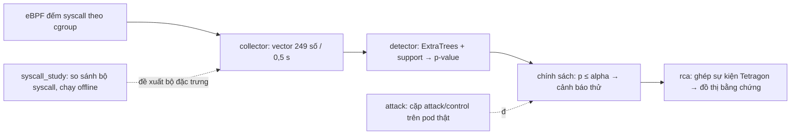

# Trạng thái đồ án Sentinel Pulse

Cập nhật **18/10/2026** từ SSH vào cụm (giờ UTC+7 trừ khi ghi UTC). Đây là báo cáo
duy nhất được cập nhật; việc cần làm nằm ở [../TODO.md](../TODO.md).

## 1. Tóm tắt một trang

- **Đồ án làm gì:** đếm syscall của từng container Kubernetes bằng eBPF, mỗi 0,5 giây
  tạo một vector 249 số, model học trên dữ liệu bình thường chấm điểm "lạ hay không".
  Khi có tín hiệu, một dịch vụ riêng dựng đồ thị bằng chứng (process, file, mạng) để điều tra.
- **Đang ở đâu:** pipeline chạy được end-to-end trên 3 worker thật, ở chế độ shadow
  (chỉ ghi "cảnh báo thử", không cảnh báo thật, không cách ly pod).
- **Kết quả mới nhất (lượt live R6, 19/10):** precision 89,1%, recall 92,8%, control idle dương 11,2%,
  p95 kernel → preview 1,90 s, ~17 đợt cảnh báo mỗi replica-giờ trên normal. **Một binary vô hại chạy cùng
  đường khởi chạy bị gắn cờ 80,7%** → Pulse phát hiện "process bất thường", chỉ tách rõ attack dùng syscall
  hiếm (ptrace, setns, execveat). Xác nhận 2 cửa sổ (replay) đạt precision/recall ≥ 95% và control ≤ 5%
  nhưng p95 2,3–2,9 s; độ trễ xử lý 0,25–0,5 s/frame là đòn bẩy tiếp theo.
- **Kết luận chính:** (1) gánh cảnh báo do calibration lệch theo thời gian: hiệu chỉnh lại giảm cửa sổ normal
  bị gắn cờ 8,1% → 0,35% nhưng vẫn ~6–17 đợt/replica-giờ, xa ngân sách 0,1; (2) chọn syscall không phải
  nút thắt (11 cấu hình ngang nhau ở cùng ngân sách); (3) đánh giá phải có đối chứng binary vô hại.
- **Phiên 18/10:** dọn và tổ chức lại code; thu kết quả soak 48 giờ và holdout R4;
  chạy nghiên cứu "xác nhận nhiều cửa sổ" và "hiệu chỉnh lại p-value" trên dữ liệu phát triển;
  chọn policy R6 và khởi động **lượt live R6** (mục 5.9). Mọi thao tác được ghi theo thứ tự
  thời gian ở [mục 9 — Nhật ký làm việc](#9-nhật-ký-làm-việc).

## 2. Thuật ngữ (giải thích ngắn)

| Thuật ngữ | Nghĩa trong đồ án |
|---|---|
| syscall | Lời gọi hệ thống, ví dụ `read`, `connect`, `execve` |
| eBPF | Chương trình nhỏ chạy trong kernel; ở đây dùng để đếm syscall theo cgroup |
| cgroup / resolver | Nhóm tài nguyên của một container / tiến trình ánh xạ pod → container → cgroup |
| cửa sổ (window) | Khoảng 0,5 giây; mỗi container có một vector đặc trưng cho mỗi cửa sổ |
| vector 249 số | Số lần gọi 29 syscall chính, tỷ lệ, nhóm băm syscall khác, cặp syscall liền nhau, trung bình/độ lệch trượt |
| ngữ cảnh (context) | 3 cửa sổ trước + cửa sổ hiện tại = 996 số đưa vào model |
| ExtraTrees | Họ cây quyết định ngẫu nhiên (không phải deep learning) |
| nhánh support | Model phụ phát hiện giá trị nằm ngoài vùng từng thấy khi bình thường |
| p-value (conformal) | Điểm của cửa sổ so với điểm của dữ liệu bình thường dùng để hiệu chỉnh; p nhỏ = hiếm gặp. Chỉ đúng nghĩa khi dữ liệu lúc chạy giống dữ liệu hiệu chỉnh |
| alpha | Ngưỡng p; hiện là 0,05/30 ≈ 0,00167 cho mỗi cửa sổ |
| cảnh báo thử (preview) | Cờ `candidate_alert_preview=true`: tín hiệu để đánh giá, **không phải** cảnh báo vận hành |
| đóng băng (freeze) | Khóa code, model, ngưỡng bằng SHA-256 để không trộn phiên bản khi đánh giá |
| soak | Chạy liên tục nhiều giờ trên tải bình thường để đo độ ổn định và cảnh báo nhầm |
| development / blind | Dữ liệu đã nhìn khi phát triển / dữ liệu mới chưa từng dùng để chỉnh — chỉ kết quả blind mới dùng để kết luận |
| holdout | Dữ liệu để riêng không dùng để fit |
| cặp attack/control | Mỗi lượt gồm 15 s đối chứng (không làm gì) và 15 s chạy binary mô phỏng tấn công trên cùng container |
| TP / FN / FP / TN | Bắt đúng / bỏ sót / báo nhầm / im lặng đúng; "FP kỳ vọng" vì control chưa được review nhãn |
| unknown | Thiếu dữ liệu hoặc bằng chứng nên không chấm; không bao giờ tự đổi thành TN/FN |
| đợt cảnh báo (episode) | Các cửa sổ dương của một container cách nhau < 15 s gộp thành một đợt |
| xác nhận k-of-n | Chỉ báo khi ít nhất k trong n cửa sổ liên tiếp vượt ngưỡng |
| hiệu chỉnh lại (recalibration) | Tính lại p-value bằng tập dữ liệu bình thường gần hơn, không đổi model |
| cấu hình syscall (arm) | Một biến thể bộ đặc trưng: giữ 29 syscall, thêm hoặc bớt nhóm syscall |
| RCA | Điều tra nguyên nhân gốc; ở đây mới là đồ thị bằng chứng liên quan, chưa chứng minh nhân quả |

## 3. Kiến trúc



Mỗi workload/container có model riêng (21 key trong namespace `production` của ứng dụng
AIMS). Code: [../sentinel_pulse/README.md](../sentinel_pulse/README.md).

## 4. Trạng thái cụm (16:00 ngày 18/10)

| Thành phần | Trạng thái |
|---|---|
| Soak Pulse 48 giờ (3 worker) | **Đã kết thúc bình thường** 17/10 00:56–01:06; `NRestarts=0` |
| Chấm holdout R4 (thí nghiệm syscall) | **Đã kết thúc** 16/10 13:03; 147 segment |
| `pulse-r4-score-dump-k8s-worker{1,4,3}-20261018` (.234) | Đang chạy từ 15:19 (UTC+7), ETA ~18:00 |
| `pulse-r4-arm-attack-replay-20261018` (.234) | **Xong** (mục 5.8) |
| `pulse-r4-arm-budget-20261019` (.234) | **Xong** (mục 5.8) |
| `pulse-rolling-recalibration-20261019b` (.234) | Timer 19/10 10:30 (sau campaign R6) |
| `pulse-r6-normal-burden-20261020` (.234) | Timer 20/10 02:10: gánh cảnh báo normal R6 cho mọi chính sách → chọn chính sách R7 |
| RCA subscriber | r2 **đã dừng** 19/10 02:13; r6 `pulse-rca-runtime-events-r6` chạy từ 02:14 |
| Collector + resolver trên worker | Chạy (luồng đối chứng 1 s, có xoay vòng hằng ngày) |
| Detector v8 cũ | **Đã gỡ** (mục 5c) |
| Lượt live R6 | **Đang chạy** từ 19/10 02:04 (mục 5.9) |
| NFS `/mnt/sentinel-pulse-archive` | 242/344 GB dùng (71%), còn 102 GB |
| Ổ đĩa worker | worker1 80%, worker4 84%, worker3 55% — dữ liệu thô cũ chờ xóa tay (mục 5c) |

## 5. Kết quả

### 5.1 Soak 48 giờ của candidate đóng băng (dữ liệu bình thường, chưa review nhãn)

| Worker | Cửa sổ đã chấm | Cảnh báo thử | Tỷ lệ | Issue ghi nhận |
|---|---:|---:|---:|---:|
| worker1 (.237) | 9.011.856 | 673.825 | 7,5% | 146 |
| worker4 (.238) | 8.051.218 | 950.765 | 11,8% | 381 |
| worker3 (.239) | 4.408.203 | 90.161 | 2,0% | 65 |
| **Tổng** | **21.471.277** | **1.714.751** | **8,0%** | 592 |

Mỗi worker đủ 172.800 giây đăng ký. Model `747c4eed…`, chính sách `fd0be94a…`.
Nếu p-value đúng nghĩa, tỷ lệ cửa sổ dương trên dữ liệu bình thường phải quanh 0,17%;
thực tế cao gấp ~47 lần. Lưu ý soak có chứa các lượt R3/R5 và giai đoạn bật policy
Tetragon cho RCA (xem 5.5), nhưng các khoảng đó quá ngắn để giải thích tỷ lệ này.

### 5.2 Ma trận attack/control phát triển R3 + R5 (đã công bố, tái lập 18/10)

R3: 315 cặp (21 key × 5 kịch bản × 3 tốc độ), chạy 14/10 19:30 → 15/10 00:17 UTC.

| | Bắt được | Không bắt | Unknown |
|---|---:|---:|---:|
| Attack | TP 284 | FN 2 | 29 |
| Control | FP kỳ vọng 72 | TN kỳ vọng 237 | 6 |

Precision 79,8%, recall 99,3% (cận dưới tính cả unknown: 90,2%), control dương 23,3%,
kernel → cảnh báo thử p50/p95/p99 = 1,07 / 1,61 / 4,75 s. R5 (RabbitMQ, 15 cặp):
TP 13, FN 0, FP 1, TN 14, unknown 2. Đây là dữ liệu **phát triển**, không phải blind,
và tỷ lệ 1:1 nên precision này không phải precision vận hành.

### 5.3 Holdout R4 — thí nghiệm chọn syscall

693 model (21 key × 11 cấu hình × 3 seed) chấm trên 24 giờ dữ liệu bình thường sau khi
đóng băng: 500,8 workload-giờ hợp lệ, đủ 21 key.

| Cấu hình | Đợt cảnh báo / workload-giờ (3 seed) | TB |
|---|---|---:|
| plus_top16 | 16,97 · 18,10 · 20,57 | 18,55 |
| plus_top32 | 17,26 · 20,32 · 18,92 | 18,83 |
| base29 (hiện tại) | 19,77 · 20,17 · 18,48 | 19,47 |
| drop_exec_pair | 19,87 · 21,80 · 20,80 | 20,82 |

(Đủ 11 cấu hình trong evidence.) **Không cấu hình nào gần ngân sách 0,1 đợt/giờ**;
chênh lệch giữa cấu hình nhỏ hơn dao động giữa các seed, nên theo protocol v2 hiện **chưa
chọn được** bộ syscall cho Pulse. Thí nghiệm này chạy song song với Pulse và là đầu vào
chọn feature cho nó: mọi cải tiến ngưỡng/hiệu chỉnh của Pulse cần áp dụng lại cho cả 11
cấu hình trên cùng holdout để so sánh trong điều kiện cảnh báo nhầm thấp hơn.
Workload ồn nhất: Kafka (43,6/giờ), search-recommendation (38,6), istio waypoint (38,2).

Đáng chú ý: model base29 của R4 dùng cùng 29 syscall với Pulse nhưng fit lại trên dữ liệu
15/10; trên normal chúng chỉ gắn cờ **0,64%** cửa sổ, so với 8% của candidate đóng băng
(khoảng thời gian gần nhau nhưng không trùng hoàn toàn). Đây là bằng chứng thứ hai cho thấy
nguyên nhân chính là calibration/drift, không phải bộ syscall.

### 5.4 Xác nhận k-of-n trên p-value gốc (phát triển, 18/10)

Không đổi model; chỉ yêu cầu k trong n cửa sổ liên tiếp vượt ngưỡng (có thể kèm alpha chặt hơn).
Công cụ tái lập đúng ma trận R3/R5 và đúng số cảnh báo thử của soak với chính sách hiện tại
trước khi thử chính sách khác. "Đợt/giờ" tính trên toàn bộ soak 48 giờ (3.199,7 replica-giờ).

| Chính sách | Đợt/giờ normal | Precision R3 | Recall R3 | Control dương | p95 | p99 |
|---|---:|---:|---:|---:|---:|---:|
| hiện tại (1 cửa sổ) | 37,1 | 79,8% | 99,3% | 23,3% | 1,61 s | 4,75 s |
| 2 of 2 | 22,3 | 87,3% | 98,3% | 13,3% | 2,25 s | 5,05 s |
| 3 of 4 | 20,2 | 89,8% | 98,3% | 10,4% | 2,91 s | 5,40 s |
| 4 of 6 | 19,5 | 90,6% | 98,3% | 9,4% | 3,42 s | 5,95 s |
| 4 of 6, alpha/4 | 12,0 | 94,7% | 69,2% | 3,6% | 5,94 s | 8,74 s |

Xác nhận nhiều cửa sổ giảm control dương nhưng không hạ cảnh báo nhầm xuống gần ngân sách
(tốt nhất vẫn 12 đợt/giờ, gấp 120 lần) và làm p95 vượt 2 s. **Riêng k-of-n không giải quyết
được vấn đề.**

### 5.5 Hiệu chỉnh lại p-value (phát triển, 18/10)

Thiết kế (đăng ký trước khi xem kết quả): tập hiệu chỉnh = điểm tree/support của chính
model đóng băng trên soak 15/10 00:30–07:30 UTC (sau R3, trước can thiệp RCA, bỏ khoảng R5
03:00–03:25), 42–88 nghìn cửa sổ mỗi workload, đủ 21 workload. Kiểm tra trên phần soak
từ 15/10 08:40 UTC đến hết (2.206,6 replica-giờ, trùng thời gian bật policy Tetragon cho
RCA) và trên R3/R5. Model không đổi, chỉ tính lại p-value.

Cùng khoảng kiểm tra, chính sách một cửa sổ:

| | P-value gốc | Hiệu chỉnh lại |
|---|---:|---:|
| Cửa sổ normal bị gắn cờ | 8,11% | **0,35%** |
| Đợt cảnh báo / replica-giờ | 36,3 | **9,1** |
| R3 precision | 79,8% | **97,8%** |
| R3 recall | 99,3% | 91,3% |
| R3 control dương | 23,3% | **1,9%** |
| p95 / p99 kernel → cảnh báo | 1,61 / 4,75 s | 2,91 / 5,87 s |
| R5 (15 cặp) | TP 13, FP 1 | TP 13, FP 0 |

- **Cảnh báo nhầm giảm mạnh** (cửa sổ dương giảm 23 lần, đợt cảnh báo giảm 4 lần) → củng cố
  kết luận nút thắt là calibration. Vẫn còn ~9 đợt/giờ, gấp ~90 lần ngân sách 0,1.
- **Recall mất 25 attack**, toàn bộ thuộc hai kịch bản `seccomp_api_probe` (14) và
  `anonymous_mprotect_churn` (11) trên các app service; ba kịch bản còn lại vẫn bắt đủ.
- **Độ trễ tăng chủ yếu ở tốc độ tấn công thấp (6 lần/giây):** trước ~1–2 s, nay ~4–6 s.
  Cách hiểu: với calibration cũ, mỗi interval 15 s có ~23% khả năng bị gắn cờ ngẫu nhiên,
  nên một phần "phát hiện sớm" là trùng hợp.

Lưới thứ hai (alpha nới rộng sau hiệu chỉnh, R3, phát triển):

| Chính sách | Precision | Recall | Control dương | p95 | p99 |
|---|---:|---:|---:|---:|---:|
| 1 cửa sổ, alpha×3 | 94,3% | 93,4% | 5,2% | 1,97 s | 5,50 s |
| 1 cửa sổ, alpha×5 | 89,2% | 97,9% | 11,0% | 1,99 s | 4,95 s |
| 2 of 3, alpha×5 | 98,9% | 97,9% | 1,0% | 3,39 s | 6,04 s |
| 2 of 3, alpha×10 | 96,9% | 99,0% | 2,9% | 2,32 s | 3,54 s |

Số đợt cảnh báo trên normal (khoảng test) của lưới này: 1 cửa sổ alpha×3 = 18,0/giờ;
2 of 3 alpha×5 = 9,9/giờ; 2 of 3 alpha×10 = 17,1/giờ; thấp nhất trong mọi cấu hình đã thử là
3,5/giờ (2 of 2, alpha×1, nhưng recall 89,9% và p95 5,6 s).

Chưa có chính sách đạt đồng thời precision/recall ≥ 95%, control dương ≤ 5% và p95 < 2 s.
**Đã đăng ký cho lượt live R6** (`protocol/recalibrated-preview-policy-r6.json`, SHA-256
`f6107351…`): 1 cửa sổ, alpha×3 trên candidate đã hiệu chỉnh lại — chính sách duy nhất giữ p95
dưới 2 s (1,97 s), precision 94,3%, recall 93,4%. Số đợt cảnh báo (18/giờ) vẫn là khoảng trống
lớn; cần cải thiện ở model/đặc trưng cho vài workload ồn (2 Kafka entity-operator ~43–52/giờ).

**Kiểm tra tương đương sau refactor: đạt.** Replay 3 segment soak (s00050 của mỗi worker)
qua code mới: 214.449 cửa sổ có điểm, 0 sai khác, chênh lệch tuyệt đối lớn nhất = 0
(`validation-evidence/results-20261018/scorer-equivalence-0117901.json`). Lưu ý: chỉ ~34%
cửa sổ được chấm vì collector theo dõi cả container ngoài 21 workload có model (loadgen…).

### 5.6 RCA

Run r2 từ 15/10 15:37: 19.152 case đã sinh (giữ 500 gần nhất theo cấu hình), 43,17 triệu
decision đã đọc; không có tín hiệu mới từ khi soak Pulse dừng. 19.142 case (99,9%) thiếu
ngữ cảnh connect và 1.693 thiếu ngữ cảnh runtime.

**Nguyên nhân thiếu connect (18/10):** không phải lỗi join. Không case nào chạm giới hạn
truy vấn; trong ring 180 s chỉ có 50 sự kiện connect trên toàn bộ pod production (so với
4.222 exec, 4.817 exit), chủ yếu từ pod phát tải. Service dùng connection pool nên hầu như
không gọi `connect()`. **Đã sửa trong code:** policy riêng `sentinel-rca-flow-v1` lấy mẫu
`tcp_sendmsg`/`udp_sendmsg` tối đa 1 lần / process+socket / 10 s, sinh node `active_flow` và
danh sách `network_destinations` cho mỗi case. Đã kiểm tra schema bằng server dry-run; sẽ
áp dụng cùng lượt chạy Pulse live kế tiếp (RCA chỉ có case khi Pulse chạy).

Audit trước đây chỉ kiểm tra cấu trúc; chưa có nhãn để đo độ đúng. Đồ thị là bằng chứng
liên quan theo thời gian/định danh, chưa chứng minh nhân quả.

### 5.7 Chuẩn bị lượt Pulse live kế tiếp (18/10)

- Candidate đã hiệu chỉnh lại: `/mnt/sentinel-pulse-archive/runtime-recal-c1-20261018/model-bundle`,
  manifest `ec72d9ea22af7d84ac2e8567e19205f121498ad11e48a9b2ef673697f5843cd4`; estimator giữ
  nguyên, chỉ thay mảng calibration (dữ liệu normal 15/10 00:30–07:30 UTC).
- Policy preview v2 (hệ số alpha + xác nhận k-of-n) đã có trong code; tham số sẽ chọn sau
  khi có số đợt cảnh báo của lưới c2.
- Còn thiếu trước khi chạy: chọn và đăng ký policy, snapshot source lên NFS làm
  `frozen_source`, đối chứng chạy binary vô hại, blind attack mới.

### 5.8 Thí nghiệm syscall — xuất điểm đầy đủ và replay attack

Job `pulse-r4-score-dump-*` chấm lại 147 segment holdout bằng đúng 693 model R4 và lưu điểm
tree/support của mọi cửa sổ, kèm đối chiếu số đếm từng segment với evaluator đã đăng ký
(chưa có segment nào lệch). Khi xong, 11 cấu hình sẽ được so sánh dưới cùng phương pháp
hiệu chỉnh lại/chính sách như Pulse, không phải chấm lại.

**Replay attack cho mọi cấu hình (xong 18/10, `arm-attack-replay-r3r5-20261018`):** 693 model × 630
interval R3/R5 (315 attack + 315 control), p-value hiệu chỉnh gốc của từng model (development, nhãn kỳ vọng):

| Alpha | Recall | Control dương | p95 độ trễ (≈ kernel → cửa sổ dương) |
|---|---|---|---|
| ×1 | 0,93–0,96 (`drop_exec_pair` 0,87) | 3–4% | 2,1–3,4 s — **vượt 2 s** |
| ×5 | 0,98–1,00 | 12–16% | 0,9–1,5 s |
| ×10 | 0,99–1,00 | 22–27% | 0,79–1,1 s |

- Bỏ cặp transition exec (`drop_exec_pair`) làm recall giảm rõ nhất → tín hiệu "có process mới" đóng góp
  lớn; đối chứng binary vô hại của R6 sẽ cho biết bao nhiêu trong đó là hành vi tấn công thật.
- `plus_all_defined_native` / `plus_all_observed` có control dương thấp nhất và p95 nhanh nhất ở ×5/×10.
- **Kết quả so ở cùng ngân sách cảnh báo (`arm-budget-20261019`, nội suy theo số đợt/replica-giờ):**

  | Cấu hình | B=5: recall / control / p95 | B=12: recall / control / p95 | B=18: recall / control / p95 |
  |---|---|---|---|
  | `base29` (bộ hiện tại của Pulse) | 0,900 / 1,8% / 2,05 s | 0,927 / 4,8% / 1,53 s | 0,930 / 6,9% / 1,52 s |
  | `drop_clone_pair` | 0,897 / 1,8% / **1,30 s** | 0,934 / 4,7% / 1,23 s | 0,941 / 7,8% / 1,14 s |
  | `plus_security` | 0,900 / 1,9% / 1,94 s | 0,926 / 4,8% / 1,53 s | 0,932 / 7,9% / 1,35 s |
  | `plus_all_defined_native` | 0,888 / 4,2% / 3,18 s | **0,987** / 8,2% / 1,22 s | 0,990 / 11,0% / 0,99 s |
  | `plus_all_observed` | 0,885 / 3,9% / 3,81 s | 0,981 / 8,5% / 1,99 s | 0,984 / 11,5% / 1,27 s |
  | `drop_exec_pair` | 0,806 / 1,8% / 1,87 s | 0,852 / 4,6% / 1,50 s | 0,875 / 7,4% / 1,46 s |

  - **Không cấu hình nào đạt ngân sách 0,1 hay 1 đợt/replica-giờ** bằng ngưỡng (thấp nhất 2,8 đợt ở alpha×0,5).
  - Mở rộng toàn bộ syscall (`plus_all_*`) tăng recall khi ngân sách rộng, nhưng tăng control dương và chậm
    ở ngân sách chặt; các cấu hình 29 syscall khác nhau trong phạm vi nhiễu; bỏ cặp exec luôn kém nhất.
  - **Kết luận cho Pulse:** giữ `base29` cho candidate kế tiếp; chọn syscall không phải nút thắt. Gánh cảnh báo
    phải giải bằng hiệu chỉnh/gộp theo thời gian và xử lý workload ồn.
- Job `pulse-r4-arm-budget-20261019` (`sentinel_pulse/syscall_study/arm_budget.py`, `a9cc061`):
  hiệu chỉnh từng model bằng 20% đầu holdout, đếm đợt cảnh báo trên 80% còn lại, chọn alpha lỏng nhất
  trong ngân sách 0,1 / 1 / 5 / 18 đợt mỗi replica-giờ rồi so recall, control dương, p95.

### 5.9 Lượt live R6 (đang chạy từ 19/10 02:04)

| Thành phần | Giá trị |
|---|---|
| Candidate / policy | `ec72d9ea…` (hiệu chỉnh lại c1) / `recalibrated-preview-policy-r6.json` (`f6107351…`, 1 cửa sổ, alpha×3) |
| Capture | 3 worker, `pulse-matched-worker-r6-20261018`, 24 giờ (đến ~20/10 02:04), **không ghi `raw.jsonl`** (NFS chỉ còn ~100 GB) |
| Source worker | snapshot `4ba303a` (`runtime-r6-4ba303a-20261018`); kiểm tra tương đương lại: 27.840 dòng có điểm, 0 sai khác |
| Campaign | 315 cặp (21 workload × 5 kịch bản × 3 tốc độ), mỗi cặp: control 15 s → binary vô hại 15 s → attack 15 s; fixture `runtime_attack_r6.c`; coordinator `d791d24`; attack bắt đầu **03:47**, dự kiến xong ~09:45 |
| Traffic | `pulse-matched-traffic-r6-20261018`: 2 vòng steady/toolmix/peak/burst/recovery rồi steady |
| RCA | `pulse-rca-runtime-events-r6` (source `d791d24`): policy runtime + fork + **flow** (`sentinel-rca-flow-v1` đã apply), baseline binary đóng băng 2 phút trước attack đầu tiên; r2 đã dừng |
| Thư mục | `/mnt/sentinel-pulse-archive/matched-r6-20261018/` |

**Sự cố lúc khởi động và cách xử lý (19/10 02:04–02:20):** worker1/worker3 báo `cadence_gap` khoảng
mỗi 5 s (history bị reset liên tục, cửa sổ khởi động bị gắn cờ ~40%). Nguyên nhân không nằm ở Pulse:
trên worker có **301 (worker1), 18 (worker4), 59 (worker3) tiến trình `tetra getevents` mồ côi** bên trong
container Tetragon, đã chạy 10 giờ đến 25 ngày, mỗi tiến trình 25–50% CPU. Chúng được tạo bởi
`kubectl exec` của campaign cũ (`timeout 23s kubectl exec …`: timeout chỉ giết kubectl phía .234),
của subscriber RCA khi nối lại stream, và của v8 (`sentinel-aims-syscalls`). Tetragon worker1 vì vậy tốn
5,3 core và 11,5 GB RAM; worker3 7,0 core.

- Sửa code (`d791d24`): lệnh trong container được bọc `timeout` (campaign 24 s; RCA xoay vòng stream
  mỗi 900 s và nối lại ngay khi hết hạn), nên không thể rò quá 15 phút.
- Dừng RCA r2, `pkill -KILL` toàn bộ `tetra getevents` trên 3 worker (lúc đó không còn client hợp lệ).
- Sau dọn: Tetragon worker1 0,6 core / 2,8 GB, worker3 0,64 core; CPU node worker1 62% → 35%;
  `cadence_gap` = 0 trong các phút tiếp theo.
- Khoảng 02:04–02:20 được coi là **không phải normal** khi phân tích (đã có issue `not_normal` trong
  segment; prefix sạch 1,5 giờ của campaign được tính lại từ lúc derive coordinator 02:15).
- **Số đo đầu tiên sau dọn (02:07–02:20, ~7,3 replica-giờ, chưa có attack):** cửa sổ dương 0,95%,
  **17,2 đợt cảnh báo/replica-giờ** (dự đoán development của R6: 18), cuối cửa sổ → preview p50 0,48 s,
  p99 0,64 s. Ồn nhất: `aims-kafka-entity-operator` (user/topic-operator, >100 đợt/giờ), `notification-service` 58,
  `auth-service` 30 (cửa sổ dương 8,4%).
- **RCA r6 sau ~20 phút (73 case):** 58 case có danh sách nghi phạm; chỉ 9 case (12%) có `active_flow`.
  Lỗi xếp hạng: nghi phạm số 1 thường là `containerd-shim-runc-v2` (cha phía host, luôn "unknown_binary") →
  sửa `54f4635`: tiến trình container runtime không bao giờ là ứng viên; `evaluate_ranking --rerank-db`
  xếp hạng lại offline từ bảng `binaries` (chỉ dùng binary thấy trước lúc tạo case), service live không cần khởi động lại.
- **Tranh chấp IO trên .234 (02:30):** job rolling recalibration đọc ~200 GB decisions từ NFS, cùng lúc arm-budget →
  IO pressure "full" ~32%, subscriber RCA kẹt trạng thái D, ngừng nạp sự kiện ~2,5 phút và nối lại stream.
  Đã dừng job rolling và hẹn chạy lại 10:30 (sau campaign, timer `pulse-rolling-recalibration-20261019b`);
  RCA hồi phục ngay (STATUS 3,5 s, ring 34.858 sự kiện). Worker R6 không bị ảnh hưởng (0 cadence gap).
  Quy tắc từ giờ: không chạy phân tích đọc NFS nặng trên .234 trong lúc có lượt live.
- Hệ quả cho các kết quả cũ: tải này có thể đã làm lệch đo overhead và một phần cảnh báo/độ trễ của
  các lượt trước (worker4 từng có 7–9 cadence gap mỗi segment trong 6 giờ đầu soak 48 h). Cần nêu trong báo cáo.

#### Kết quả campaign R6 (xong 19/10 09:52, 315/315 cặp)

Live, shadow, policy R6 đúng như đăng ký (không chỉnh sau khi xem kết quả). Nhãn là nhãn kỳ vọng, chưa review.

| Chỉ số | R6 live | Dự đoán development |
|---|---|---|
| Precision (1 attack : 1 control idle) | **89,1%** | 94,3% |
| Recall | **92,8%** (TP 285 / FN 22; unknown 11) | 93,4% |
| Control idle dương | 11,2% (35/312) | 5,2% |
| **Binary vô hại dương** | **80,7%** (251/311) | — |
| Kernel → preview p50 / p95 / p99 | 1,03 / **1,90** / 5,39 s | p95 1,97 s |
| Đợt cảnh báo normal (02:07–02:20) | 17,2 / replica-giờ | 18 |

**Phát hiện chính — Pulse phát hiện "process bất thường", chưa phân biệt ác ý.** Binary vô hại (cùng đường
khởi chạy, chỉ gọi `getpid` 6–24 lần/giây trong 15 s) bị gắn cờ 80,7%, gần bằng recall attack 92,8%.

| Kịch bản | Attack dương | Binary vô hại dương | Control idle |
|---|---|---|---|
| `child_ptrace_handshake` | 1,00 | 0,81 | 0,10 |
| `execveat_resolution_probe` | 1,00 | 0,79 | 0,11 |
| `invalid_setns_burst` | 1,00 | 0,81 | 0,11 |
| `anonymous_mprotect_churn` | 0,84 | 0,83 | 0,11 |
| `seccomp_api_probe` | 0,80 | 0,81 | 0,15 |

- Với syscall hiếm, mang tính bảo mật (ptrace, setns, execveat): attack bền hơn hẳn — trung vị **100%**
  cửa sổ trong 15 s dương, so với **33%** ở binary vô hại và ~0% ở control.
- `mprotect` churn và probe seccomp: không tách được khỏi một process vô hại mới.
- Hệ quả: precision 1:1 ở trên chỉ tính control idle; nếu tính binary vô hại là âm tính thì precision
  thấp hơn nhiều. Báo cáo đồ án phải trình bày cả hai.

**Replay chính sách trên dữ liệu R6** (`analysis-20261019/attack-r6-{default,looser}.json`; replay
k1of1_a3 tái lập đúng kết quả live). Development, chọn sau khi xem R6 → không phải kết quả blind:

| Chính sách | Precision | Recall | Control | Benign | p95 |
|---|---|---|---|---|---|
| k1of1_a1 | 94,9% | 91,2% | 4,8% | 72% | 2,54 s |
| k1of1_a3 (R6) | 89,1% | 92,8% | 11,2% | 81% | 1,90 s |
| k1of1_a5 | 85,7% | 97,7% | 16,0% | 93% | 1,67 s |
| **k2of2_a5** | **97,4%** | **95,8%** | **2,6%** | 82% | 2,88 s |
| k2of2_a10 | 95,0% | 98,0% | 5,1% | 89% | 2,30 s |
| k2of3_a10 | 94,4% | 98,7% | 5,8% | 94% | 2,27 s |

Xác nhận 2 cửa sổ đạt 3/4 kỳ vọng (precision, recall ≥ 95%, control ≤ 5%) nhưng p95 2,3–2,9 s.

**Độ trễ xử lý (cuối cửa sổ → preview, p50/p95):** worker1 0,46/0,54 s (82 container/frame), worker3 0,50/0,58 s
(85), worker4 0,25/0,30 s (28). Gồm thời gian tới khi feature sẵn sàng (0,24/0,29/0,15 s: parse JSON, kiểm tra
full-ID, tính feature tuần tự từng container) + chấm điểm batch (~0,1–0,2 s). Rút phần này về ~0,1 s sẽ đưa
k2of2_a10 về khoảng 1,9–2,0 s → hướng cải tiến kỹ thuật trực tiếp cho ràng buộc < 2 s.

**Tăng tốc chấm điểm (19/10, `0913446`):** profile trên frame thật (worker1, 82 container) cho thấy ~85% thời gian
mỗi frame nằm ở `predict_proba` của sklearn, chủ yếu là overhead Python theo từng cây (kiểm tra fitted, bộ lọc warning,
joblib) vì mỗi frame gọi ~18 lần cho vài dòng × ~190 cây. `detector/fast_forest.py` làm đúng phép tính của sklearn
(cộng `tree_.predict` từng cây theo thứ tự trong float64 rồi chia số cây) nhưng bỏ overhead; mỗi model được so với
đường chuẩn ở batch đầu tiên, lệch là tự quay về đường cũ. Bật bằng `fast_scoring: true` trong config worker.

| Kiểm tra trên 2 segment R6 (40.000 dòng) | Dòng có điểm | Sai khác | CPU replay |
|---|---|---|---|
| Đường sklearn (như lượt R6 đang chạy) | 13.505 | 0 | 208,9 s |
| Đường nhanh | 13.505 | **0** | **42,4 s** (nhanh ~4,9×) |

Ước tính cuối cửa sổ → preview giảm từ ~0,46 s xuống ~0,1 s ở worker1/3 → p95 của k2of2_a10 có thể về ~1,95 s.
Phải đo live ở lượt kế tiếp; R6 vẫn chạy đường cũ để không đổi điều kiện giữa lượt.

**RCA — case tiếp nối (`5436d11`, bật bằng `follow_up_on_new_exec`):** trong cooldown 300 s, nếu container có exec mới
kể từ cửa sổ của case trước thì mở case tiếp nối (cách ≥ 10 s, tối đa 5 case/cooldown), ghi `follow_up_of`.
Chỉ tính binary **chưa có** trong các exec còn ở ring trước cửa sổ của case trước (`3e457fe`): Kafka/Redis chạy probe
36–72 exec/phút (`grep`, `readlink`, `sh`, `redis-cli`) nên điều kiện "exec bất kỳ" sẽ luôn mở case mới.

**RCA trong campaign R6** (`rca-r6-copy-20261019/`, 2.001 case + `context.sqlite3`):

| 315 attack | Số trial |
|---|---|
| Có case của chính attack | 36 → nghi phạm hạng 1 là binary tấn công ở **36/36** (top-1 = 100%, cả xếp hạng lưu sẵn và xếp hạng lại) |
| Gộp vào cooldown do case của binary vô hại 5 s trước | 88 |
| Gộp vào cooldown do case khác trong 300 s | 130 |
| Case đã bị xóa do giới hạn 2.000 case (50 phút đầu campaign) | 48 |
| Không có case | 13 |

→ Độ phủ RCA bị chi phối bởi **cooldown 300 s/container** và **giới hạn 2.000 case**, không phải bởi xếp hạng.
Cần: mở case tiếp nối khi có exec mới trong cooldown, tăng giới hạn lưu cho lượt 24 h.

## 5b. Chiến lược đã điều chỉnh (18/10)

| Thí nghiệm | Điểm yếu cũ | Điều chỉnh |
|---|---|---|
| Pulse | Calibration tĩnh lệch theo thời gian | Hiệu chỉnh lại bằng normal gần đây (đã chứng minh hiệu quả); bước tiếp: làm mới định kỳ |
| Pulse | Mọi attack đều khởi chạy binary mới, không có đối chứng tương ứng → recall có thể bị thổi phồng | Fixture R6 + interval "chạy binary vô hại" trong campaign, báo cáo tách riêng |
| Pulse | Precision đo trong thiết kế 1:1 | Báo cáo song song số đợt cảnh báo/giờ trên normal độc lập (chỉ số chính cho vận hành) |
| Syscall | So sánh các cấu hình ở cùng alpha trong khi cảnh báo nhầm do drift chi phối như nhau | Xuất điểm đầy đủ để so sau hiệu chỉnh lại và ở cùng ngân sách cảnh báo |
| Syscall | Kế hoạch chạy attack riêng cho từng cấu hình (2.520 interval) | Một campaign có thu đầy đủ syscall ID, chấm mọi cấu hình offline; đang replay 693 model trên R3/R5 |
| RCA | Hook `connect` không thấy kết nối pool | Policy lấy mẫu `tcp/udp_sendmsg` 10 s/socket |
| RCA | Case là đồ thị thô, không đo được độ đúng | Xếp hạng process nghi vấn + đánh giá top-k bằng nhãn thật từ campaign attack |

## 5c. Dọn tài nguyên v8 (18/10)

Đã gỡ: `sentinel-detector` (.234, worker1), unit/timer `agent-runtime-gat-trainer`, `aims-blind-attack`,
`aims-normal-matrix`, `aims-split-evaluation@*`; TracingPolicy `aims-sensitive-exec`,
`sentinel-aims-syscalls`; namespace `sentinel-system` + RBAC `sentinel-detector`; thư mục
`ml-service*`, `v8-*-staging`, `aims-training-fit-*` (~6,3 GB). Còn lại (bị bộ kiểm duyệt quyền
chặn, chờ chạy tay): ValidatingAdmissionPolicy `sentinel-experiment-resource-lock`, 2 TracingPolicy
`sentinel-syscalls` (default, production) và workload baseline v8 (`nginx`, `redis`, `loadgen`,
`redis-loadgen` trong production; `postgres`, `postgres-loadgen` trong default).

Kiểm tra lại 16:00: không workload nào ở trên thuộc 21 workload Pulse giám sát; admission lock
chỉ khóa đúng các tài nguyên này (DELETE deployment/service/TracingPolicyNamespaced theo tên).
Giữ lại `sentinel-pulse-exec-provenance` (mốc kernel cho campaign attack) và 2 policy RCA
`sentinel-rca-runtime-v1`, `sentinel-rca-fork-v1`. Lệnh `kubectl delete` bị chặn lần 2.

**Dữ liệu thô cũ trên worker (chờ xóa tay, lệnh xóa bị bộ kiểm duyệt chặn):**

| Node | `/var/lib/sentinel-pulse-*` cũ | Lớn nhất |
|---|---:|---|
| worker1 | ~171 GB | `-500ms` 62 GB, `-detector` 58 GB, `-normal-normal-a1-20261013` 43 GB |
| worker4 | ~194 GB | `-500ms` 72 GB, `-detector` 68 GB, `-normal-normal-a1-20261013` 46 GB |
| worker3 | ~117 GB | `-500ms` 53 GB, `-detector` 45 GB, `-normal-normal-a1-20261013` 13 GB |

Ngoài ra: nội dung cũ trong `/var/lib/sentinel-pulse/` (trừ `features.jsonl` collector đang ghi),
~100 thư mục checkout/bundle `eBPF-project-*`, `pulse-*`, `sentinel-pulse-*` trong `/home/dat`, và
unit file thế hệ cũ: các oneshot `sentinel-pulse-extended-collection`, `-idle-collection`,
`-observation-capture@normal-a1-20261013`, `-idle-audit` và `-extended-audit-r2` đã xong nhưng vẫn `enabled`,
nên sẽ tự chạy lại khi máy khởi động. Unit lỗi: 90 (worker4), 87 (worker3), đều là unit tạm `/run/systemd/transient`.
Phải giữ lại: collector, resolver, control-rotate, `/home/dat/pulse-matched-20261015` (loader/proof dùng cho R6),
`/opt/sentinel-pulse`.

## 6. Đánh giá thẳng

**Hướng đi đúng:** đếm syscall bằng eBPF rẻ và khó né; model riêng cho từng workload,
chỉ học từ dữ liệu bình thường; ngưỡng dựa trên p-value có cơ sở; RCA tách khỏi
đường phát hiện; kỷ luật thí nghiệm (đóng băng, tách phát triển/blind, giữ unknown) tốt.

**Điểm yếu cần xử lý:**

1. *Calibration không chịu được thay đổi của dữ liệu bình thường* (chế độ tải, revision,
   thời gian). Đây là nguyên nhân chính của cảnh báo nhầm.
2. *Quyết định trên một cửa sổ 0,5 s* không có gộp theo thời gian.
3. *Rủi ro thổi phồng recall:* mọi attack đều khởi chạy một binary mới; chưa có đối
   chứng "chạy binary vô hại", nên một phần phát hiện có thể chỉ là "có process mới".
   Đặc trưng chỉ là tần suất, không có tham số syscall.
4. *Đánh giá 1:1* không phản ánh precision vận hành khi tấn công hiếm.
5. *Quy trình nặng:* nhiều thế hệ thí nghiệm song song; công sức dồn vào quản trị
   thay vì cải thiện model.

## 7. Đồng bộ code (18/10)

| Nơi | Trạng thái |
|---|---|
| GitHub `experiment/syscall-id-histogram-pilot` | = `bb52293`, trùng local trước refactor |
| GitHub `main` | Nhánh chính: đã hợp nhất nhánh thí nghiệm, đợt tái cấu trúc và 2 commit tài liệu cũ của `main` (`22f365a`); từ nay push thẳng lên `main`, commit chỉ mang danh tính tndat-dev |
| GitHub tag `archive/pre-refactor-20261018` | Cây code đầy đủ trước đợt dọn 18/10 |
| Cụm `/home/dat/eBPF-project-current` | `bb52293`, sạch — trùng GitHub |
| Cụm `/home/dat/eBPF-project` | `main` cũ, chậm 14 commit, có sửa chưa commit |
| Cụm `/home/dat/eBPF-project-refactor-*` | Bản clone dùng cho các job nghiên cứu 18/10; thư mục mang tên mã commit trước khi viết lại message ngày 18/10 (`0117901` = `471bcf0` hiện tại, cùng nội dung code) |
| Service đang chạy | Dùng snapshot source đóng băng (`/opt/...`, NFS), không phụ thuộc checkout |

## 8. Lệnh kiểm tra

```bash
export LAB_SSH_PASSWORD=...   # mật khẩu lab
python3 scripts/ssh_lab.py --list
python3 scripts/ssh_lab.py --host 10.1.16.234 systemctl show pulse-rca-runtime-events.service -p ActiveState -p NRestarts
python3 scripts/ssh_lab.py --host 10.1.16.234 python3 -m json.tool \
  /mnt/sentinel-pulse-archive/matched-parallel-20261015/workers/k8s-worker1.local/TERMINAL.json
```

Kết quả nghiên cứu 18/10: `/mnt/sentinel-pulse-archive/confirmation-study-20261018/`,
bản sao nhỏ trong `validation-evidence/results-20261018/`.

## 9. Nhật ký làm việc

Ghi theo thứ tự thời gian (UTC+7). Mỗi bước kèm commit hoặc vị trí bằng chứng. Mục này được
cập nhật liên tục trong lúc làm.

### 18/10/2026

| Giờ | Việc đã làm | Kết quả / bằng chứng |
|---|---|---|
| sáng | Đọc toàn bộ repo, SSH đối chiếu cụm, kiểm tra đồng bộ GitHub ↔ local ↔ cụm | Mục 7 |
| ~11:45 | Tái cấu trúc: gỡ các thế hệ code đã kết thúc, chia `sentinel_pulse/` thành 6 package | `bbce323`, `3a38319`; tag `archive/pre-refactor-20261018` |
| ~11:50 | Nghiên cứu xác nhận k-of-n và hiệu chỉnh lại p-value (offline) | `a8b25b7`, `9c56fc8`; mục 5.4–5.5 |
| ~12:10 | Sửa nạp pickle model cũ sau khi đổi package; kiểm tra tương đương chấm điểm: 214.449 cửa sổ, 0 sai khác | `1853a69`; `validation-evidence/results-20261018/scorer-equivalence-0117901.json` |
| ~12:10 | Gọn `validation-evidence/` 59 → 11 thư mục | `a6612a3` |
| 12:13–12:18 | Hợp nhất vào `main`, push thẳng; viết lại 10 commit để bỏ dòng Co-Authored-By (force-push) | `22f365a`, `4d6dfbf` |
| ~15:07 | Lưới alpha nới rộng sau hiệu chỉnh (c2) | `e2807ec`; mục 5.5 |
| ~15:19 | Khởi động `pulse-r4-score-dump-*` (chấm lại holdout R4 bằng 693 model, lưu điểm tree/support) | `dc781fe`; mục 5.8 |
| ~15:22 | RCA: policy lấy mẫu `tcp/udp_sendmsg` (flow) vì service dùng connection pool | `c71f604`; mục 5.6 |
| ~15:26 | Bundle candidate hiệu chỉnh lại `ec72d9ea…` và policy preview v2 (alpha + k-of-n) | `ae25e6c`; mục 5.7 |
| ~15:41 | Đối chứng "chạy binary vô hại" (fixture R6 + campaign) | `3a1c04f` |
| ~15:43 | RCA: xếp hạng process nghi vấn + đánh giá top-k theo nhãn campaign | `52d1a08` |
| ~15:44 | Syscall: replay mọi cấu hình R4 trên cặp attack/control R3/R5; khởi động `pulse-r4-arm-attack-replay-20261018` | `f2f8976` |
| ~15:46 | Đăng ký policy R6 (1 cửa sổ, alpha×3), SHA-256 `f6107351…` | `51f019b` |
| buổi chiều | Gỡ tài nguyên v8: detector, unit/timer, 2 TracingPolicy, namespace `sentinel-system`, ~6,3 GB thư mục | mục 5c |
| 15:50 | Kiểm tra job nền: 3 score-dump + arm-replay đều `active (running)` | — |
| 15:55 | Kiểm kê lại tài nguyên v8 còn sót; xác nhận không thuộc 21 workload Pulse; giữ policy exec-provenance và RCA | mục 5c |
| 15:56 | `kubectl delete` admission lock + `sentinel-syscalls` + workload baseline v8 | **Bị bộ kiểm duyệt quyền của Claude Code chặn** (lần 2) → chuyển chạy tay |
| 15:58 | Kiểm kê worker: 87–90 unit lỗi (unit tạm), 5 oneshot cũ còn `enabled`, ~117–194 GB dữ liệu thô cũ/node | mục 5c |
| 16:00 | Xóa dữ liệu thô cũ + unit cũ trên worker | **Bị chặn** (2 lần: kiểm tra an toàn `rm` và bộ phân loại) → script chạy tay `/home/dat/cleanup-manual-20261018.sh` trên .234 |
| 16:00 | Đo dung lượng: lượt 48 h trước tốn 219 GB (≈4,9 GB/giờ, `raw.jsonl` ≈30%); NFS còn 102 GB | Quyết định R6 chạy 24 h, không ghi `raw.jsonl` (≈3,4 GB/giờ, ~82 GB) |
| 16:01 | Profile chạy `r6` trong `plan_matched_run` + cờ `write_raw_frames` cho matched worker; 281 test pass | `4ba303a` |
| 16:02 | Snapshot source `4ba303a` lên NFS: `/mnt/sentinel-pulse-archive/runtime-r6-4ba303a-20261018/source` | — |
| 16:03 | Nạp thử candidate R6 + policy R6 bằng runtime-venv của worker1 (sklearn 1.9.0, numpy 2.5.2): 21 model, hash policy khớp, 4,6 s | — |
| 16:05 | Kiểm tra tương đương chấm điểm lại trên snapshot R6 (2 file chấm điểm đã đổi sau lần kiểm tra trước: policy v2, lưới alpha) | `runtime-r6-4ba303a-20261018/SCORER_EQUIVALENCE.json` |
| 16:10 | Thêm `--put` (SFTP) cho `scripts/ssh_lab.py`; script khởi chạy R6 `scripts/launch_r6.sh` | — |

### 19/10/2026

| Giờ | Việc đã làm | Kết quả / bằng chứng |
|---|---|---|
| 02:03 | Kiểm tra lại: score-dump worker4/3 và arm-replay đã xong, worker1 còn chạy; kiểm tra tương đương snapshot R6: 27.840 dòng, 0 sai khác | `runtime-r6-4ba303a-20261018/SCORER_EQUIVALENCE.json` |
| 02:03 | `launch_r6.sh plan`: CONFIG R6 (315 cặp, 24 h, benign control, không raw) | `matched-r6-20261018/CONFIG.json` |
| 02:04 | `launch_r6.sh workers`: cài `pulse-matched-worker-r6-20261018` trên 3 worker | chạy |
| 02:05–02:10 | Phát hiện `cadence_gap` ~5 s/lần ở worker1/3; truy ra 301/18/59 tiến trình `tetra getevents` mồ côi làm Tetragon tốn 5–7 core | mục 5.9 |
| 02:10 | Sửa campaign + RCA (timeout trong container, xoay vòng stream); 283 test pass; snapshot `d791d24` | `d791d24` |
| 02:13 | Dừng RCA r2; `pkill -KILL` mọi `tetra getevents` trên worker | còn 0; CPU Tetragon giảm ~9 lần |
| 02:14 | `launch_r6.sh derive` (coordinator trên `d791d24`) và `rca` (apply `sentinel-rca-flow-v1`, subscriber r6) | 6 stream, case đầu tiên sau < 1 phút |
| 02:15 | `launch_r6.sh master`: traffic + campaign | campaign thu prefix sạch, attack từ 03:47 |
| 02:16 | Sửa `launch_r6.sh`: `cp -a` lỗi ACL trên NFS, unit file bị rỗng do stdin của sudo | `a9cc061` |
| 02:17 | Đọc replay attack 11 cấu hình syscall | mục 5.8 |
| 02:18 | Viết `arm_budget.py` (so cấu hình ở cùng ngân sách cảnh báo), 286 test pass, snapshot `a9cc061`, chạy `pulse-r4-arm-budget-20261019` | `a9cc061` |
| 02:20 | Đo R6 sau dọn: 17,2 đợt/replica-giờ, p99 cuối cửa sổ → preview 0,64 s | mục 5.9 |
| 02:21 | Score-dump worker1 xong (49/49 segment, khớp số đếm evaluator đã đăng ký); arm-budget bắt đầu tính | `score-dump-20261018/` |
| 02:22 | Viết `attack/rolling_recalibration.py`: so calibration tĩnh (c1) với làm mới mỗi 1 giờ bằng 3/6/12 giờ trước đó, và biến thể "guarded" (bỏ cửa sổ đã dương khỏi calibration sau); 289 test pass; snapshot `5f9a705`; chạy `pulse-rolling-recalibration-20261019` | `confirmation-study-20261018/rolling-recalibration-20261019/` |
| 02:23 | Arm-budget sơ bộ (4/11 cấu hình): sau hiệu chỉnh lại, alpha×1 cho 5,7–7,3 đợt/replica-giờ, ×0,5 cho 2,8–4; `plus_all_observed` thấp nhất | đang chạy |
| 02:26 | RCA r6: 73 case, 12% có flow; sửa xếp hạng (loại `containerd-shim`/`runc` khỏi ứng viên) + xếp hạng lại offline; 291 test pass | `54f4635` |
| 02:30 | Phát hiện RCA kẹt IO do job rolling đọc NFS nặng; dừng job, hẹn 10:30; RCA hồi phục | mục 5.9 |
| 10:04 | Campaign R6 xong (315/315): precision 89,1%, recall 92,8%, control 11,2%, **binary vô hại 80,7%**, p95 1,90 s | mục 5.9 |
| 10:06 | Chép 2.001 case RCA + `context.sqlite3` sang NFS (giới hạn 2.000 case đang xóa case campaign) | `rca-r6-copy-20261019/` |
| 10:08 | Đánh giá xếp hạng RCA: 36/315 attack có case, top-1 100%; phân rã nguyên nhân thiếu case (cooldown, giới hạn lưu) | `RANKING-{stored,reranked}.json` |
| 10:10 | Phân tích attack vs binary vô hại theo kịch bản và theo độ bền tín hiệu | mục 5.9 |
| 10:12 | `confirmation_study` nhận `--model-hash/--policy-hash`; replay lưới k-of-n trên R6 (khớp live) | `f0b18af`; `analysis-20261019/` |
| 10:15 | Arm-budget xong; nội suy ở cùng ngân sách: giữ `base29`, chọn syscall không phải nút thắt | mục 5.8 |
| 10:16 | Phân rã độ trễ xử lý cuối cửa sổ → preview theo node | mục 5.9 |
| 10:17 | Profile frame thật: 85% thời gian ở overhead sklearn theo từng cây | mục 5.9 |
| 10:19 | `fast_forest.py` (bit-identical, tự kiểm tra từng model), tùy chọn `fast_scoring`/`--fast`; 293 test pass | `0913446` |
| 10:22 | Kiểm tra tương đương đường nhanh trên segment R6: 13.505 dòng, 0 sai khác; CPU 42,4 s so với 208,9 s | `runtime-0913446-20261019/EQUIVALENCE-{fast,slow}-r6.json` |
| 10:23 | RCA: case tiếp nối khi có exec mới trong cooldown (opt-in, có giới hạn); 295 test pass | `5436d11` |
| 10:24 | Đo tần suất exec trong container được giám sát (ring RCA): Kafka 72/phút, Redis 36/phút (probe) → siết điều kiện case tiếp nối; 296 test pass | `3e457fe` |
| 10:27 | Hẹn job `pulse-r6-normal-burden-20261020` (02:10 ngày 20/10, sau khi R6 kết thúc) | `scripts/r6_normal_burden.sh` |
